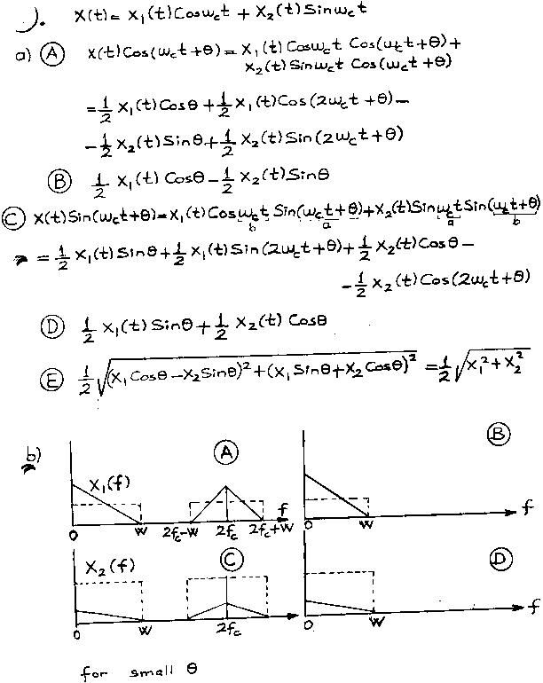
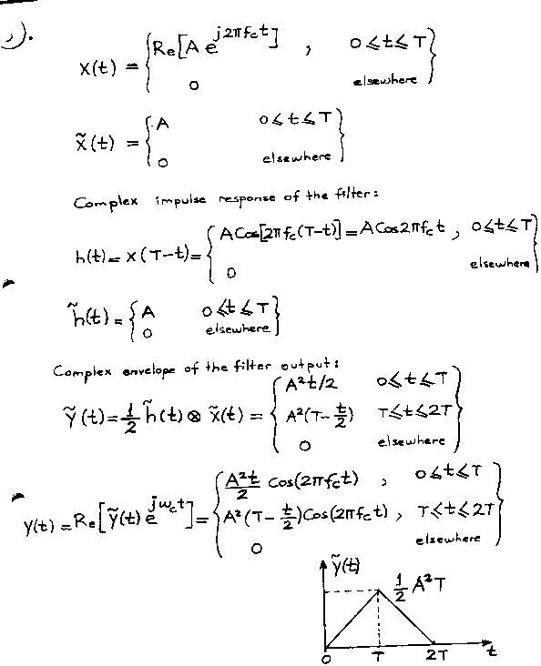

The 90-minute "Communication Systems I" second midterm exam of the Başkent University Department of Electrical and Electronics Engineering, dated January 2, 2001. The paper lists the course code under its number at the time, EEM 421; in the archive it is filed under Communications I (EEM441). The exam and the solutions are in English. The original exam and the handwritten solution pages can be downloaded as a PDF at the end of the post.

## Question 1: Quadrature receiver

The signal at the receiver input is x(t) = x₁(t)cos ω_ct + x₂(t)sin ω_ct. The local oscillator signals are cos(ω_ct + θ) and sin(ω_ct + θ); each of the two branches contains a low-pass filter (bandwidth W), a squarer, then a summer and a square root. Find the signals at points A, B, C, D, E in the time domain and sketch the spectra at A, B, C, D.

**Solution.** The signals before the filters (A and C) and after the filters (B and D):

- A: ½x₁cos θ − ½x₂ sin θ + 2ω_c components
- B: ½x₁(t)cos θ − ½x₂(t)sin θ
- C: ½x₁ sin θ + ½x₂ cos θ + 2ω_c components
- D: ½x₁(t)sin θ + ½x₂(t)cos θ
- E = √(B² + D²) = ½√(x₁² + x₂²); the result is independent of θ.

The spectra of B and D, for small θ, lie in the range 0…W within the bands of x₁(f) and x₂(f); at A and C, the same spectra are shifted to around 2f_c.

## Question 2: SSB

An 800 kHz carrier is modulated with x(t) = cos(2000πt) + 2 sin(2000πt); the carrier amplitude is A_c = 100.

1. Find the Hilbert transform of x(t).
2. Write the time-domain expression of the lower-sideband SSB signal.
3. Find the spectral magnitude of the lower-sideband signal.

**Solution.** x̂(t) = sin 2000πt − 2cos 2000πt. Lower sideband: x_c(t) = (A_c/2)[x cos ω_ct + x̂ sin ω_ct]. Expanding gives

x_c(t) = (A_c/2)[cos(ω_c−ω_m)t − 2 sin(ω_c−ω_m)t]

The spectrum has impulses only at ±(f_c − f_m) = ±799 kHz; their magnitudes are (A_c/4)|1 ∓ j2| = √5A_c/4 ≈ 55.9.

## Question 3: Matched filter

x(t) = A cos(2πf₀t), 0 ≤ t ≤ T (f₀ = K/T, K a large integer); h(t) = x(T − t). Find the complex envelopes of x(t) and h(t), the complex envelope of y(t), and the filter response.

**Solution.** The complex envelopes are x̃(t) = A and h̃(t) = A (0 ≤ t ≤ T). The complex envelope of the output is ỹ(t) = ½ h̃ ⊛ x̃:

- A²t/2 for 0 ≤ t ≤ T,
- for T ≤ t ≤ 2T, the source has A²(T − t/2) written (see the note below).

The peak value is A²T/2 at t = T (a triangle whose end falls to zero at 2T). The actual output is y(t) = Re[ỹ(t)e^{jω_ct}].

*Note: In the handwritten solution the second interval is written as A²(T − t/2); for the triangle to peak at A²T/2 at T and fall to zero at 2T, the correct expression is A²(2T − t)/2. The sketch is correct; the expression is wrong.*

## Question 4: VSB distortion

Consider the VSB signal for a single-tone m(t) = A_m cos(2πf_m t): s(t) = ½aA_mA_ccos[2π(f_c+f_m)t] + ½(1−a)A_mA_ccos[2π(f_c−f_m)t], where a < 1 is the attenuation of the upper sideband.

1. Find the quadrature component.
2. If the carrier A_ccos 2πf_ct is added to the signal and the result is passed through an envelope detector, find the distortion caused by the quadrature component.
3. For what value of a is the distortion worst?

**Solution.** Expanding gives s(t) = ½A_mA_ccos 2πf_m t cos 2πf_ct + ½A_mA_c(1−2a) sin 2πf_m t sin 2πf_ct; the quadrature component is −½A_cA_m(1−2a)sin(2πf_m t). When the carrier is added, the envelope is

a(t) = A_c[1 + ½A_m cos 2πf_m t]·d(t), d(t) = √(1 + [½A_m(1−2a)sin 2πf_m t / (1 + ½A_m cos 2πf_m t)]²)

where d(t) is the distortion term. The distortion is worst when (1−2a)² is largest, that is, at a = 0 (single sideband).
