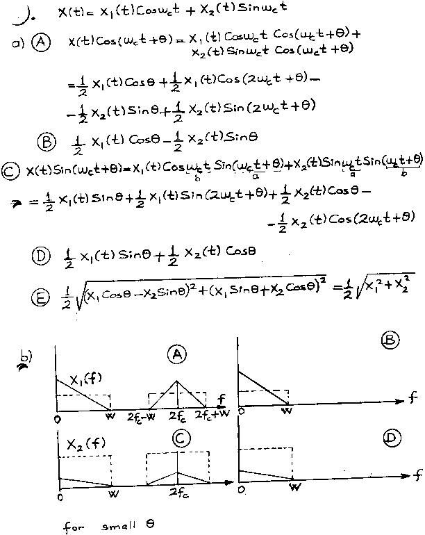
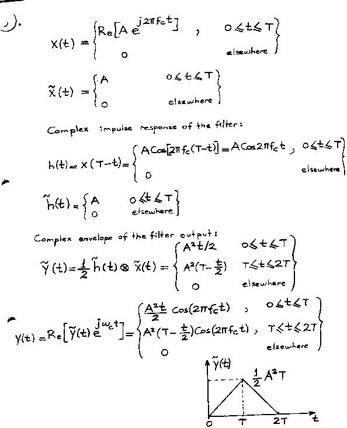

Başkent Üniversitesi Elektrik-Elektronik Mühendisliği Bölümü'nün 2 Ocak 2001 tarihli, 90 dakikalık "Communication Systems I" ikinci ara sınavı. Kâğıtta ders kodu o dönemki numarasıyla EEM 421 yazıyor; arşivde Haberleşme I (EEM441) altında toplandı. Sınav ve çözümler İngilizce. Orijinal sınav ve el yazısı çözüm sayfaları yazının sonundaki PDF olarak indirilebilir.

## Soru 1: Karesel alıcı

Alıcı girişindeki işaret x(t) = x₁(t)cos ω_ct + x₂(t)sin ω_ct. Yerel osilatör işaretleri cos(ω_ct + θ) ve sin(ω_ct + θ); iki kolda alçak geçiren süzgeç (bandı W), karesini alma, toplama ve karekök bulunur. A, B, C, D, E noktalarındaki işaretler zaman bölgesinde bulunup A, B, C, D'nin spektrumu çizilecek.

**Çözüm.** Süzgeçlerden önce (A ve C), süzgeçlerden sonra (B ve D) işaretler:

- A: ½x₁cos θ − ½x₂ sin θ + 2ω_c bileşenleri
- B: ½x₁(t)cos θ − ½x₂(t)sin θ
- C: ½x₁ sin θ + ½x₂ cos θ + 2ω_c bileşenleri
- D: ½x₁(t)sin θ + ½x₂(t)cos θ
- E = √(B² + D²) = ½√(x₁² + x₂²); sonuç θ'dan bağımsızdır.

B ve D'nin spektrumu, θ küçükken x₁(f) ve x₂(f) bandında 0…W aralığındadır; A ve C'de ise aynı spektrumlar 2f_c çevresine taşınmıştır.

## Soru 2: SSB

800 kHz taşıyıcı, x(t) = cos(2000πt) + 2 sin(2000πt) ile modüle ediliyor; taşıyıcı genliği A_c = 100.

1. x(t)'nin Hilbert dönüşümünü bulun.
2. Alt yan bant SSB işaretinin zaman bölgesi ifadesini yazın.
3. Alt yan bant işaretinin spektrum genliğini bulun.

**Çözüm.** x̂(t) = sin 2000πt − 2cos 2000πt. Alt yan bant: x_c(t) = (A_c/2)[x cos ω_ct + x̂ sin ω_ct]. Açınca

x_c(t) = (A_c/2)[cos(ω_c−ω_m)t − 2 sin(ω_c−ω_m)t]

elde edilir. Spektrumda yalnız ±(f_c − f_m) = ±799 kHz'de dürtüler vardır; genlikleri (A_c/4)|1 ∓ j2| = √5A_c/4 ≈ 55,9'dur.

## Soru 3: Uyumlu süzgeç

x(t) = A cos(2πf₀t), 0 ≤ t ≤ T (f₀ = K/T, K büyük bir tamsayı); h(t) = x(T − t). x(t) ve h(t)'nin karmaşık zarfını, y(t)'nin karmaşık zarfını ve süzgeç cevabını bulun.

**Çözüm.** Karmaşık zarflar x̃(t) = A ve h̃(t) = A (0 ≤ t ≤ T). Çıkışın karmaşık zarfı ỹ(t) = ½ h̃ ⊛ x̃:

- 0 ≤ t ≤ T için A²t/2,
- T ≤ t ≤ 2T için kaynakta A²(T − t/2) yazılmış (aşağıdaki nota bakın).

Tepe değer t = T'de A²T/2'dir (ucu 2T'de sıfıra inen üçgen). Gerçek çıkış y(t) = Re[ỹ(t)e^{jω_ct}].

*Not: El yazısı çözümde ikinci aralık A²(T − t/2) olarak yazılmış; üçgenin T'de A²T/2 tepesine ve 2T'de sıfıra inmesi için doğru ifade A²(2T − t)/2'dir. Çizim doğru, ifade hatalıdır.*

## Soru 4: VSB bozulması

Tek tonlu m(t) = A_m cos(2πf_m t) ile VSB işareti s(t) = ½aA_mA_ccos[2π(f_c+f_m)t] + ½(1−a)A_mA_ccos[2π(f_c−f_m)t], a < 1 üst yan bandın zayıflamasıdır.

1. Dik bileşeni bulun.
2. İşarete taşıyıcı A_ccos 2πf_ct eklenip zarf detektöründen geçirilirse dik bileşenin yol açtığı bozulmayı bulun.
3. Bozulmanın en kötü olduğu a değeri nedir?

**Çözüm.** Açılımdan s(t) = ½A_mA_ccos 2πf_m t cos 2πf_ct + ½A_mA_c(1−2a) sin 2πf_m t sin 2πf_ct bulunur; dik bileşen −½A_cA_m(1−2a)sin(2πf_m t) olur. Taşıyıcı eklenince zarf

a(t) = A_c[1 + ½A_m cos 2πf_m t]·d(t), d(t) = √(1 + [½A_m(1−2a)sin 2πf_m t / (1 + ½A_m cos 2πf_m t)]²)

olur; d(t) bozulma terimidir. (1−2a)² en büyük olduğunda, yani a = 0'da (tek yan bant) bozulma en kötüdür.
