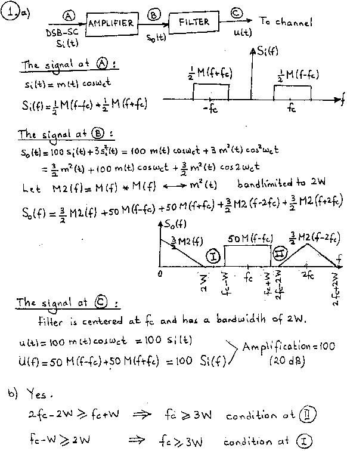
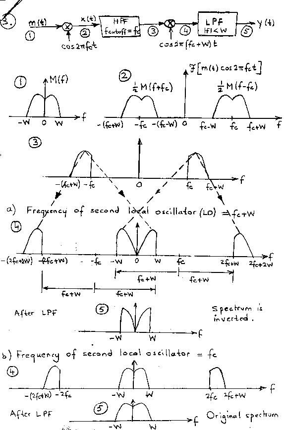

Second midterm exam of the EEM 441 "Communication Systems I" course, held on January 15, 2002 (90 minutes) by the Department of Electrical and Electronics Engineering at Başkent University. The exam is in English; the handwritten solutions are in English as well. The original exam pages and the handwritten solutions can be downloaded as a PDF at the end of the post.

## Question 1: Nonlinear amplifier

A DSB-SC signal is amplified before being sent to the channel; the amplifier has the characteristic s₀(t) = 100 s_i(t) + 3 s_i²(t), followed by a filter (A: input, B: amplifier output, C: filter output). (a) Given that the message spectrum is rectangular and bandlimited to W, find and sketch the spectra at points A, B, and C. (b) Can the DSB-SC signal be recovered without distortion, and is there a constraint on the carrier?

**Solution.** At point A, s_i(t) = m(t)cos ω_ct, S_i(f) = ½M(f−f_c) + ½M(f+f_c). At point B,

s₀(t) = 100 m cos ω_ct + (3/2)m²(t) + (3/2)m²(t)cos 2ω_ct

so the spectrum consists of the components (3/2)M₂(f) (baseband, of width 2W), 50M(f∓f_c), and (3/2)M₂(f∓2f_c) (M₂ = M∗M). At point C, a filter centered at f_c with bandwidth 2W passes only the middle component: u(t) = 100 m(t)cos ω_ct = 100 s_i(t), i.e., an amplification by a factor of 100 (20 dB).

(b) Yes. The baseband term requires f_c − W ≥ 2W, i.e., f_c ≥ 3W; the term around 2f_c requires 2f_c − 2W ≥ f_c + W, i.e., again f_c ≥ 3W.

## Question 2: Switching modulator

The message x(t) is bandlimited to W, |x(t)|_max ≤ 1; the switching function is s(t) = ½ + (2/π)Σ(−1)^(n−1)cos[2πf_ct(2n−1)]/(2n−1), f_c = 1/T_c, f_c ≫ W; the output passes through a bandpass filter (center f_c, bandwidth 2W). (a) Find u(t) and the type of modulation for m(t) = x(t) and for m(t) = 0.5x(t) + cos ω_ct; (b) for the second case, find the carrier level and the modulation index.

**Solution.** (i) Only the n = 1 term of the series passes through the filter: u(t) = (2/π)x(t)cos(2πf_ct), a DSB-SC signal. (ii) For m(t) = 0.5x + cos ω_ct, the terms passing through the filter are:

u(t) = ½cos ω_ct + (1/π)x(t)cos ω_ct = ½[1 + (2/π)x(t)]cos ω_ct

i.e., an AM signal. (b) The carrier amplitude is A_c = ½; the modulation index is μ = (2/π)|x(t)|_max ≤ 2/π.

## Question 3: Second local oscillator

m(t) is bandlimited to W; the system consists of: multiplication by cos 2πf_ct, a high-pass filter with cutoff frequency f_c, a second multiplication by cos 2π(f_c+W)t, and a low-pass filter over the band |f| < W. (a) Sketch Y(f); (b) sketch Y(f) if the second local oscillator is at f_c instead of f_c + W.

**Solution.** The high-pass filter removes the lower sideband, leaving the upper sideband (f_c … f_c+W). (a) With the second oscillator at f_c + W, the upper sideband is shifted to baseband over −W…W, but the spectrum is inverted ("spectrum is inverted"). (b) With the second oscillator at f_c, the spectrum appears at baseband in the correct orientation, i.e., in the same orientation as the original message spectrum.

## Question 4: SSB with carrier and envelope detector

s(t) = A_c cos(2πf_ct) + m(t)cos(2πf_ct) − m̂(t)sin(2πf_ct): a carrier plus an SSB signal. What conditions must hold for an ideal envelope detector to give a good approximation to m(t)?

**Solution.** The envelope is a(t) = √([A_c + m(t)]² + [m̂(t)]²) = √(A_c² + 2A_cm(t) + m²(t) + m̂²(t)). If A_c ≫ |m(t)| and A_c ≫ |m̂(t)|, then a(t) ≈ √(A_c² + 2A_cm(t)) = A_c√(1 + 2m(t)/A_c) ≈ A_c + m(t). Apart from the DC offset, the envelope detector output is proportional to m(t).
