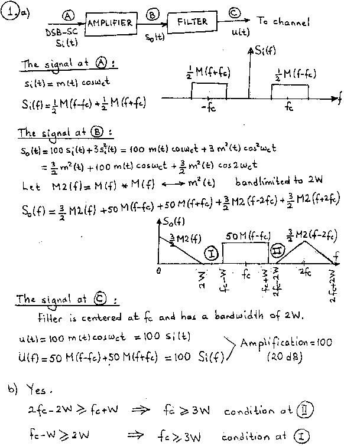
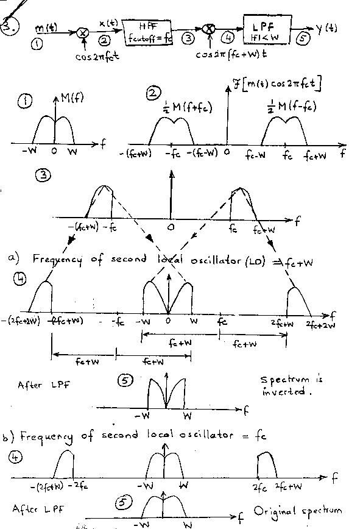

Başkent Üniversitesi Elektrik-Elektronik Mühendisliği Bölümü'nün 15 Ocak 2002 tarihli, 90 dakikalık EEM 441 "Communication Systems I" ikinci ara sınavı. Sınav İngilizce; el yazısı çözümler de İngilizce. Orijinal sınav sayfaları ve el yazısı çözümler yazının sonundaki PDF olarak indirilebilir.

## Soru 1: Doğrusal olmayan yükselteç

DSB-SC işaret kanala gönderilmeden önce yükseltiliyor; yükselteç s₀(t) = 100 s_i(t) + 3 s_i²(t) ilişkisine sahip, ardından bir süzgeç var (A: giriş, B: yükselteç çıkışı, C: süzgeç çıkışı). (a) Mesaj spektrumu W ile bant sınırlı dikdörtgen olduğuna göre A, B, C noktalarındaki spektrumları bulup çizin. (b) DSB-SC işaret bozulmadan geri kazanılabilir mi, taşıyıcı için bir kısıt var mı?

**Çözüm.** A noktasında s_i(t) = m(t)cos ω_ct, S_i(f) = ½M(f−f_c) + ½M(f+f_c). B noktasında

s₀(t) = 100 m cos ω_ct + (3/2)m²(t) + (3/2)m²(t)cos 2ω_ct

yani spektrum (3/2)M₂(f) (taban bandı, 2W genişlikli), 50M(f∓f_c) ve (3/2)M₂(f∓2f_c) bileşenlerinden oluşur (M₂ = M∗M). C noktasında merkezi f_c ve bandı 2W olan süzgeç yalnız ortadaki bileşeni geçirir: u(t) = 100 m(t)cos ω_ct = 100 s_i(t), yani 100 kat (20 dB) yükseltme.

(b) Evet. Taban bandı terimi f_c − W ≥ 2W, yani f_c ≥ 3W; 2f_c çevresindeki terim 2f_c − 2W ≥ f_c + W, yani yine f_c ≥ 3W koşulunu verir.

## Soru 2: Anahtarlamalı modülatör

Mesaj x(t) W ile bant sınırlı, |x(t)|_max ≤ 1; anahtarlama fonksiyonu s(t) = ½ + (2/π)Σ(−1)^(n−1)cos[2πf_ct(2n−1)]/(2n−1), f_c = 1/T_c, f_c ≫ W; çıkış bant geçiren süzgeçten (merkez f_c, genişlik 2W) geçiyor. (a) m(t) = x(t) ve m(t) = 0,5x(t) + cos ω_ct için u(t) ve modülasyon türü; (b) ikinci durumda taşıyıcı seviyesi ve modülasyon indisi.

**Çözüm.** (i) Serinin yalnız n = 1 terimi süzgeçten geçer: u(t) = (2/π)x(t)cos(2πf_ct), DSB-SC işaret. (ii) m(t) = 0,5x + cos ω_ct için süzgeçten geçen terimler:

u(t) = ½cos ω_ct + (1/π)x(t)cos ω_ct = ½[1 + (2/π)x(t)]cos ω_ct

yani AM işareti. (b) Taşıyıcı genliği A_c = ½; modülasyon indisi μ = (2/π)|x(t)|_max ≤ 2/π.

## Soru 3: İkinci yerel osilatör

m(t) W ile bant sınırlı; sistem: cos 2πf_ct ile çarpma, kesim frekansı f_c olan yüksek geçiren süzgeç, cos 2π(f_c+W)t ile ikinci çarpma ve |f| < W bandında alçak geçiren süzgeç. (a) Y(f)'yi çizin; (b) ikinci yerel osilatör f_c + W yerine f_c ise Y(f)'yi çizin.

**Çözüm.** Yüksek geçiren süzgeç alt yan bandı atar, üst yan bant (f_c … f_c+W) kalır. (a) İkinci osilatör f_c + W iken üst yan bant taban bandına −W…W aralığına taşınır ancak spektrum ters çevrilmiş olur ("spectrum is inverted"). (b) İkinci osilatör f_c iken spektrum taban bandında doğru yönde, yani orijinal mesaj spektrumuyla aynı yönde çıkar.

## Soru 4: Taşıyıcılı SSB ve zarf detektörü

s(t) = A_c cos(2πf_ct) + m(t)cos(2πf_ct) − m̂(t)sin(2πf_ct): taşıyıcı artı SSB işareti. İdeal zarf detektörünün m(t)'ye iyi bir yaklaşıklık vermesi için koşullar nelerdir?

**Çözüm.** Zarf a(t) = √([A_c + m(t)]² + [m̂(t)]²) = √(A_c² + 2A_cm(t) + m²(t) + m̂²(t)). A_c ≫ |m(t)| ve A_c ≫ |m̂(t)| ise a(t) ≈ √(A_c² + 2A_cm(t)) = A_c√(1 + 2m(t)/A_c) ≈ A_c + m(t). DC kaybı dışında zarf detektörü çıkışı m(t) ile orantılıdır.
