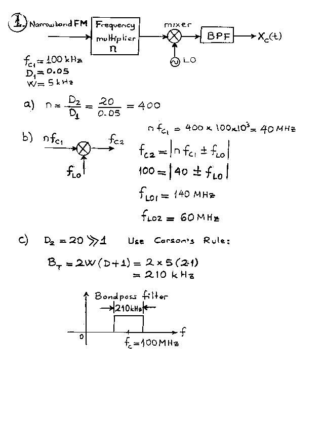
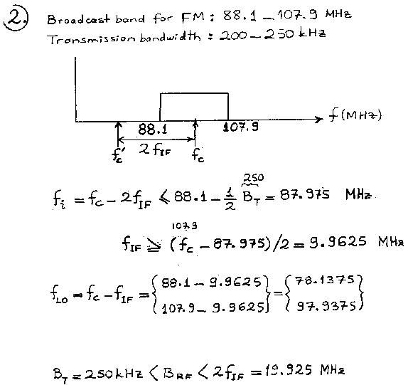
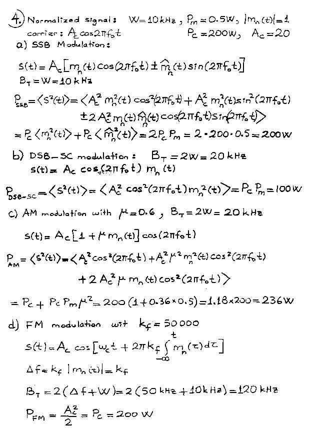

The second midterm exam of EEM 441 "Communication Theory I" of the Department of Electrical and Electronics Engineering at Başkent University, held on January 6, 2004, with a duration of 120 minutes. The question sheets are two pages and the handwritten solutions are four pages. The exam and solutions are in English. The original exam pages and handwritten solutions can be downloaded as a PDF at the end of the post.

## Question 1: Narrowband FM to Wideband FM

A wideband FM signal x_c(t) with a deviation ratio of 20 and a carrier frequency of 100 MHz is generated from a narrowband FM signal with a carrier of 100 kHz and a deviation ratio of 0.05 (frequency multiplier n, mixer, local oscillator, bandpass filter; W = 5 kHz). Find (a) n, (b) the local oscillator frequencies for the mixer, (c) the center frequency and bandwidth of the filter.

**Solution.** (a) n = D₂/D₁ = 20/0.05 = 400. (b) n·f_c1 = 400 × 100 kHz = 40 MHz. Since the desired output is 100 MHz = |40 MHz ± f_LO|, f_LO = 140 MHz or 60 MHz. (c) Since D₂ = 20 ≫ 1, by Carson's rule: B_T = 2W(D + 1) = 2 × 5 × 21 = 210 kHz; the filter must be centered at 100 MHz with a bandwidth of 210 kHz.

## Question 2: FM Superheterodyne Receiver

A commercial FM superheterodyne receiver is being designed such that the image frequency always falls below the broadcast band. The broadcast band is 88.1–107.9 MHz; the transmission bandwidth is 200–250 kHz. Find the smallest f_IF, the corresponding range of f_LO, and the limits on B_RF.

**Solution.** The image f_i = f_c − 2f_IF must satisfy f_i ≤ 88.1 − B_T/2 = 87.975 MHz (B_T = 250 kHz). In the worst case f_c = 107.9 MHz: f_IF ≥ (107.9 − 87.975)/2 = 9.9625 MHz. The range of f_LO = f_c − f_IF is 78.1375 – 97.9375 MHz. The RF bandwidth is 250 kHz < B_RF < 2f_IF = 19.925 MHz.

## Question 3: AM Transmitter

For a transmitter rated at a peak envelope power of 4 kW, find the largest allowable value of μ for single-tone AM when the average power is S_T = 1 kW.

**Solution.** If S_T = (A_c²/2)(1 + μ²/2) = 1 kW, then A_c² = 4/(2 + μ²) kW. The peak envelope power (1 + μ)²A_c² must be ≤ 4 kW; substituting gives (1 + μ)² ≤ 2 + μ² ⇒ 2μ ≤ 1 ⇒ μ ≤ 0.5.

## Question 4: Power and Bandwidth

Normalized m(t): bandwidth 10 kHz, power 0.5 W; the carrier A cos(2πf₀t) has a power of 200 W (A = 20). Find the bandwidth and power for (a) SSB, (b) DSB-SC, (c) AM (μ = 0.6), (d) FM (k_f = 50 000).

**Solution.**

| Modulation | Bandwidth | Power |
|---|---|---|
| SSB | 10 kHz | 200 W |
| DSB-SC | 20 kHz | 100 W |
| AM (μ = 0.6) | 20 kHz | 236 W |
| FM (k_f = 50 000) | 2(50 + 10) = 120 kHz | 200 W |

For SSB, s(t) = A_c[m_n cos(2πf₀t) ± m̂_n sin(2πf₀t)] was used, and P = P_c⟨m²⟩ + P_c⟨m̂²⟩ = 2P_cP_m = 200 W was found. For DSB-SC, P = P_cP_m = 100 W; for AM, P = P_c + P_cP_mμ² = 200(1 + 0.36 × 0.5) = 236 W; for FM, Δf = k_f|m_n|_max = 50 kHz, P = A_c²/2 = 200 W.

