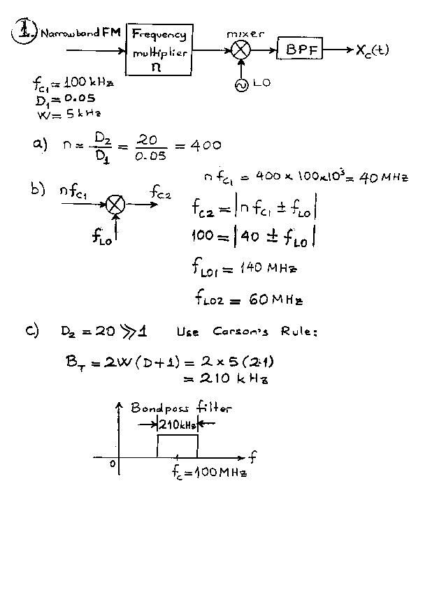
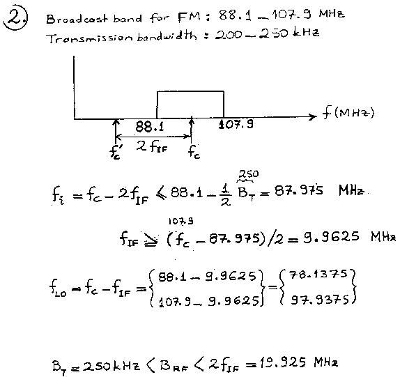
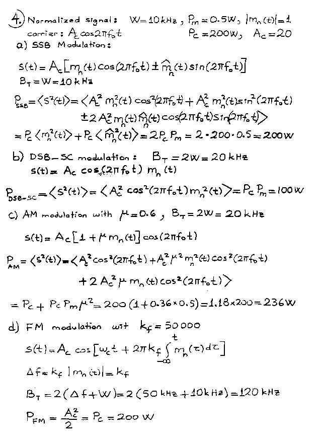

Başkent Üniversitesi Elektrik-Elektronik Mühendisliği Bölümü'nün 6 Ocak 2004 tarihli, 120 dakikalık EEM 441 "Communication Theory I" ikinci ara sınavı. Soru sayfaları iki, el yazısı çözümler dört sayfadır. Sınav ve çözümler İngilizce. Orijinal sınav sayfaları ve el yazısı çözümler yazının sonundaki PDF olarak indirilebilir.

## Soru 1: Dar bantlı FM'den geniş bantlı FM

Taşıyıcısı 100 kHz ve sapma oranı 0,05 olan dar bant FM işaretinden, sapma oranı 20 ve taşıyıcı frekansı 100 MHz olan geniş bant FM işareti x_c(t) üretiliyor (frekans çarpıcı n, karıştırıcı, yerel osilatör, bant geçiren süzgeç; W = 5 kHz). (a) n'yi, (b) karıştırıcı için yerel osilatör frekanslarını, (c) süzgecin merkez frekansını ve bant genişliğini bulun.

**Çözüm.** (a) n = D₂/D₁ = 20/0,05 = 400. (b) n·f_c1 = 400 × 100 kHz = 40 MHz. İstenen çıkış 100 MHz = |40 MHz ± f_LO| olduğundan f_LO = 140 MHz veya 60 MHz. (c) D₂ = 20 ≫ 1 olduğundan Carson kuralı: B_T = 2W(D + 1) = 2 × 5 × 21 = 210 kHz; süzgeç 100 MHz merkezli, 210 kHz genişlikli olmalıdır.

## Soru 2: FM süperheterodin alıcı

İmaj frekansı her zaman yayın bandının altına düşen ticari bir FM süperheterodin alıcı tasarlanıyor. Yayın bandı 88,1–107,9 MHz; iletim bant genişliği 200–250 kHz. En küçük f_IF'yi, buna karşılık gelen f_LO aralığını ve B_RF sınırlarını bulun.

**Çözüm.** İmaj f_i = f_c − 2f_IF ≤ 88,1 − B_T/2 = 87,975 MHz olmalıdır (B_T = 250 kHz). En kötü durum f_c = 107,9 MHz: f_IF ≥ (107,9 − 87,975)/2 = 9,9625 MHz. f_LO = f_c − f_IF aralığı 78,1375 – 97,9375 MHz. RF bant genişliği 250 kHz < B_RF < 2f_IF = 19,925 MHz.

## Soru 3: AM verici

4 kW tepe zarf gücüne göre derecelendirilmiş bir verici için tek tonlu AM'de, ortalama güç S_T = 1 kW iken izin verilen en büyük μ değerini bulun.

**Çözüm.** S_T = (A_c²/2)(1 + μ²/2) = 1 kW ise A_c² = 4/(2 + μ²) kW. Tepe zarf gücü (1 + μ)²A_c² ≤ 4 kW olmalıdır; yerine koyunca (1 + μ)² ≤ 2 + μ² ⇒ 2μ ≤ 1 ⇒ μ ≤ 0,5.

## Soru 4: Güç ve bant genişliği

Normalize m(t): bant genişliği 10 kHz, güç 0,5 W; taşıyıcı A cos(2πf₀t) gücü 200 W (A = 20). (a) SSB, (b) DSB-SC, (c) AM (μ = 0,6), (d) FM (k_f = 50 000) için bant genişliği ve güç.

**Çözüm.**

| Modülasyon | Bant genişliği | Güç |
|---|---|---|
| SSB | 10 kHz | 200 W |
| DSB-SC | 20 kHz | 100 W |
| AM (μ = 0,6) | 20 kHz | 236 W |
| FM (k_f = 50 000) | 2(50 + 10) = 120 kHz | 200 W |

SSB için s(t) = A_c[m_n cos(2πf₀t) ± m̂_n sin(2πf₀t)] alınmış, P = P_c⟨m²⟩ + P_c⟨m̂²⟩ = 2P_cP_m = 200 W bulunmuştur. DSB-SC'de P = P_cP_m = 100 W; AM'de P = P_c + P_cP_mμ² = 200(1 + 0,36 × 0,5) = 236 W; FM'de Δf = k_f|m_n|_max = 50 kHz, P = A_c²/2 = 200 W.

