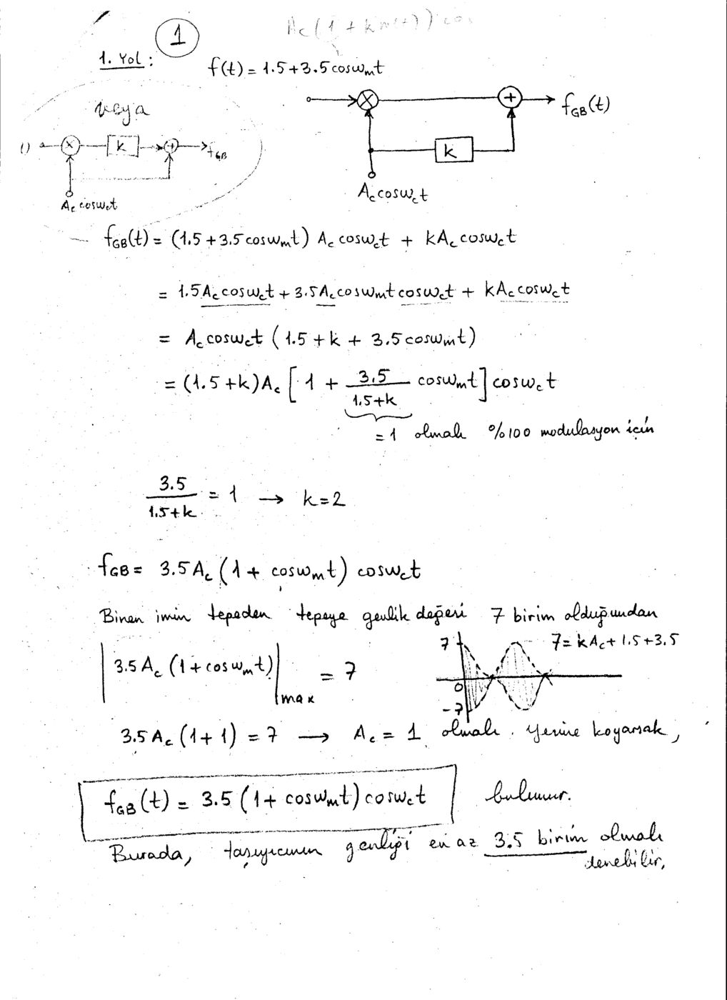
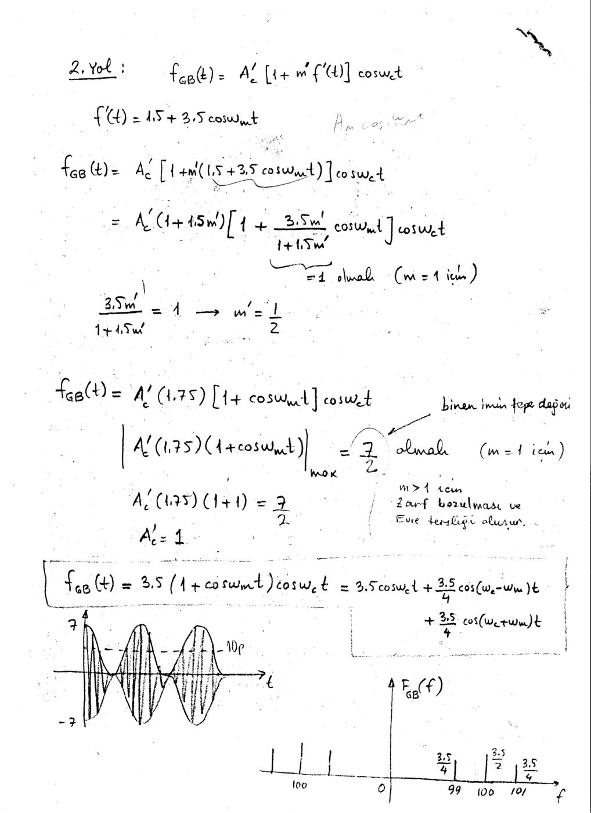
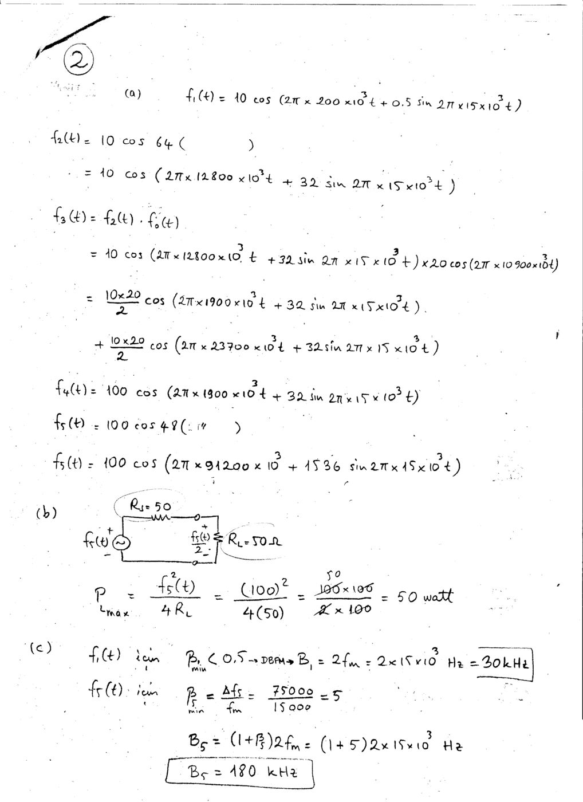
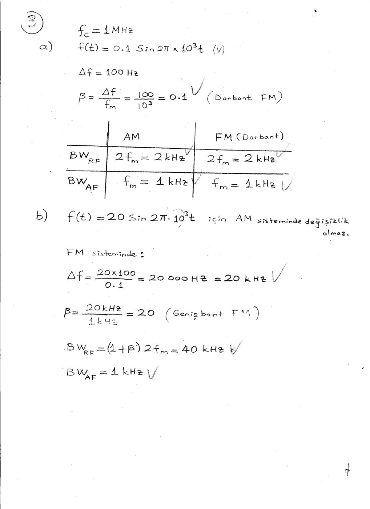
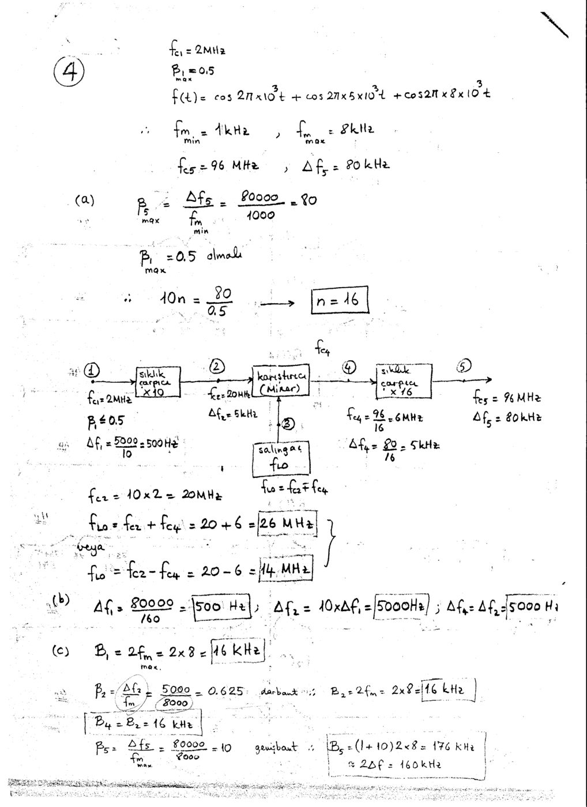

The 2-hour EEM 441 Communications I midterm exam (in Turkish) of July 24, 2009, from the Department of Electrical and Electronics Engineering, Faculty of Engineering, Başkent University, together with handwritten solutions. At the end of the post, the questions of the "EEM 441 Communications I Quiz I" dated November 10, 2009 are also included, transcribed from a paper photographed with a phone; photographs of the papers were not published. The original exam pages and handwritten solutions can be downloaded as a PDF at the end of the post.

## Question 1: Amplitude modulation

A function f(t) is given in the figure, with maximum value 5, minimum value −2, and period 1 ms (marked on the paper). (a) What must the minimum carrier amplitude be for amplitude modulation, and what kinds of distortion arise if it is smaller? Find the expression of the amplitude-modulated signal. (b) Sketch the AM signal. (c) If the carrier is 100 kHz, sketch the frequency spectrum of the AM signal.

**Solution (method 1).** f(t) = 1.5 + 3.5 cos ω_mt. f_AM(t) = (1.5 + 3.5cos ω_mt)A_c cos ω_ct + kA_c cos ω_ct = (1.5 + k)A_c[1 + (3.5/(1.5 + k))cos ω_mt]cos ω_ct. For 100% modulation, 3.5/(1.5 + k) = 1 ⇒ k = 2. Since the envelope is 7 units peak to peak, 3.5A_c(1 + 1) = 7 ⇒ A_c = 1 and

f_AM(t) = 3.5(1 + cos ω_mt)cos ω_ct

so the carrier amplitude must be at least 3.5 units.

**Solution (method 2).** With f_AM(t) = A_c'[1 + m'f(t)]cos ω_ct (for m = 1), 3.5m'/(1 + 1.5m') = 1 ⇒ m' = ½; A_c'(1.75)(1 + 1) = 7/2 ⇒ A_c' = 1; the result is the same f_AM(t) = 3.5(1 + cos ω_mt)cos ω_ct. In the spectrum, the carrier has amplitude 3.5 and the two sidebands have amplitude 1.75 (at ±f_m around 100 kHz). If the modulation index exceeds 1, envelope distortion and phase reversal occur.

## Question 2: Multiplier-mixer chain

Input f₁(t) = 10 cos(2π·200·10³t + 0.5 sin(2π·15·10³t)) V. Chain: ×64 frequency multiplier → mixer (f₀(t) = 20cos(2π·10900·10³t)) → band-pass filter (1885–1915 kHz) → ×48 frequency multiplier → f₅(t). (a) What is f₅(t)? (b) What is the maximum power that f₅(t) can deliver to a 50 Ω load? (c) If the minimum frequency deviation of f₅(t) is 75 kHz, what are the bandwidths of f₁(t) and f₅(t)?

**Solution.** (a) f₂(t) = 10cos(2π·12800·10³t + 32 sin 2π·15·10³t). After the mixer, the component at 12800 − 10900 = 1900 kHz passes through the filter: f₄(t) = 100cos(2π·1900·10³t + 32 sin 2π·15·10³t) (amplitude 10×20/2 = 100). After the last multiplier: f₅(t) = 100cos(2π·91200·10³t + 1536 sin 2π·15·10³t). (b) For a 50 Ω load with a source internal resistance of 50 Ω, P = (100)²/(4 × 50) = 50 W (the load is matched to the source). (c) For f₁, β₁ = 0.5 → narrowband, B₁ = 2f_m = 30 kHz. For f₅, β₅ = Δf₅/f_m = 75000/15000 = 5, B₅ = 2(1 + β)f_m = 2 × 6 × 15 kHz = 180 kHz.

## Question 3: AM and FM bandwidths

(a) In an AM and FM system with a 1 MHz carrier, f(t) = 0.1 sin(2π·10³t) is applied as the modulating signal; in FM, a 0.1 V signal produces a 100 Hz deviation. Find the RF and AF amplifier bandwidths in the two receivers. (b) Repeat for f(t) = 20 sin(2π·10³t).

**Solution.** (a) β = Δf/f_m = 100/1000 = 0.1 (narrowband FM). For both AM and FM, B_RF = 2f_m = 2 kHz, B_AF = f_m = 1 kHz. (b) Nothing changes in the AM system. In FM, Δf = 20 × 100/0.1 = 20 kHz, β = 20 (wideband), B_RF = 2(1 + β)f_m = 42 kHz (the source writes (1 + β)·2f_m = 40 kHz), B_AF = 1 kHz.

*Note: By Carson's rule, 2(β + 1)f_m = 2 × 21 × 1 kHz = 42 kHz; the 40 kHz in the handwritten solution is approximately the value of 2Δf.*

## Question 4: Narrowband to wideband FM

f₁(t) is a narrowband FM signal obtained from f(t) by frequency modulating a carrier f_c1 = 2 MHz; the maximum β₁ of f₁(t) is 0.5. f(t) = cos(2π·10³t) + cos(2π·5·10³t) + cos(2π·8·10³t). Chain: ×10 multiplier (point 2) → mixer + local oscillator f_LO (points 3, 4) → ×n multiplier (point 5). The carrier of f₅(t) is f_c5 = 96 MHz and its maximum deviation is Δf₅ = 80 kHz. (a) Find n and f_LO. (b) Find the maximum deviations at points 1, 2, and 4. (c) Find the bandwidths of the FM signals at points 1, 2, 4, and 5.

**Solution.** f_m,min = 1 kHz, f_m,max = 8 kHz. We need β₅ = 80/1 = 80 and β₁ = 0.5: 10n = 80/0.5 = 160 ⇒ n = 16. f_c2 = 20 MHz, f_c4 = 96/16 = 6 MHz; f_LO = f_c2 ± f_c4 = 26 MHz or 14 MHz. (b) Δf₁ = 80000/160 = 500 Hz, Δf₂ = 5000 Hz, Δf₄ = 5000 Hz. (c) B₁ = 2f_m,max = 16 kHz; β₂ = 5000/8000 = 0.625 (narrowband) ⇒ B₂ = B₄ = 16 kHz; β₅ = 80000/8000 = 10 ⇒ B₅ = 2(1 + 10)·8 = 176 kHz (≈ 2Δf = 160 kHz).

## Quiz I, November 10, 2009 (transcribed from a photographed paper)

Duration: 1 hour. The first question is the same as Question 1 of the midterm above (periodic f(t); amplitude modulation, sketches, and the spectrum for a 100 kHz carrier). The second question:

The block diagram for obtaining an SSB signal by the phase-shift method is given; the boxes in the diagram are left blank (input f(t), points f₁(t), f₂(t), f₃(t), f₄(t), an oscillator, a summer, and the output f_SSB(t)).

1. Fill in the necessary information in the blank boxes of the block diagram.
2. Let the modulating signal be f(t) = Σᵢ₌₁ᴺ cos(ωᵢt + θᵢ) and the carrier f_c(t) = cos(ω_ct). Show that the signal v(t) = Σ[cos(ω_ct)cos(ωᵢt + θᵢ) − sin(ω_ct)sin(ωᵢt + θᵢ)] is an SSB signal (ω_c ≫ ω_N). Does this signal represent the lower sideband or the upper sideband?
3. What expression can be written for the other sideband?
4. Write the total DSB signal.
5. If the SSB signal in (b) is mixed with cos(ω_ct) and passed through a low-pass filter, the information-bearing signal is recovered. Sketch the frequency spectrum of the signal at the mixer output; state between which values the cutoff frequency f₀ of the LPF can lie (in terms of ω_c, ω₁, …, ω_N).
