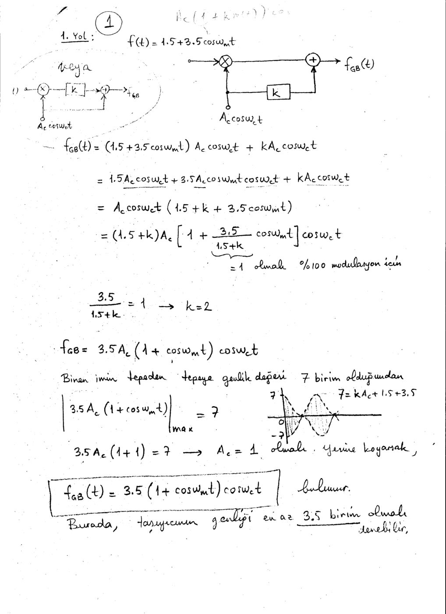
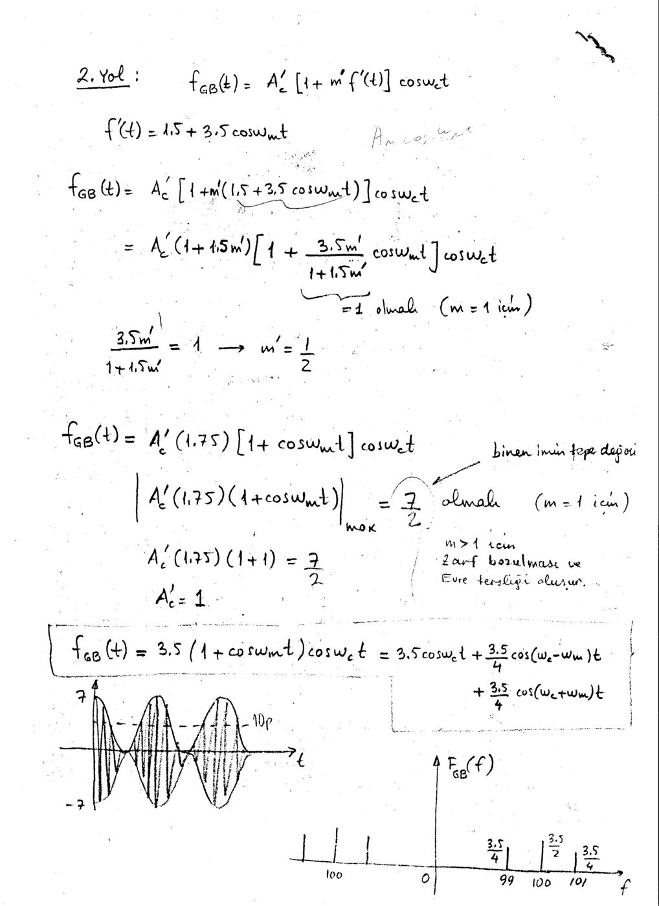
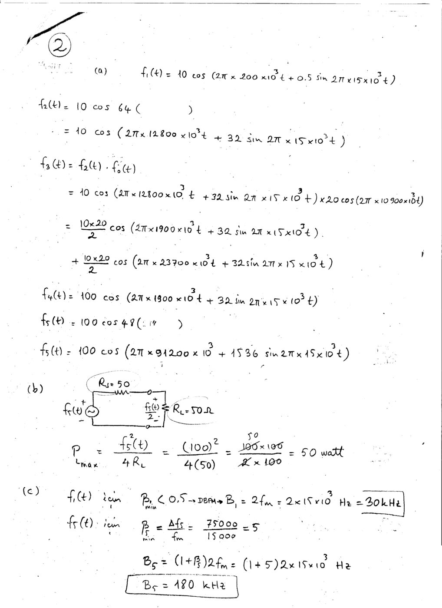
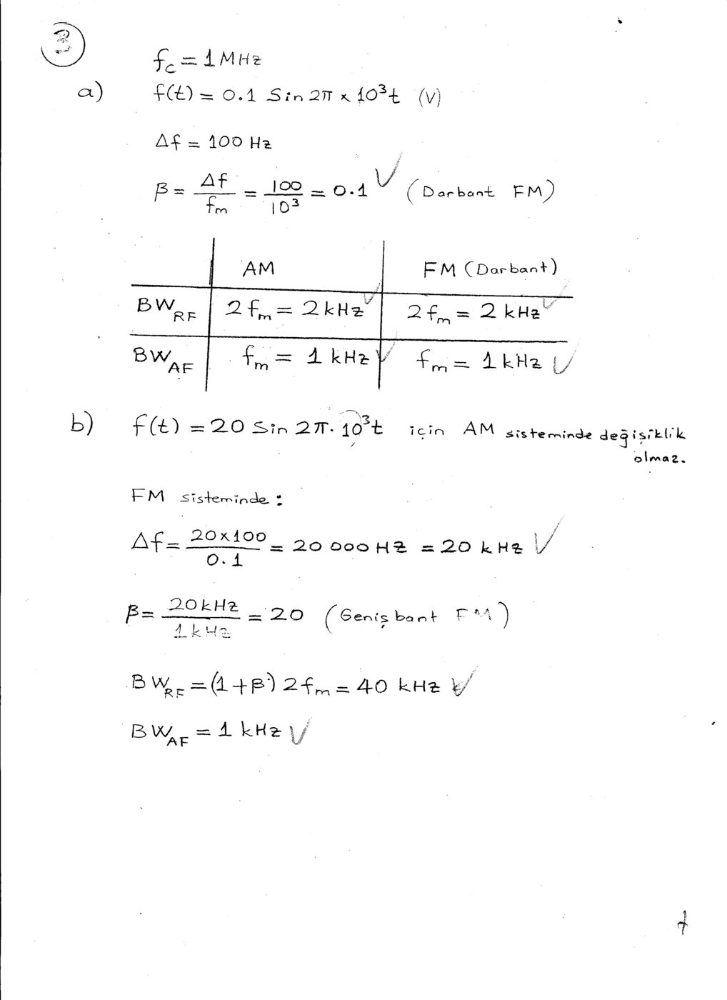
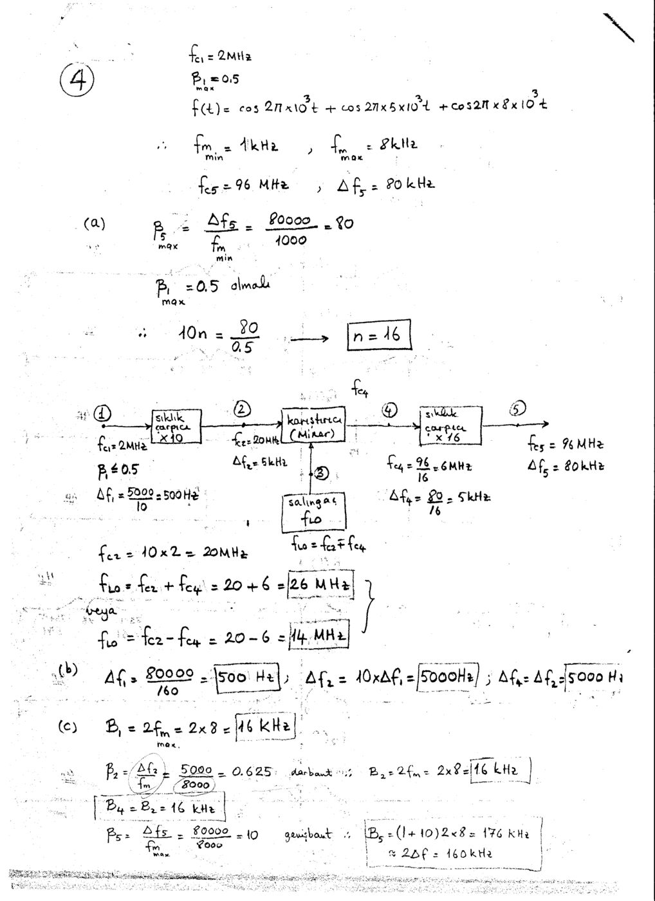

Başkent Üniversitesi Mühendislik Fakültesi Elektrik-Elektronik Mühendisliği Bölümü'nün 24 Temmuz 2009 tarihli, 2 saatlik EEM 441 Haberleşme I ara sınavı (Türkçe) ve el yazısı çözümleri. Yazının sonunda ayrıca, telefonla çekilmiş bir kâğıttan metne aktarılan 10 Kasım 2009 tarihli "EEM 441 Haberleşme I Quiz I" soruları yer alıyor; kâğıtların fotoğrafları yayınlanmadı. Orijinal sınav sayfaları ve el yazısı çözümler yazının sonundaki PDF olarak indirilebilir.

## Soru 1: Genlik bindirimi

Şekilde en büyük değeri 5, en küçük değeri −2 olan ve periyodu 1 ms (kâğıtta işaretli) bir f(t) verilmiş. (a) Genlik bindirimi için taşıyıcı genliği en az ne olmalıdır, küçük olursa nasıl bozulmalar doğar; genlik bindirimli işaretin ifadesini bulun. (b) GB işaretini çizin. (c) Taşıyıcı 100 kHz ise GB işaretinin frekans görüngesini çizin.

**Çözüm (1. yol).** f(t) = 1,5 + 3,5 cos ω_mt. f_GB(t) = (1,5 + 3,5cos ω_mt)A_c cos ω_ct + kA_c cos ω_ct = (1,5 + k)A_c[1 + (3,5/(1,5 + k))cos ω_mt]cos ω_ct. %100 modülasyon için 3,5/(1,5 + k) = 1 ⇒ k = 2. Zarf tepeden tepeye 7 birim olduğundan 3,5A_c(1 + 1) = 7 ⇒ A_c = 1 ve

f_GB(t) = 3,5(1 + cos ω_mt)cos ω_ct

olur; taşıyıcı genliği en az 3,5 birim olmalıdır.

**Çözüm (2. yol).** f_GB(t) = A_c'[1 + m'f(t)]cos ω_ct ile (m = 1 için) 3,5m'/(1 + 1,5m') = 1 ⇒ m' = ½; A_c'(1,75)(1 + 1) = 7/2 ⇒ A_c' = 1; sonuçta aynı f_GB(t) = 3,5(1 + cos ω_mt)cos ω_ct elde edilir. Spektrumda taşıyıcı 3,5, iki yan bant 1,75 genliğindedir (100 kHz çevresinde ±f_m). Modülasyon indisi 1'den büyük olursa zarf bozulması ve evre tersliği oluşur.

## Soru 2: Çarpıcı-karıştırıcı zinciri

Giriş f₁(t) = 10 cos(2π·200·10³t + 0,5 sin(2π·15·10³t)) V. Zincir: ×64 frekans çarpıcı → karıştırıcı (f₀(t) = 20cos(2π·10900·10³t)) → bant geçiren süzgeç (1885–1915 kHz) → ×48 frekans çarpıcı → f₅(t). (a) f₅(t) nedir? (b) f₅(t)'nin 50 Ω'luk yüke aktarabileceği en büyük güç? (c) f₅(t)'nin en küçük frekans sapması 75 kHz ise f₁(t) ve f₅(t)'nin bant genişlikleri?

**Çözüm.** (a) f₂(t) = 10cos(2π·12800·10³t + 32 sin 2π·15·10³t). Karıştırıcıdan sonra 12800 − 10900 = 1900 kHz'lik bileşen süzgeçten geçer: f₄(t) = 100cos(2π·1900·10³t + 32 sin 2π·15·10³t) (genlik 10×20/2 = 100). Son çarpıcıdan: f₅(t) = 100cos(2π·91200·10³t + 1536 sin 2π·15·10³t). (b) Kaynak iç direnci 50 Ω olan 50 Ω'luk yükte P = (100)²/(4 × 50) = 50 W (yük kaynakla uyumlu). (c) f₁ için β₁ = 0,5 → dar bant, B₁ = 2f_m = 30 kHz. f₅ için β₅ = Δf₅/f_m = 75000/15000 = 5, B₅ = 2(1 + β)f_m = 2 × 6 × 15 kHz = 180 kHz.

## Soru 3: AM ve FM bant genişlikleri

(a) Taşıyıcısı 1 MHz olan AM ve FM sisteminde f(t) = 0,1 sin(2π·10³t) bindiriliyor; FM'de 0,1 V'luk işaret 100 Hz sapma oluşturuyor. İki alıcıdaki RF ve AF yükselteç bant genişliklerini bulun. (b) f(t) = 20 sin(2π·10³t) için tekrarlayın.

**Çözüm.** (a) β = Δf/f_m = 100/1000 = 0,1 (dar bant FM). AM ve FM için B_RF = 2f_m = 2 kHz, B_AF = f_m = 1 kHz. (b) AM sisteminde değişiklik olmaz. FM'de Δf = 20 × 100/0,1 = 20 kHz, β = 20 (geniş bant), B_RF = 2(1 + β)f_m = 42 kHz (kaynakta (1 + β)·2f_m = 40 kHz yazılmış), B_AF = 1 kHz.

*Not: Carson kuralıyla 2(β + 1)f_m = 2 × 21 × 1 kHz = 42 kHz'dir; el yazısı çözümdeki 40 kHz yaklaşık 2Δf değeridir.*

## Soru 4: Dar bantlıdan geniş bantlıya FM

f₁(t), f(t)'nin f_c1 = 2 MHz taşıyıcıyı frekans bindirmesiyle elde edilen dar bant FM'dir; f₁(t)'nin en büyük β₁ = 0,5. f(t) = cos(2π·10³t) + cos(2π·5·10³t) + cos(2π·8·10³t). Zincir: ×10 çarpıcı (nokta 2) → karıştırıcı + yerel osilatör f_LO (nokta 3, 4) → ×n çarpıcı (nokta 5). f₅(t)'nin taşıyıcısı f_c5 = 96 MHz, en büyük sapma Δf₅ = 80 kHz. (a) n ve f_LO'yu bulun. (b) 1, 2 ve 4 numaralı noktalardaki en büyük sapmalar. (c) 1, 2, 4 ve 5 numaralı noktalardaki FM işaretlerinin bant genişlikleri.

**Çözüm.** f_m,min = 1 kHz, f_m,max = 8 kHz. β₅ = 80/1 = 80, β₁ = 0,5 olmalıdır: 10n = 80/0,5 = 160 ⇒ n = 16. f_c2 = 20 MHz, f_c4 = 96/16 = 6 MHz; f_LO = f_c2 ± f_c4 = 26 MHz veya 14 MHz. (b) Δf₁ = 80000/160 = 500 Hz, Δf₂ = 5000 Hz, Δf₄ = 5000 Hz. (c) B₁ = 2f_m,max = 16 kHz; β₂ = 5000/8000 = 0,625 (dar bant) ⇒ B₂ = B₄ = 16 kHz; β₅ = 80000/8000 = 10 ⇒ B₅ = 2(1 + 10)·8 = 176 kHz (≈ 2Δf = 160 kHz).

## Quiz I, 10 Kasım 2009 (fotoğraflanmış kâğıttan metne aktarıldı)

Süre 1 saat. Birinci soru yukarıdaki ara sınavın 1. sorusu ile aynıdır (periyodik f(t); genlik bindirimi, çizimler ve 100 kHz taşıyıcı için görüngü). İkinci soru:

SSB işaretinin evre kaydırma yöntemiyle elde edilişi blok şemasıyla verilmiş; şemadaki kutuların içi boş bırakılmıştır (f(t) girişi, f₁(t), f₂(t), f₃(t), f₄(t) noktaları, bir osilatör, toplayıcı ve çıkış f_SSB(t)).

1. Blok şemadaki boş kutuların içine gerekli bilgileri yazın.
2. Binen im f(t) = Σᵢ₌₁ᴺ cos(ωᵢt + θᵢ), taşıyıcı f_c(t) = cos(ω_ct) ise v(t) = Σ[cos(ω_ct)cos(ωᵢt + θᵢ) − sin(ω_ct)sin(ωᵢt + θᵢ)] işaretinin bir SSB işareti olduğunu gösterin (ω_c ≫ ω_N). Bu im alt yan bandı mı, üst yan bandı mı göstermektedir?
3. Diğer yan bant için nasıl bir ifade yazılabilir?
4. Toplam DSB işaretini yazın.
5. (b)'deki SSB işareti cos(ω_ct) ile karıştırılıp alçak geçiren süzgeçten geçirilirse bilgi taşıyan im tekrar elde edilir. Karıştırıcı çıkışındaki işaretin frekans görüngesini çizin; LPF'nin kesim frekansı f₀'ın hangi değerler arasında olabileceğini (ω_c, ω₁, …, ω_N türünden) belirtin.
