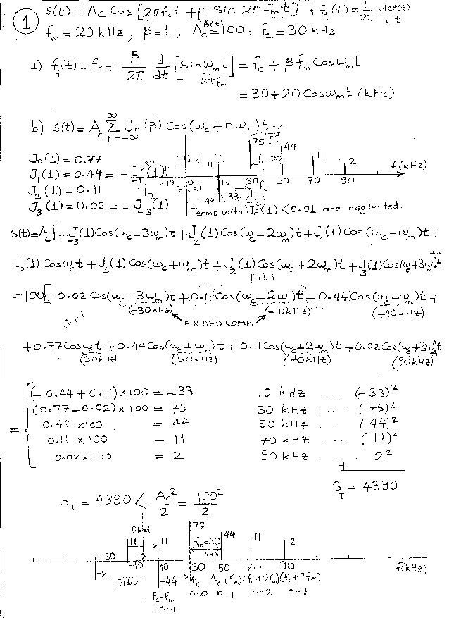
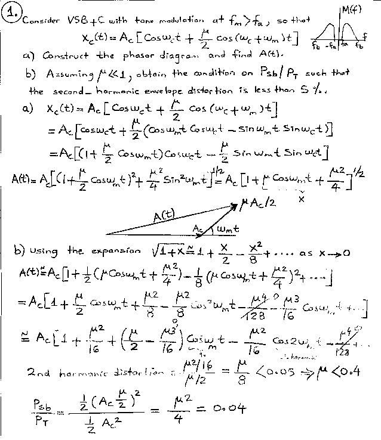
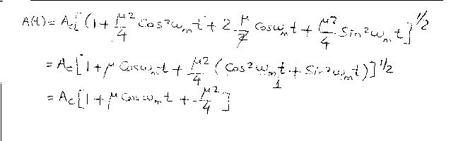

Three handwritten solved pages sat in the Communications I folder without the exam paper: the spectrum of a single-tone FM signal via Bessel lines, and the envelope distortion of a VSB signal with carrier. The problem statements were reconstructed as far as possible from the solution pages. The solution pages can be downloaded as a PDF at the end of the post.

## Single-Tone FM: Spectrum and Folded Components

s(t) = A_ccos[2πf_ct + β sin(2πf_mt)], f_m = 20 kHz, β = 1, A_c = 100, f_c = 30 kHz. (a) Find the instantaneous frequency. (b) Sketch the spectrum.

**Solution.** (a) f_i(t) = f_c + βf_m cos ω_mt = 30 + 20 cos ω_mt kHz. (b) s(t) = A_cΣJ_n(β)cos(ω_c + nω_m)t. The Bessel coefficients are J₀(1) = 0.77, J₁(1) = 0.44, J₂(1) = 0.11, J₃(1) = 0.02 (J₋ₙ = (−1)ⁿJₙ); those below 0.01 are neglected. The lines are at 30 kHz (carrier), 50, 70, 90 kHz, and the lower sidebands at 10, −10, −30 kHz. Since f_c = 30 kHz and f_m = 20 kHz are small, the negative frequencies fold over and superimpose on the positive frequencies: at 10 kHz, −0.44 + 0.11 (together with the folded component of the second lower sideband); at 30 kHz, 0.77 − 0.02 (together with the folded component of the third lower sideband). The amplitudes (with A_c = 100):

| Frequency | Amplitude |
|---|---|
| 10 kHz | −33 |
| 30 kHz | 75 |
| 50 kHz | 44 |
| 70 kHz | 11 |
| 90 kHz | 2 |

At the end of the solution, S_T = 4390 < A_c²/2 = 100²/2 = 5000 is written, and the spectrum is drawn with these lines.

## VSB with Carrier: Envelope and Second-Harmonic Distortion

x_c(t) = A_c[cos ω_ct + (μ/2)cos(ω_c + ω_m)t], f_m > f_a (VSB + carrier, single-tone modulation). (a) Draw the phasor diagram and find A(t). (b) For μ ≪ 1, find the condition on P_sb/P_T such that the second-harmonic envelope distortion is less than 5%.

**Solution.** (a) x_c(t) = A_c[(1 + (μ/2)cos ω_mt)cos ω_ct − (μ/2)sin ω_mt sin ω_ct]. The envelope is

A(t) = A_c[(1 + (μ/2)cos ω_mt)² + (μ²/4)sin²ω_mt]^(1/2) = A_c[1 + μ cos ω_mt + μ²/4]^(1/2).

(b) Using the expansion √(1 + x) ≈ 1 + x/2 − x²/8, A(t) ≈ A_c[1 + μ²/16 + (μ/2 − μ³/16)cos ω_mt − (μ²/16)cos 2ω_mt + …]. The second-harmonic distortion is (μ²/16)/(μ/2) = μ/8 < 0.05 ⇒ μ < 0.4. The ratio of sideband power to total power is P_sb/P_T = μ²/4 = 0.04.

