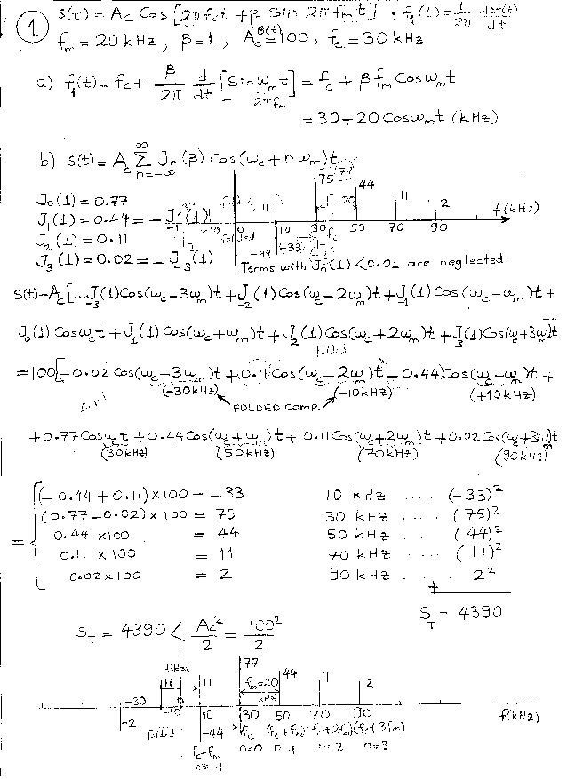
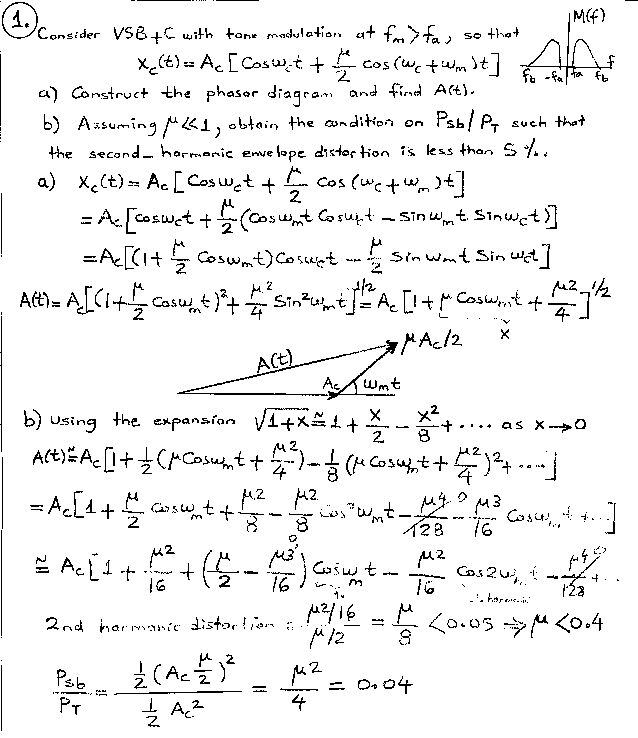
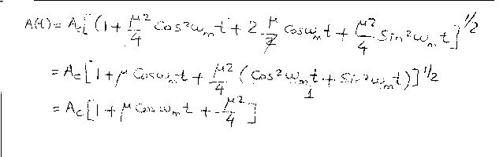

Haberleşme I klasöründe sınav kâğıdı olmadan duran, el yazısı ile çözülmüş üç sayfa: tek tonlu bir FM işaretinin Bessel çizgileriyle spektrumu ve taşıyıcılı bir VSB işaretinin zarf bozulması. Sorular çözüm sayfalarından anlaşıldığı kadarıyla yazılmıştır. Çözüm sayfaları yazının sonundaki PDF olarak indirilebilir.

## Tek tonlu FM: spektrum ve katlanan bileşenler

s(t) = A_ccos[2πf_ct + β sin(2πf_mt)], f_m = 20 kHz, β = 1, A_c = 100, f_c = 30 kHz. (a) Anlık frekansı bulun. (b) Spektrumu çizin.

**Çözüm.** (a) f_i(t) = f_c + βf_m cos ω_mt = 30 + 20 cos ω_mt kHz. (b) s(t) = A_cΣJ_n(β)cos(ω_c + nω_m)t. Bessel katsayıları J₀(1) = 0,77, J₁(1) = 0,44, J₂(1) = 0,11, J₃(1) = 0,02 (J₋ₙ = (−1)ⁿJₙ); 0,01'in altındakiler yok sayılıyor. Çizgiler 30 kHz (taşıyıcı), 50, 70, 90 kHz ve alt yan bantlar 10, −10, −30 kHz'dedir. f_c = 30 kHz ve f_m = 20 kHz küçük olduğundan negatif frekanslar katlanır ve pozitif frekansa üst üste biner: 10 kHz'de −0,44 + 0,11 (ikinci alt yan bandın katlanmışı ile birlikte), 30 kHz'de 0,77 − 0,02 (üçüncü alt yan bandın katlanmışı ile birlikte). Genlikler (A_c = 100 ile):

| Frekans | Genlik |
|---|---|
| 10 kHz | −33 |
| 30 kHz | 75 |
| 50 kHz | 44 |
| 70 kHz | 11 |
| 90 kHz | 2 |

Çözümün sonunda S_T = 4390 < A_c²/2 = 100²/2 = 5000 yazılmış ve spektrum bu çizgilerle çizilmiştir.

## Taşıyıcılı VSB: zarf ve ikinci harmonik bozulma

x_c(t) = A_c[cos ω_ct + (μ/2)cos(ω_c + ω_m)t], f_m > f_a (VSB + taşıyıcı, tek tonlu modülasyon). (a) Fazör diyagramını çizip A(t)'yi bulun. (b) μ ≪ 1 için, ikinci harmonik zarf bozulmasının %5'ten küçük olması için P_sb/P_T koşulunu bulun.

**Çözüm.** (a) x_c(t) = A_c[(1 + (μ/2)cos ω_mt)cos ω_ct − (μ/2)sin ω_mt sin ω_ct]. Zarf

A(t) = A_c[(1 + (μ/2)cos ω_mt)² + (μ²/4)sin²ω_mt]^(1/2) = A_c[1 + μ cos ω_mt + μ²/4]^(1/2).

(b) √(1 + x) ≈ 1 + x/2 − x²/8 açılımıyla A(t) ≈ A_c[1 + μ²/16 + (μ/2 − μ³/16)cos ω_mt − (μ²/16)cos 2ω_mt + …]. İkinci harmonik bozulma (μ²/16)/(μ/2) = μ/8 < 0,05 ⇒ μ < 0,4. Yan bant gücünün toplam güce oranı P_sb/P_T = μ²/4 = 0,04 bulunur.

