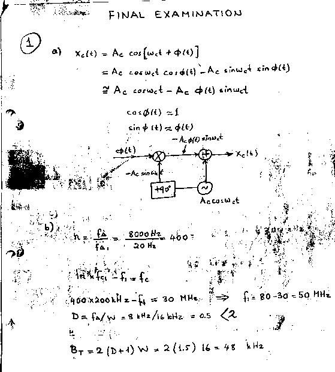
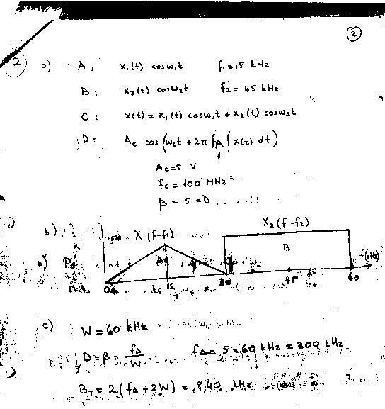
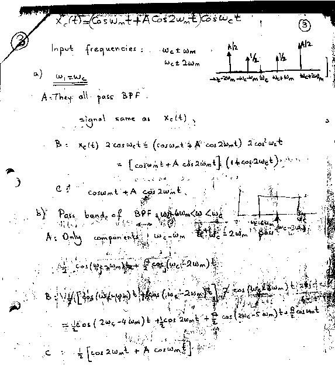
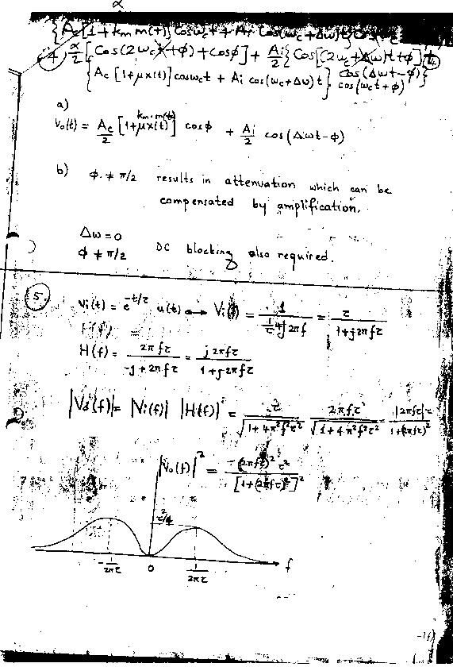

Başkent University Department of Electrical and Electronics Engineering's 150-minute "Communication Systems I" final exam dated January 15, 2001 (EEM 421 on the paper). It consists of five questions, each worth 20 points. The scanned sheets contain handwritten solutions; the questions and solutions are in English. The original exam and the handwritten solution pages can be downloaded as a PDF at the end of the post.

## Question 1: Wideband FM modulator

A wideband FM signal centered at 30 MHz with a deviation of 8 kHz is to be generated using a structure consisting of a narrowband FM generator (center 200 kHz, deviation 20 Hz), a frequency multiplier (n), a mixer, and a bandpass filter. (a) The expression of the NBFM signal and its block diagram; (b) n, the mixer oscillator frequency f₁, and the filter bandwidth (W = 16 kHz).

**Solution.** For NBFM, cos φ(t) ≈ 1 and sin φ(t) ≈ φ(t) are assumed:

x_c(t) ≈ A_ccos ω_ct − A_cφ(t)sin ω_ct

Block diagram: to multiply φ(t) by −A_c sin ω_ct, a branch with the carrier phase-shifted by 90° and a summer are used.

(b) n = Δf₂/Δf₁ = 8000/20 = 400. At the mixer, 400 × 200 kHz − f₁ = 30 MHz must hold; in the source, 80 MHz − 30 MHz was used, giving f₁ = 50 MHz. The deviation ratio is D = 8/16 = 0.5; by Carson's rule, B_T = 2(D+1)W = 2(1.5)(16) = 48 kHz.

## Question 2: Transmitting two signals via FM

x₁(t) and x₂(t), band-limited to 15 kHz, are multiplied by subcarriers f₁ = 15 kHz and f₂ = 45 kHz and summed, then fed to an FM modulator (carrier 100 MHz, amplitude 5 V, β = 5). (a) Time expressions at points A, B, C, D; (b) the spectrum at points A, B, C; (c) the maximum frequency deviation and the FM output bandwidth.

**Solution.** A: x₁(t)cos ω₁t; B: x₂(t)cos ω₂t; C: x(t) = x₁cos ω₁t + x₂cos ω₂t; D: A_ccos(ω_ct + 2πf_Δ∫x dt), A_c = 5 V, f_c = 100 MHz. In the spectrum, the x₁ band lies side by side at 0–30 kHz and the x₂ band at 30–60 kHz. The total bandwidth is W = 60 kHz, f_Δ = βW = 5 × 60 = 300 kHz.

*Note: The handwritten solution gives B_T = 2(f_Δ + 2W) = 840 kHz. Carson's rule gives B_T = 2(f_Δ + W) = 2(300 + 60) = 720 kHz.*

## Question 3: DSB receiver

x_c(t) = (cos ω_m t + A cos 2ω_m t)cos ω_ct, ω_c > ω_m; the receiver has a bandpass filter (bandwidth 6ω_m, center ω₁), a multiplier with 2cos ω₁t, and a lowpass filter (0–3ω_m). The signals at points A, B, C are to be found for (a) ω₁ = ω_c and (b) ω₁ = ω_c − 3ω_m.

**Solution.** (a) When ω₁ = ω_c, all components pass through the filter: at point A, x_c(t) appears unchanged; at point B, x_c(t)·2cos ω_ct; at point C, cos ω_m t + A cos 2ω_m t, i.e., the message. (b) For ω₁ = ω_c − 3ω_m, the filter passes only the ω_c − ω_m and ω_c − 2ω_m components; at point A, ½cos(ω_c − ω_m)t + (A/2)cos(ω_c − 2ω_m)t remains. After multiplication, at the lowpass filter output, point C contains ½[cos 2ω_m t + A cos ω_m t]: the components swap places and the message is distorted.

## Question 4: Unwanted interfering carrier

An AM signal is summed with an unwanted interfering carrier x_i(t) = A_i cos[(ω_c + Δω)t], then multiplied by a local oscillator with phase ω_c + φ and passed through a lowpass filter. (a) The expression for v₀(t); (b) the conditions on Δf and φ for recovering the message without distortion.

**Solution.** (a) v₀(t) = (A_c/2)[1 + μx(t)]cos φ + (A_i/2)cos(Δωt − φ). (b) φ ≠ π/2 is required; when φ ≠ π/2, the resulting attenuation can be compensated by amplification. Δω = 0 is required, and DC blocking is also needed.

## Question 5: Energy spectral density

The signal v_i(t) = e^(−t/τ)u(t) is applied to the circuit H(f) = 1/(1 − j/(2πfτ)); the energy spectral density of the output is to be found.

**Solution.** Since V_i(f) = τ/(1 + j2πfτ) and H(f) = j2πfτ/(1 + j2πfτ),

|V₀(f)|² = τ²(2πfτ)² / [1 + (2πfτ)²]²

The spectrum is zero at f = 0, reaches a peak value of τ²/4 at 2πfτ = 1, and decreases at high frequencies (a two-peaked, evenly symmetric curve).

