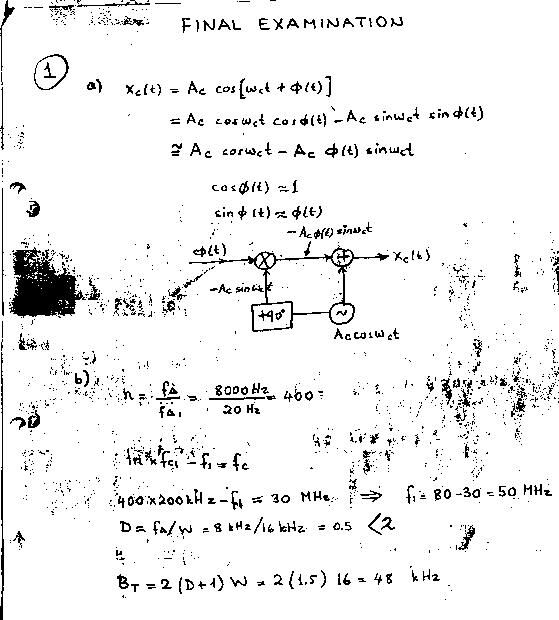
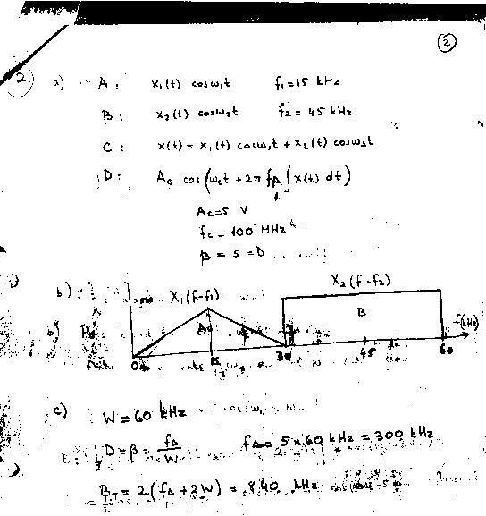
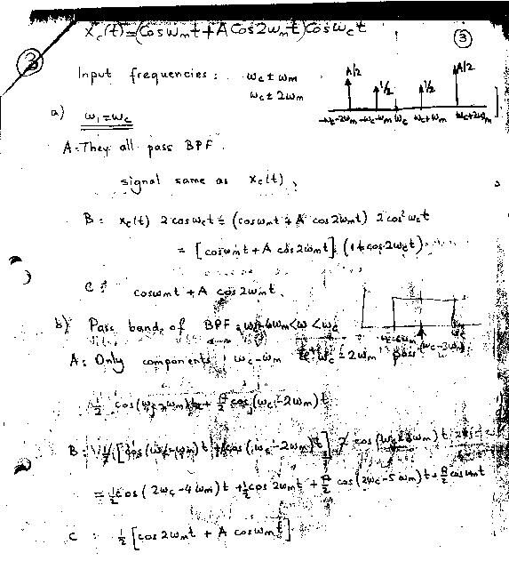
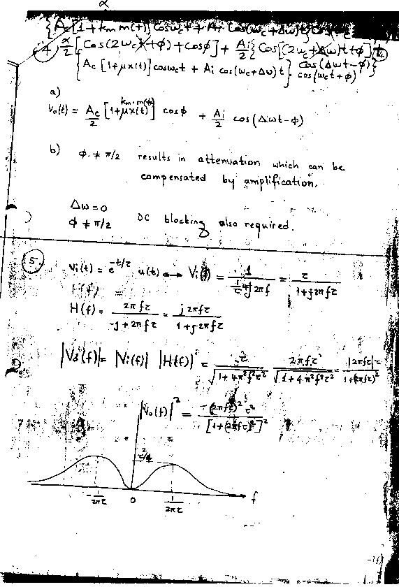

Başkent Üniversitesi Elektrik-Elektronik Mühendisliği Bölümü'nün 15 Ocak 2001 tarihli, 150 dakikalık "Communication Systems I" final sınavı (kâğıtta EEM 421). Beş sorudan oluşur, her biri 20 puan. Taranmış kâğıtlar üzerinde el yazısı çözümler var; sorular ve çözümler İngilizce. Orijinal sınav ve el yazısı çözüm sayfaları yazının sonundaki PDF olarak indirilebilir.

## Soru 1: Geniş bant FM modülatör

Dar bant FM üreteci (merkez 200 kHz, sapma 20 Hz), frekans çarpıcı (n), karıştırıcı ve bant geçiren süzgeçten oluşan yapıyla, 30 MHz merkezli ve 8 kHz sapmalı geniş bant FM üretilecek. (a) NBFM işaretinin ifadesi ve blok şeması; (b) n, karıştırıcı osilatör frekansı f₁ ve süzgeç bant genişliği (W = 16 kHz).

**Çözüm.** NBFM için cos φ(t) ≈ 1 ve sin φ(t) ≈ φ(t) varsayılır:

x_c(t) ≈ A_ccos ω_ct − A_cφ(t)sin ω_ct

Blok şema: φ(t)'yi −A_c sin ω_ct ile çarpmak için taşıyıcıdan 90° faz kaydırılmış kol ve toplayıcı kullanılır.

(b) n = Δf₂/Δf₁ = 8000/20 = 400. Karıştırıcıda 400 × 200 kHz − f₁ = 30 MHz olmalıdır; kaynakta 80 MHz − 30 MHz kullanılarak f₁ = 50 MHz bulunmuştur. Sapma oranı D = 8/16 = 0,5; Carson kuralıyla B_T = 2(D+1)W = 2(1,5)(16) = 48 kHz.

## Soru 2: İki işaretin FM ile iletilmesi

15 kHz ile bant sınırlı x₁(t) ve x₂(t), alt taşıyıcılar f₁ = 15 kHz ve f₂ = 45 kHz ile çarpılıp toplanıyor, sonra FM modülatöre (taşıyıcı 100 MHz, genlik 5 V, β = 5) veriliyor. (a) A, B, C, D noktalarının zaman ifadeleri, (b) A, B, C noktalarının spektrumu, (c) en büyük frekans sapması ve FM çıkış bant genişliği.

**Çözüm.** A: x₁(t)cos ω₁t; B: x₂(t)cos ω₂t; C: x(t) = x₁cos ω₁t + x₂cos ω₂t; D: A_ccos(ω_ct + 2πf_Δ∫x dt), A_c = 5 V, f_c = 100 MHz. Spektrumda x₁ bandı 0–30 kHz, x₂ bandı 30–60 kHz arasında yan yana yer alır. Toplam bant genişliği W = 60 kHz, f_Δ = βW = 5 × 60 = 300 kHz.

*Not: El yazısı çözümde B_T = 2(f_Δ + 2W) = 840 kHz yazılmış. Carson kuralı B_T = 2(f_Δ + W) = 2(300 + 60) = 720 kHz verir.*

## Soru 3: DSB alıcı

x_c(t) = (cos ω_m t + A cos 2ω_m t)cos ω_ct, ω_c > ω_m; alıcıda bant geçiren süzgeç (bandı 6ω_m, merkezi ω₁), 2cos ω₁t ile çarpıcı ve alçak geçiren süzgeç (0–3ω_m) var. A, B, C noktalarındaki işaretler (a) ω₁ = ω_c ve (b) ω₁ = ω_c − 3ω_m için bulunacak.

**Çözüm.** (a) ω₁ = ω_c olduğunda tüm bileşenler süzgeçten geçer: A noktasında x_c(t) aynen bulunur; B noktasında x_c(t)·2cos ω_ct; C noktasında cos ω_m t + A cos 2ω_m t, yani mesaj. (b) ω₁ = ω_c − 3ω_m için süzgeç yalnız ω_c − ω_m ve ω_c − 2ω_m bileşenlerini geçirir; A noktasında ½cos(ω_c − ω_m)t + (A/2)cos(ω_c − 2ω_m)t kalır. Çarpımdan sonra alçak geçiren süzgeç çıkışında C noktasında ½[cos 2ω_m t + A cos ω_m t] bulunur: bileşenlerin yeri değişir ve mesaj bozulur.

## Soru 4: İstenmeyen girişim taşıyıcısı

AM işareti, istenmeyen bir girişim taşıyıcısı x_i(t) = A_i cos[(ω_c + Δω)t] ile toplanıyor ve ω_c + φ fazlı yerel osilatörle çarpılıp alçak geçiren süzgeçten geçiriliyor. (a) v₀(t) ifadesi, (b) mesajın bozulmadan elde edilmesi için Δf ve φ koşulları.

**Çözüm.** (a) v₀(t) = (A_c/2)[1 + μx(t)]cos φ + (A_i/2)cos(Δωt − φ). (b) φ ≠ π/2 olmalıdır; φ ≠ π/2 olduğunda oluşan zayıflama kuvvetlendirmeyle giderilebilir. Δω = 0 olmalı ve ayrıca DC bloklama gerekir.

## Soru 5: Enerji spektral yoğunluğu

v_i(t) = e^(−t/τ)u(t) işareti H(f) = 1/(1 − j/(2πfτ)) devresine uygulanıyor; çıkışın enerji spektral yoğunluğu bulunacak.

**Çözüm.** V_i(f) = τ/(1 + j2πfτ) ve H(f) = j2πfτ/(1 + j2πfτ) olduğundan

|V₀(f)|² = τ²(2πfτ)² / [1 + (2πfτ)²]²

Spektrum f = 0'da sıfırdır, 2πfτ = 1'de τ²/4 tepe değerine ulaşır ve yüksek frekanslarda azalır (iki tepeli, çift simetrik eğri).

