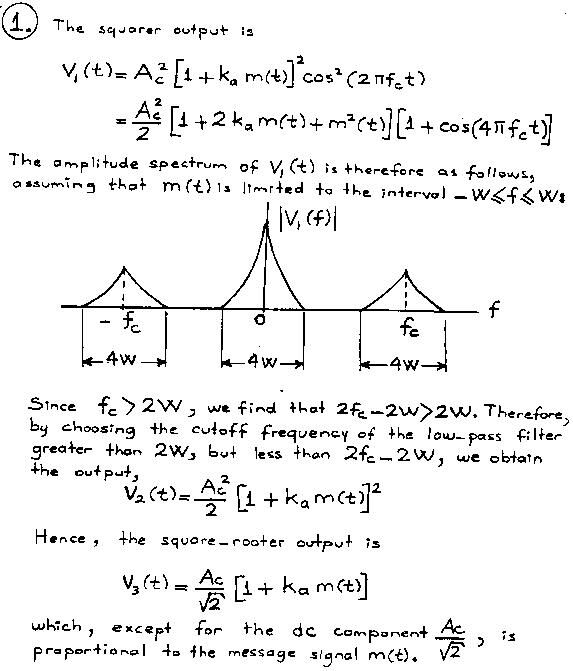
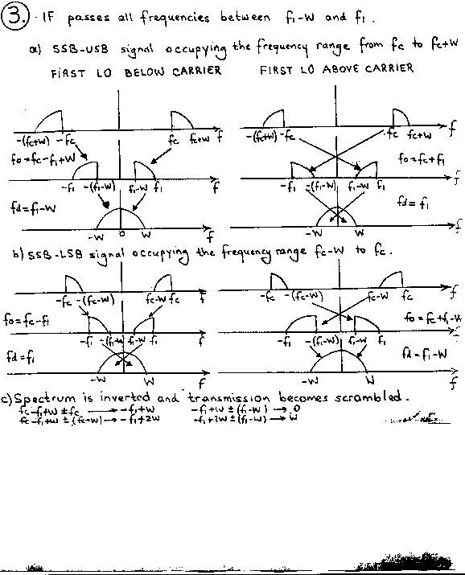
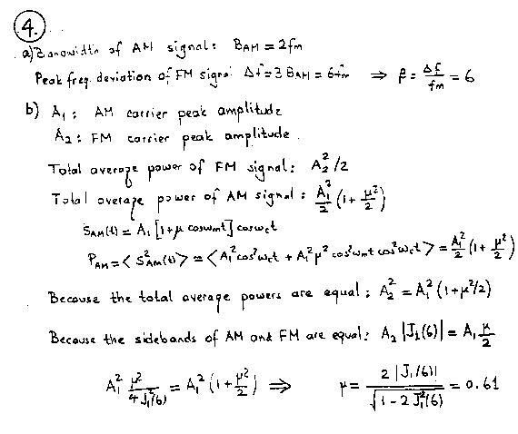

The 90-minute EEM 441 "Communication Systems I" final exam of January 21, 2002, from the Department of Electrical and Electronics Engineering at Başkent University. The exam paper and handwritten solutions for the four questions are in English. The original exam pages and handwritten solutions can be downloaded as a PDF at the end of the post.

## Question 1: AM Demodulation with a Squarer

The AM signal s(t) = A_c[1 + k_am(t)]cos(2πf_ct) is passed through a squarer, a low-pass filter, and a square-root block (v₁ = s², v₃ = √v₂). Given that |k_am(t)| < 1, m(t) is band-limited to −W…W, and f_c > 2W, show that m(t) can be recovered from the square-root output.

**Solution.** v₁(t) = (A_c²/2)[1 + 2k_am(t) + k_a²m²(t)][1 + cos 4πf_ct]. The baseband part of the spectrum has a width of 4W. Since f_c > 2W, we have 2f_c − 2W > 2W; at the output of a low-pass filter whose cutoff frequency is chosen greater than 2W and less than 2f_c − 2W, what remains is v₂(t) = (A_c²/2)[1 + k_am(t)]². Square root: v₃(t) = (A_c/√2)[1 + k_am(t)], that is, apart from the DC component, proportional to m(t).

## Question 2: Power and Bandwidth

For a normalized m(t), the bandwidth is 10 kHz and the power is 0.5 W; for the carrier A cos(2πf₀t), the power is 200 W (A = 20). The bandwidth and power of the modulated signal are to be found for (a) SSB, (b) DSB-SC, (c) AM (modulation index 0.6), (d) FM (k_f = 50 000).

**Solution.** Here P_c = 200 W and P_m = 0.5 W.

| Modulation | Bandwidth | Power |
|---|---|---|
| SSB | B_T = W = 10 kHz | P = P_c(⟨m²⟩ + ⟨m̂²⟩) = 2P_cP_m = 200 W |
| DSB-SC | B_T = 2W = 20 kHz | P = P_cP_m = 100 W |
| AM (μ = 0.6) | B_T = 2W = 20 kHz | P = P_c + P_cP_mμ² = 200(1 + 0.36·0.5) = 236 W |
| FM (k_f = 50 000) | B_T = 2(Δf + W) = 2(50 + 10) = 120 kHz | P = A²/2 = 200 W |

*Note: The SSB power is found as 200 W according to the definition s(t) = A_c[m cos ωt ∓ m̂ sin ωt] in the handwritten solution; the page in the solution is low-resolution, so the figures were read accordingly.*

## Question 3: Double-Conversion Receiver

In a double-conversion receiver in which the first intermediate-frequency amplifier passes all frequencies between f₁ − W and f₁, the local oscillator frequencies f₀ and f_d are to be determined for: (a) the USB in the range f_c…f_c+W; (b) the LSB in the range f_c−W…f_c; (c) what happens if the incoming signal is LSB while the receiver is tuned for USB?

**Solution.** (a) For USB, if the first oscillator is taken below the carrier, f₀ = f_c − f₁ + W and f_d = f₁ − W; if taken above, f₀ = f_c + f₁ and f_d = f₁. (b) For LSB, f₀ = f_c − f₁ and f_d = f₁ (below), or f₀ = f_c + f₁ − W and f_d = f₁ − W (above). (c) The spectrum is inverted and the transmission becomes unintelligible (scrambled).

## Question 4: Comparison of AM and FM

A single sinusoidal signal of frequency f_m is used in both an AM and an FM system. The peak frequency deviation of the FM is 3 times the AM bandwidth; the sidebands spaced by f_m have equal amplitudes, and the total average powers are equal. Find (a) the FM modulation index and (b) the AM modulation index. (J₁(6) = −0.28)

**Solution.** Since B_AM = 2f_m and Δf = 3B_AM = 6f_m, β = Δf/f_m = 6. Equality of powers gives A₂² = A₁²(1 + μ²/2); equality of sidebands gives A₂|J₁(6)| = A₁μ/2. From these two,

μ = 2|J₁(6)| / √(1 − 2J₁²(6)) ≈ 0.61

is obtained.

