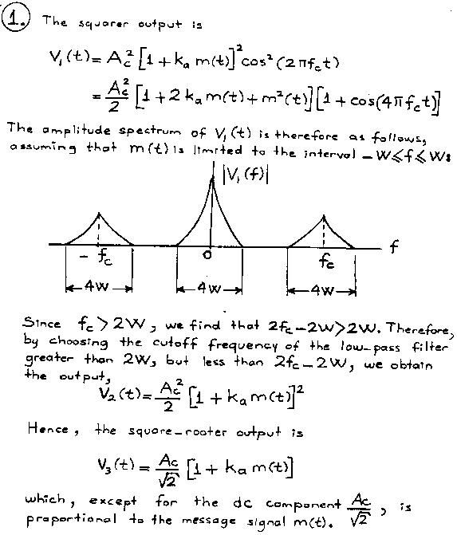
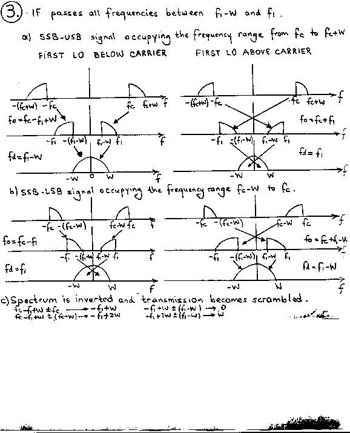
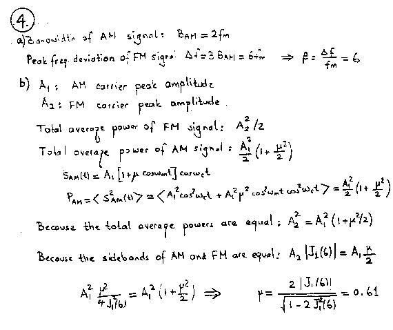

Başkent Üniversitesi Elektrik-Elektronik Mühendisliği Bölümü'nün 21 Ocak 2002 tarihli, 90 dakikalık EEM 441 "Communication Systems I" final sınavı. Dört sorunun sınav kâğıdı ve el yazısı çözümleri İngilizcedir. Orijinal sınav sayfaları ve el yazısı çözümler yazının sonundaki PDF olarak indirilebilir.

## Soru 1: Kare alıcı ile AM demodülasyonu

s(t) = A_c[1 + k_am(t)]cos(2πf_ct) AM işareti kare alıcı, alçak geçiren süzgeç ve karekökten geçiyor (v₁ = s², v₃ = √v₂). |k_am(t)| < 1, m(t) −W…W ile sınırlı ve f_c > 2W olduğuna göre m(t)'nin karekök çıkışından elde edilebildiğini gösterin.

**Çözüm.** v₁(t) = (A_c²/2)[1 + 2k_am(t) + k_a²m²(t)][1 + cos 4πf_ct]. Spektrumun taban bandı kısmı 4W genişliğindedir. f_c > 2W olduğundan 2f_c − 2W > 2W olur; kesim frekansı 2W'den büyük, 2f_c − 2W'den küçük seçilen alçak geçiren süzgeç çıkışında v₂(t) = (A_c²/2)[1 + k_am(t)]² kalır. Karekök: v₃(t) = (A_c/√2)[1 + k_am(t)], yani DC bileşeni dışında m(t) ile orantılı.

## Soru 2: Güç ve bant genişliği

Normalize m(t) için bant genişliği 10 kHz, güç 0,5 W; taşıyıcı A cos(2πf₀t) için güç 200 W (A = 20). (a) SSB, (b) DSB-SC, (c) AM (modülasyon indisi 0,6), (d) FM (k_f = 50 000) için modüle edilmiş işaretin bant genişliği ve gücü bulunacak.

**Çözüm.** Burada P_c = 200 W ve P_m = 0,5 W'tır.

| Modülasyon | Bant genişliği | Güç |
|---|---|---|
| SSB | B_T = W = 10 kHz | P = P_c(⟨m²⟩ + ⟨m̂²⟩) = 2P_cP_m = 200 W |
| DSB-SC | B_T = 2W = 20 kHz | P = P_cP_m = 100 W |
| AM (μ = 0,6) | B_T = 2W = 20 kHz | P = P_c + P_cP_mμ² = 200(1 + 0,36·0,5) = 236 W |
| FM (k_f = 50 000) | B_T = 2(Δf + W) = 2(50 + 10) = 120 kHz | P = A²/2 = 200 W |

*Not: SSB gücü, el yazısı çözümdeki s(t) = A_c[m cos ωt ∓ m̂ sin ωt] tanımına göre 200 W bulunur; çözümdeki sayfa küçük çözünürlüklüdür, rakamlar buna göre okunmuştur.*

## Soru 3: Çift dönüşümlü alıcı

Birinci ara frekans yükseltecinin f₁ − W ile f₁ arasındaki tüm frekansları geçirdiği çift dönüşümlü alıcıda yerel osilatör frekansları f₀ ve f_d belirlenecek: (a) f_c…f_c+W aralığındaki USB; (b) f_c−W…f_c aralığındaki LSB; (c) alıcı USB için ayarlıyken gelen işaret LSB ise ne olur?

**Çözüm.** (a) USB için birinci osilatör taşıyıcının altında alınırsa f₀ = f_c − f₁ + W, f_d = f₁ − W; üstünde alınırsa f₀ = f_c + f₁, f_d = f₁. (b) LSB için f₀ = f_c − f₁, f_d = f₁ (altta) veya f₀ = f_c + f₁ − W, f_d = f₁ − W (üstte). (c) Spektrum ters çevrilir ve iletim anlaşılmaz hâle gelir (scrambled).

## Soru 4: AM ve FM karşılaştırması

f_m frekanslı tek bir sinüzoidal işaret hem AM hem FM sisteminde kullanılıyor. FM'in tepe frekans sapması AM bant genişliğinin 3 katı; f_m aralıklı yan bantların genlikleri eşit ve toplam ortalama güçler eşit. (a) FM modülasyon indisini, (b) AM modülasyon indisini bulun. (J₁(6) = −0,28)

**Çözüm.** B_AM = 2f_m ve Δf = 3B_AM = 6f_m olduğundan β = Δf/f_m = 6. Güçlerin eşitliği A₂² = A₁²(1 + μ²/2); yan bant eşitliği A₂|J₁(6)| = A₁μ/2. İkisinden

μ = 2|J₁(6)| / √(1 − 2J₁²(6)) ≈ 0,61

bulunur.

