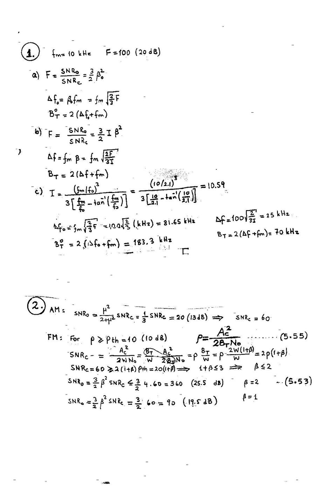
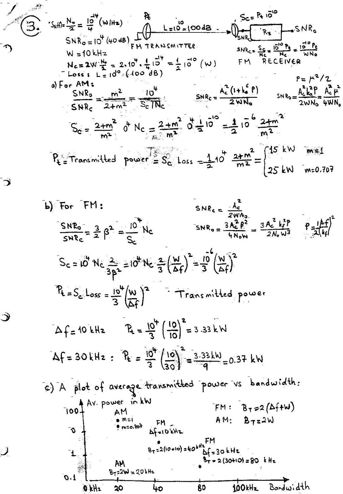
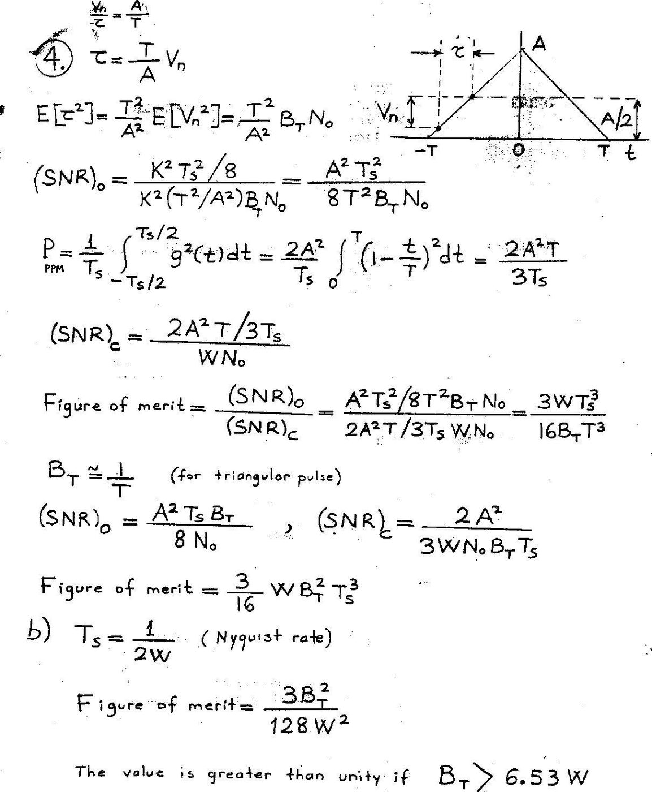

The 90-minute EEM 442 "Communication Systems II" first midterm exam of the Department of Electrical and Electronics Engineering at Başkent University, dated April 24, 2001. This exam belongs to the Communications II (EEM 442) course; because it was found in the Communications I folder, it is published here, under Communications I. The exam and the handwritten solutions are in English. The original exam pages and the handwritten solutions can be downloaded as a PDF at the end of the post.

## Question 1: FM Figure of Merit and Emphasis

A sinusoidal signal of frequency f_m is transmitted by FM in the presence of AWGN. A signal-to-noise ratio improvement (figure of merit) of F at the demodulator output is required: what are the required peak frequency deviation Δf and transmission bandwidth (a) without pre-emphasis/de-emphasis, (b) with standard pre-emphasis/de-emphasis? (c) For F = 20 dB, f_m = 10 kHz and f₀ = 2.1 kHz, compare (a) and (b).

**Solution.** (a) F = SNR₀/SNR_c = (3/2)β² ⇒ Δf = βf_m = f_m√(2F/3), B_T = 2(Δf + f_m). (b) With emphasis F = (3/2)Iβ² ⇒ Δf = f_m√(2F/(3I)); here I = (f_m/f₀)³ / (3[f_m/f₀ − tan⁻¹(f_m/f₀)]). (c) For F = 100, I = 10.59. Without emphasis: Δf ≈ 81.65 kHz, B_T ≈ 183.3 kHz. With emphasis: Δf = 100√(2/(3 × 10.59)) ≈ 25 kHz, B_T = 2(25 + 10) = 70 kHz. De-emphasis reduces the bandwidth by a factor of about 2.6 for the same quality.

## Question 2: Switching from AM to FM

AM is transmitted with μ = 1 and SNR₀ = 13 dB. The modulation is changed to FM without emphasis and the bandwidth is increased, while the other parameters (SNR_c) remain constant. What are the largest usable deviation ratio and the SNR₀? The carrier-to-noise ratio at the FM input is above the 10 dB threshold value.

**Solution.** For AM, SNR₀ = μ²/(2 + μ²)·SNR_c = SNR_c/3 = 20 (13 dB) ⇒ SNR_c = 60. For FM, the threshold is ρ ≥ 10 and SNR_c = 2ρ(1 + β), so 60 ≥ 20(1 + β) ⇒ β ≤ 2. For β = 2, SNR₀ = (3/2)β²SNR_c = 360 (25.5 dB); for β = 1, it is 90 (19.5 dB).

## Question 3: Required Transmitter Power

The white-noise two-sided power spectral density is 0.25 × 10⁻¹⁴ W/Hz, the total path loss is 100 dB, and the input bandwidth is 10 kHz. A 40 dB output S/N is required for a 10 kHz sinusoidal signal. Find the minimum required carrier power: (a) for AM with μ = 0.707 and μ = 1; (b) for FM with Δf = 10 kHz and 30 kHz; (c) show the results on a power–bandwidth graph.

**Solution.** SNR₀ = 10⁴ and the noise power is N_c = 2W·N₀/2 = ½ × 10⁻¹⁰ W. (a) AM: SNR₀/SNR_c = μ²/(2 + μ²) ⇒ S_c = N_c·10⁴(2 + μ²)/μ²; transmitter power P_t = S_c × 10¹⁰ = ½ × 10⁴(2 + μ²)/μ². For μ = 1 it is 15 kW, for μ = 0.707 it is 25 kW. (b) FM: SNR₀/SNR_c = (3/2)β² ⇒ P_t = (10⁴/3)(W/Δf)². For Δf = 10 kHz it is 3.33 kW; for Δf = 30 kHz it is 0.37 kW. (c) Bandwidths: for AM 2W = 20 kHz; for FM 2(Δf + W) = 40 kHz and 80 kHz. The graph shows the AM points (20 kHz; 15 and 25 kW) and the FM points (40 kHz; 3.33 kW) and (80 kHz; 0.37 kW): as bandwidth increases, the required power decreases.

## Question 4: PPM

The pulse train shown in the figure (peak amplitude A, triangular pulses, duration T, repetition period T_s) is used in PPM with a slicing level of A/2. (a) For full-load sinusoidal modulation and receiver noise with zero mean and power density N₀/2, find the output SNR and the figure of merit; the peak pulse-to-noise ratio is high. (b) If the signal is sampled at the Nyquist rate, what must the transmission bandwidth be for the figure of merit to exceed 1?

**Solution.** The noise causes a shift of τ = (T/A)V_n; E[τ²] = (T²/A²)B_TN₀. SNR₀ = A²T_s²/(8T²B_TN₀). The pulse power is P = 2A²T/(3T_s), SNR_c = 2A²T/(3T_sWN₀). The figure of merit is 3WT_s³/(16B_TT³); taking B_T ≈ 1/T for a triangular pulse gives (3/16)WB_T²T_s³. With T_s = 1/2W, the figure of merit is 3B_T²/(128W²); this value is greater than 1 when B_T > 6.53W.

