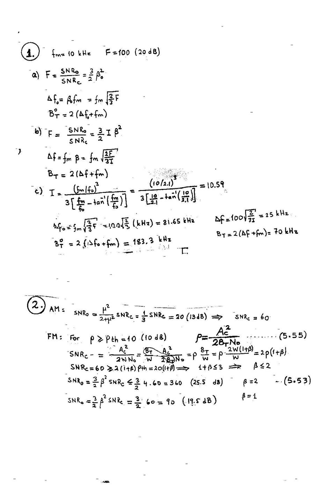
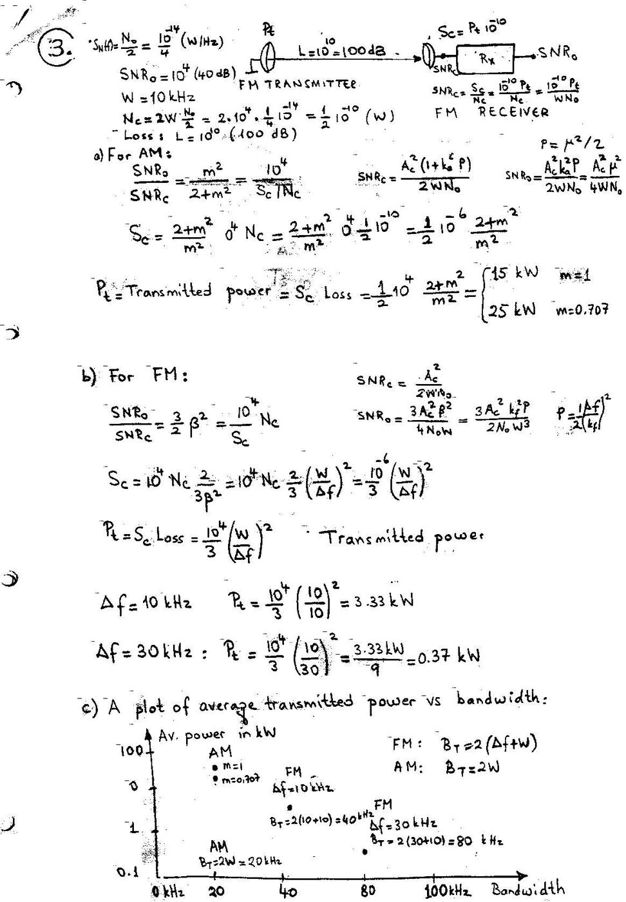
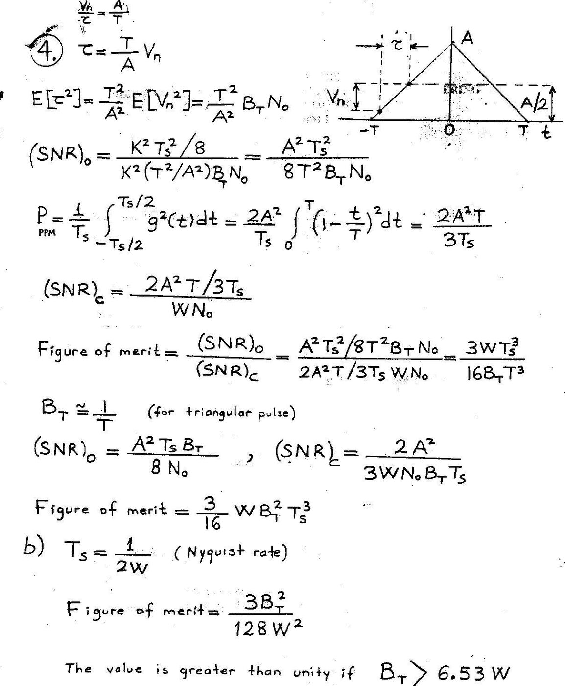

Başkent Üniversitesi Elektrik-Elektronik Mühendisliği Bölümü'nün 24 Nisan 2001 tarihli, 90 dakikalık EEM 442 "Communication Systems II" birinci ara sınavı. Bu sınav Haberleşme II (EEM 442) dersine aittir; Haberleşme I klasöründe bulunduğu için burada, Haberleşme I altında yayımlanmıştır. Sınav ve el yazısı çözümler İngilizce. Orijinal sınav sayfaları ve el yazısı çözümler yazının sonundaki PDF olarak indirilebilir.

## Soru 1: FM kalite faktörü ve vurgu

f_m frekanslı sinüzoidal işaret AWGN varlığında FM ile iletiliyor. Demodülatör çıkışında SNR iyileşmesi (kalite faktörü) F olması isteniyor: gereken tepe frekans sapması Δf ve iletim bant genişliği (a) vurgu/vurgu giderme (pre/de-emphasis) yokken, (b) standart vurgu varken nedir? (c) F = 20 dB, f_m = 10 kHz ve f₀ = 2,1 kHz için (a) ve (b)'yi karşılaştırın.

**Çözüm.** (a) F = SNR₀/SNR_c = (3/2)β² ⇒ Δf = βf_m = f_m√(2F/3), B_T = 2(Δf + f_m). (b) Vurguyla F = (3/2)Iβ² ⇒ Δf = f_m√(2F/(3I)); burada I = (f_m/f₀)³ / (3[f_m/f₀ − tan⁻¹(f_m/f₀)]). (c) F = 100 için I = 10,59. Vurgusuz: Δf ≈ 81,65 kHz, B_T ≈ 183,3 kHz. Vurguyla: Δf = 100√(2/(3 × 10,59)) ≈ 25 kHz, B_T = 2(25 + 10) = 70 kHz. Vurgu giderme aynı kalite için bant genişliğini yaklaşık 2,6 kat azaltır.

## Soru 2: AM'den FM'e geçiş

μ = 1 ve SNR₀ = 13 dB ile AM iletiliyor. Modülasyon vurgusuz FM'e çevrilir ve bant genişliği artırılır, diğer parametreler (SNR_c) sabit kalır. En büyük kullanılabilir sapma oranı ve SNR₀ nedir? FM girişindeki taşıyıcı-gürültü oranı 10 dB'lik eşik değerinin üzerindedir.

**Çözüm.** AM'de SNR₀ = μ²/(2 + μ²)·SNR_c = SNR_c/3 = 20 (13 dB) ⇒ SNR_c = 60. FM'de eşik ρ ≥ 10 ve SNR_c = 2ρ(1 + β) olduğundan 60 ≥ 20(1 + β) ⇒ β ≤ 2. β = 2 için SNR₀ = (3/2)β²SNR_c = 360 (25,5 dB); β = 1 için 90 (19,5 dB).

## Soru 3: Gerekli verici gücü

Beyaz gürültü iki yanlı güç spektral yoğunluğu 0,25 × 10⁻¹⁴ W/Hz, toplam yol kaybı 100 dB, giriş bant genişliği 10 kHz. 10 kHz'lik sinüzoidal işaret için 40 dB çıkış S/N isteniyor. Gerekli en küçük taşıyıcı gücünü bulun: (a) μ = 0,707 ve μ = 1 AM; (b) Δf = 10 kHz ve 30 kHz FM; (c) bulguları güç–bant genişliği grafiğinde gösterin.

**Çözüm.** SNR₀ = 10⁴ ve gürültü gücü N_c = 2W·N₀/2 = ½ × 10⁻¹⁰ W. (a) AM: SNR₀/SNR_c = μ²/(2 + μ²) ⇒ S_c = N_c·10⁴(2 + μ²)/μ²; verici gücü P_t = S_c × 10¹⁰ = ½ × 10⁴(2 + μ²)/μ². μ = 1 için 15 kW, μ = 0,707 için 25 kW. (b) FM: SNR₀/SNR_c = (3/2)β² ⇒ P_t = (10⁴/3)(W/Δf)². Δf = 10 kHz için 3,33 kW; Δf = 30 kHz için 0,37 kW. (c) Bant genişlikleri: AM için 2W = 20 kHz; FM için 2(Δf + W) = 40 kHz ve 80 kHz. Grafikte AM noktaları (20 kHz; 15 ve 25 kW), FM noktaları (40 kHz; 3,33 kW) ve (80 kHz; 0,37 kW) yer alır: bant genişliği artarken gereken güç azalır.

## Soru 4: PPM

Şekildeki darbe katarı (tepe genliği A, üçgen darbe, süre T, tekrar T_s) PPM'de kesme seviyesi A/2. (a) Tam yüklü sinüzoidal modülasyon ve ortalaması sıfır, güç yoğunluğu N₀/2 olan alıcı gürültüsü için çıkış SNR'sini ve kalite faktörünü bulun; tepe darbe/gürültü oranı yüksektir. (b) İşaret Nyquist hızında örnekleniyorsa, kalite faktörünün 1'i aşması için iletim bant genişliği ne olmalı?

**Çözüm.** Gürültü τ = (T/A)V_n kadar kaymaya yol açar; E[τ²] = (T²/A²)B_TN₀. SNR₀ = A²T_s²/(8T²B_TN₀). Darbe gücü P = 2A²T/(3T_s), SNR_c = 2A²T/(3T_sWN₀). Kalite faktörü 3WT_s³/(16B_TT³); üçgen darbe için B_T ≈ 1/T alınınca (3/16)WB_T²T_s³ olur. T_s = 1/2W ile kalite faktörü 3B_T²/(128W²); bu değer B_T > 6,53W iken 1'den büyüktür.

