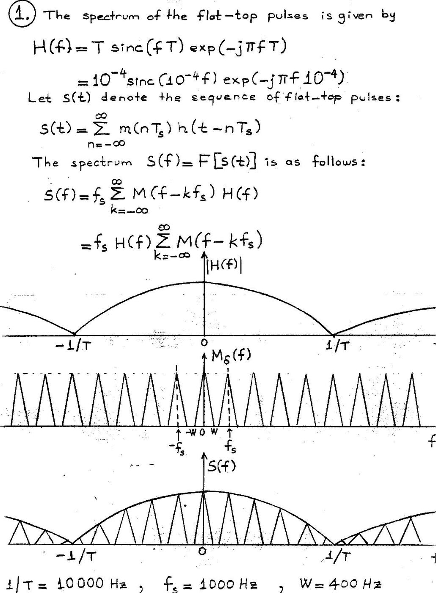
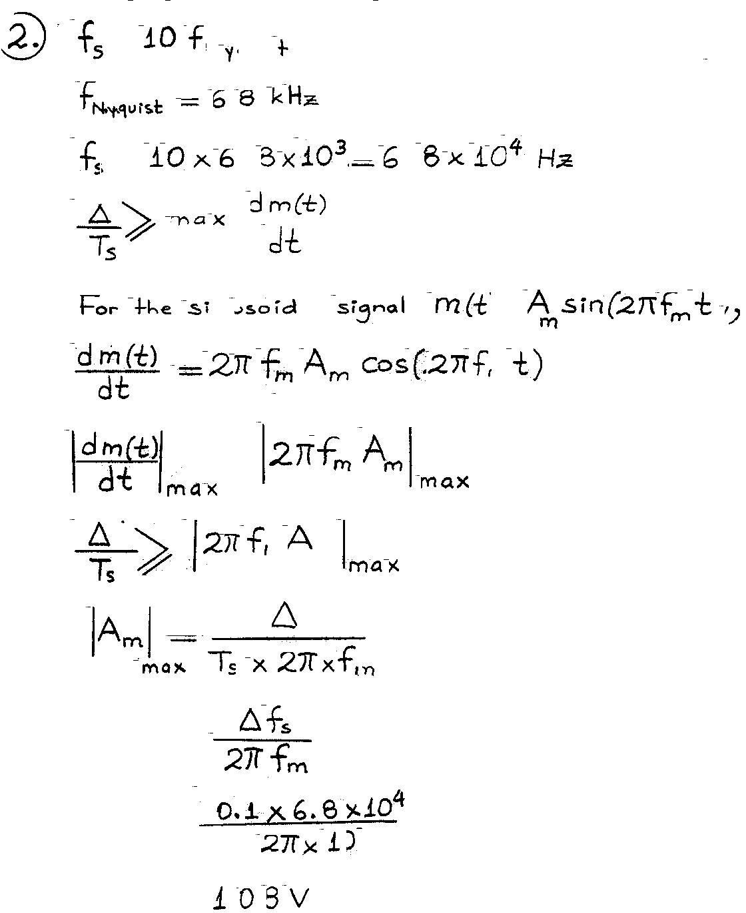
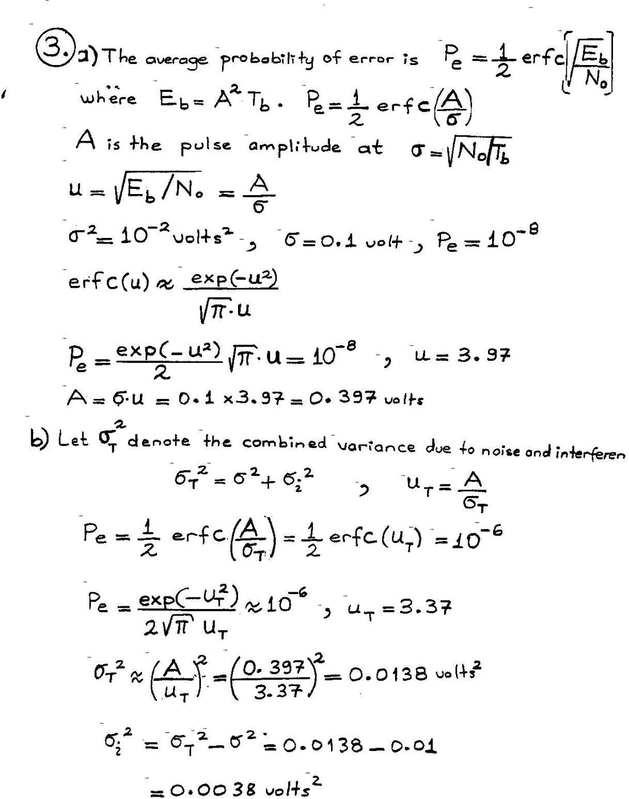
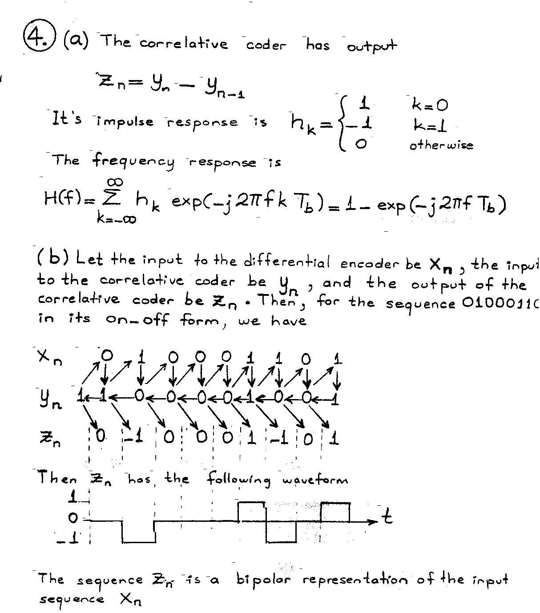

The 90-minute EEM 442 "Communication Systems II" first midterm exam of the Department of Electrical and Electronics Engineering at Başkent University, dated April 29, 2002. This exam belongs to the Communications II (EEM 442) course; because it was found in the Communications I folder, it is published here, under Communications I. The exam is in English; the solutions are handwritten and in English. The original exam pages and handwritten solutions can be downloaded as a PDF at the end of the post.

## Question 1: Flat-Top PAM

The idealized spectrum |M(f)| of the message m(t) is a triangle over the band ±400 Hz. The signal is sampled at a rate of 1 kHz with flat-top pulses, each of 1 unit amplitude and 0.1 ms duration. Find and sketch the spectrum of the resulting PAM signal.

**Solution.** The pulse spectrum is H(f) = T sinc(fT)e^(−jπfT) = 10⁻⁴ sinc(10⁻⁴f)e^(−jπf10⁻⁴) (1/T = 10 000 Hz). For S(t) = Σm(nT_s)h(t − nT_s),

S(f) = f_sH(f)ΣM(f − kf_s), f_s = 1000 Hz

is obtained: the spectrum consists of copies of M(f) spaced 1 kHz apart, weighted by the sinc envelope H(f) (the envelope is zero at 10 kHz). The copies are triangles of W = 400 Hz and do not overlap.

## Question 2: Linear Delta Modulator

A linear delta modulator for a speech signal with a bandwidth limit of 3.4 kHz: sampling rate = 10·f_Nyquist, step size Δ = 100 mV. A 1 kHz sinusoidal test signal is used. Find the largest amplitude that avoids slope overload.

**Solution.** f_Nyquist = 6.8 kHz, f_s = 10 × 6.8 kHz = 68 kHz. To avoid slope overload, Δ/T_s ≥ max|dm/dt| = 2πf_mA_m must hold:

A_max = Δf_s/(2πf_m) = 0.1 × 6.8×10⁴/(2π × 10³) ≈ 1.08 V.

## Question 3: PCM Error Probability

A continuous-time signal is sampled and transmitted using PCM. The variance of the random variable at the input of the decision device in the receiver is 0.01 V². (a) If NRZ signaling is used, find the transmitted pulse amplitude such that the average error rate does not exceed 1 in 10⁸ bits. (b) If interference raises the error rate to 1 in 10⁶ bits, what is the variance of the interference?

**Solution.** P_e = ½erfc(A/σ) and σ = 0.1 V. For P_e = 10⁻⁸, using erfc(u) ≈ exp(−u²)/(√π·u), u = 3.97; A = 0.1 × 3.97 = 0.397 V. (b) The combined variance is σ_T² = σ² + σ_i²; for P_e = 10⁻⁶, u_T = 3.37, σ_T² = (0.397/3.37)² = 0.0138 V², so σ_i² = 0.0138 − 0.01 ≈ 0.0038 V².

## Question 4: Correlative Encoder

The structure in the figure can be viewed as a cascade of a difference encoder, consisting of a 1-unit delay and a modulo-2 adder, with a correlative encoder having a single delay (a delay and an adder). (a) Find the frequency response and impulse response of the correlative encoder. (b) Show that the structure converts the on-off representation of the binary sequence into a bipolar representation; illustrate with the sequence 0 1 0 0 0 1 1 0 1.

**Solution.** (a) z_n = y_n − y_(n−1); the impulse response is h₀ = 1, h₁ = −1, others 0. H(f) = 1 − exp(−j2πfT_b). (b) The difference encoder output is y_n = x_n ⊕ y_(n−1) (taking y = 1 initially). For the input 0 1 0 0 0 1 1 0 1, the output z_n is 0, −1, 0, 0, 0, 1, −1, 0, 1: the 1s become successive alternating +1, −1 pulses (bipolar), and the 0s become the zero level.

