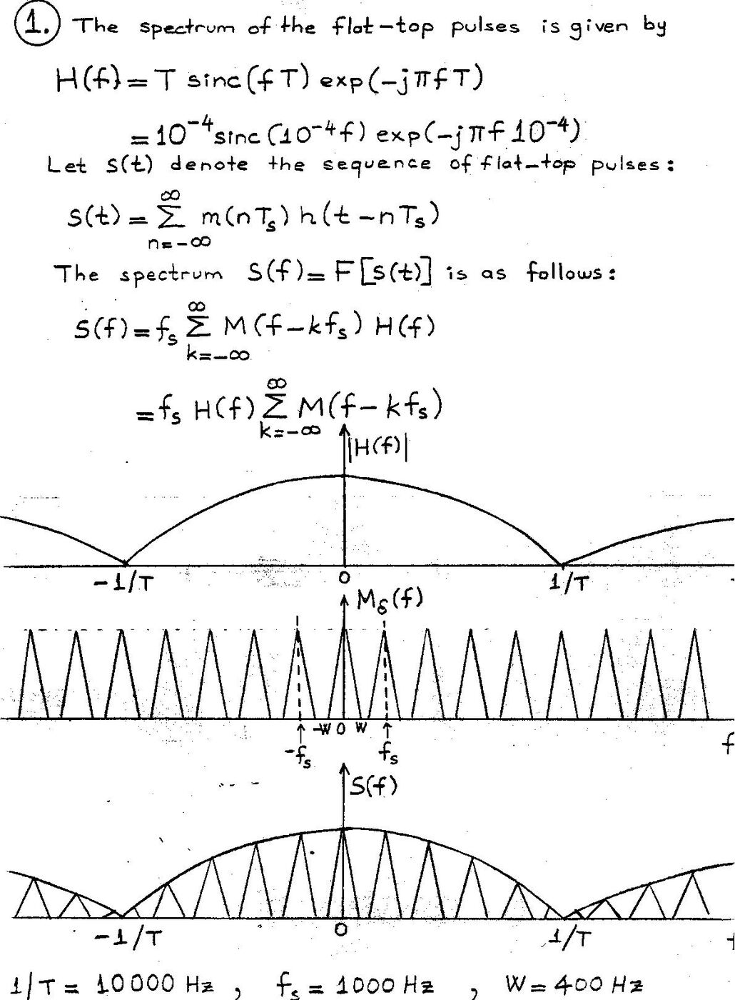
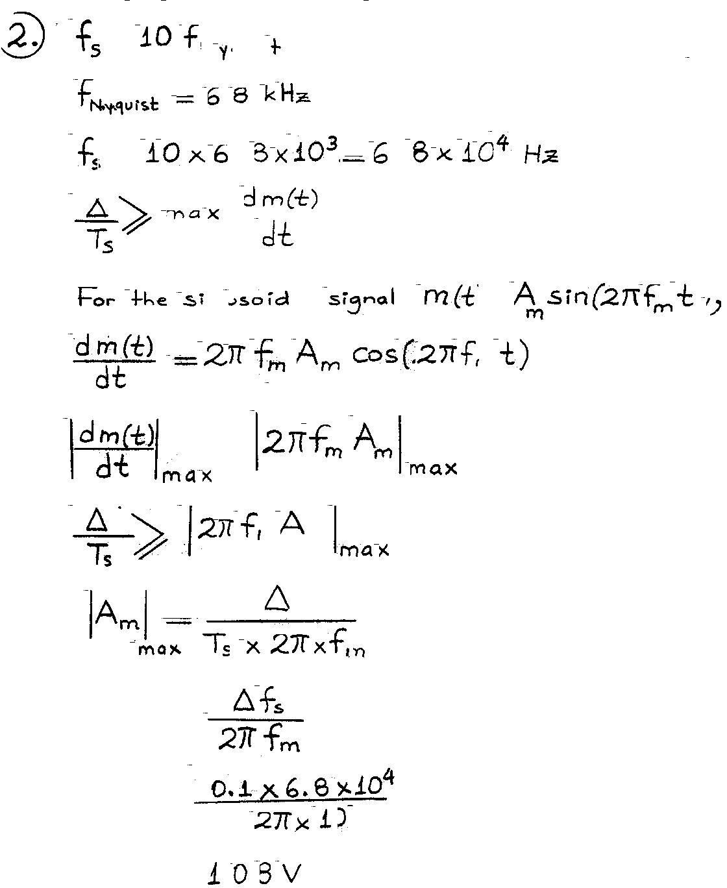
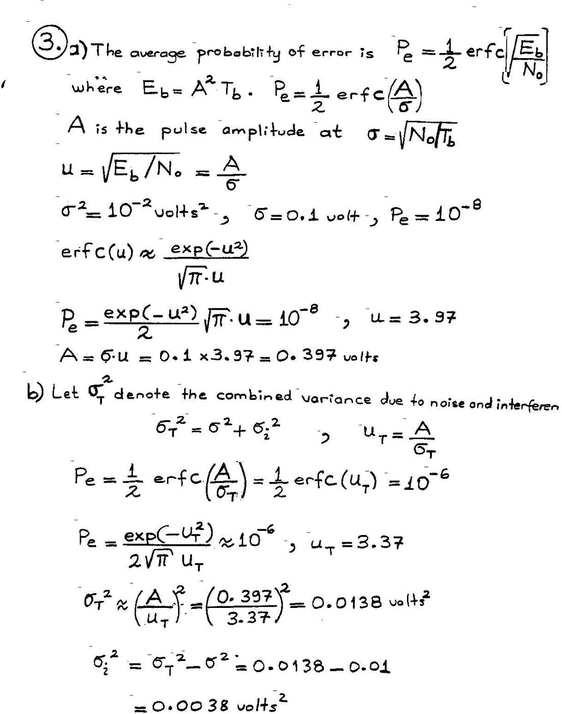
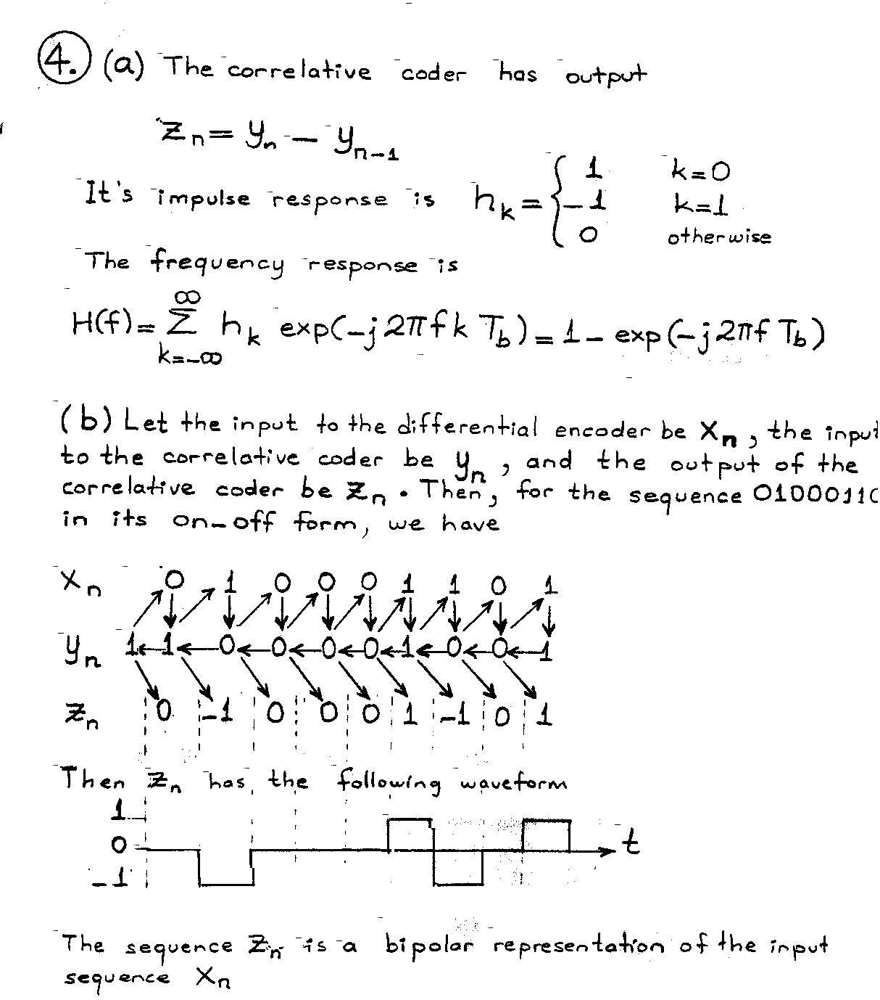

Başkent Üniversitesi Elektrik-Elektronik Mühendisliği Bölümü'nün 29 Nisan 2002 tarihli, 90 dakikalık EEM 442 "Communication Systems II" birinci ara sınavı. Bu sınav Haberleşme II (EEM 442) dersine aittir; Haberleşme I klasöründe bulunduğu için burada, Haberleşme I altında yayımlanmıştır. Sınav İngilizce; çözümler el yazısı ve İngilizcedir. Orijinal sınav sayfaları ve el yazısı çözümler yazının sonundaki PDF olarak indirilebilir.

## Soru 1: Yassı tepeli PAM

Mesaj m(t)'nin idealleştirilmiş spektrumu |M(f)|, ±400 Hz bandında bir üçgendir. Sinyal 1 kHz hızla, her biri 1 birim genlikli ve 0,1 ms süreli yassı tepeli (flat-top) darbelerle örnekleniyor. Oluşan PAM işaretinin spektrumunu bulup çizin.

**Çözüm.** Darbenin spektrumu H(f) = T sinc(fT)e^(−jπfT) = 10⁻⁴ sinc(10⁻⁴f)e^(−jπf10⁻⁴) olur (1/T = 10 000 Hz). S(t) = Σm(nT_s)h(t − nT_s) için

S(f) = f_sH(f)ΣM(f − kf_s), f_s = 1000 Hz

bulunur: spektrum, 1 kHz aralıklı M(f) kopyalarının H(f) sinc zarfıyla ağırlıklandırılmış hâlidir (zarf 10 kHz'de sıfırdır). Kopyalar W = 400 Hz'lik üçgenlerdir ve çakışmaz.

## Soru 2: Doğrusal delta modülatör

Bant sınırı 3,4 kHz olan konuşma işareti için doğrusal delta modülatör: örnekleme hızı = 10·f_Nyquist, adım büyüklüğü Δ = 100 mV. 1 kHz'lik sinüzoidal test işareti kullanılıyor. Eğim aşımını (slope overload) önleyecek en büyük genliği bulun.

**Çözüm.** f_Nyquist = 6,8 kHz, f_s = 10 × 6,8 kHz = 68 kHz. Eğim aşımı olmaması için Δ/T_s ≥ max|dm/dt| = 2πf_mA_m olmalıdır:

A_max = Δf_s/(2πf_m) = 0,1 × 6,8×10⁴/(2π × 10³) ≈ 1,08 V.

## Soru 3: PCM hata olasılığı

Sürekli zamanlı bir işaret örneklenip PCM ile iletiliyor. Alıcıdaki karar cihazı girişinde rastgele değişkenin varyansı 0,01 V². (a) NRZ işaretleme kullanılıyorsa ortalama hata oranı 10⁸ bitte 1'i aşmayacak biçimde iletilecek darbe genliğini bulun. (b) Girişim hata oranını 10⁶ bitte 1'e çıkarıyorsa girişimin varyansı nedir?

**Çözüm.** P_e = ½erfc(A/σ) ve σ = 0,1 V. P_e = 10⁻⁸ için erfc(u) ≈ exp(−u²)/(√π·u) ile u = 3,97; A = 0,1 × 3,97 = 0,397 V. (b) Birleşik varyans σ_T² = σ² + σ_i²; P_e = 10⁻⁶ için u_T = 3,37, σ_T² = (0,397/3,37)² = 0,0138 V², dolayısıyla σ_i² = 0,0138 − 0,01 ≈ 0,0038 V².

## Soru 4: İlişkili (correlative) kodlayıcı

Şekildeki yapı, 1 birimlik gecikme ve mod-2 toplayıcıdan oluşan bir fark kodlayıcının, tek gecikmeli bir ilişkili kodlayıcıyla (gecikme ve toplayıcı) kaskadı olarak görülebilir. (a) İlişkili kodlayıcının frekans ve dürtü cevabını bulun. (b) Yapının, ikili dizinin aç-kapa (on-off) gösterimini bipolar gösterime çevirdiğini gösterin; 0 1 0 0 0 1 1 0 1 dizisiyle örnekleyin.

**Çözüm.** (a) z_n = y_n − y_(n−1); dürtü cevabı h₀ = 1, h₁ = −1, diğerleri 0. H(f) = 1 − exp(−j2πfT_b). (b) Fark kodlayıcı çıkışı y_n = x_n ⊕ y_(n−1) (başlangıçta y = 1 alınarak). Giriş 0 1 0 0 0 1 1 0 1 için z_n çıkışı 0, −1, 0, 0, 0, 1, −1, 0, 1 olur: 1'ler birbirini izleyen alternatif +1, −1 darbelere (bipolar), 0'lar sıfır seviyeye dönüşür.

