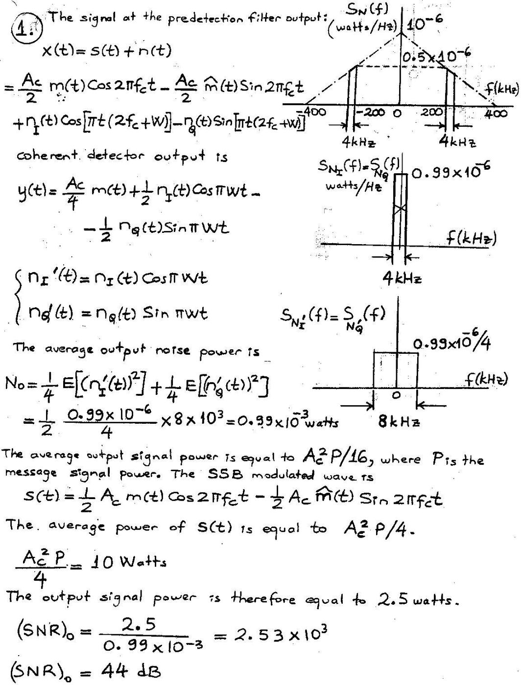
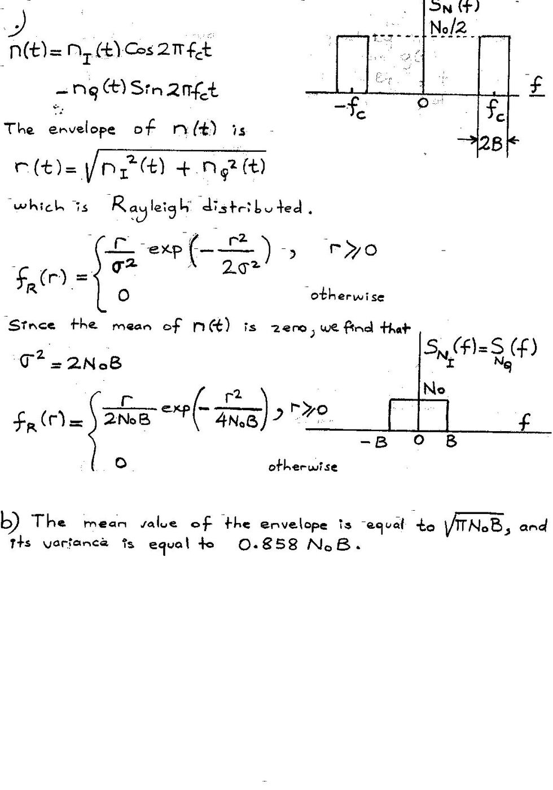
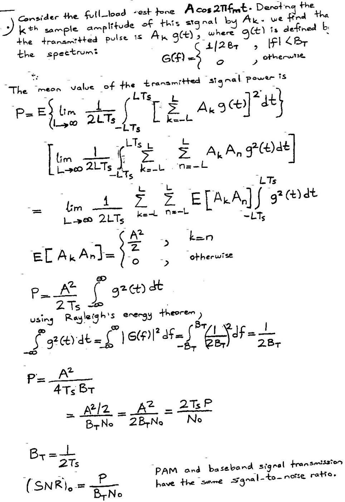
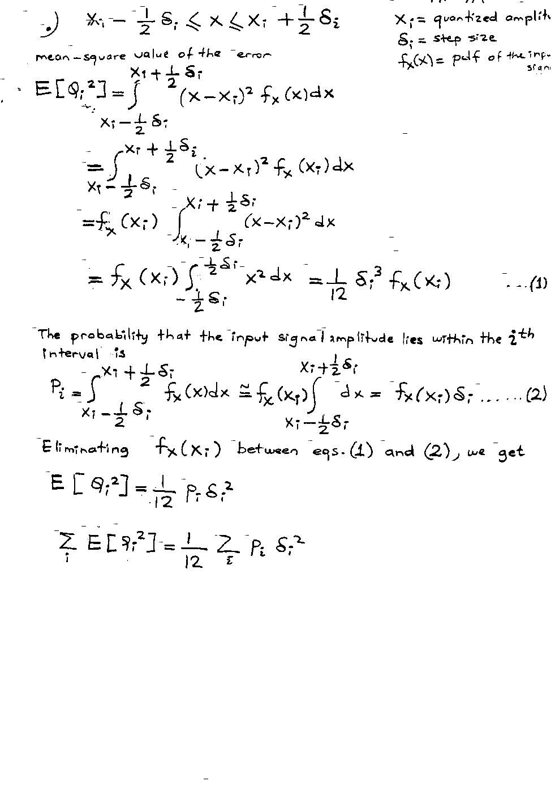

The 90-minute EEM 442 "Communication Systems II" second midterm exam of the Department of Electrical and Electronics Engineering at Başkent University, dated May 29, 2001. This exam belongs to the Communications II (EEM 442) course; because it was found in the Communications I folder, it is published here under Communications I. The exam and the handwritten solutions are in English. The original exam pages and handwritten solutions can be downloaded as a PDF at the end of the post.

## Question 1: DSB-SC over a noisy channel

A DSB-SC signal is transmitted over a noisy channel whose power spectral density is as shown in the figure (10⁻⁶ W/Hz at f = 0, a triangle falling to zero at ±400 kHz). The message bandwidth is 4 kHz, the carrier is 200 kHz, and the average power of the modulated signal is 10 W. Find the signal-to-noise ratio at the receiver output.

**Solution.** Around 200 kHz the noise density is approximately 0.5 × 10⁻⁶ W/Hz; in the solution the density of the quadrature components is taken as S_NI = S_NQ = 0.99 × 10⁻⁶ W/Hz (the sum S_N(f+f_c) + S_N(f−f_c)). The output noise power is N₀ = 0.99 × 10⁻³ W, the output signal power is 2.5 W, and SNR₀ = 2.5/0.99 × 10⁻³ ≈ 2.53 × 10³, i.e. about 44 dB.

*Note: The handwritten solution uses an SSB model (s(t) = ½A_cm cos − ½A_cm̂ sin, power A_c²P/4 = 10 W) instead of DSB-SC. The same result would not hold for DSB-SC; although the question says DSB-SC, the solution is carried out under the assumption of an SSB receiver.*

## Question 2: Envelope of bandpass noise

The zero-mean Gaussian noise n(t) has a power spectral density consisting of two rectangles of height N₀/2 and width 2B centered at ±f_c. Find (a) the probability density function of the envelope of n(t), and (b) the mean and variance of the envelope.

**Solution.** n(t) = n_I cos 2πf_ct − n_Q sin 2πf_ct; the envelope r = √(n_I² + n_Q²) is Rayleigh distributed. Since the variance of n_I and n_Q is σ² = 2N₀B,

f_R(r) = (r/(2N₀B))·exp(−r²/(4N₀B)), r ≥ 0.

(b) The mean is √(πN₀B) and the variance is 0.858 N₀B.

## Question 3: PAM and baseband

PAM is transmitted over a minimum-bandwidth (B_T = 1/(2T_s)) channel with white Gaussian noise; the noise has zero mean and density N₀/2. The PAM uses the standard pulse g(t): G(f) = 1/(2B_T), |f| < B_T. For fully loaded sinusoidal modulation, show that PAM and baseband transmission give equal SNR at the same average transmitted power.

**Solution.** The amplitude of the k-th sample is A_k, and the pulse is A_kg(t). Taking E[A_kA_n] = A²/2 (for k = n) and zero (otherwise), the average transmitted power is P = (A²/2T_s)∫g²(t)dt; since ∫g²dt = 1/(2B_T) by Rayleigh's energy theorem, P = A²/(4T_sB_T). SNR₀ = (A²/2)/(B_TN₀) = A²/(2B_TN₀) = 2T_sP/N₀, and since B_T = 1/(2T_s), SNR₀ = P/(B_TN₀): the same as for baseband transmission.

## Question 4: Nonuniform quantizer

Show that for a nonuniform quantizer the mean-square quantization error is approximately (1/12)ΣΔᵢ²pᵢ (Δᵢ: size of the i-th step, pᵢ: probability that the input amplitude lies in the i-th interval; the steps are small relative to the input range).

**Solution.** In the i-th interval the error is q_i = x − xᵢ, |q_i| ≤ Δᵢ/2. E[q_i²] = ∫(x − xᵢ)²f_X(x)dx ≈ f_X(xᵢ)∫(x−xᵢ)²dx = (1/12)Δᵢ³f_X(xᵢ). Since pᵢ ≈ f_X(xᵢ)Δᵢ, eliminating f_X(xᵢ) gives E[q_i²] = (1/12)pᵢΔᵢ²; the total is ΣE[q_i²] = (1/12)ΣpᵢΔᵢ².

