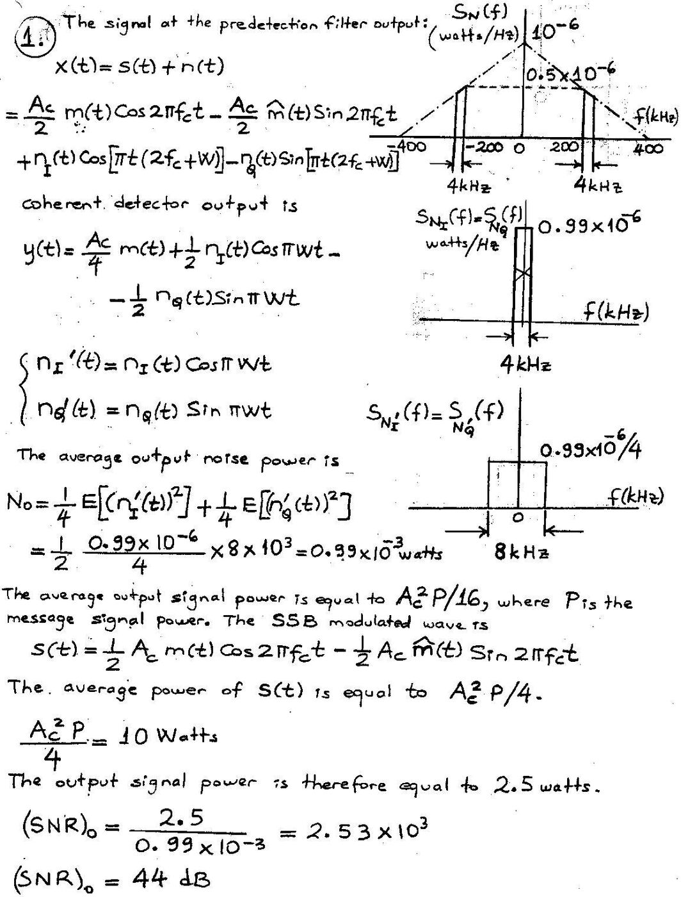
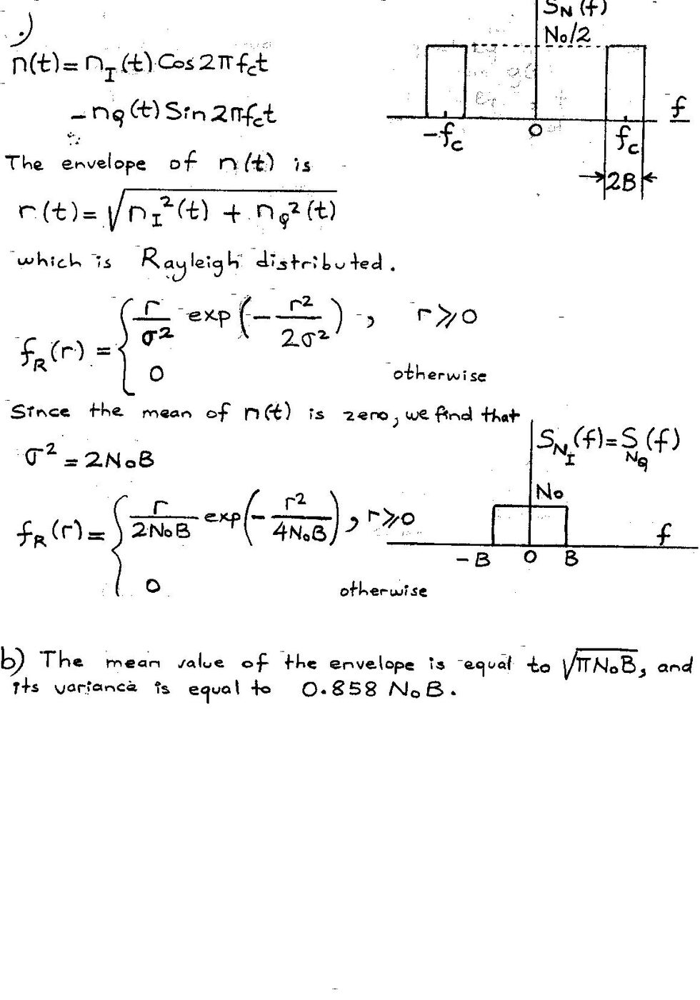
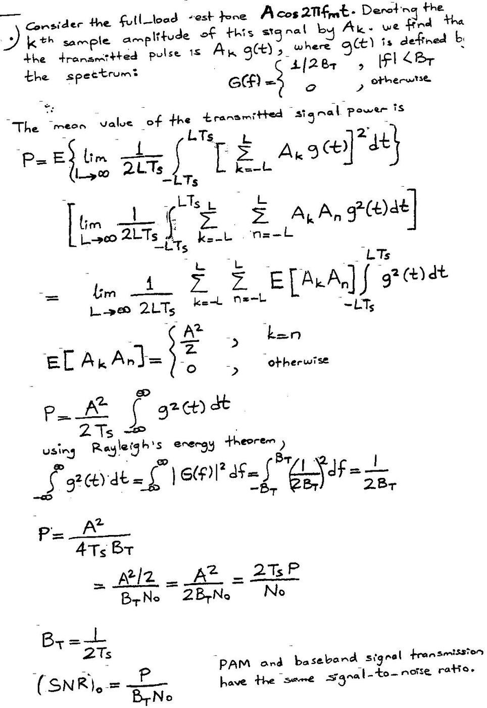
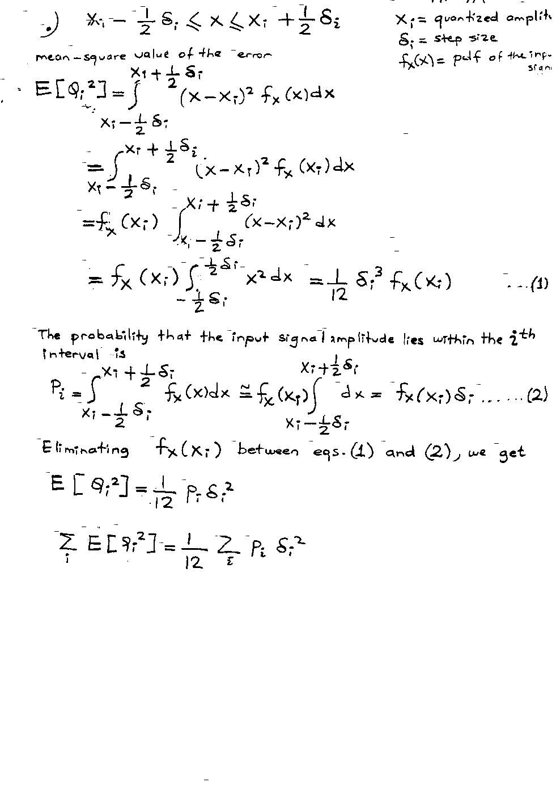

Başkent Üniversitesi Elektrik-Elektronik Mühendisliği Bölümü'nün 29 Mayıs 2001 tarihli, 90 dakikalık EEM 442 "Communication Systems II" ikinci ara sınavı. Bu sınav Haberleşme II (EEM 442) dersine aittir; Haberleşme I klasöründe bulunduğu için burada, Haberleşme I altında yayımlanmıştır. Sınav ve el yazısı çözümler İngilizce. Orijinal sınav sayfaları ve el yazısı çözümler yazının sonundaki PDF olarak indirilebilir.

## Soru 1: Gürültülü kanalda DSB-SC

DSB-SC işaret, güç spektral yoğunluğu şekildeki gibi (f = 0'da 10⁻⁶ W/Hz, ±400 kHz'te sıfıra inen üçgen) olan gürültülü bir kanaldan iletiliyor. Mesaj bant genişliği 4 kHz, taşıyıcı 200 kHz, modüleli işaretin ortalama gücü 10 W. Alıcı çıkışındaki işaret-gürültü oranını bulun.

**Çözüm.** 200 kHz çevresinde gürültü yoğunluğu yaklaşık 0,5 × 10⁻⁶ W/Hz'dir; çözümde dik bileşenlerin yoğunluğu S_NI = S_NQ = 0,99 × 10⁻⁶ W/Hz alınmıştır (S_N(f+f_c) + S_N(f−f_c) toplamı). Çıkış gürültü gücü N₀ = 0,99 × 10⁻³ W, çıkış işaret gücü 2,5 W ve SNR₀ = 2,5/0,99 × 10⁻³ ≈ 2,53 × 10³, yani yaklaşık 44 dB bulunur.

*Not: El yazısı çözüm, DSB-SC yerine SSB modeli (s(t) = ½A_cm cos − ½A_cm̂ sin, güç A_c²P/4 = 10 W) kullanıyor. DSB-SC için aynı sonuç geçerli olmaz; soru DSB-SC dese de çözüm SSB alıcı varsayımıyla yürütülmüştür.*

## Soru 2: Bant geçiren gürültünün zarfı

Sıfır ortalamalı Gaussian gürültü n(t), güç spektral yoğunluğu ±f_c çevresinde N₀/2 yüksekliğinde ve 2B genişliğinde iki dikdörtgendir. (a) n(t)'nin zarfının olasılık yoğunluk fonksiyonunu, (b) zarfın ortalamasını ve varyansını bulun.

**Çözüm.** n(t) = n_I cos 2πf_ct − n_Q sin 2πf_ct; zarf r = √(n_I² + n_Q²) Rayleigh dağılımlıdır. n_I ve n_Q'nun varyansı σ² = 2N₀B olduğundan

f_R(r) = (r/(2N₀B))·exp(−r²/(4N₀B)), r ≥ 0.

(b) Ortalama √(πN₀B), varyans 0,858 N₀B.

## Soru 3: PAM ve temel bant

Beyaz Gaussian gürültülü, asgari bant genişlikli (B_T = 1/(2T_s)) bir kanaldan PAM iletiliyor; gürültü sıfır ortalamalı, yoğunluk N₀/2. PAM standart g(t) darbesini kullanıyor: G(f) = 1/(2B_T), |f| < B_T. Tam yüklü sinüzoidal modülasyon için, aynı ortalama iletilen güçte PAM ve temel bant iletimin eşit SNR verdiğini gösterin.

**Çözüm.** k. örnek genliği A_k, darbe A_kg(t). Ortalama iletilen güç, E[A_kA_n] = A²/2 (k = n için) ve sıfır (diğer durumlarda) alınarak P = (A²/2T_s)∫g²(t)dt bulunur; Rayleigh enerji teoreminden ∫g²dt = 1/(2B_T) olduğundan P = A²/(4T_sB_T). SNR₀ = (A²/2)/(B_TN₀) = A²/(2B_TN₀) = 2T_sP/N₀ ve B_T = 1/(2T_s) olduğundan SNR₀ = P/(B_TN₀): temel bant iletimle aynı.

## Soru 4: Düzgün olmayan nicemleyici

Düzgün olmayan bir nicemleyicide nicemleme hatasının ortalama karesinin yaklaşık (1/12)ΣΔᵢ²pᵢ olduğunu gösterin (Δᵢ: i. adım büyüklüğü, pᵢ: giriş genliğinin i. aralıkta olma olasılığı; adımlar giriş genişliğine göre küçük).

**Çözüm.** i. aralıkta hata q_i = x − xᵢ, |q_i| ≤ Δᵢ/2. E[q_i²] = ∫(x − xᵢ)²f_X(x)dx ≈ f_X(xᵢ)∫(x−xᵢ)²dx = (1/12)Δᵢ³f_X(xᵢ). pᵢ ≈ f_X(xᵢ)Δᵢ olduğundan f_X(xᵢ) yok edilirse E[q_i²] = (1/12)pᵢΔᵢ²; toplam ΣE[q_i²] = (1/12)ΣpᵢΔᵢ².

