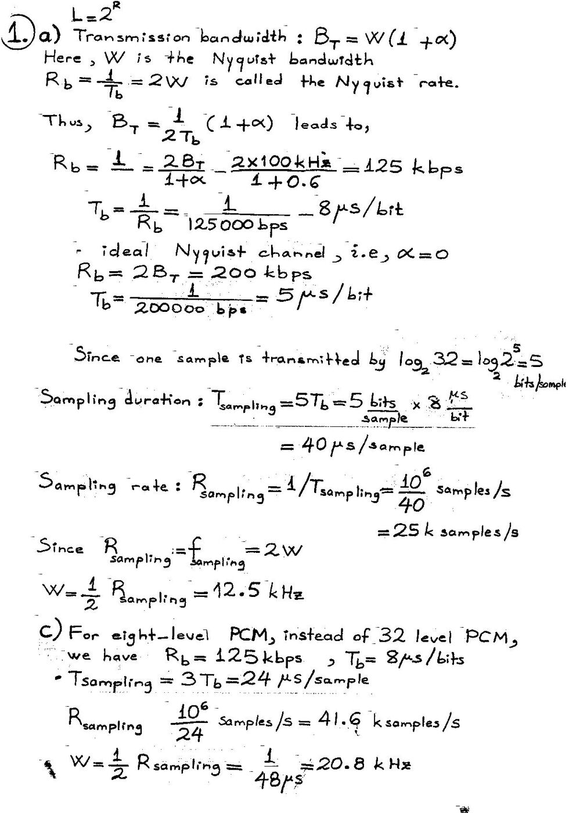
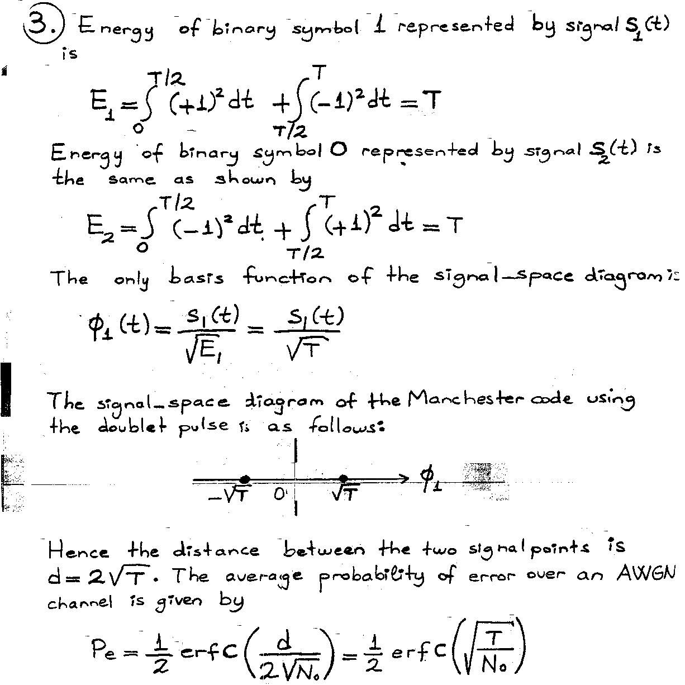
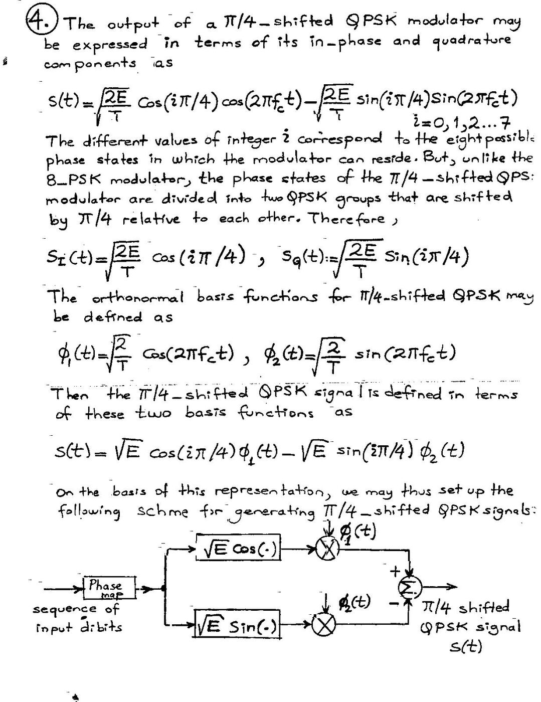

The 90-minute EEM 442 "Communication Systems II" second midterm exam of the Department of Electrical and Electronics Engineering at Başkent University, dated May 4, 2002. This exam belongs to the Communications II (EEM 442) course; because it was found in the Communications I folder, it is published here under Communications I. The exam and the handwritten solutions are in English. The original exam pages and the handwritten solutions can be downloaded as a PDF at the end of the post.

## Question 1: PCM and a raised cosine channel

An analog signal is converted to binary PCM and transmitted over a channel band-limited to 100 kHz. 32 quantization levels are used, and the overall equivalent transfer function is of the raised cosine type (α = 0.6). (a) The maximum PCM bit rate that can be used without producing ISI (note the difference between bit rate and symbol rate); (b) the maximum bandwidth of the analog signal; (c) (a) and (b) for 8-level PCM.

**Solution.** Since B_T = W(1 + α) and R_b = 2W, R_b = 2B_T/(1 + α) = 2 × 100 kHz/1.6 = 125 kbps (T_b = 8 µs/bit). (For the ideal Nyquist channel with α = 0, it is 200 kbps.) For 32 levels, 5 bits are needed per sample: the sampling period is 40 µs, the sampling rate is 25 kHz, and the signal bandwidth is W = 12.5 kHz. (c) For 8 levels, 3 bits/sample: 24 µs, 41.6 kHz sampling rate, W = 20.8 kHz.

## Question 2: Gaussian-shaped pulse

A digital system uses Gaussian pulses of the form x(t) = exp(−πa²t²). To reduce ISI, the condition x(T) = 0.01 is imposed (T: symbol interval). The bandwidth W of the pulse is defined as the value at which X(W)/X(0) = 0.01. Find W and compare it with a raised cosine spectrum with 100% rolloff factor.

**Solution.** X(f) = a⁻¹exp(−πf²/a²). X(W)/X(0) = 0.01 ⇒ W² = −(a²/π)ln 0.01; x(T) = 0.01 ⇒ T² = −ln(0.01)/(πa²). From the ratio of these two, WT = −ln(0.01)/π = 1.466 ⇒ W = 1.466/T. Since W = 1/T for a raised cosine with 100% rolloff factor, the Gaussian pulse requires more bandwidth.

## Question 3: Manchester code

In Manchester coding, binary 1 is represented by the doublet pulse s(t) shown in the figure (first half +1, second half −1), and 0 by its negative. Derive the error probability formula for maximum likelihood detection in an AWGN channel.

**Solution.** The energy of both symbols is E₁ = E₂ = T. The single basis function is φ₁ = s₁(t)/√T; in the signal space the points are at ±√T, and the distance between them is d = 2√T. In AWGN, the average error probability is

P_e = ½erfc(d/(2√N₀)) = ½erfc(√(T/N₀)).

## Question 4: π/4-shifted DQPSK

As in an ordinary QPSK modulator, the output of π/4-shifted DQPSK can be written in the form s(t) = s_I(t)cos(2πf_ct) − s_Q(t)sin(2πf_ct). Formulate s_I(t) and s_Q(t) and draw a diagram for generating the signal.

**Solution.** s(t) = √(2E/T)cos(iπ/4)cos(2πf_ct) − √(2E/T)sin(iπ/4)sin(2πf_ct), i = 0, 1, …, 7. The eight phase states split into two QPSK groups shifted by π/4 relative to each other. Thus s_I(t) = √(2E/T)cos(iπ/4), s_Q(t) = √(2E/T)sin(iπ/4). With the basis functions φ₁(t) = √(2/T)cos 2πf_ct, φ₂(t) = √(2/T)sin 2πf_ct, s(t) = √E cos(iπ/4)φ₁(t) − √E sin(iπ/4)φ₂(t). Generation diagram: input dibit sequence → phase mapping → √E cos(·) and √E sin(·) on two branches → multiplication by φ₁ and φ₂ → subtracting summer → π/4-shifted QPSK signal.

