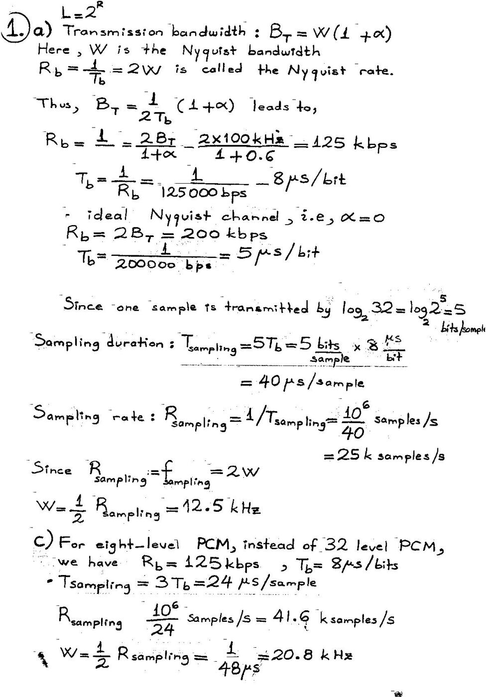
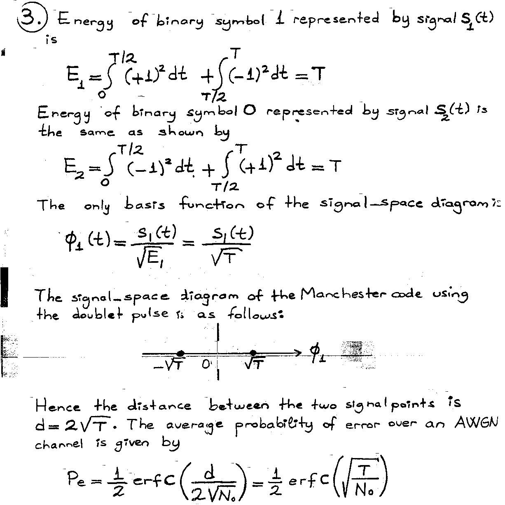
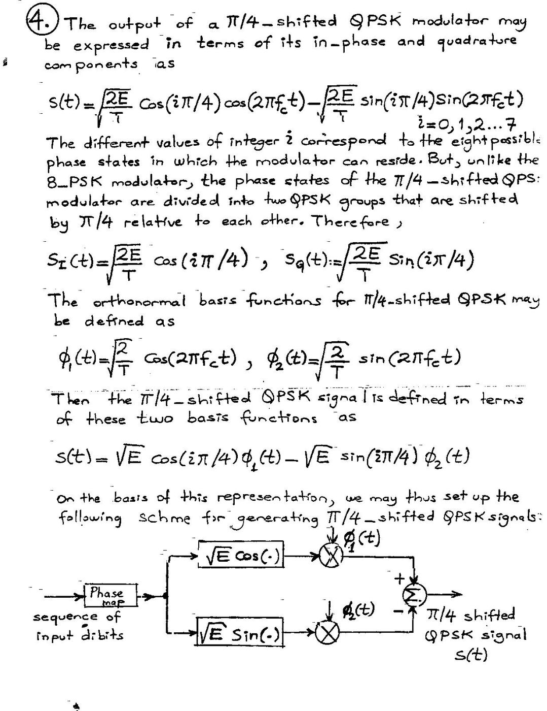

Başkent Üniversitesi Elektrik-Elektronik Mühendisliği Bölümü'nün 4 Mayıs 2002 tarihli, 90 dakikalık EEM 442 "Communication Systems II" ikinci ara sınavı. Bu sınav Haberleşme II (EEM 442) dersine aittir; Haberleşme I klasöründe bulunduğu için burada, Haberleşme I altında yayımlanmıştır. Sınav ve el yazısı çözümler İngilizce. Orijinal sınav sayfaları ve el yazısı çözümler yazının sonundaki PDF olarak indirilebilir.

## Soru 1: PCM ve yükseltilmiş kosinüs kanalı

Analog işaret ikili PCM'ye çevrilip 100 kHz ile bant sınırlı bir kanaldan iletiliyor. 32 nicemleme seviyesi kullanılıyor ve toplam eşdeğer aktarım fonksiyonu yükseltilmiş kosinüs tipinde (α = 0,6). (a) ISI oluşturmadan kullanılabilecek en büyük PCM bit hızı (bit hızı ve sembol hızı farkına dikkat); (b) analog işaretin en büyük bant genişliği; (c) 8 seviyeli PCM için (a) ve (b).

**Çözüm.** B_T = W(1 + α) ve R_b = 2W olduğundan R_b = 2B_T/(1 + α) = 2 × 100 kHz/1,6 = 125 kbps (T_b = 8 µs/bit). (α = 0 ideal Nyquist kanalında 200 kbps.) 32 seviye için örnek başına 5 bit gerekir: örnekleme süresi 40 µs, örnekleme hızı 25 kHz, işaret bant genişliği W = 12,5 kHz. (c) 8 seviye için 3 bit/örnek: 24 µs, 41,6 kHz örnekleme, W = 20,8 kHz.

## Soru 2: Gauss biçimli darbe

Sayısal sistemde x(t) = exp(−πa²t²) biçimli Gauss darbeleri kullanılıyor. ISI'yi azaltmak için x(T) = 0,01 koşulu konuyor (T: sembol aralığı). Darbenin W bant genişliği X(W)/X(0) = 0,01 olduğu değer olarak tanımlanıyor. W'yi bulun ve %100 yuvarlama faktörlü yükseltilmiş kosinüs spektrumuyla karşılaştırın.

**Çözüm.** X(f) = a⁻¹exp(−πf²/a²). X(W)/X(0) = 0,01 ⇒ W² = −(a²/π)ln 0,01; x(T) = 0,01 ⇒ T² = −ln(0,01)/(πa²). Bu ikisinin oranından WT = −ln(0,01)/π = 1,466 ⇒ W = 1,466/T. %100 yuvarlama faktörlü yükseltilmiş kosinüste W = 1/T olduğundan Gauss darbesi daha fazla bant genişliği ister.

## Soru 3: Manchester kodu

Manchester kodunda ikili 1, şekildeki çift (doublet) darbe s(t) ile (ilk yarı +1, ikinci yarı −1), 0 ise bunun negatifiyle gösteriliyor. AWGN kanalında en büyük olabilirlik (maximum likelihood) algılama için hata olasılığı formülünü türetin.

**Çözüm.** Her iki sembolün enerjisi E₁ = E₂ = T'dir. Tek taban fonksiyonu φ₁ = s₁(t)/√T; işaret uzayında noktalar ±√T'dedir, aralarındaki uzaklık d = 2√T. AWGN'de ortalama hata olasılığı

P_e = ½erfc(d/(2√N₀)) = ½erfc(√(T/N₀)).

## Soru 4: π/4 kaymalı DQPSK

Sıradan QPSK modülatörde olduğu gibi π/4 kaymalı DQPSK çıkışı s(t) = s_I(t)cos(2πf_ct) − s_Q(t)sin(2πf_ct) biçiminde yazılabilir. s_I(t) ve s_Q(t)'yi formüle edin ve işaretin üretimi için bir şema çizin.

**Çözüm.** s(t) = √(2E/T)cos(iπ/4)cos(2πf_ct) − √(2E/T)sin(iπ/4)sin(2πf_ct), i = 0, 1, …, 7. Sekiz faz durumu, birbirine göre π/4 kaymış iki QPSK grubuna ayrılır. Böylece s_I(t) = √(2E/T)cos(iπ/4), s_Q(t) = √(2E/T)sin(iπ/4). Taban fonksiyonları φ₁(t) = √(2/T)cos 2πf_ct, φ₂(t) = √(2/T)sin 2πf_ct ile s(t) = √E cos(iπ/4)φ₁(t) − √E sin(iπ/4)φ₂(t). Üretim şeması: giriş dibit dizisi → faz eşleme → iki koldan √E cos(·) ve √E sin(·) → φ₁ ve φ₂ ile çarpma → fark alıcı toplayıcı → π/4 kaymalı QPSK işareti.

