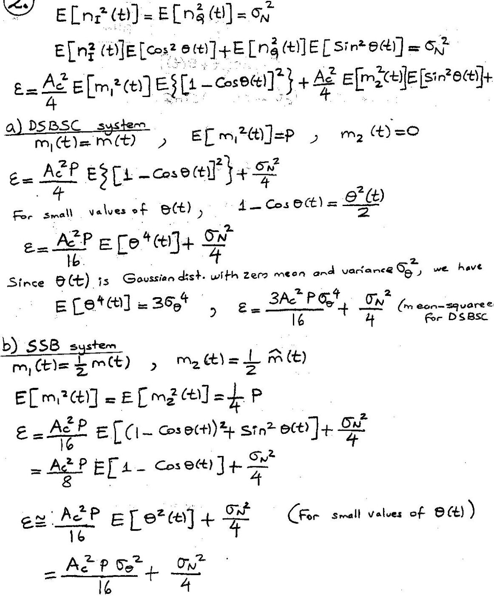
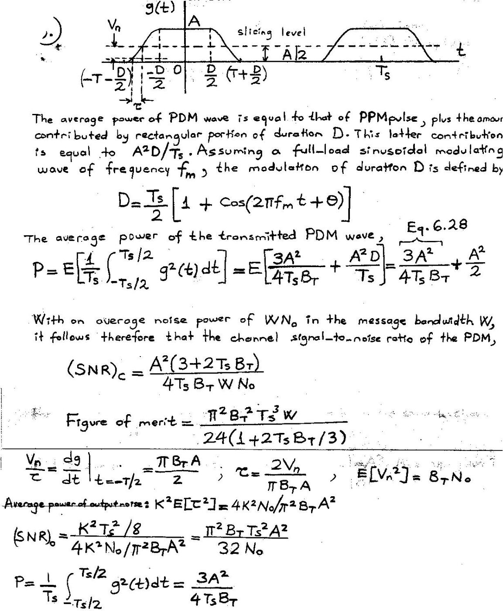
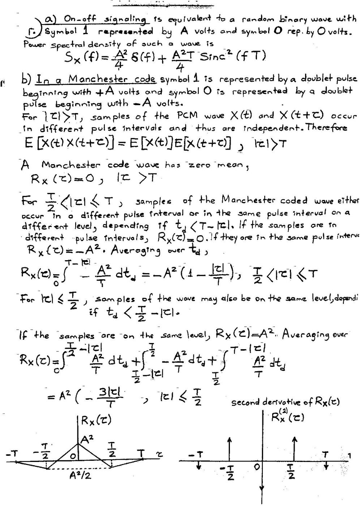
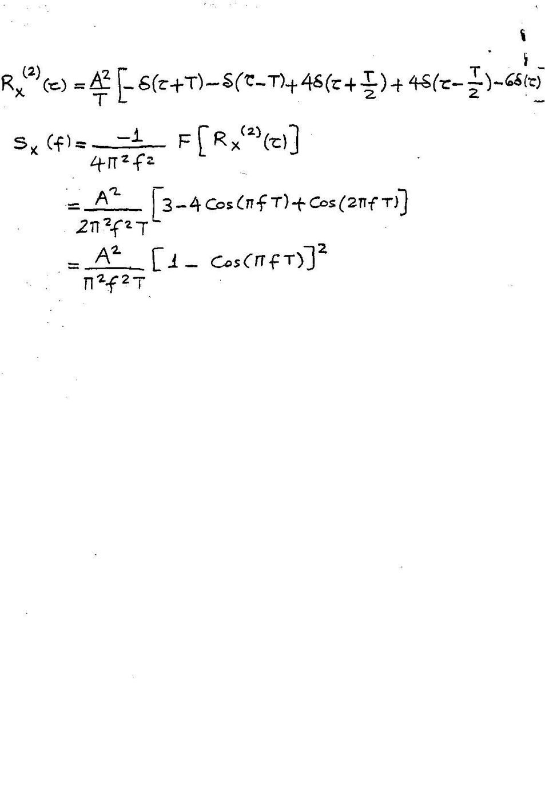

The 120-minute EEM 442 "Communication Systems II" final exam of the Başkent University Department of Electrical and Electronics Engineering, dated June 4, 2001. This exam belongs to the Communications II (EEM 442) course; because it was in the Communications I folder, it is published here under Communications I. The exam (two pages) and the six pages of handwritten solutions are in English; part (b) of the fourth question is completed in the solution pages, while part (c) of question 3 (comparison with PPM) does not appear in the solution pages. The original exam pages and the handwritten solutions can be downloaded as a PDF at the end of the post.

## Question 1: Quadrature Components of Narrowband Noise

The power spectral density of the narrowband noise n(t) is as shown in the figure: carrier frequency 5 Hz, S_N(f) = triangles with a peak of 1.0, over 4–7 Hz and over −7…−4 Hz (peak at 5 Hz). Find (a) the power spectral densities of the in-phase and quadrature components, and (b) their cross spectral densities.

**Solution.** For −B ≤ f ≤ B, S_NI(f) = S_NQ(f) = S_N(f + f_c) + S_N(f − f_c). For −2…2 Hz, the two shifted triangles are added: the result is a piecewise-linear spectrum that is 2.0 at f = 0, 0.5 at ±1 Hz, and 0 at ±2 Hz. The cross spectral density is found from S_NINQ(f) = j[S_N(f + f_c) − S_N(f − f_c)]; for f ≥ 0 this gives a curve with a peak of 0.5j at 1 Hz, and for f ≤ 0 its sign-reversed form, i.e. an odd-symmetric curve (S_NINQ(f) = S*_NINQ(f)).

 and the cross spectrum")

## Question 2: Coherent Demodulation with Phase Error

In the coherent demodulator, the local oscillator carries a phase error θ(t) relative to cos(2πf_ct); θ(t) is a zero-mean Gaussian process with variance σ_θ², and most of the time |θ| ≪ 1. Find the mean-square error at the receiver output for (a) DSB-SC and (b) SSB (error: the expected value of the square of the difference between the receiver output and the message component).

**Solution.** Write s(t) = A_c[m₁(t)cos 2πf_ct − m₂(t)sin 2πf_ct]; for DSB-SC, m₁ = m, m₂ = 0; for upper-sideband SSB, m₁ = ½m, m₂ = ½m̂. The mixer and low-pass filter output is

y(t) = ½[A_cm₁ + n_c]cos θ + ½[A_cm₂ + n_s]sin θ

and the error is e = y − (A_c/2)m₁. For small θ, using 1 − cos θ ≈ θ²/2:

- (a) DSB-SC: ε = (3A_c²Pσ_θ⁴)/16 + σ_N²/4. (E[θ⁴] = 3σ_θ⁴; P is the message power.)
- (b) SSB: ε ≈ (A_c²Pσ_θ²)/16 + σ_N²/4.

That is, in DSB-SC the error is proportional to the square of the phase variance, while in SSB it is proportional to the variance itself.

## Question 3: PDM

The PDM pulse consists of a rectangular pulse of duration D, preceded and followed by sloped portions identical to halves of the PPM pulse; at the receiver the slicing level is half the peak amplitude. Apart from a small shift τ in the edge detection time, all noise effects are eliminated, and one of the edges is fixed by a noise-free reference. Find (a) the output SNR of PDM and (b) the channel SNR. (c) Compare the figure of merit with that of PPM.

**Solution.** For fully loaded sinusoidal modulation, D = (T_s/2)[1 + cos(2πf_mt + θ)]. The average power of PDM is the power of PPM plus the contribution A²D/T_s of the rectangular portion: P = 3A²/(4T_sB_T) + A²/2. The channel SNR is (SNR)_c = A²(3 + 2T_sB_T)/(4T_sB_TWN₀). The output SNR is (SNR)₀ = π²B_TT_s²A²/(32N₀). The figure of merit is

π²B_T²T_s³W / [24(1 + 2T_sB_T/3)].

## Question 4: PCM Power Spectral Density

Given that 1s and 0s are equally likely and adjacent time slots are statistically independent, find and plot the power spectral density of the PCM wave for (a) on-off signaling and (b) the Manchester code.

**Solution.** (a) On-off signaling is a random binary wave in which a 1 is represented by A volts and a 0 by zero volts:

S_x(f) = (A²/4)δ(f) + (A²T/4)sinc²(fT).

(b) In the Manchester code, a 1 is a pair of pulses starting with +A, and a 0 is a pair of pulses starting with −A; the mean of the wave is zero. For |τ| > T, R_x(τ) = 0; for T/2 < |τ| ≤ T, R_x(τ) = −A²(1 − |τ|/T); for |τ| ≤ T/2, R_x(τ) = A²(1 − 3|τ|/T). The second derivative of R_x consists of impulses:

R_x⁽²⁾(τ) = (A²/T)[−δ(τ+T) − δ(τ−T) + 4δ(τ+T/2) + 4δ(τ−T/2) − 6δ(τ)]

and taking S_x(f) = −F[R_x⁽²⁾]/(4π²f²) gives

S_x(f) = A²/(π²f²T)·[1 − cos(πfT)]²

The spectrum is zero at f = 0 (it contains no DC).

