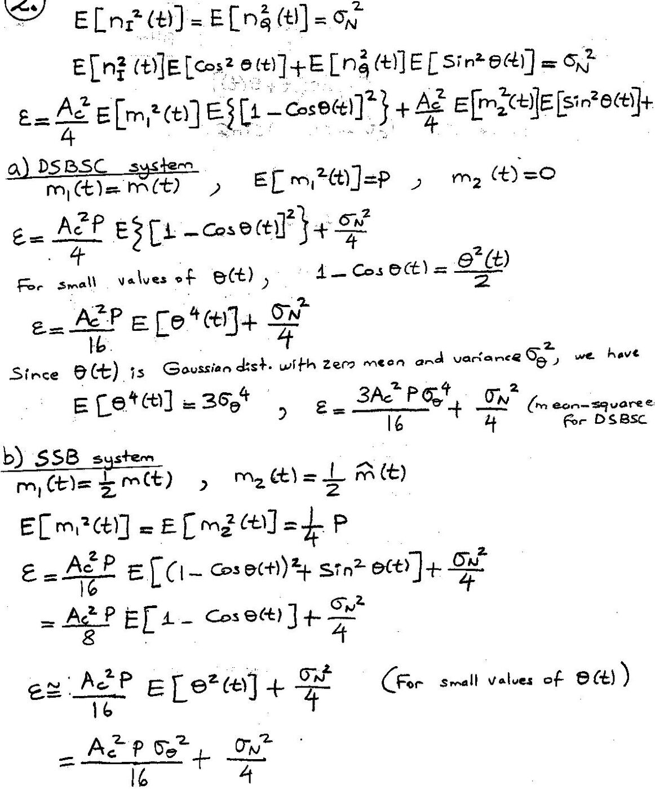
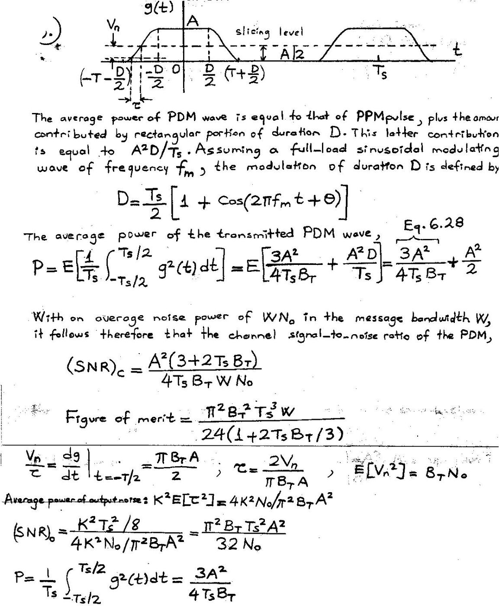
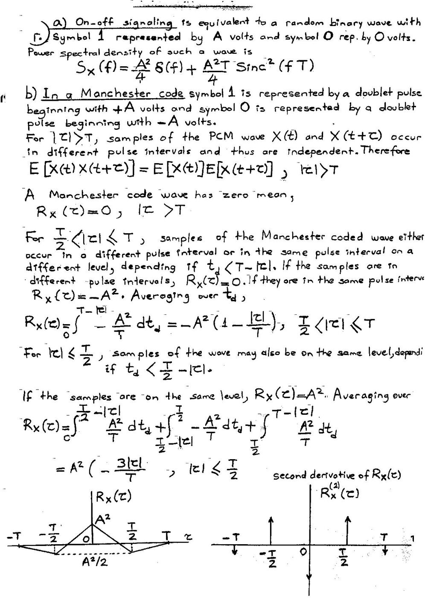
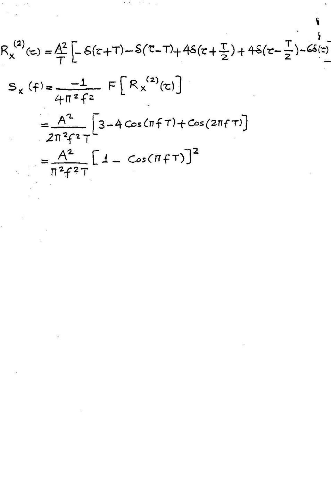

Başkent Üniversitesi Elektrik-Elektronik Mühendisliği Bölümü'nün 4 Haziran 2001 tarihli, 120 dakikalık EEM 442 "Communication Systems II" final sınavı. Bu sınav Haberleşme II (EEM 442) dersine aittir; Haberleşme I klasöründe bulunduğu için burada, Haberleşme I altında yayımlanmıştır. Sınav (iki sayfa) ve altı sayfa el yazısı çözüm İngilizcedir; dördüncü sorunun (b) şıkkı çözüm sayfalarında tamamlanmıştır, 3. sorunun (c) şıkkı (PPM ile karşılaştırma) çözüm sayfalarında yer almamaktadır. Orijinal sınav sayfaları ve el yazısı çözümler yazının sonundaki PDF olarak indirilebilir.

## Soru 1: Dar bant gürültünün dik bileşenleri

Dar bant gürültü n(t)'nin güç spektral yoğunluğu şekildeki gibi: taşıyıcı frekansı 5 Hz, S_N(f) = 1,0 tepeli, 4–7 Hz arası ve −7…−4 Hz arası üçgenler (tepe 5 Hz'de). (a) Dik (in-phase) ve karesel bileşenlerin güç spektral yoğunluklarını, (b) çapraz spektral yoğunluklarını bulun.

**Çözüm.** −B ≤ f ≤ B aralığında S_NI(f) = S_NQ(f) = S_N(f + f_c) + S_N(f − f_c). −2…2 Hz için iki kaydırılmış üçgen toplanır: f = 0'da 2,0, ±1 Hz'de 0,5, ±2 Hz'de 0 olan kırık çizgili bir spektrum elde edilir. Çapraz spektral yoğunluk S_NINQ(f) = j[S_N(f + f_c) − S_N(f − f_c)] ile bulunur; f ≥ 0 için tepesi 1 Hz'de 0,5j olan, f ≤ 0 için bunun işaret değiştirmiş biçimi olan tek simetrili bir eğri verir (S_NINQ(f) = S*_NINQ(f)).

 ve çapraz spektrum")

## Soru 2: Evre hatalı uyumlu demodülasyon

Uyumlu demodülatörde yerel osilatör cos(2πf_ct)'ye göre θ(t) evre hatası taşıyor; θ(t) sıfır ortalamalı, varyansı σ_θ² olan Gaussian bir süreç ve çoğu zaman |θ| ≪ 1. Alıcı çıkışının ortalama kare hatasını (a) DSB-SC ve (b) SSB için bulun (hata: alıcı çıkışı ile mesaj bileşeni arasındaki farkın karesinin beklenen değeri).

**Çözüm.** s(t) = A_c[m₁(t)cos 2πf_ct − m₂(t)sin 2πf_ct] biçiminde, DSB-SC için m₁ = m, m₂ = 0; üst yan bant SSB için m₁ = ½m, m₂ = ½m̂. Karıştırıcı ve alçak geçiren süzgeç çıkışı

y(t) = ½[A_cm₁ + n_c]cos θ + ½[A_cm₂ + n_s]sin θ

olur; hata e = y − (A_c/2)m₁. Küçük θ için 1 − cos θ ≈ θ²/2 kullanılarak:

- (a) DSB-SC: ε = (3A_c²Pσ_θ⁴)/16 + σ_N²/4. (E[θ⁴] = 3σ_θ⁴; P mesaj gücü.)
- (b) SSB: ε ≈ (A_c²Pσ_θ²)/16 + σ_N²/4.

Yani DSB-SC'de hata evre varyansının karesiyle, SSB'de ise varyansın kendisiyle orantılıdır.

## Soru 3: PDM

PDM darbesi, süresi D olan dikdörtgen bir darbenin önünde ve arkasında PPM darbesinin yarılarıyla aynı eğimli kısımlardan oluşur; alıcıda kesme seviyesi tepe genliğinin yarısıdır. Kenar algılama zamanındaki küçük τ kayması dışında tüm gürültü etkisi giderilir ve kenarlardan biri gürültüsüz bir referansla sabitlenmiştir. (a) PDM'nin çıkış SNR'sini, (b) kanal SNR'sini bulun. (c) Kalite faktörünü PPM ile karşılaştırın.

**Çözüm.** Tam yüklü sinüzoidal modülasyon için D = (T_s/2)[1 + cos(2πf_mt + θ)]. PDM'nin ortalama gücü PPM'nin gücüne dikdörtgen kısmın A²D/T_s katkısını ekler: P = 3A²/(4T_sB_T) + A²/2. Kanal SNR'si (SNR)_c = A²(3 + 2T_sB_T)/(4T_sB_TWN₀). Çıkış SNR'si (SNR)₀ = π²B_TT_s²A²/(32N₀). Kalite faktörü

π²B_T²T_s³W / [24(1 + 2T_sB_T/3)].

## Soru 4: PCM güç spektral yoğunluğu

1'ler ve 0'lar eşit olasılıklı ve komşu zaman aralıkları istatistiksel bağımsız olduğuna göre PCM dalgasının güç spektral yoğunluğunu (a) aç-kapa (on-off) işaretleme ve (b) Manchester kodu için bulup çizin.

**Çözüm.** (a) On-off işaretleme, 1'i A volt, 0'ı sıfır volt gösteren rastgele ikili dalgadır:

S_x(f) = (A²/4)δ(f) + (A²T/4)sinc²(fT).

(b) Manchester kodunda 1, +A ile başlayan çift darbe, 0 ise −A ile başlayan çift darbedir; dalganın ortalaması sıfırdır. |τ| > T için R_x(τ) = 0; T/2 < |τ| ≤ T için R_x(τ) = −A²(1 − |τ|/T); |τ| ≤ T/2 için R_x(τ) = A²(1 − 3|τ|/T). R_x'in ikinci türevi dürtülerden oluşur:

R_x⁽²⁾(τ) = (A²/T)[−δ(τ+T) − δ(τ−T) + 4δ(τ+T/2) + 4δ(τ−T/2) − 6δ(τ)]

ve S_x(f) = −F[R_x⁽²⁾]/(4π²f²) alınarak

S_x(f) = A²/(π²f²T)·[1 − cos(πfT)]²

bulunur. Spektrum f = 0'da sıfırdır (DC içermez).

