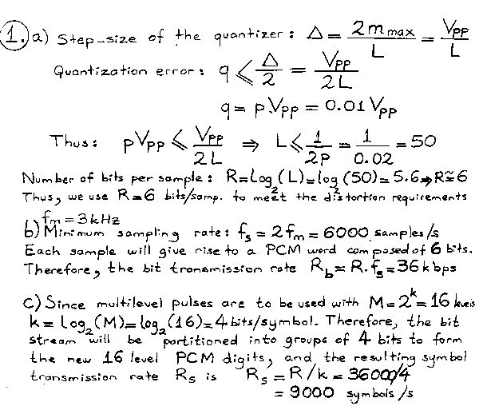
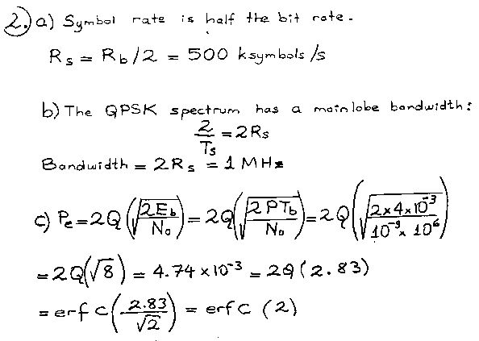
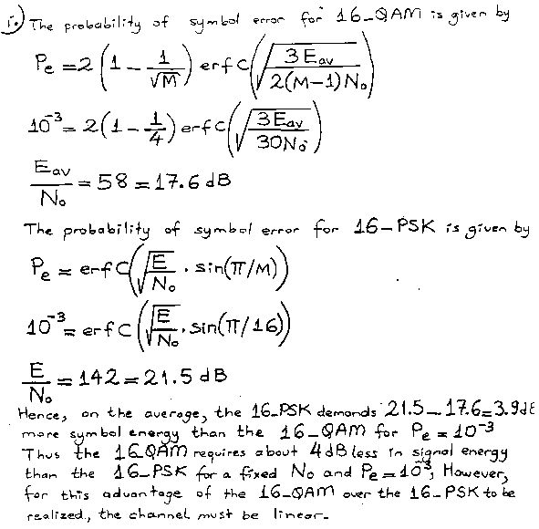
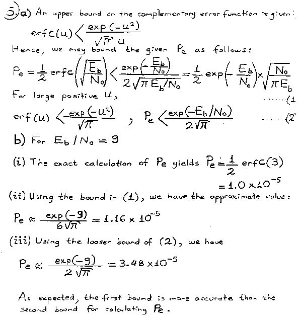

The 120-minute EEM 442 "Communication Systems 2" final exam of the Başkent University Department of Electrical and Electronics Engineering, dated June 10, 2002. This exam belongs to the Communications II (EEM 442) course; because it was found in the Communications I folder, it is published here, under Communications I. The exam is two pages, and the handwritten solutions are five pages; all are in English. The original exam pages and the handwritten solutions can be downloaded as a PDF at the end of the post.

## Question 1: PCM

An analog signal with maximum frequency f_m = 3 kHz is to be transmitted in a system with M = 16 pulse levels; the quantization error must not exceed ±1% of the peak-to-peak amplitude. (a) The minimum number of bits per sample (number of bits in the PCM word), (b) the minimum sampling rate and transmission rate, (c) the PCM pulse (symbol) rate.

**Solution.** (a) Step size Δ = V_pp/L, error q ≤ Δ/2 = V_pp/(2L) and q = 0.01 V_pp ⇒ L ≤ 50; R = log₂50 = 5.6 ⇒ 6 bits/sample. (b) f_s = 2f_m = 6000 samples/s; R_b = 6 × 6000 = 36 kbps. (c) For pulses with M = 16 levels, k = log₂16 = 4 bits/symbol; R_s = 36000/4 = 9000 symbols/s.

## Question 2: QPSK

A 1 Mbps bit stream is transmitted using QPSK; the even- and odd-indexed bits are assigned to two orthogonal carriers. (a) The symbol rate, (b) the required channel bandwidth if only the main lobe of the spectrum is to be passed, (c) the symbol error probability if the carrier power is 4 mW and N₀ = 10⁻⁹ W/Hz.

**Solution.** (a) R_s = R_b/2 = 500 ksymbols/s. (b) The main lobe width is 2/T_s = 2R_s ⇒ 1 MHz. (c) P_e = 2Q(√(2E_b/N₀)) = 2Q(√(2PT_b/N₀)) = 2Q(√(2 × 4×10⁻³/(10⁻⁹ × 10⁶))) = 2Q(√8) = 2Q(2.83) ≈ 4.74 × 10⁻³.

## Question 3: 256-QAM and 64-QAM

Determine the reduction in transmission bandwidth and the average signal energy of 256-QAM relative to 64-QAM.

**Solution.** B = 2R_b/log₂M. For 256-QAM, B₂₅₆ = 1/(4T_b), and for 64-QAM, B₆₄ = 1/(3T_b): the bandwidth saving is 1/(12T_b). Average energy E = 2(M − 1)E₀/3: E₂₅₆ = 170E₀, E₆₄ = 42E₀ ⇒ 10log(170/42) ≈ 6 dB more energy.

## Question 4: 16-PSK and 16-QAM

Compare the SNR requirements of the two systems for an average symbol error probability of 10⁻³.

**Solution.** For 16-QAM, P_e = 2(1 − 1/√M)erfc(√(3E_av/(2(M−1)N₀))) ⇒ E_av/N₀ = 58 (17.6 dB). For 16-PSK, P_e = erfc(√(E/N₀)·sin(π/M)) ⇒ E/N₀ = 142 (21.5 dB). On average, 16-PSK requires about 3.9 dB (≈ 4 dB) more symbol energy; the channel must be linear for this advantage to be realized.

## Question 5: Error function bounds

For two antipodal signals, P_e = 0.5·erfc(√(E_b/N₀)). (a) Using the two upper bounds on erfc, derive approximate expressions for P_e. (b) For E_b/N₀ = 9, compare the approximations with the exact formula (from the erf table).

**Solution.** With erfc(u) < exp(−u²)/(√π·u), P_e < (1/2)exp(−E_b/N₀)·√(N₀/(πE_b)); with the looser bound, P_e < exp(−E_b/N₀)/(2√π). For E_b/N₀ = 9, the exact value is P_e = ½erfc(3) ≈ 1.0 × 10⁻⁵; the first bound gives 1.16 × 10⁻⁵ and the second bound gives 3.48 × 10⁻⁵. As expected, the first bound is more accurate.

