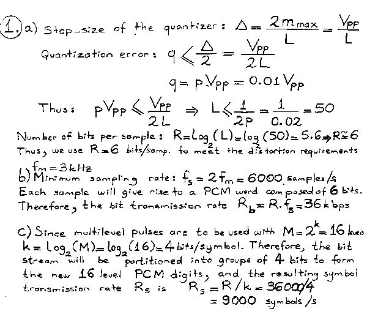
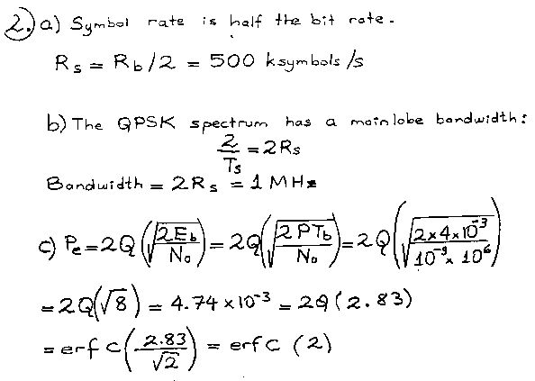
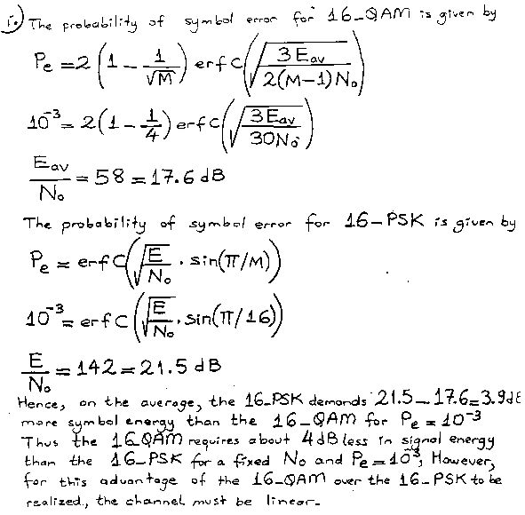
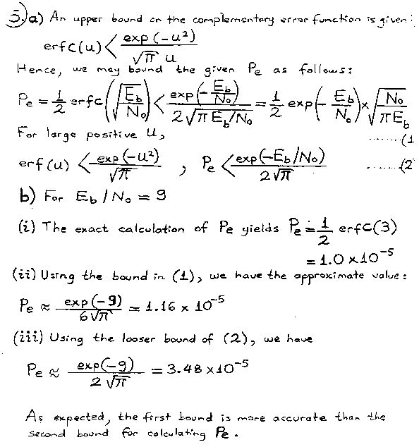

Başkent Üniversitesi Elektrik-Elektronik Mühendisliği Bölümü'nün 10 Haziran 2002 tarihli, 120 dakikalık EEM 442 "Communication Systems 2" final sınavı. Bu sınav Haberleşme II (EEM 442) dersine aittir; Haberleşme I klasöründe bulunduğu için burada, Haberleşme I altında yayımlanmıştır. Sınav iki sayfa, el yazısı çözümler beş sayfadır; hepsi İngilizcedir. Orijinal sınav sayfaları ve el yazısı çözümler yazının sonundaki PDF olarak indirilebilir.

## Soru 1: PCM

En yüksek frekansı f_m = 3 kHz olan analog işaret M = 16 darbe seviyeli bir sistemde iletilecek; nicemleme hatası tepeden tepeye genliğin ±%1'ini aşmayacak. (a) Gereken en küçük bit/örnek (PCM sözcüğü bit sayısı), (b) en küçük örnekleme hızı ve iletim hızı, (c) PCM darbe (sembol) hızı.

**Çözüm.** (a) Adım Δ = V_pp/L, hata q ≤ Δ/2 = V_pp/(2L) ve q = 0,01 V_pp ⇒ L ≤ 50; R = log₂50 = 5,6 ⇒ 6 bit/örnek. (b) f_s = 2f_m = 6000 örnek/s; R_b = 6 × 6000 = 36 kbps. (c) M = 16 seviyeli darbeler için k = log₂16 = 4 bit/sembol; R_s = 36000/4 = 9000 sembol/s.

## Soru 2: QPSK

1 Mbps'lik bit akışı QPSK ile iletiliyor; çift ve tek sıralı bitler iki dik taşıyıcıya bağlanıyor. (a) Sembol hızı, (b) yalnız spektrumun ana lobu geçirilecekse gereken kanal bant genişliği, (c) taşıyıcı gücü 4 mW ve N₀ = 10⁻⁹ W/Hz ise sembol hata olasılığı.

**Çözüm.** (a) R_s = R_b/2 = 500 ksembol/s. (b) Ana lob genişliği 2/T_s = 2R_s ⇒ 1 MHz. (c) P_e = 2Q(√(2E_b/N₀)) = 2Q(√(2PT_b/N₀)) = 2Q(√(2 × 4×10⁻³/(10⁻⁹ × 10⁶))) = 2Q(√8) = 2Q(2,83) ≈ 4,74 × 10⁻³.

## Soru 3: 256-QAM ve 64-QAM

256-QAM'ın 64-QAM'a göre iletim bant genişliği azalmasını ve ortalama işaret enerjisini belirleyin.

**Çözüm.** B = 2R_b/log₂M. 256-QAM için B₂₅₆ = 1/(4T_b), 64-QAM için B₆₄ = 1/(3T_b): bant genişliği kazancı 1/(12T_b). Ortalama enerji E = 2(M − 1)E₀/3: E₂₅₆ = 170E₀, E₆₄ = 42E₀ ⇒ 10log(170/42) ≈ 6 dB daha fazla enerji.

## Soru 4: 16-PSK ve 16-QAM

Ortalama sembol hata olasılığı 10⁻³ için iki sistemin SNR gereksinimlerini karşılaştırın.

**Çözüm.** 16-QAM için P_e = 2(1 − 1/√M)erfc(√(3E_av/(2(M−1)N₀))) ⇒ E_av/N₀ = 58 (17,6 dB). 16-PSK için P_e = erfc(√(E/N₀)·sin(π/M)) ⇒ E/N₀ = 142 (21,5 dB). 16-PSK ortalama olarak yaklaşık 3,9 dB (≈ 4 dB) daha fazla sembol enerjisi ister; bu avantajın gerçekleşmesi için kanalın doğrusal olması gerekir.

## Soru 5: Hata fonksiyonu sınırları

Zıt (antipodal) iki işaret için P_e = 0,5·erfc(√(E_b/N₀)). (a) erfc'nin iki üst sınırını kullanarak P_e için yaklaşık ifadeleri türetin. (b) E_b/N₀ = 9 için yaklaşıkları kesin formülle karşılaştırın (erf tablosundan).

**Çözüm.** erfc(u) < exp(−u²)/(√π·u) ile P_e < (1/2)exp(−E_b/N₀)·√(N₀/(πE_b)); daha gevşek sınırla P_e < exp(−E_b/N₀)/(2√π). E_b/N₀ = 9 için kesin değer P_e = ½erfc(3) ≈ 1,0 × 10⁻⁵; birinci sınır 1,16 × 10⁻⁵, ikinci sınır 3,48 × 10⁻⁵ verir. Beklendiği gibi birinci sınır daha doğrudur.

