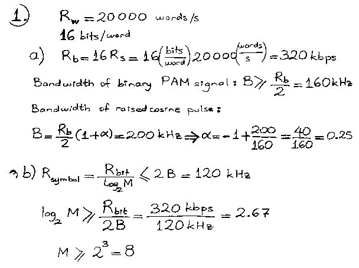
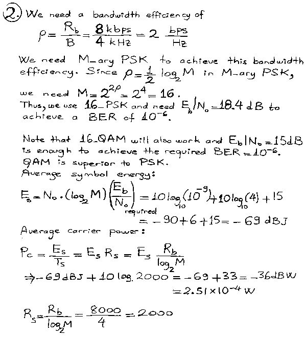
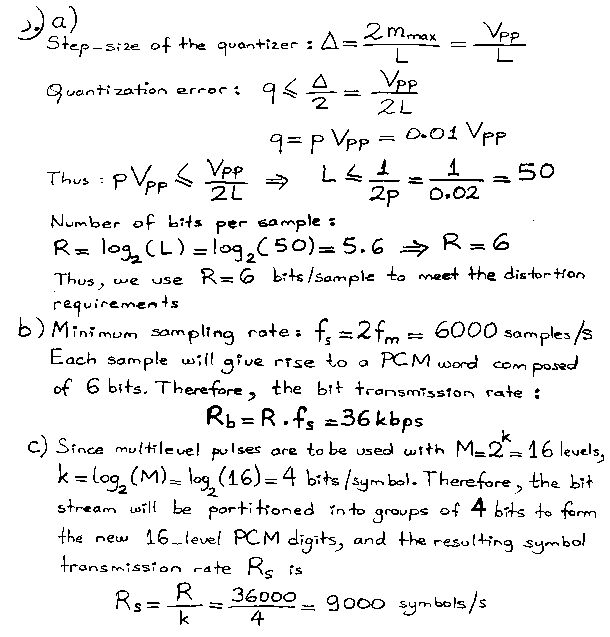
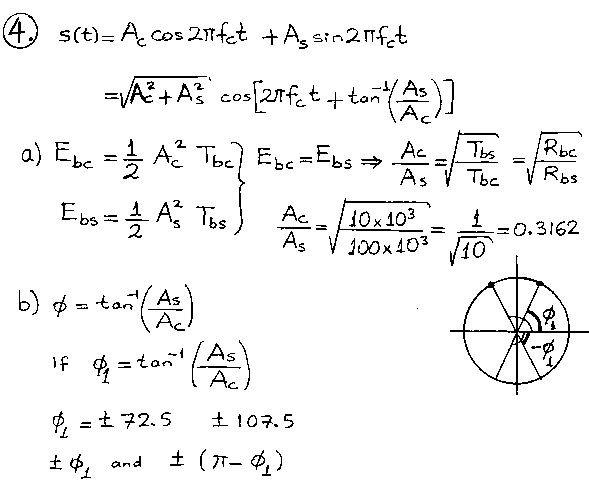
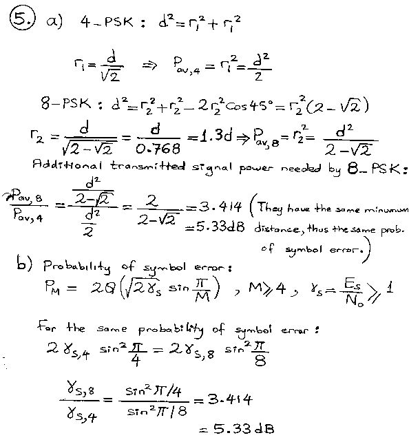

The 150-minute EEM 442 "Communication Systems" final exam of June 2, 2003, from the Department of Electrical and Electronics Engineering at Başkent University. This exam belongs to the Communications II (EEM 442) course; since it was found in the Communications I folder, it is published here under Communications I. The exam is two pages long and the handwritten solutions are five pages; all are in English. The original exam pages and the handwritten solutions can be downloaded as a PDF at the end of the post.

## Question 1: Binary PAM

A computer produces binary words of 16 bits each at a rate of 20,000 words per second. (a) If the output is transmitted as a binary PAM signal, what is the required bandwidth; and if the required bandwidth is 200 kHz, what is the α value of the raised cosine filter? (b) What must M be so that the signal can be transmitted as an M-ary signal in a channel of B = 60 kHz?

**Solution.** R_b = 16 × 20,000 = 320 kbps; for binary PAM, B ≥ R_b/2 = 160 kHz. For raised cosine, B = (R_b/2)(1 + α) = 200 kHz ⇒ α = 0.25. (b) R_symbol = R_bit/log₂M ≤ 2B = 120 kHz ⇒ log₂M ≥ 320/120 = 2.67 ⇒ M ≥ 8.

## Question 2: Modulation design

A data rate of 8 kbps is required over a 4 kHz channel; N₀ = 10⁻⁹ W/Hz, BER P_b = 10⁻⁶. Design a modulation system and give values for the spectral efficiency, M, symbol energy, symbol rate, and average carrier power.

**Solution.** Bandwidth efficiency ρ = R_b/B = 8 kbps/4 kHz = 2 b/s/Hz. For M-PSK, ρ = ½log₂M ⇒ M = 2^(2ρ) = 16: 16-PSK, and for P_b = 10⁻⁶ it requires E_b/N₀ = 18.4 dB. 16-QAM also works and needs only 15 dB; QAM is superior to PSK. Average symbol energy E_s = N₀·log₂M·(E_b/N₀) = −90 + 6 + 15 = −69 dBJ; R_s = R_b/log₂M = 2000 symbols/s; average carrier power P_c = E_sR_s ⇒ −69 + 33 = −36 dBW ≈ 2.51 × 10⁻⁴ W.

## Question 3: PCM

An analog signal with highest frequency f_m = 3 kHz is to be transmitted by a PCM system with M = 16 levels; the quantization error must not exceed ±1% of the peak-to-peak amplitude. (a) The smallest number of bits per PCM word, (b) the minimum sampling rate and transmission rate, (c) the PCM pulse rate.

**Solution.** Same as Question 1 of the 2002 final: L ≤ 50 ⇒ 6 bits/sample; f_s = 6000 samples/s and R_b = 36 kbps; with 16-level pulses, R_s = 36000/4 = 9000 symbols/s.

## Question 4: Two orthogonal carriers

The carriers cos(2πf_ct) and sin(2πf_ct) carry digital information through an AWGN channel at two different data rates (10 kbit/s and 100 kbit/s). (a) Find the relative amplitudes of the two carriers so that the E_b/N₀ of the two channels is equal. (b) With the amplitudes in this ratio, find the possible phase shifts of the carrier when the data on the two orthogonal carriers take all combinations of +1 and −1.

**Solution.** s(t) = A_ccos 2πf_ct + A_ssin 2πf_ct = √(A_c² + A_s²)cos[2πf_ct − tan⁻¹(A_s/A_c)]. The bit energies E_bc = ½A_c²T_bc and E_bs = ½A_s²T_bs must be equal ⇒ A_c/A_s = √(T_bs/T_bc) = √(R_bc/R_bs) = √(10/100) = 1/√10 ≈ 0.3162. (b) φ₁ = tan⁻¹(A_s/A_c) = tan⁻¹(√10) ≈ 72.5°; the possible phase shifts are ±72.5° and ±107.5° (±φ₁ and ±(π − φ₁)).

## Question 5: 4-PSK and 8-PSK constellations

Find the radii r₁ and r₂ of the four-phase and eight-phase signal constellations such that the distance between two adjacent points is d. From this, determine the additional energy required for the 8-PSK signal at high SNR to reach the same symbol error probability as the 4-phase signal, where errors arise from the choice of adjacent points. (b) Show that the result in (a) is correct using the analytical expression for the M-PSK symbol error probability.

**Solution.** (a) 4-PSK: d² = 2r₁² ⇒ r₁ = d/√2, P_av,4 = d²/2. 8-PSK: d² = r₂²(2 − √2) ⇒ r₂ = d/0.768 ≈ 1.3d, P_av,8 = d²/(2 − √2). Ratio P_av,8/P_av,4 = 2/(2 − √2) = 3.414 ≈ 5.33 dB. (b) P_M = 2Q(√(2γ_s)·sin(π/M)); for the same P_M, 2γ_s,4sin²(π/4) = 2γ_s,8sin²(π/8) ⇒ γ_s,8/γ_s,4 = sin²(π/4)/sin²(π/8) = 3.414 (5.33 dB).

