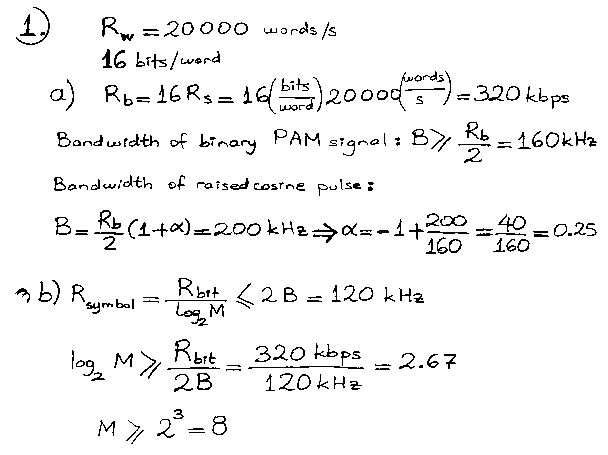
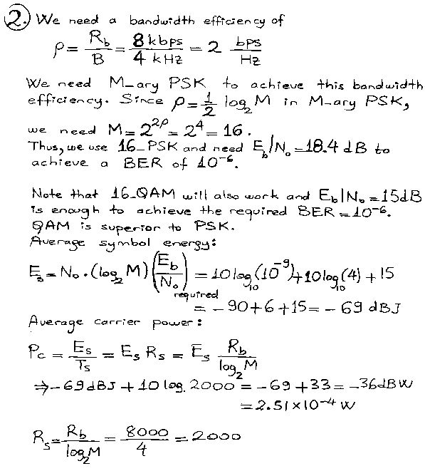
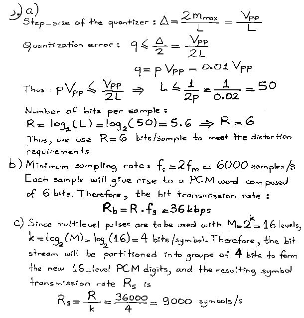
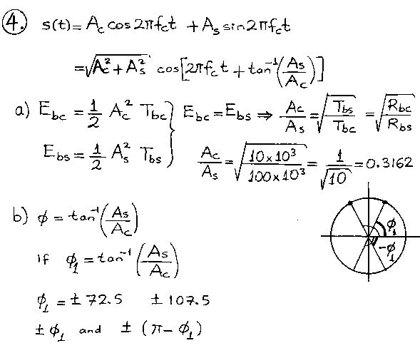
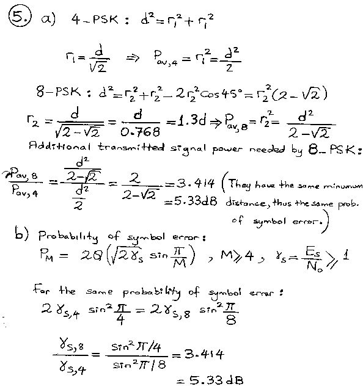

Başkent Üniversitesi Elektrik-Elektronik Mühendisliği Bölümü'nün 2 Haziran 2003 tarihli, 150 dakikalık EEM 442 "Communication Systems" final sınavı. Bu sınav Haberleşme II (EEM 442) dersine aittir; Haberleşme I klasöründe bulunduğu için burada, Haberleşme I altında yayımlanmıştır. Sınav iki sayfa, el yazısı çözümler beş sayfadır; hepsi İngilizcedir. Orijinal sınav sayfaları ve el yazısı çözümler yazının sonundaki PDF olarak indirilebilir.

## Soru 1: İkili PAM

Bir bilgisayar, her biri 16 bitlik ikili sözcükleri saniyede 20 000 sözcük hızla üretiyor. (a) Çıkış ikili PAM işareti olarak iletilirse gereken bant genişliği nedir; gereken bant 200 kHz ise yükseltilmiş kosinüs süzgecinin α değeri? (b) İşaretin B = 60 kHz'lik kanalda M'li (M-ary) işaret olarak iletilebilmesi için M kaç olmalı?

**Çözüm.** R_b = 16 × 20 000 = 320 kbps; ikili PAM için B ≥ R_b/2 = 160 kHz. Yükseltilmiş kosinüste B = (R_b/2)(1 + α) = 200 kHz ⇒ α = 0,25. (b) R_sembol = R_bit/log₂M ≤ 2B = 120 kHz ⇒ log₂M ≥ 320/120 = 2,67 ⇒ M ≥ 8.

## Soru 2: Modülasyon tasarımı

4 kHz'lik kanalda 8 kbps veri hızı isteniyor; N₀ = 10⁻⁹ W/Hz, BER P_b = 10⁻⁶. Spektrum verimi, M, sembol enerjisi, sembol hızı ve ortalama taşıyıcı gücü için değerleri veren bir modülasyon sistemi tasarlayın.

**Çözüm.** Bant verimi ρ = R_b/B = 8 kbps/4 kHz = 2 b/s/Hz. M-PSK'de ρ = ½log₂M ⇒ M = 2^(2ρ) = 16: 16-PSK ve P_b = 10⁻⁶ için E_b/N₀ = 18,4 dB gerekir. 16-QAM de çalışır ve yalnız 15 dB yeterlidir; QAM PSK'den üstündür. Ortalama sembol enerjisi E_s = N₀·log₂M·(E_b/N₀) = −90 + 6 + 15 = −69 dBJ; R_s = R_b/log₂M = 2000 sembol/s; ortalama taşıyıcı gücü P_c = E_sR_s ⇒ −69 + 33 = −36 dBW ≈ 2,51 × 10⁻⁴ W.

## Soru 3: PCM

En yüksek frekansı f_m = 3 kHz olan analog işaret M = 16 seviyeli PCM sistemiyle iletilecek; nicemleme hatası tepeden tepeye genliğin ±%1'ini aşmayacak. (a) En küçük bit/PCM sözcüğü, (b) en küçük örnekleme hızı ve iletim hızı, (c) PCM darbe hızı.

**Çözüm.** 2002 finalinin 1. sorusuyla aynıdır: L ≤ 50 ⇒ 6 bit/örnek; f_s = 6000 örnek/s ve R_b = 36 kbps; 16 seviyeli darbelerle R_s = 36000/4 = 9000 sembol/s.

## Soru 4: İki dik taşıyıcı

cos(2πf_ct) ve sin(2πf_ct) taşıyıcıları, AWGN kanalından iki farklı veri hızında (10 kbit/s ve 100 kbit/s) sayısal bilgi iletiyor. (a) İki kanalın E_b/N₀'ı eşit olacak biçimde iki taşıyıcının göreli genliklerini bulun. (b) Genlikler bu oranda iken, iki dik taşıyıcıdaki veri +1 ve −1'in tüm kombinasyonlarını aldığında taşıyıcının olası faz kaymalarını bulun.

**Çözüm.** s(t) = A_ccos 2πf_ct + A_ssin 2πf_ct = √(A_c² + A_s²)cos[2πf_ct − tan⁻¹(A_s/A_c)]. Bit enerjileri E_bc = ½A_c²T_bc, E_bs = ½A_s²T_bs eşit olmalı ⇒ A_c/A_s = √(T_bs/T_bc) = √(R_bc/R_bs) = √(10/100) = 1/√10 ≈ 0,3162. (b) φ₁ = tan⁻¹(A_s/A_c) = tan⁻¹(√10) ≈ 72,5°; olası faz kaymaları ±72,5° ve ±107,5° (±φ₁ ve ±(π − φ₁)).

## Soru 5: 4-PSK ve 8-PSK takımyıldızları

Dört fazlı ve sekiz fazlı işaret takımyıldızlarında komşu iki nokta arasındaki uzaklık d olacak biçimde r₁ ve r₂ yarıçaplarını bulun. Buradan, 8-PSK işaretin yüksek SNR'de, hatanın komşu noktaların seçiminden kaynaklandığı 4 fazlı işaretle aynı sembol hata olasılığına ulaşması için gereken ek enerjiyi belirleyin. (b) M-PSK sembol hata olasılığı analitik ifadesiyle (a)'daki sonucun doğru olduğunu gösterin.

**Çözüm.** (a) 4-PSK: d² = 2r₁² ⇒ r₁ = d/√2, P_av,4 = d²/2. 8-PSK: d² = r₂²(2 − √2) ⇒ r₂ = d/0,768 ≈ 1,3d, P_av,8 = d²/(2 − √2). Oran P_av,8/P_av,4 = 2/(2 − √2) = 3,414 ≈ 5,33 dB. (b) P_M = 2Q(√(2γ_s)·sin(π/M)); aynı P_M için 2γ_s,4sin²(π/4) = 2γ_s,8sin²(π/8) ⇒ γ_s,8/γ_s,4 = sin²(π/4)/sin²(π/8) = 3,414 (5,33 dB).

