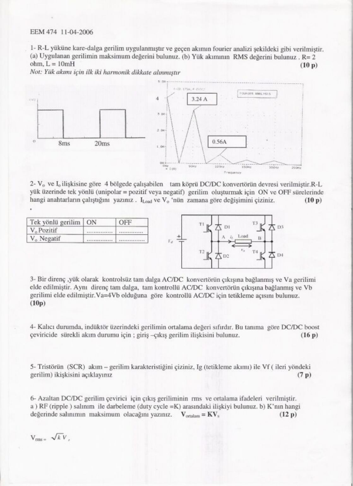
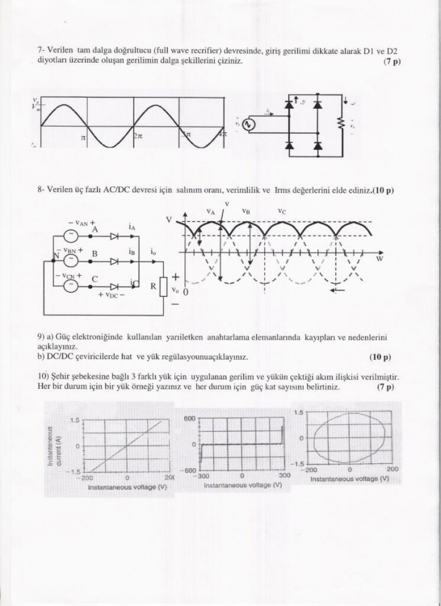
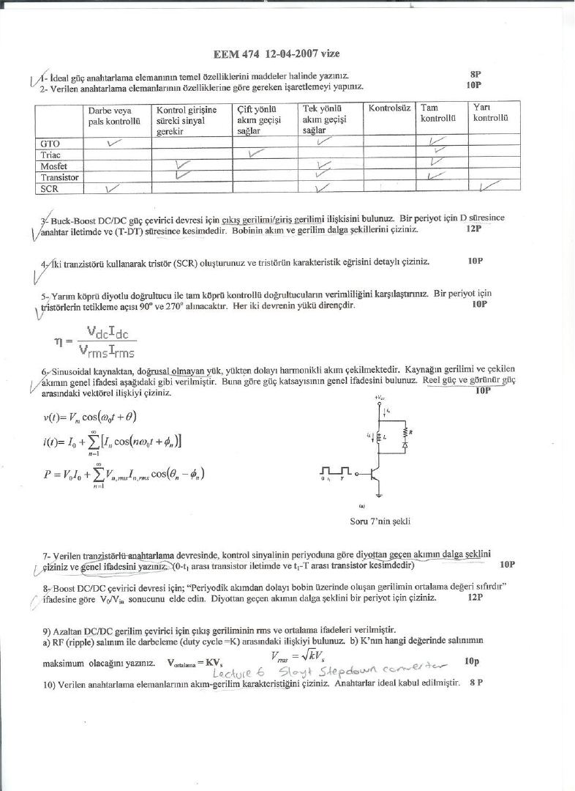
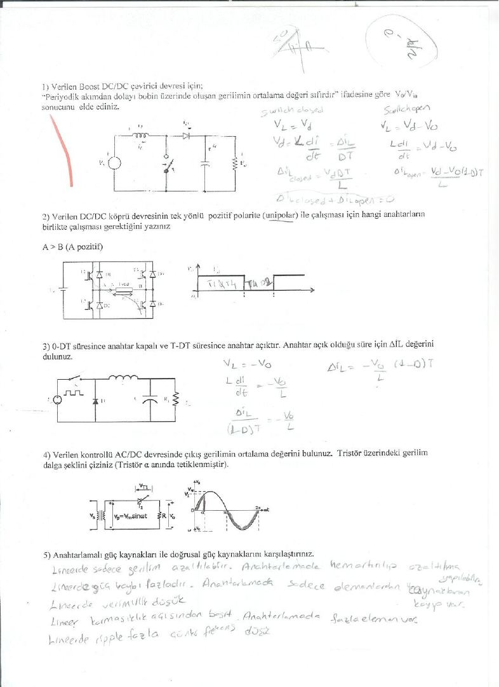

A text transcription of the questions from the EEM474 Power Electronics midterm exams of 11 April 2006 and 12 April 2007, together with the solutions handwritten (on squared notebook paper) while preparing for those exams. All of the scanned pages are in the PDF at the end of the post; the name and surname fields on the exam papers are blank.

## 11 April 2006 midterm

### Questions

1. A square-wave voltage is applied to an R-L load; the Fourier analysis of the resulting current is given as in the figure (R = 2 Ω, L = 10 mH; the waveform is marked with 8 ms and 20 ms; the first two harmonics are taken: 3.24 A and 0.56 A, DC component 4 A). a) Find the maximum value of the applied voltage. b) Find the RMS value of the load current. (10 pts)
2. The circuit of a full-bridge DC/DC converter that can operate in 4 regions according to the Vo–Io relationship is given. In order to produce a unidirectional (positive or negative) voltage across the R-L load, write which switches operate during the ON and OFF intervals; plot ILoad and Vo versus time. (10 pts)
3. A resistor is connected as the load to the output of an uncontrolled full-wave AC/DC converter and the voltage Va is obtained. The same resistor is connected to the output of a full-wave, fully controlled AC/DC converter and the voltage Vb is obtained. Given that Va = 4Vb, find the firing angle for the controlled AC/DC converter. (10 pts)
4. In steady state, the average voltage across the inductor is zero. Using this definition, find the input-output voltage relationship of the DC/DC boost converter for continuous-current operation. (16 pts)
5. Draw the current-voltage characteristic of the thyristor (SCR); explain the pair Ig (gate trigger current) and Vf (forward voltage). (7 pts)
6. For a step-down DC/DC voltage converter, the RMS and average expressions of the output voltage are given (Vaverage = K·Vs, Vrms = √K·Vs). a) Find the relationship between the RF (ripple) oscillation and the pulsing (duty cycle = K). b) State the value of K at which the oscillation is maximum. (12 pts)
7. In the given full-wave rectifier circuit, taking the input voltage into account, draw the waveforms of the voltage across diodes D1 and D2. (7 pts)
8. For the given three-phase AC/DC circuit (three diodes, common cathode, load R), obtain the ripple ratio, efficiency and Irms values. (10 pts)
9. a) Explain the losses in the semiconductor switching elements used in power electronics and their causes. b) Explain line and load regulation in DC/DC converters. (10 pts)
10. For three different loads connected to the city mains, the relationship between the applied voltage and the current drawn by the load is given (three graphs: straight line, pulsed, and elliptical). Write an example load for each case and state the power factor for each case. (7 pts)

### Handwritten solutions

**Question 1.** The load is R-L: i(t) = (1/L)∫vL dt + Vo/R. The DC component of the current is Io = 4 A (the harmonic that does work); Io = (1/T)∫i dt, T = 20 ms, and since the voltage is Vo between 0 and 8 ms, 4 = (1/20)·8·(Vo/2) and **Vo = 20 V**. The RMS value of the current is Irms = √(Io² + Σ In²/2) = √(16 + 3.24²/2 + 0.56²/2) ≈ **4.63 A**.

**Question 2.** Unipolar operation table:

| Output voltage | ON | OFF |
|---|---|---|
| Vo positive | T1, T4 | D2, T4 (freewheeling) |
| Vo negative | T3, T2 | T2, D4 (freewheeling) |

The current increases during the ON interval and decreases during the OFF interval; Vo is ±Vd during ON and zero during OFF.

**Question 3.** Uncontrolled full-wave: Va = (2/T)∫₀^{T/2} Vm sin ωt dt = 2Vm/π = 0.6366 Vm. In the controlled circuit on the paper, Vb = (1/π)∫α→π Vm sin ωt dωt = (Vm/π)(1 + cos α) was used; with Va = 4Vb, 0.6366/4 = (1 + cos α)/π and **α = 120°** was found.

*Note: This expression belongs to the half-controlled bridge. If the question concerns a fully controlled bridge with a resistive load, Vb = (2Vm/π) cos α should be used; for Va = 4Vb, cos α = 1/4, i.e. α ≈ 75.5°.*

**Question 4 (boost).** With the switch closed, Vd = L·di/dt, ΔiL(closed) = Vd·DT/L; with the switch open, VL = Vd − Vo, ΔiL(open) = (Vd − Vo)(1 − D)T/L. With ΔiL(closed) + ΔiL(open) = 0, **Vo = Vd/(1 − D)**.

**Question 5.** The SCR characteristic is drawn: in the reverse direction, the reverse blocking and avalanche region; in the forward direction, the forward blocking region and, for Ig = 0, the forward breakover voltage, with turn-on at a lower voltage for Ig3 > Ig2 > Ig1. Explanation: if VAK rises above a certain value, the thyristor turns on without waiting for current at the gate; as VAK increases, the required Ig decreases.

**Question 6.** RF = Vac/Vdc was written with Vdc = K·Vs, and taking Vac = √K·Vs gives RF = √K/K, with "if RF = 1 then K = √K" written.

*Note: The solution is incorrect. √K·Vs is Vrms, not Vac. Since Vac = √(Vrms² − Vdc²) = Vs√(K − K²), RF = Vac/Vdc = √((1 − K)/K); the ripple ratio grows as K → 0, while Vac itself is greatest at the maximum of K(1 − K), i.e. at K = 0.5.*

**Question 7.** In the bridge rectifier, D1 and D2 are under reverse voltage only during the negative half-waves of the input voltage; on the paper, the labels "D1, D2" are marked under the negative half-periods.

**Question 8.** Three-phase half-wave rectifier: Vdc = (3/2π)∫π/6→5π/6 Vm sin θ dθ = 3√3·Vm/(2π) ≈ 0.827 Vm; Vrms = √((3/2π)∫ Vm² sin²θ dθ) ≈ 0.8406 Vm. Efficiency η = Pdc/Pac = (Vdc²/R)/(Vrms²/R) = (3√3/2π)²/0.8406² ≈ 0.968; Irms = Vrms/R = 0.8406 Vm/R.

*Note: For the ripple factor RF = Vac/Vdc, Vac = √(Vrms² − Vdc²) ≈ 0.1506 Vm should be used; this gives RF ≈ 0.18. On the paper, 0.8406 was written directly as the numerator (Vrms), which gives not the ripple factor but the form factor (Vrms/Vdc ≈ 1.017).*

**Question 10.** Resistive load: current and voltage are linearly related, PF = 1; diode (nonlinear) load: the current is pulsed, PF < 1; R-L load: elliptical (phase difference), PF < 1. (On the paper, the mark next to "pf" for the resistive load is not legible; a linear relationship means PF = 1.)

**Question 9.** Not solved on the paper.

## 12 April 2007 midterm

### Questions

1. List the basic characteristics of an ideal power switching element. (8 pts)
2. Mark the required designations for the given switching elements (GTO, TRIAC, MOSFET, Transistor, SCR) according to their characteristics: pulse-controlled, requires a continuous signal at the control input, allows bidirectional current flow, allows unidirectional current flow, uncontrolled, fully controlled, half-controlled. (10 pts)
3. For the buck-boost DC/DC power converter circuit, find the output voltage/input voltage relationship. Within one period, the switch is conducting for D and off for (T − DT). Draw the current and voltage waveforms of the inductor. (12 pts)
4. Build a thyristor (SCR) using two transistors and draw the characteristic curve of the thyristor in detail. (10 pts)
5. Compare the efficiency of a half-bridge diode rectifier with that of a full-bridge controlled rectifier. The firing angles of the thyristors within one period will be taken as 90° and 270°; the load of both circuits is a resistor. η = Vdc·Idc/(Vrms·Irms). (10 pts)
6. A nonlinear load draws a harmonic-rich current from a sinusoidal source because of the load. The general expressions for the source voltage and the current drawn are given: v(t) = Vm cos(ω₀t + θ), i(t) = I₀ + Σ In cos(nω₀t + φn), P = V₀I₀ + Σ Vn,rms·In,rms·cos(θn − φn). Accordingly, find the general expression for the power factor. Draw the vector relationship between real power and apparent power. (10 pts)
7. In the given transistor switching circuit (Vcc, a parallel branch of L and R, and a diode; the transistor conducts from 0 to t1 and is off from t1 to T), draw the waveform of the current through the diode according to the period of the control signal and write its general expression. (10 pts)
8. For the boost DC/DC converter circuit, obtain the result Vo/Vin using the statement "The average value of the voltage across the inductor due to the periodic current is zero." Draw the waveform of the current through the diode for one period. (12 pts)
9. For a step-down DC/DC voltage converter, the RMS and average expressions of the output voltage are given (Vrms = √K·Vs, Vaverage = K·Vs). a) Find the relationship between the RF (ripple) oscillation and the pulsing (duty cycle = K). b) State the value of K at which the oscillation is maximum. (10 pts)
10. Draw the current-voltage characteristics of the given switching elements; the switches are assumed to be ideal. (8 pts)

### Handwritten solutions

**Question 1 (ideal switch).** When the switch is open, no current flows; when the switch is closed, no voltage appears across it; since the internal resistance is zero, the power dissipated in it is zero; it changes to the ON/OFF state instantaneously; no power is dissipated while switching ON/OFF.

**Question 3 (buck-boost).** With S ON, Vd = VL = L·di/dt = L·Δi/(DT), Δi = Vd·DT/L. With S OFF, VL = Vo and Δi = Vo(1 − D)T/L. With Δi(open) + Δi(closed) = 0, Vd·DT = Vo(1 − D)T and **Vo/Vd = D/(1 − D)** is obtained. The inductor voltage is drawn at the level Vd during ON and (Vd − Vo) during OFF; the current rises linearly during ON and falls during OFF.

*Note: In a buck-boost converter, the inductor voltage with the switch open is VL = −|Vo| (the output polarity is opposite to the input); the "Vd − Vo" level on the paper belongs to the boost converter. The exact expression of the ratio is Vo/Vd = −D/(1 − D).*

**Question 4.** An equivalent of the thyristor with terminals A (anode), K (cathode) and G (gate) is drawn by connecting two transistors, one PNP and one NPN, so that each feeds the other's base/collector.

**Question 5.** For half-wave, Vdc = (1/2π)∫α→π Vm sin ωt dωt = Vm(1 + cos α)/(2π); Vrms = [(1/2π)∫α→π Vm² sin² ωt dωt]^½. For "full-wave", Vdc = (1/π)∫α→π Vm sin ωt dωt = Vm(1 + cos α)/π and Vrms = √((1/π)∫α→π (Vm sin ωt)² dωt).

*Note: In a full-bridge fully controlled rectifier, conduction lies between α and π + α and Vdc = (2Vm/π) cos α; the expression written corresponds to the half-controlled bridge. At α = 90°, both give Vm/π; α = 270° falls outside the 0–2π interval within one period.*

**Question 6.** P = V₀I₀ + Σ Vn,rms·In,rms·cos(θn − φn). If the voltage contains only the fundamental component, PF = P/S = Vrms·I₁,rms·cos(θ − φ₁)/(Vrms·Irms). In the triangle drawing, the components P (real power), Q and D (distortion) and S (apparent power) are shown.

**Question 7.** From 0 to t1, with the transistor conducting, is = iL = (1/L)∫₀^t1 Vcc dt. From t1 to T, the diode conducts: i₂(t) = I₂·e^(−tR/L) (freewheeling of the R-L circuit); the current decays exponentially. In the drawing, the diode current begins at t1 and decreases toward T.

**Question 8 (boost).** The drawn circuit contains L, S, D, C and R; the triangular inductor current with Imax and Imin marked, and the diode current, are shown. The voltage ratio is the same as the result in the 2006 midterm: Vo = Vd/(1 − D).

## Undated preparation questions (boost, full bridge, buck, controlled rectifier)

A page of five questions used while studying, with no date written on it. The questions and handwritten notes:

1. Boost DC/DC converter: Vo/Vin according to the statement "the average value of the voltage across the inductor due to the periodic current is zero." Note: switch closed VL = Vd, ΔiL = Vd·DT/L; open VL = Vd − Vo, ΔiL = (Vd − Vo)(1 − D)T/L; their sum is zero.
2. Which switches must operate together for the DC bridge circuit to work with unidirectional positive polarity (unipolar, A > B). Note: the diagonal switch pair (T1–T4) operates; in the drawing, the intervals above Vo are marked T1T4 / T4D2.
3. The switch is closed during 0–DT and open during T − DT; for the buck converter with the switch open, ΔiL: VL = −Vo and ΔiL = −(Vo/L)(1 − D)T.
4. The average value of the output voltage in a controlled AC/DC circuit and the drawing of the thyristor voltage waveform (the thyristor is fired at the instant α). In the solved figure, a half-wave expression of the type Vo = (Vm/2π)(1 + cos α) is given with the drawing.
5. Compare switching power supplies with linear power supplies. Handwritten answer: In a linear supply the voltage can only be reduced; in a switching supply it can be both increased and decreased. In a linear supply the power loss is high and the efficiency is low; in a switching supply there is only loss due to the components. The linear supply is simple in terms of complexity; the switching supply has many components. In a linear supply the ripple is high because the frequency is low.
