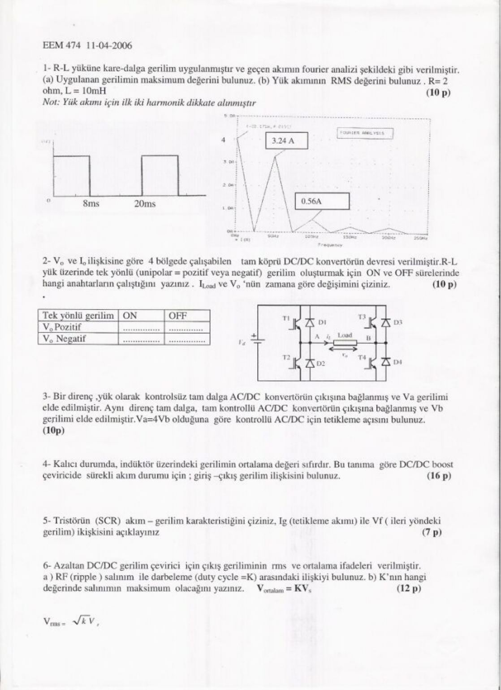
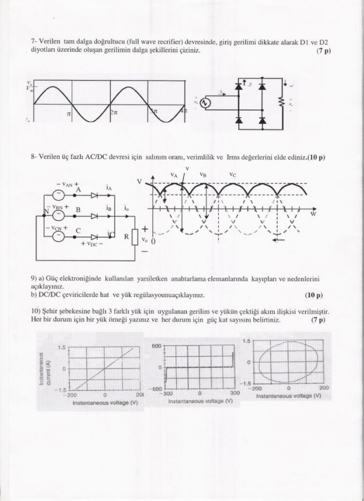
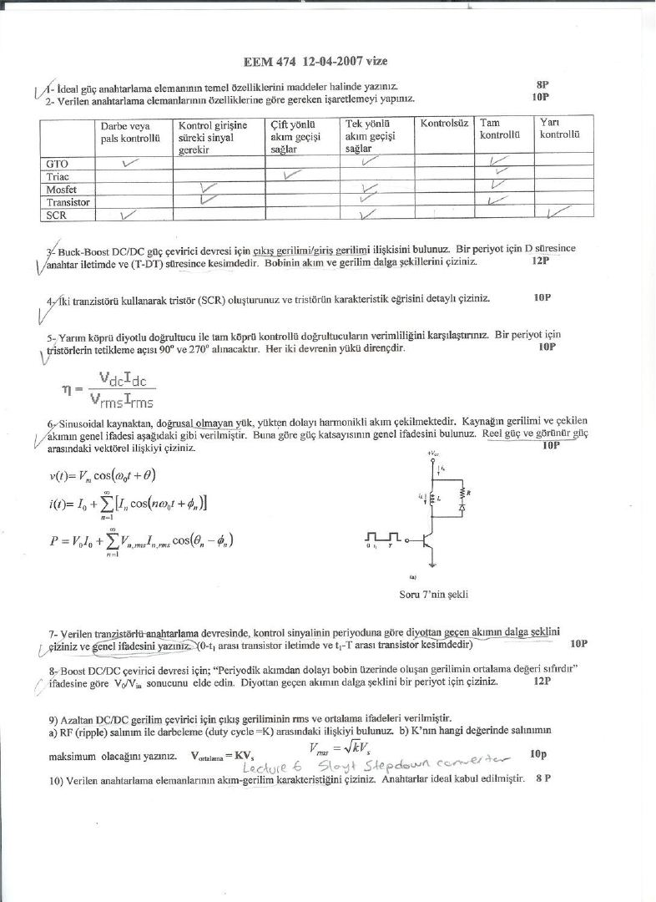
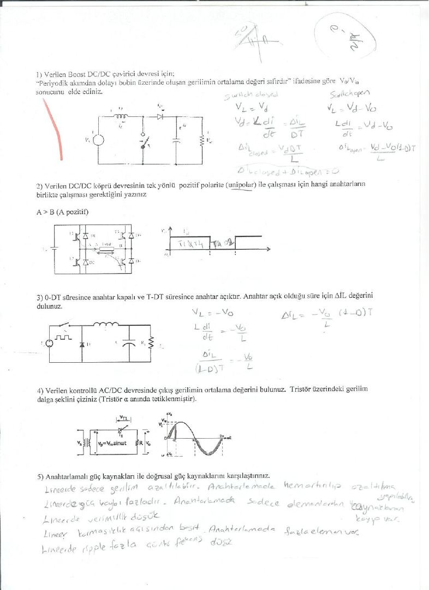

EEM474 Güç Elektroniği dersinin 11 Nisan 2006 ve 12 Nisan 2007 tarihli ara sınavlarının soruları ile bu sınavlara hazırlanırken el yazısıyla (kareli defter kâğıdına) yazılmış çözümlerin metne aktarılmış hâli. Tarayıcıyla alınmış sayfaların tümü yazının sonundaki PDF'tedir; sınav kâğıtlarındaki ad-soyad alanları boştur.

## 11 Nisan 2006 vize

### Sorular

1. R-L yüküne kare dalga gerilim uygulanmış; geçen akımın Fourier analizi şekildeki gibi verilmiştir (R = 2 Ω, L = 10 mH; dalga biçiminde 8 ms ve 20 ms işaretli; ilk iki harmonik alınmış: 3,24 A ve 0,56 A, doğru bileşen 4 A). a) Uygulanan gerilimin maksimum değerini bulunuz. b) Yük akımının RMS değerini bulunuz. (10 p)
2. Vo ve Io ilişkisine göre 4 bölgede çalışabilen tam köprü DC/DC konvertörün devresi verilmiştir. R-L yük üzerinde tek yönlü (pozitif veya negatif) gerilim oluşturmak için ON ve OFF sürelerinde hangi anahtarların çalıştığını yazınız; ILoad ve Vo'nun zamana göre değişimini çiziniz. (10 p)
3. Bir direnç, yük olarak kontrolsüz tam dalga AC/DC konvertörün çıkışına bağlanmış ve Va gerilimi elde edilmiştir. Aynı direnç tam dalga, tam kontrollü AC/DC konvertörün çıkışına bağlanmış ve Vb gerilimi elde edilmiştir. Va = 4Vb olduğuna göre kontrollü AC/DC için tetikleme açısını bulunuz. (10 p)
4. Kalıcı durumda indüktör üzerindeki gerilimin ortalama değeri sıfırdır. Bu tanıma göre DC/DC boost çeviricide sürekli akım durumu için giriş-çıkış gerilim ilişkisini bulunuz. (16 p)
5. Tristörün (SCR) akım-gerilim karakteristiğini çiziniz; Ig (tetikleme akımı) ile Vf (ileri yöndeki gerilim) ikilisini açıklayınız. (7 p)
6. Azaltan DC/DC gerilim çeviricisi için çıkış geriliminin RMS ve ortalama ifadeleri verilmiştir (Vortalama = K·Vs, Vrms = √K·Vs). a) RF (ripple) salınım ile darbeleme (duty cycle = K) arasındaki ilişkiyi bulunuz. b) K'nın hangi değerinde salınımın maksimum olacağını yazınız. (12 p)
7. Verilen tam dalga doğrultucu (full wave rectifier) devresinde giriş gerilimini dikkate alarak D1 ve D2 diyotları üzerinde oluşan gerilimin dalga şekillerini çiziniz. (7 p)
8. Verilen üç fazlı AC/DC devresi (üç diyot, ortak katot, yük R) için salınım oranı, verimlilik ve Irms değerlerini elde ediniz. (10 p)
9. a) Güç elektroniğinde kullanılan yarı iletken anahtarlama elemanlarında kayıpları ve nedenlerini açıklayınız. b) DC/DC çeviricilerde hat ve yük regülasyonunu açıklayınız. (10 p)
10. Şehir şebekesine bağlı üç farklı yük için uygulanan gerilim ile yükün çektiği akım ilişkisi (doğru, kesik/darbeli ve elips biçiminde üç grafik) verilmiştir. Her durum için bir yük örneği yazınız ve her durum için güç kat sayısını belirtiniz. (7 p)

### El yazısı çözümler

**Soru 1.** Yük R-L'dir: i(t) = (1/L)∫vL dt + Vo/R. Akımın doğru bileşeni Io = 4 A'dır (iş yapan harmonik); Io = (1/T)∫i dt, T = 20 ms ve gerilim 0–8 ms arasında Vo olduğundan 4 = (1/20)·8·(Vo/2) ve **Vo = 20 V**. Akımın RMS değeri Irms = √(Io² + Σ In²/2) = √(16 + 3,24²/2 + 0,56²/2) ≈ **4,63 A**.

**Soru 2.** Tek yönlü (unipolar) çalışma tablosu:

| Çıkış gerilimi | ON | OFF |
|---|---|---|
| Vo pozitif | T1, T4 | D2, T4 (serbest dolaşım) |
| Vo negatif | T3, T2 | T2, D4 (serbest dolaşım) |

Akım ON süresinde artar, OFF süresinde azalır; Vo ise ON'da ±Vd, OFF'ta sıfırdır.

**Soru 3.** Kontrolsüz tam dalga: Va = (2/T)∫₀^{T/2} Vm sin ωt dt = 2Vm/π = 0,6366 Vm. Kâğıttaki kontrollü devrede Vb = (1/π)∫α→π Vm sin ωt dωt = (Vm/π)(1 + cos α) alınmış; Va = 4Vb ile 0,6366/4 = (1 + cos α)/π ve **α = 120°** bulunmuştur.

*Not: Bu ifade yarı kontrollü köprüye aittir. Soruda tam kontrollü köprü ve direnç yükü varsa Vb = (2Vm/π) cos α alınmalı; Va = 4Vb için cos α = 1/4, yani α ≈ 75,5° bulunur.*

**Soru 4 (boost).** Anahtar kapalıyken Vd = L·di/dt, ΔiL(kapalı) = Vd·DT/L; anahtar açıkken VL = Vd − Vo, ΔiL(açık) = (Vd − Vo)(1 − D)T/L. ΔiL(kapalı) + ΔiL(açık) = 0 ile **Vo = Vd/(1 − D)**.

**Soru 5.** SCR karakteristiği çizilmiştir: ters yönde ters kesim (reverse blocking) ve çığ (avalanche) bölgesi; ileri yönde ileri kesim bölgesi ve Ig = 0 için ileri kırılma gerilimi (forward breakover voltage), Ig3 > Ig2 > Ig1 için daha düşük gerilimde iletime geçiş. Açıklama: VAK belli bir değerin üzerine çıkarsa gate'ten akım beklemeden tristör iletime geçer; VAK arttıkça gereken Ig azalır.

**Soru 6.** RF = Vac/Vdc ile Vdc = K·Vs yazılmış, Vac = √K·Vs alınarak RF = √K/K bulunmuş ve "RF = 1 ise K = √K" yazılmıştır.

*Not: Çözüm hatalıdır. √K·Vs, Vrms'tir, Vac değildir. Vac = √(Vrms² − Vdc²) = Vs√(K − K²) olduğundan RF = Vac/Vdc = √((1 − K)/K) olur; ripple oranı K → 0'da büyür, Vac ise K(1 − K) ifadesinin maksimumunda, yani K = 0,5'te en büyüktür.*

**Soru 7.** Köprü doğrultucuda D1 ve D2 yalnız giriş geriliminin negatif yarım dalgalarında ters gerilim altındadır; kâğıtta "D1, D2" etiketleri negatif yarım periyotların altına işaretlenmiştir.

**Soru 8.** Üç fazlı yarım dalga doğrultucu: Vdc = (3/2π)∫π/6→5π/6 Vm sin θ dθ = 3√3·Vm/(2π) ≈ 0,827 Vm; Vrms = √((3/2π)∫ Vm² sin²θ dθ) ≈ 0,8406 Vm. Verimlilik η = Pdc/Pac = (Vdc²/R)/(Vrms²/R) = (3√3/2π)²/0,8406² ≈ 0,968; Irms = Vrms/R = 0,8406 Vm/R.

*Not: Ripple faktörü RF = Vac/Vdc'de Vac = √(Vrms² − Vdc²) ≈ 0,1506 Vm alınmalıdır; RF ≈ 0,18 olur. Kâğıtta pay olarak doğrudan 0,8406 yazılmıştır (Vrms), bu ripple faktörü değil form faktörü (Vrms/Vdc ≈ 1,017) verir.*

**Soru 10.** R yükü: akım ve gerilim doğrusal ilişkili, PF = 1; diyotlu (doğrusal olmayan) yük: akım darbeli, PF < 1; R-L yükü: elips biçimli (faz farkı), PF < 1. (Kâğıtta R yükü için "pf" yanındaki işaret okunaklı değildir; doğrusal ilişki PF = 1 anlamına gelir.)

**Soru 9.** Kâğıtta çözülmemiştir.

## 12 Nisan 2007 vize

### Sorular

1. İdeal güç anahtarlama elemanının temel özelliklerini maddeler hâlinde yazınız. (8 p)
2. Verilen anahtarlama elemanlarının (GTO, Triyak, MOSFET, Transistör, SCR) özelliklerine göre gereken işaretlemeyi yapınız: darbe/palsle kontrollü, kontrol girişine sürekli sinyal gerekir, çift yönlü akım geçişi sağlar, tek yönlü akım geçişi sağlar, kontrolsüz, tam kontrollü, yarı kontrollü. (10 p)
3. Buck-boost DC/DC güç çevirici devresi için çıkış gerilimi/giriş gerilimi ilişkisini bulunuz. Bir periyot için D süresince anahtar iletimde ve (T − DT) süresince kesimdedir. Bobinin akım ve gerilim dalga şekillerini çiziniz. (12 p)
4. İki transistörü kullanarak tristör (SCR) oluşturunuz ve tristörün karakteristik eğrisini detaylı çiziniz. (10 p)
5. Yarım köprü diyotlu doğrultucu ile tam köprü kontrollü doğrultucuların verimliliğini karşılaştırınız. Bir periyot için tristörlerin tetikleme açısı 90° ve 270° alınacaktır; her iki devrenin yükü dirençtir. η = Vdc·Idc/(Vrms·Irms). (10 p)
6. Sinüzoidal kaynaktan doğrusal olmayan yük, yükten dolayı harmonikli akım çekilmektedir. Kaynağın gerilimi ve çekilen akımın genel ifadesi v(t) = Vm cos(ω₀t + θ), i(t) = I₀ + Σ In cos(nω₀t + φn), P = V₀I₀ + Σ Vn,rms·In,rms·cos(θn − φn) verilmiştir. Buna göre güç katsayısının genel ifadesini bulunuz. Reel güç ve görünür güç arasındaki vektörel ilişkiyi çiziniz. (10 p)
7. Verilen transistörlü anahtarlama devresinde (Vcc, L ile R'nin paralel kolu ve diyot, 0–t1 arası transistör iletimde, t1–T arası kesimde) kontrol sinyalinin periyoduna göre diyottan geçen akımın dalga şeklini çiziniz ve genel ifadesini yazınız. (10 p)
8. Boost DC/DC çevirici devresi için "Periyodik akımdan dolayı bobin üzerinde oluşan gerilimin ortalama değeri sıfırdır" ifadesine göre Vo/Vin sonucunu elde ediniz. Diyottan geçen akımın dalga şeklini bir periyot için çiziniz. (12 p)
9. Azaltan DC/DC gerilim çevirici için çıkış geriliminin RMS ve ortalama ifadeleri verilmiştir (Vrms = √K·Vs, Vortalama = K·Vs). a) RF (ripple) salınım ile darbeleme (duty cycle = K) arasındaki ilişkiyi bulunuz. b) K'nın hangi değerinde salınımın maksimum olacağını yazınız. (10 p)
10. Verilen anahtarlama elemanlarının akım-gerilim karakteristiğini çiziniz; anahtarlar ideal kabul edilmiştir. (8 p)

### El yazısı çözümler

**Soru 1 (ideal anahtar).** Anahtar açıkken akım geçmez; anahtar kapalıyken gerilim oluşmaz; iç direnç sıfır olduğundan üzerinde harcanan güç sıfırdır; anlık olarak ON/OFF durumuna geçer; ON/OFF yaparken güç harcanmaz.

**Soru 3 (buck-boost).** S ON iken Vd = VL = L·di/dt = L·Δi/(DT), Δi = Vd·DT/L. S OFF iken VL = Vo ve Δi = Vo(1 − D)T/L. Δi(açık) + Δi(kapalı) = 0 ile Vd·DT = Vo(1 − D)T ve **Vo/Vd = D/(1 − D)** bulunur. Bobin gerilimi ON'da Vd, OFF'ta (Vd − Vo) düzeyinde çizilmiş, akım ON'da doğrusal artıp OFF'ta azalmıştır.

*Not: Buck-boost çeviricide anahtar açıkken bobin gerilimi VL = −|Vo| olur (çıkış polaritesi girişin tersidir); kâğıttaki "Vd − Vo" düzeyi boost çeviriciye aittir. Oranın tam ifadesi Vo/Vd = −D/(1 − D)'dir.*

**Soru 4.** Biri PNP, diğeri NPN iki transistör birbirinin tabanını/kolektörünü besleyecek biçimde bağlanarak A (anot), K (katot) ve G (kapı) uçlu tristör eşdeğeri çizilmiştir.

**Soru 5.** Yarım dalga için Vdc = (1/2π)∫α→π Vm sin ωt dωt = Vm(1 + cos α)/(2π); Vrms = [(1/2π)∫α→π Vm² sin² ωt dωt]^½. "Tam dalga" için Vdc = (1/π)∫α→π Vm sin ωt dωt = Vm(1 + cos α)/π ve Vrms = √((1/π)∫α→π (Vm sin ωt)² dωt).

*Not: Tam köprü tam kontrollü doğrultucuda iletim α ile π + α arasındadır ve Vdc = (2Vm/π) cos α'dır; yazılan ifade yarı kontrollü köprüye karşılık gelir. α = 90°'de ikisi de Vm/π verir; α = 270° bir periyot içinde 0–2π aralığı dışında kalır.*

**Soru 6.** P = V₀I₀ + Σ Vn,rms·In,rms·cos(θn − φn). Gerilimde yalnız temel bileşen varsa PF = P/S = Vrms·I₁,rms·cos(θ − φ₁)/(Vrms·Irms). Üçgen çizimde P (reel güç), Q ve D (distorsiyon) bileşenleri ve S (görünür güç) gösterilmiştir.

**Soru 7.** 0–t1 arasında transistör iletimde iken is = iL = (1/L)∫₀^t1 Vcc dt. t1–T arasında diyot iletimdedir: i₂(t) = I₂·e^(−tR/L) (R-L devresinin serbest dolaşımı); akım üstel biçimde azalır. Çizimde diyot akımı t1'de başlayıp T'ye doğru azalmaktadır.

**Soru 8 (boost).** Çizilen devrede L, S, D, C ve R vardır; Imax ve Imin işaretli üçgen biçimli bobin akımı ve diyot akımı gösterilmiştir. Gerilim oranı 2006 vizesindeki sonuçla aynıdır: Vo = Vd/(1 − D).

## Tarihsiz hazırlık soruları (boost, tam köprü, buck, kontrollü doğrultucu)

Ders çalışırken kullanılan, tarihi yazılı olmayan beş soruluk bir sayfa. Soru ve el yazısı notlar:

1. Boost DC/DC çevirici: "periyodik akımdan dolayı bobin üzerinde oluşan gerilimin ortalama değeri sıfırdır" ifadesine göre Vo/Vin. Not: anahtar kapalı VL = Vd, ΔiL = Vd·DT/L; açık VL = Vd − Vo, ΔiL = (Vd − Vo)(1 − D)T/L; toplamları sıfır.
2. DC köprü devresinin tek yönlü pozitif polarite (unipolar, A > B) ile çalışması için hangi anahtarların birlikte çalışması gerektiği. Not: çapraz anahtar çifti (T1–T4) çalışır; çizimde Vo üstündeki aralıklar T1T4 / T4D2 olarak işaretlenmiştir.
3. 0–DT sürede anahtar kapalı, T − DT sürede açık; buck çeviricide anahtar açıkken ΔiL: VL = −Vo ve ΔiL = −(Vo/L)(1 − D)T.
4. Kontrollü AC/DC devresinde çıkış geriliminin ortalama değeri ve tristör gerilim dalga şeklinin çizimi (tristör α anında tetiklenir). Çözümlü şekil: Vo = (Vm/2π)(1 + cos α) türünde yarım dalga ifade çizimle verilmiştir.
5. Anahtarlamalı güç kaynakları ile doğrusal güç kaynaklarını karşılaştırınız. El yazısı cevap: Lineerde yalnız gerilim azaltılabilir; anahtarlamada hem artırılıp hem azaltılabilir. Lineerde güç kaybı fazladır, verimlilik düşüktür; anahtarlamada yalnız elemanlardan kaynaklanan kayıp vardır. Lineer, karmaşıklık açısından basittir; anahtarlamada fazla eleman vardır. Lineerde ripple fazladır, çünkü frekans düşüktür.
