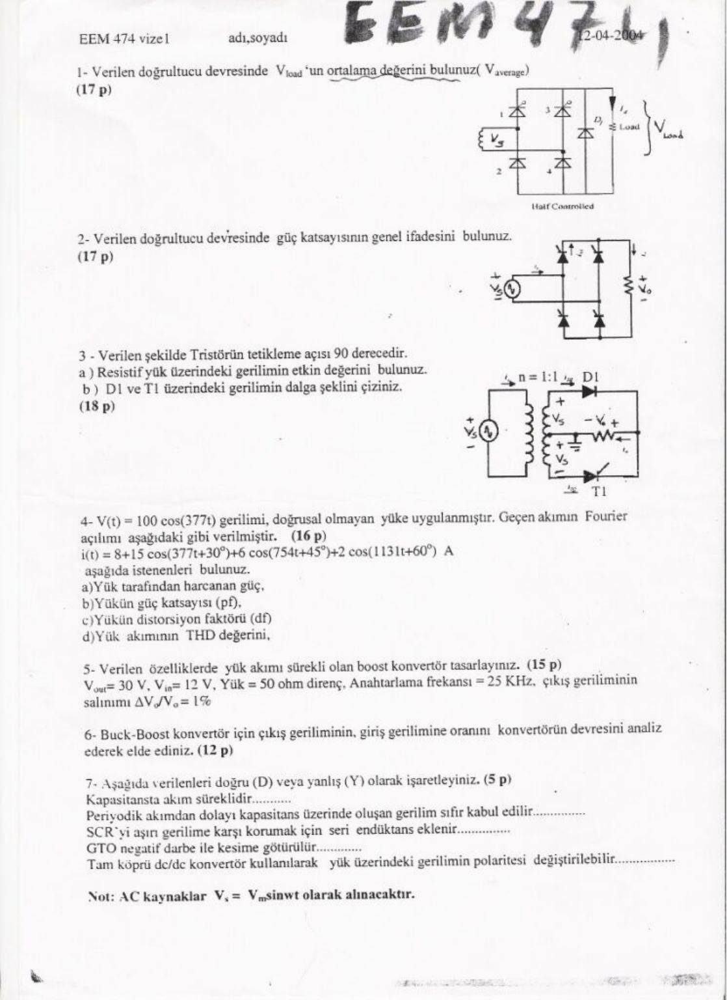
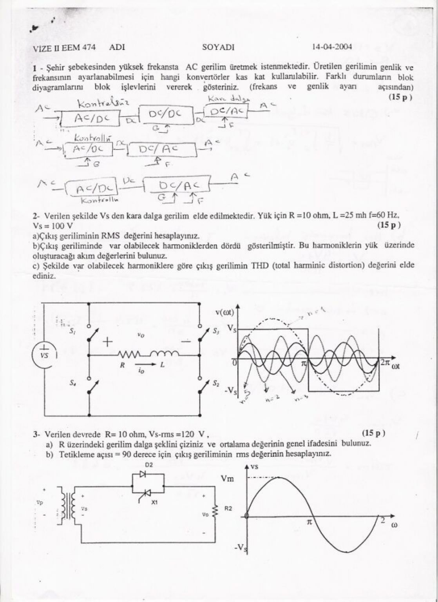
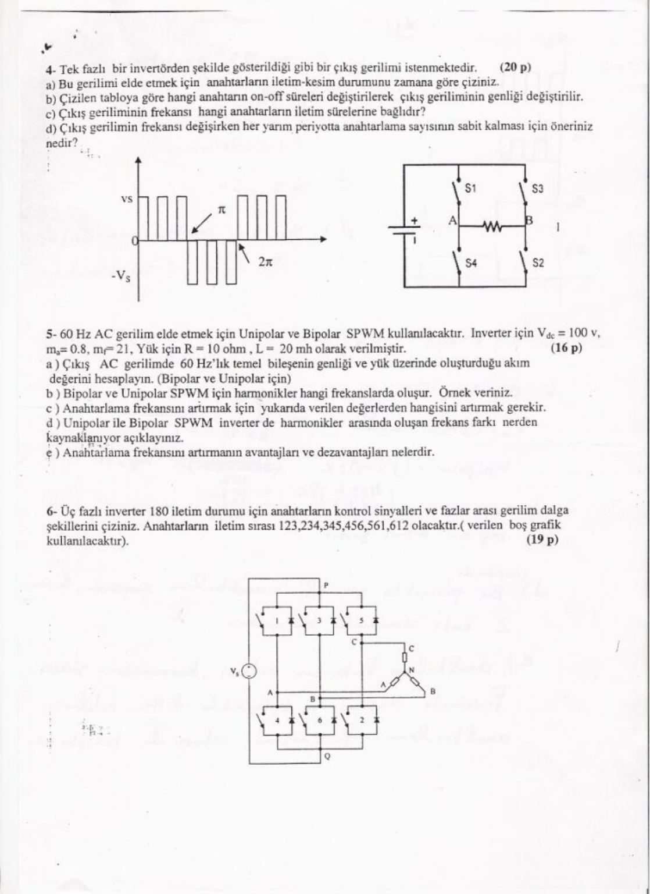
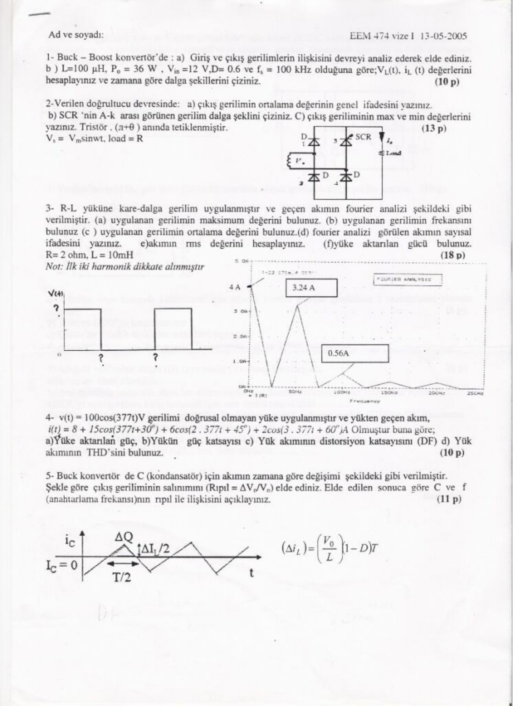
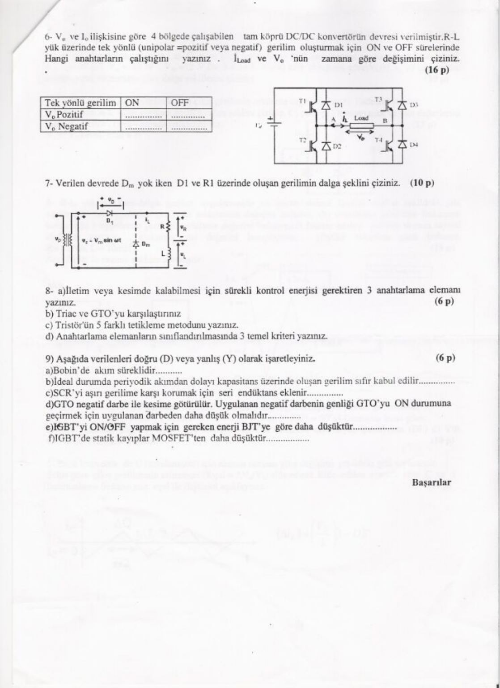

This is a transcription of scanned copies of the midterm exam papers for the EEM474 Power Electronics course from 2004 and 2005, together with the handwritten solutions written on them. The exams are dated 12 April 2004 (Midterm I), 14 April 2004 (Midterm II) and 13 May 2005 (Midterm I). The name fields on the papers are blank. All scanned pages are collected in the PDF at the end of the post.

## 12 April 2004 – Midterm I

1. Find the average value of Vload (Vaverage) in a half-controlled single-phase bridge rectifier circuit. (17 p)
2. Find the general expression for the power factor in the given rectifier circuit. (17 p)
3. The firing angle of the thyristor is 90° (n = 1:1 transformer, diode D1 and thyristor T1, resistive load). a) Find the RMS value of the voltage across the resistive load. b) Sketch the voltage waveforms across D1 and T1. (18 p)
4. The voltage v(t) = 100 cos(377t) V is applied to a nonlinear load. The Fourier expansion of the current drawn is given as i(t) = 8 + 15 cos(377t + 30°) + 6 cos(754t + 45°) + 2 cos(1131t + 60°) A. Find a) the power dissipated by the load, b) the power factor (pf) of the load, c) the distortion factor (df) of the load, d) the THD of the load current. (16 p)
5. Design a continuous-current boost converter: Vout = 30 V, Vin = 12 V, load 50 Ω, switching frequency 25 kHz, output voltage ripple ΔVo/Vo = 1%. (15 p)
6. Derive the ratio of the output voltage to the input voltage for the buck-boost converter by analyzing the circuit. (12 p)
7. True (T) / false (F) marking: current continuity in a capacitor; assuming the average voltage across a capacitor is zero because of the periodic current; adding a series inductance to protect an SCR against overvoltage; turning off a GTO with a negative pulse; the ability to reverse the polarity of the load voltage with a full-bridge DC/DC converter. (5 p)

Note: AC sources shall be taken as Vs = Vm sin ωt.

## 14 April 2004 – Midterm II

### Questions

1. High-frequency AC voltage is to be generated from the utility grid. Which converters can be cascaded so that the amplitude and frequency of the generated voltage can be adjusted? Show the block diagrams of the different cases, giving the function of each block (in terms of frequency and amplitude adjustment). (15 p)
2. A square-wave voltage is obtained from Vs = 100 V with a full-bridge inverter; the load is R = 10 Ω, L = 25 mH, f = 60 Hz. a) Calculate the RMS value of the output voltage. b) Four of the harmonics that may be present in the output voltage are shown; find the current values these harmonics produce in the load. c) Obtain the THD of the output voltage based on the harmonics shown in the figure. (15 p)
3. R = 10 Ω, Vs,rms = 120 V; the circuit contains a transformer, an antiparallel diode D2 and a thyristor X1. a) Sketch the voltage waveform across R and find the general expression for its average value. b) Calculate the RMS value of the output voltage for a firing angle of 90°. (15 p)
4. An output voltage with three pulses per half-cycle, as shown in the figure, is required from a single-phase inverter. a) Plot the on/off states of the switches versus time to obtain this voltage. b) According to the table you drew, by varying the on-off times of which switch is the amplitude of the output voltage changed? c) On which switches' conduction times does the frequency of the output voltage depend? d) What do you propose so that the number of switchings in each half-cycle stays constant while the output voltage frequency is varied? (20 p)
5. Unipolar and bipolar SPWM will be used to obtain a 60 Hz AC voltage. For the inverter, Vdc = 100 V, ma = 0.8, mf = 21, load R = 10 Ω, L = 20 mH. a) Calculate the amplitude of the 60 Hz fundamental component in the AC output voltage and the current it produces in the load (for bipolar and unipolar). b) At which frequencies do harmonics occur for bipolar and unipolar SPWM? Give examples. c) Which of the values given above must be increased in order to increase the switching frequency? d) What causes the difference in harmonic frequencies between unipolar and bipolar SPWM inverters? Explain. e) What are the advantages and disadvantages of increasing the switching frequency? (16 p)
6. For a three-phase inverter in the 180° conduction mode, draw the switch control signals and the line-to-line voltage waveforms. The switch conduction sequence shall be 123, 234, 345, 456, 561, 612. (19 p)

### Transcription of the handwritten solutions

**Question 1.** Three block chains are drawn: (i) uncontrolled AC/DC → DC/DC (amplitude control G) → DC/AC (frequency control F); (ii) controlled AC/DC (amplitude control G) → DC/AC (frequency control F); (iii) controlled AC/DC → DC/AC, with amplitude and frequency control by the inverter alone.

**Question 2.** For a square wave, Vrms = Vdc = 100 V (|v| = Vdc in every half-cycle). The harmonic components are Vn = 4Vdc/(nπ), and the currents are In = Vn / √(R² + (nω₀L)²). There are no even harmonics (the output is zero for n = 2).

| n | Vn (V) | In (A) |
|---|---|---|
| 1 | 127.3 | 9.27 |
| 3 | 42.4 | 1.42 |
| 5 | 25.5 | 0.53 |

The RMS value of the fundamental component is V1,rms = 4Vdc/(√2 π) ≈ 90.0 V; THD = √(Vrms² − V1,rms²) / V1,rms = √(100² − 90.03²)/90.03 ≈ 0.483 (48.3%).

**Question 3.** In the solution, the waveform is taken so that one half-cycle conducts fully and the other half-cycle conducts after 90°, giving Vorms = (Vm/2)·√(3/2) = 60√3. For Vm = 120√2 V this value is about 103.9 V; the paper reads "≈ 102 V".

*Note: 60√3 = 103.92 V; the 102 V on the paper is a rounding error.*

**Question 4.** a) Switches S1 and S2 are turned on with three pulses, while S3 and S4 are turned on for the whole half-cycle. b) The amplitude (RMS value) of the output voltage can be adjusted by varying the on/off times of switches S1 and S2. c) The output frequency depends on the conduction times of switches S3 and S4. d) The switching frequency of S1, S2 should be chosen as three times the frequency of S3, S4.

**Question 5.** a) Fundamental component amplitude ma·Vdc = 0.8 × 100 = 80 V. b) In bipolar SPWM the harmonics occur at multiples of (j·mf ± k), and in unipolar SPWM at multiples of (j·2mf ± k); for mf = 21, in bipolar they appear at the 19th, 21st and 23rd multiples, and in unipolar around 42 ± 1 and 42 ± 3. c) To increase the switching frequency, mf must be increased. d) Since unipolar SPWM has twice as many switchings per period as bipolar, the harmonics are clustered around 2mf. e) When the switching frequency is increased, the harmonics move to higher frequencies and are easily filtered; on the other hand, switching losses increase.

*Note: In the source, the frequencies are denoted by "fc"; the harmonic frequencies are multiples of the fundamental (reference) frequency: bipolar (j·mf ± k)·f₁ with k even for odd j, unipolar (j·2mf ± k)·f₁ with k odd (the 41st, 43rd, 39th, 45th multiples, ...). Taking Z₁ = √(10² + (2π·60·0.02)²) ≈ 12.5 Ω for the fundamental-component current, an 80 V peak fundamental gives ≈ 6.4 A peak current; this calculation is not written out in the source.*

## 13 May 2005 – Midterm I

1. For the buck-boost converter, a) obtain the relationship between the input and output voltages by analyzing the circuit. b) Given L = 100 µH, Po = 36 W, Vin = 12 V, D = 0.6, fs = 100 kHz, calculate VL(t) and iL(t) and sketch their waveforms versus time. (10 p)
2. In the given rectifier circuit (D1…D4 and an SCR, Vs = Vm sin ωt, load R), a) write the general expression for the average value of the output voltage, b) sketch the anode-cathode voltage waveform of the SCR, c) find the maximum and minimum values of the output voltage. The thyristor is fired at the instant (π + θ). (13 p)
3. A square-wave voltage is applied to an R-L load; the Fourier analysis of the current drawn is given as in the figure (R = 2 Ω, L = 10 mH; the first two harmonics are considered; the amplitudes are 3.24 A and 0.56 A). Find a) the maximum value of the applied voltage, b) its frequency, c) its average value; d) write the numerical expression of the current whose Fourier analysis is shown; e) the RMS value of the current; f) the power delivered to the load. (18 p)
4. The voltage v(t) = 100 cos(377t) V is applied to a nonlinear load; the current is i(t) = 8 + 15 cos(377t + 30°) + 6 cos(2·377t + 45°) + 2 cos(3·377t + 60°) A. Find a) the power delivered to the load, b) the power factor of the load, c) the distortion factor (DF) of the current, d) the THD of the load current. (10 p)
5. For the buck converter, the variation of the capacitor current with time is given (ΔQ triangle, ΔiL/2, T/2). Based on the figure, obtain the output voltage ripple (Ripple = ΔVo/Vo) and, from the result, explain the relationship between C, f (switching frequency) and the ripple. (ΔiL = (Vo/L)(1 − D)T) (11 p)
6. The circuit of a full-bridge DC/DC converter that can operate in four quadrants according to the Vo–Io relationship is given. To produce a unidirectional (unipolar: positive or negative) voltage across the R-L load, write in a table which switches operate during the ON and OFF intervals; sketch ILoad and Vo versus time. (16 p)
7. Without Dm (half-wave circuit with a transformer, R-L load, freewheeling diode Dm), sketch the voltage waveform across D1 and R1. (10 p)
8. a) List three switching devices that require continuous control energy to stay in conduction or cutoff. b) Compare the triac and the GTO. c) List five different triggering methods of a thyristor. d) List three basic criteria for the classification of switching devices. (6 p)
9. True/false: a) Current is continuous in an inductor; b) in the ideal case, the voltage across a capacitor due to a periodic current is assumed to be zero; c) a series inductance is added to protect an SCR against overvoltage; d) a GTO is turned off with a negative pulse, and the amplitude of the applied negative pulse must be lower than that of the pulse applied to turn the GTO on; e) the energy required to switch an IGBT on/off is lower than for a BJT; f) static losses in an IGBT are lower than in a MOSFET. (6 p)

*Note: It is inferred that the last page belongs to the 2005 exam from the continuation of the question numbers (from 5 to 6); the page carries no date. The values given for the Fourier spectrum in Question 3, 4 A (DC component), 3.24 A and 0.56 A, are used in the solution: Irms = √(4² + 3.24²/2 + 0.56²/2) ≈ 4.63 A.*

## Other handwritten solution pages

The following two pages do not contain the question texts, so it is not certain which exam they belong to; the transcription therefore includes only the results.

- **Power factor (question 4).** PF = P/S = (Vo,rms²/R) / (Vs,rms·Is,rms) = Vo,rms/Vs,rms. With Vo,rms² = (1/2π)∫α→π Vm² sin²t dt and Vs,rms = Vm/√2, PF = √(1 − α/π + sin2α/(2π)). (In the last line on the paper the terms are written at half scale; the expression above is its simplified form.)
- **Question 6.** Vm = 40√2 V; the output RMS value is 0.707 Vm = 40 V, the average is 0.6366 Vm ≈ 36 V; for the 4 Ω load, the load current is Io,rms = 10 A and Io,dc = 9 A, Is,rms = IL,rms = 10 A.
- **Question 8.** In the controlled bridge, Io,dc = Vo,dc/R, Vo,dc = (1/π)∫α→π+α Vm sin ωt dωt = (2Vm/π) cos α. For Vm = 120√2 V, R = 30 Ω, Idc = 2·120√2·cos25°/(π·30) ≈ 3.26 A at α = 25°; ≈ 0.93 A at α = 75°.
- **Question 9.** Three-phase bridge rectifier: Vdc = 3√3 Vm/π ≈ 1.654 Vm; for R = 100 Ω, Vm = 480√2 ≈ 678.8 V, Vdc ≈ 1122.8 V, Idc ≈ 11.23 A, Irms ≈ 11.24 A; the RMS source current equals the load current (Is,rms = IL,rms).

*Note: In the last line of Question 9, the expression PF = P/S = Irms²R/(Vrms·Irms) = Irms·R/Vs,rms is written and a value of 1123.7 is obtained; this number is in units of voltage (V), not a power factor. The PF at the rectifier input is not calculated separately.*
