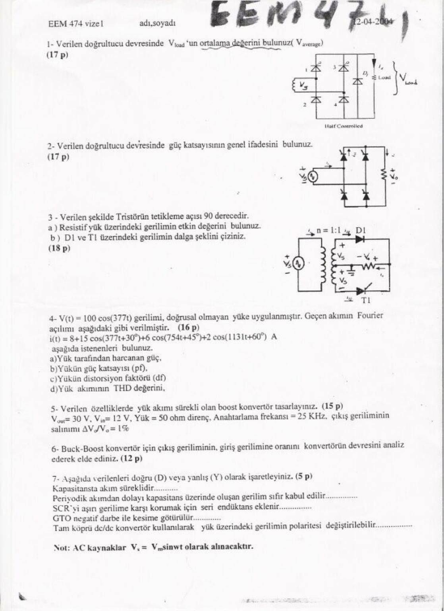
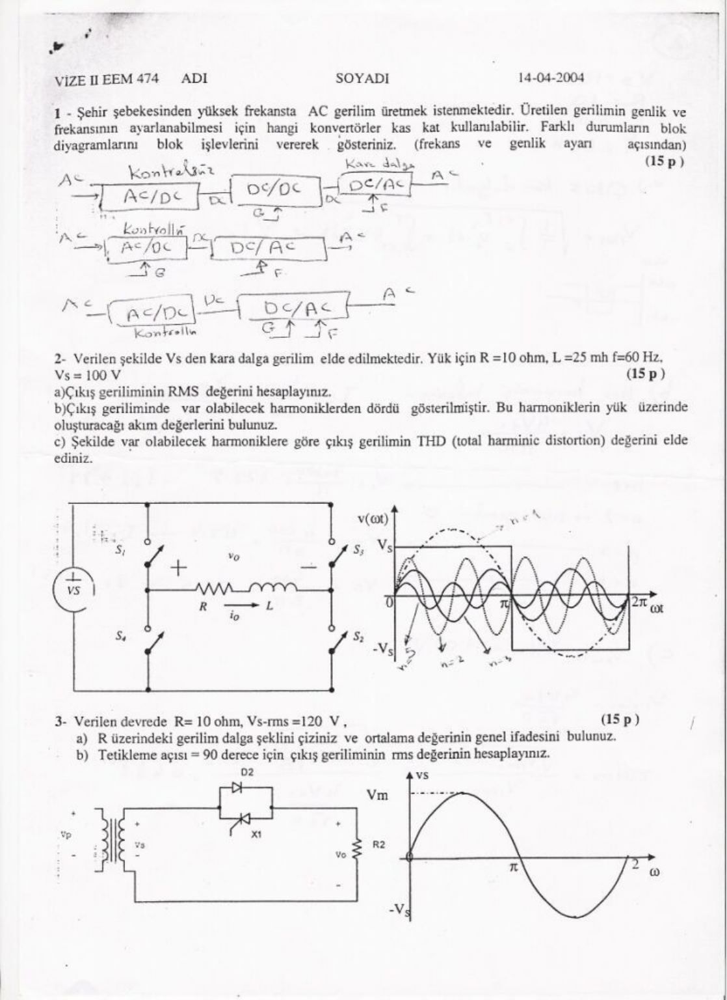
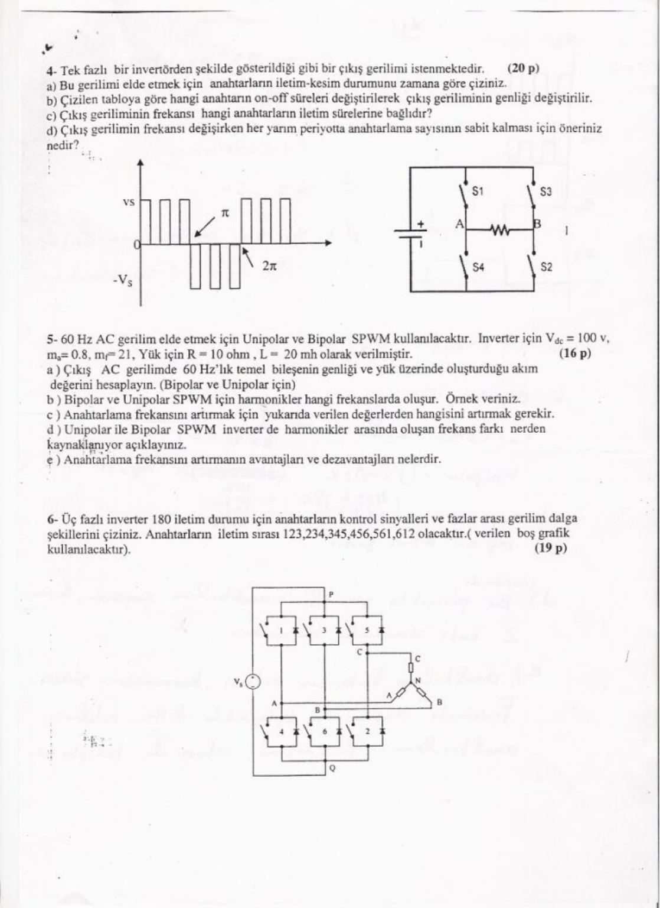
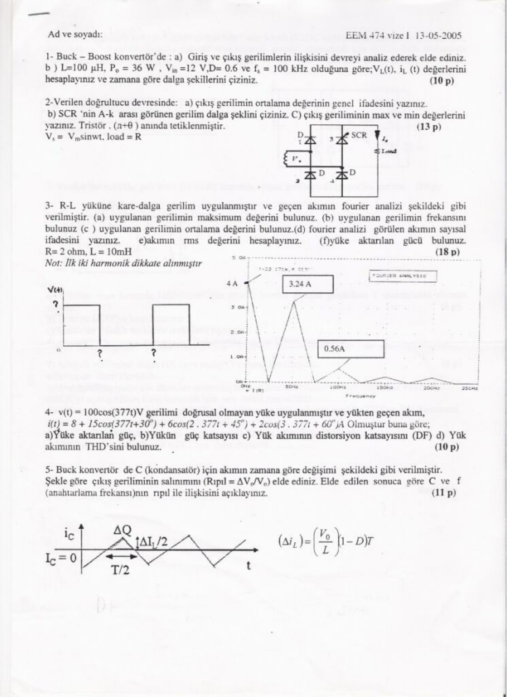
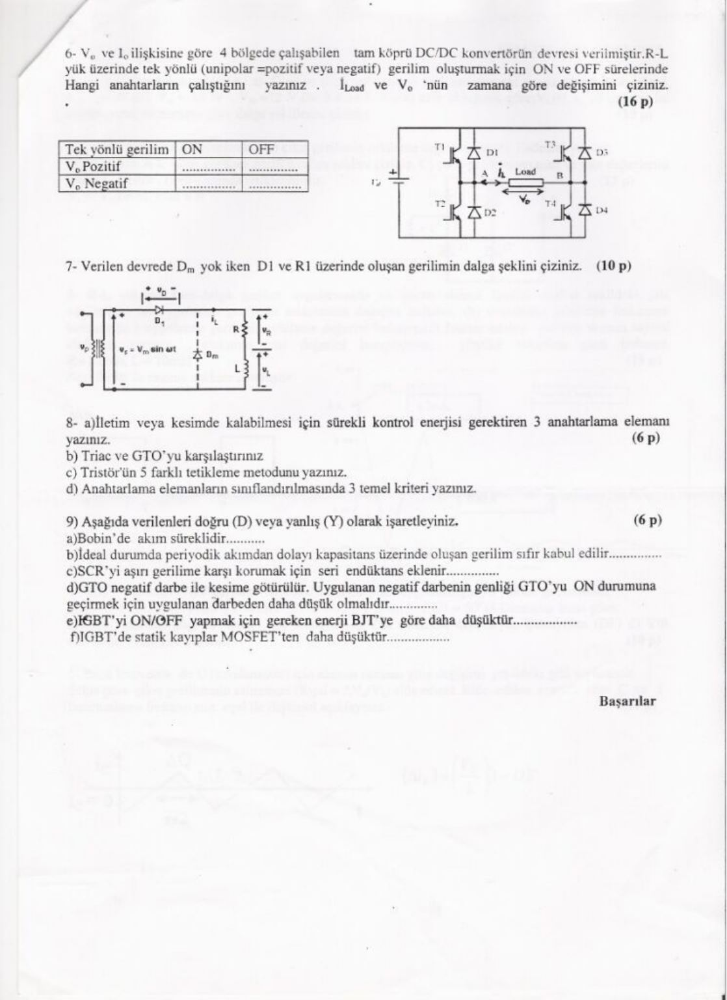

EEM474 Güç Elektroniği dersinin 2004 ve 2005 yıllarına ait ara sınav (vize) kâğıtlarının tarayıcıyla alınmış kopyaları ve üzerlerine el yazısıyla yazılmış çözümlerin metne aktarılmış hâli. Sınavlar sırasıyla 12 Nisan 2004 (Vize I), 14 Nisan 2004 (Vize II) ve 13 Mayıs 2005 (Vize I) tarihlidir. Kâğıtlarda ad-soyad alanları boştur. Tüm tarama sayfaları yazının sonundaki PDF'te toplanmıştır.

## 12 Nisan 2004 – Vize I

1. Yarı kontrollü tek fazlı köprü doğrultucu devresinde Vload'un ortalama değerini (Vaverage) bulunuz. (17 p)
2. Verilen doğrultucu devresinde güç katsayısının genel ifadesini bulunuz. (17 p)
3. Tristörün tetikleme açısı 90°'dir (n = 1:1 transformatör, D1 diyotu ve T1 tristörü, direnç yükü). a) Resistif yük üzerindeki gerilimin etkin değerini bulunuz. b) D1 ve T1 üzerindeki gerilimin dalga şeklini çiziniz. (18 p)
4. v(t) = 100 cos(377t) V gerilimi doğrusal olmayan yüke uygulanmıştır. Geçen akımın Fourier açılımı i(t) = 8 + 15 cos(377t + 30°) + 6 cos(754t + 45°) + 2 cos(1131t + 60°) A olarak verilmiştir. a) Yük tarafından harcanan güç, b) yükün güç katsayısı (pf), c) yükün distorsiyon faktörü (df), d) yük akımının THD değerini bulunuz. (16 p)
5. Sürekli akımlı bir boost konvertör tasarlayınız: Vout = 30 V, Vin = 12 V, yük 50 Ω, anahtarlama frekansı 25 kHz, çıkış gerilimi salınımı ΔVo/Vo = %1. (15 p)
6. Buck-boost konvertör için çıkış geriliminin giriş gerilimine oranını, devreyi analiz ederek elde ediniz. (12 p)
7. Doğru (D) / yanlış (Y) işaretleme: kapasitansta akım sürekliliği; periyodik akımdan dolayı kapasitans üzerindeki gerilimin ortalamasının sıfır kabul edilmesi; SCR'yi aşırı gerilimden korumak için seri endüktans eklenmesi; GTO'nun negatif darbeyle kesime götürülmesi; tam köprü DC/DC konvertörle yük üzerindeki gerilimin polaritesinin değiştirilebilmesi. (5 p)

Not: AC kaynaklar Vs = Vm sin ωt olarak alınacaktır.

## 14 Nisan 2004 – Vize II

### Sorular

1. Şehir şebekesinden yüksek frekansta AC gerilim üretilmek istenmektedir. Üretilen gerilimin genlik ve frekansının ayarlanabilmesi için hangi konvertörler kaskat kullanılabilir? Farklı durumların blok diyagramlarını blok işlevlerini vererek gösteriniz (frekans ve genlik ayarı açısından). (15 p)
2. Tam köprü evirici ile Vs = 100 V'tan kare dalga gerilim elde edilmektedir; yük R = 10 Ω, L = 25 mH, f = 60 Hz. a) Çıkış geriliminin RMS değerini hesaplayınız. b) Çıkış geriliminde var olabilecek harmoniklerden dördü gösterilmiştir; bu harmoniklerin yük üzerinde oluşturacağı akım değerlerini bulunuz. c) Şekildeki harmoniklere göre çıkış geriliminin THD değerini elde ediniz. (15 p)
3. R = 10 Ω, Vs,rms = 120 V; devrede transformatör, antiparalel D2 diyotu ve X1 tristörü bulunur. a) R üzerindeki gerilim dalga şeklini çiziniz ve ortalama değerinin genel ifadesini bulunuz. b) Tetikleme açısı 90° için çıkış geriliminin RMS değerini hesaplayınız. (15 p)
4. Tek fazlı bir invertörden şekilde gösterildiği gibi (her yarım periyotta üç darbeli) bir çıkış gerilimi istenmektedir. a) Bu gerilimi elde etmek için anahtarların iletim-kesim durumlarını zamana göre çiziniz. b) Çizilen tabloya göre hangi anahtarın on-off sürelerini değiştirerek çıkış geriliminin genliği değiştirilir? c) Çıkış geriliminin frekansı hangi anahtarların iletim sürelerine bağlıdır? d) Çıkış gerilimin frekansı değişirken her yarım periyotta anahtarlama sayısının sabit kalması için öneriniz nedir? (20 p)
5. 60 Hz AC gerilim elde etmek için unipolar ve bipolar SPWM kullanılacaktır. Evirici için Vdc = 100 V, ma = 0,8, mf = 21, yük R = 10 Ω, L = 20 mH. a) Çıkış AC gerilimde 60 Hz'lik temel bileşenin genliğini ve yük üzerinde oluşturduğu akım değerini hesaplayın (bipolar ve unipolar için). b) Bipolar ve unipolar SPWM için harmonikler hangi frekanslarda oluşur? Örnek veriniz. c) Anahtarlama frekansını artırmak için yukarıda verilen değerlerden hangisini artırmak gerekir? d) Unipolar ile bipolar SPWM inverter arasında harmonikler arasında oluşan frekans farkı nerden kaynaklanıyor? Açıklayınız. e) Anahtarlama frekansını artırmanın avantajları ve dezavantajları nelerdir? (16 p)
6. Üç fazlı inverter, 180° iletim durumu için anahtarların kontrol sinyallerini ve fazlar arası gerilim dalga şekillerini çiziniz. Anahtarların iletim sırası 123, 234, 345, 456, 561, 612 olacaktır. (19 p)

### El yazısı çözümlerin dökümü

**1. soru.** Üç blok zinciri çizilmiştir: (i) kontrolsüz AC/DC → DC/DC (genlik ayarı G) → DC/AC (frekans ayarı F); (ii) kontrollü AC/DC (genlik ayarı G) → DC/AC (frekans ayarı F); (iii) kontrollü AC/DC → DC/AC, genlik ve frekans ayarı yalnız eviriciden.

**2. soru.** Kare dalga için Vrms = Vdc = 100 V (her yarım periyotta |v| = Vdc). Harmonik bileşenler Vn = 4Vdc/(nπ), akımlar In = Vn / √(R² + (nω₀L)²). Çift harmonikler yoktur (n = 2 için çıkış sıfır).

| n | Vn (V) | In (A) |
|---|---|---|
| 1 | 127,3 | 9,27 |
| 3 | 42,4 | 1,42 |
| 5 | 25,5 | 0,53 |

Temel bileşenin etkin değeri V1,rms = 4Vdc/(√2 π) ≈ 90,0 V; THD = √(Vrms² − V1,rms²) / V1,rms = √(100² − 90,03²)/90,03 ≈ 0,483 (%48,3).

**3. soru.** Çözümde dalga şeklinin yarım periyodu tam, diğer yarım periyodu 90°'den sonra iletimde olacak biçimde alınmış ve Vorms = (Vm/2)·√(3/2) = 60√3 sonucuna varılmıştır. Vm = 120√2 V için bu değer yaklaşık 103,9 V'tur; kâğıtta "≈ 102 V" yazılmıştır.

*Not: 60√3 = 103,92 V'tur; kâğıttaki 102 V yuvarlama hatasıdır.*

**4. soru.** a) S1 ve S2 anahtarları üç darbe ile, S3 ve S4 yarım periyot boyunca iletime sokulur. b) S1 ve S2 anahtarlarının on/off süreleri değiştirilerek çıkış geriliminin genliği (etkin değeri) ayarlanabilir. c) Çıkış frekansı S3 ve S4 anahtarlarının iletim sürelerine bağlıdır. d) S1, S2 anahtarlama frekansı S3, S4 frekansının üç katı olarak seçilmelidir.

**5. soru.** a) Temel bileşen genliği ma·Vdc = 0,8 × 100 = 80 V. b) Bipolar SPWM'de harmonikler (j·mf ± k) katlarında, unipolar SPWM'de (j·2mf ± k) katlarında oluşur; mf = 21 için bipolarda 19, 21, 23. katlar, unipolarda 42 ± 1 ve 42 ± 3 çevresinde. c) Anahtarlama frekansını artırmak için mf artırılmalıdır. d) Unipolar SPWM'de bir periyottaki anahtarlama sayısı bipolara göre iki kat olduğundan harmonikler 2mf çevresinde toplanır. e) Anahtarlama frekansı artınca harmonikler yüksek frekanslara kayar ve kolayca filtrelenir; buna karşılık anahtarlama kayıpları artar.

*Not: Kaynaktaki yazımda frekanslar "fc" ile gösterilmiştir; harmonik frekansları temel (referans) frekansın katlarıdır: bipolar (j·mf ± k)·f₁ ile j tek ise k çift, unipolar (j·2mf ± k)·f₁ ile k tek (41, 43, 39, 45. katlar...). Temel bileşen akımı için Z₁ = √(10² + (2π·60·0,02)²) ≈ 12,5 Ω alınırsa 80 V tepe değerli temel bileşenden ≈ 6,4 A tepe akım elde edilir; kaynakta bu hesap yazılmamıştır.*

## 13 Mayıs 2005 – Vize I

1. Buck-boost konvertörde a) giriş ve çıkış gerilimlerinin ilişkisini devreyi analiz ederek elde ediniz. b) L = 100 µH, Po = 36 W, Vin = 12 V, D = 0,6, fs = 100 kHz olduğuna göre VL(t) ve iL(t) değerlerini hesaplayınız ve zamana göre dalga şekillerini çiziniz. (10 p)
2. Verilen doğrultucu devresinde (D1…D4 ve bir SCR, Vs = Vm sin ωt, yük R) a) çıkış geriliminin ortalama değeri için genel ifadeyi yazınız, b) SCR'nin anot-katot arası gerilim dalga şeklini çiziniz, c) çıkış geriliminin maksimum ve minimum değerlerini bulunuz. Tristör (π + θ) anında tetiklenmiştir. (13 p)
3. R-L yüküne kare dalga gerilim uygulanmış; geçen akımın Fourier analizi şekildeki gibi verilmiştir (R = 2 Ω, L = 10 mH; ilk iki harmonik dikkate alınmıştır; genlikler 3,24 A ve 0,56 A). a) Uygulanan gerilimin maksimum değerini, b) frekansını, c) ortalama değerini bulunuz; d) Fourier analizi görülen akımın sayısal ifadesini yazınız; e) akımın RMS değerini; f) yüke aktarılan gücü bulunuz. (18 p)
4. v(t) = 100 cos(377t) V gerilimi doğrusal olmayan yüke uygulanmıştır; akım i(t) = 8 + 15 cos(377t + 30°) + 6 cos(2·377t + 45°) + 2 cos(3·377t + 60°) A. a) Yüke aktarılan güç, b) yükün güç katsayısı, c) akımın distorsiyon katsayısı (DF), d) yük akımının THD'si. (10 p)
5. Buck konvertörde kondansatör akımının zamana göre değişimi verilmiştir (ΔQ üçgeni, ΔiL/2, T/2). Şekle göre çıkış geriliminin salınımını (Ripple = ΔVo/Vo) elde ediniz ve sonuca göre C ve f (anahtarlama frekansı) ile ripple ilişkisini açıklayınız. (ΔiL = (Vo/L)(1 − D)T) (11 p)
6. Vo ve Io ilişkisine göre dört bölgede çalışabilen tam köprü DC/DC konvertörün devresi verilmiştir. R-L yük üzerinde tek yönlü (unipolar: pozitif veya negatif) gerilim oluşturmak için ON ve OFF sürelerinde hangi anahtarların çalıştığını tabloya yazınız; ILoad ve Vo'nun zamana göre değişimini çiziniz. (16 p)
7. Dm yokken (transformatörlü yarım dalga devre, R-L yük, serbest dolaşım diyotu Dm) D1 ve R1 üzerinde oluşan gerilimin dalga şeklini çiziniz. (10 p)
8. a) İletim veya kesimde kalabilmesi için sürekli kontrol enerjisi gerektiren üç anahtarlama elemanını yazınız. b) Triyak ile GTO'yu karşılaştırınız. c) Tristörün beş farklı tetikleme metodunu yazınız. d) Anahtarlama elemanlarının sınıflandırılmasında üç temel kriteri yazınız. (6 p)
9. Doğru/yanlış: a) Bobinde akım süreklidir; b) ideal durumda periyodik akımdan dolayı kapasitans üzerinde oluşan gerilim sıfır kabul edilir; c) SCR'yi aşırı gerilime karşı korumak için seri endüktans eklenir; d) GTO negatif darbe ile kesime götürülür, uygulanan negatif darbenin genliği GTO'yu ON durumuna geçirmek için uygulanan darbeden daha düşük olmalıdır; e) IGBT'yi ON/OFF yapmak için gereken enerji BJT'ye göre daha düşüktür; f) IGBT'de statik kayıplar MOSFET'ten daha düşüktür. (6 p)

*Not: Son sayfanın 2005 sınavına ait olduğu, soru numaralarının (5'ten 6'ya) devam etmesinden çıkarılmıştır; sayfada tarih yazmamaktadır. 3. sorudaki Fourier spektrumu için verilen 4 A (doğru bileşen), 3,24 A ve 0,56 A değerleri çözümde kullanılır: Irms = √(4² + 3,24²/2 + 0,56²/2) ≈ 4,63 A.*

## Diğer el yazısı çözüm sayfaları

Aşağıdaki iki sayfada soru metinleri bulunmadığından hangi sınava ait oldukları kesin değildir; aktarma bu nedenle yalnız sonuçları içerir.

- **Güç katsayısı (soru 4).** PF = P/S = (Vo,rms²/R) / (Vs,rms·Is,rms) = Vo,rms/Vs,rms. Vo,rms² = (1/2π)∫α→π Vm² sin²t dt ve Vs,rms = Vm/√2 ile PF = √(1 − α/π + sin2α/(2π)) olur. (Kâğıttaki son satırda terimler yarım ölçekte yazılmış; yukarıdaki ifade sadeleştirilmiş biçimidir.)
- **Soru 6.** Vm = 40√2 V; çıkış etkin değeri 0,707 Vm = 40 V, ortalaması 0,6366 Vm ≈ 36 V; yük akımı 4 Ω'luk yükte Io,rms = 10 A ve Io,dc = 9 A, Is,rms = IL,rms = 10 A.
- **Soru 8.** Kontrollü köprüde Io,dc = Vo,dc/R, Vo,dc = (1/π)∫α→π+α Vm sin ωt dωt = (2Vm/π) cos α. Vm = 120√2 V, R = 30 Ω için α = 25°'de Idc = 2·120√2·cos25°/(π·30) ≈ 3,26 A; α = 75°'de ≈ 0,93 A.
- **Soru 9.** Üç fazlı köprü doğrultucu: Vdc = 3√3 Vm/π ≈ 1,654 Vm; R = 100 Ω, Vm = 480√2 ≈ 678,8 V için Vdc ≈ 1122,8 V, Idc ≈ 11,23 A, Irms ≈ 11,24 A; kaynak akımının etkin değeri yük akımıyla aynıdır (Is,rms = IL,rms).

*Not: Soru 9'daki son satırda güç katsayısı için PF = P/S = Irms²R/(Vrms·Irms) = Irms·R/Vs,rms ifadesi yazılmış ve 1123,7 değeri bulunmuştur; bu sayı güç katsayısı değil, gerilim (V) cinsindendir. Doğrultucu girişindeki PF ayrıca hesaplanmamıştır.*
