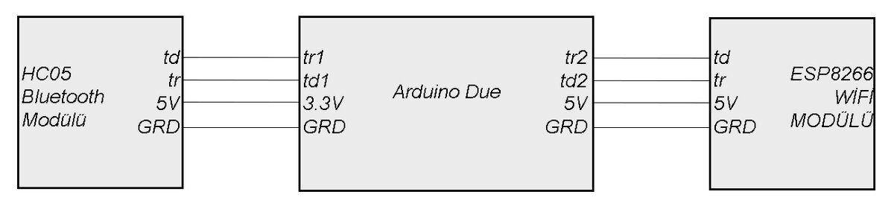
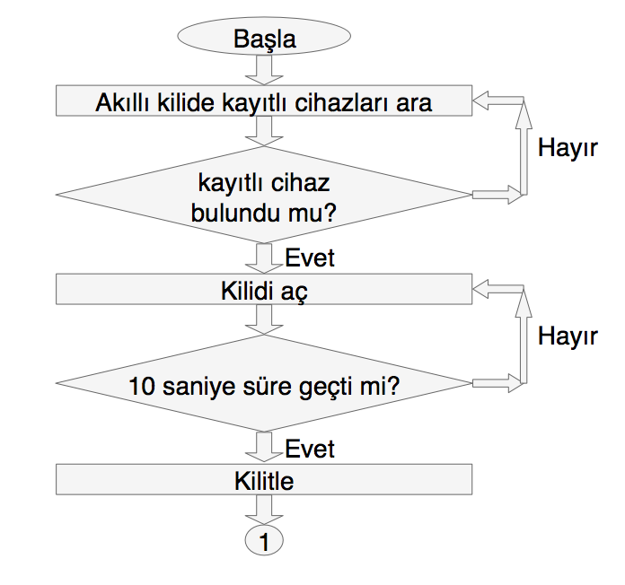
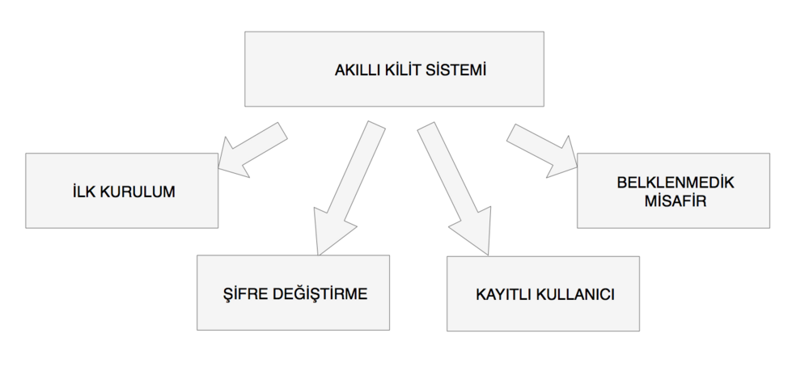

This post describes the **Smart Lock System** that Hasan Can Öztürk developed together with a project partner during the **EEM491 Capstone Project I** (fall 2016) and **EEM492 Capstone Project II** (spring 2017) courses in the Department of Electrical and Electronics Engineering at Başkent University. Hasan Can Öztürk was the group leader on the project. The advisor was **Asst. Prof. Dr. Alparslan Çağrı Yapıcı**, and the jury members were **Prof. Dr. Murat Emin Akata** and **Assoc. Prof. Dr. Sedat Nazlıbilek**.

The post was compiled from the capstone report, the presentations from both semesters, the project poster, three firmware versions, two Android applications (MIT App Inventor and Java), and the diagrams in the design folder. The package containing the report (with student numbers, the project partner's name, and the résumé pages covered up), the poster, all the code, and the diagrams can be downloaded at the end of the post.

. The project partner's name and e-mail were removed from the poster.")

## Project objective

In the poster's wording, the objective is *"to build a device that, in addition to traditional methods, lets us open and lock the door with smart technologies for the door locks of homes and workplaces"*. The mechanism was built with Wi-Fi and Bluetooth technologies. The Concept Definition and Operation Document (KTİD) in the report lists the following expectations of the system:

1. When one comes within about **3 meters** of the door, the lock will be opened **automatically** with a mobile phone.
1. Until the lock password is changed, it will be enough for the correct password to have been entered once; any smartphone user who knows the password will be able to enter.
1. The lock will open in **less than 1 second**.
1. At distances greater than 3 meters, the lock will be opened with an **internet connection** and a mobile phone. This will be done through an account assigned to the user, with a username and password.
1. The password used for automatic opening at close range can be changed through this account.

The Project Requirements Specification Document (PİBD) divides this into hardware and software tasks: building a door lock control circuit with contactless communication technologies, making the circuit support Bluetooth and Wi-Fi, developing the software that will run on the circuit, the phone interface, and the server software for control over the internet, and finally integrating the subunits to prepare a first prototype suitable for mass production.

### From home automation to smart lock

The project's initial proposal carried a broader title: **"Development of a Home Automation System with Near-Field and Far-Field Communication"**. The proposal presentation describes a structure in which any phone user who knows the password can open the lock when communicating at close range, while the system administrator can open it remotely and assign passwords. For the remote connection, a **MySQL** database on the server, **PHP** for communication with the server, **HTML** for the browser interface, **Java** for Android, and **Swift** for iOS were planned. An **LCD and keypad** for assigning the password in case of connection problems, and a **mechanical key** as an "emergency solution" for situations where all power is cut, were also planned.

As the project progressed, the scope narrowed to the **door lock**, which is one part of home automation: in the first semester, close-range control over Bluetooth; in the second semester, control through the network over Wi-Fi and driving the actual lock mechanism with a motor.

## System architecture

")

According to the "Implementation" section of the report, the system consists of four main subunits:

1. **Door control unit with Bluetooth** — a close-range connection when the phone approaches the lock.
1. **Door control unit with Wi-Fi** — control with an HTTP request from a phone on the same network.
1. **Motor control unit** — a driver that moves the motor in two directions on the Arduino's command.
1. **Physical lock unit** — a motorized mechanism placed inside a mortise door lock.

The report summarizes the order of work as follows: first the development board, Bluetooth module, and smart device operating system were researched and selected; the Arduino software for the Bluetooth module was completed and the module was tested; then the phone application that would send data to the Bluetooth module was written; finally the motor was driven in order to control the door lock with the motor driver board.

### Components used

| Component | Function | Note |
| --- | --- | --- |
| Arduino Due (1st semester), Arduino Uno (2nd semester) | Control center; processes commands coming from Bluetooth and Wi-Fi and drives the motor | The poster lists the processor as ATmega328P (Uno) |
| HC-06 Bluetooth module | Short-range serial communication with the phone (SPP), in slave mode | Bluetooth 2.0 + EDR, 2.4 GHz; configured with AT commands. The wiring diagrams say HC-05 |
| ESP8266 Wi-Fi module | Connects to the network and opens a small web server on port 80 | Managed from the Arduino's serial port with the AT command set |
| Motor driver + geared DC motor | Moves the lock bolt in both directions | Driven by Arduino pins 6 and 7 |
| Lock mechanism | The physical door lock | The largest item in the budget |
| LED | In the first semester, in place of the lock, to show whether the door is open/closed | Remained as a status indicator in the second semester too |
| LCD and numeric keypad | In the first semester, for creating a password and manual entry in an emergency | In the final presentation, "the keypad used for emergencies" |
| Battery | Power supply | On the poster: "Just run it with a single battery" |

According to the power section of the poster, the parts of the device that consume power are the ATmega328P processor, the Wi-Fi module, the Bluetooth module, and the DC motor. The total consumption of both modules and the processor in **sleep mode** is below 4 mA. Thanks to the gearbox on the motor, a current of **0.8 A** is drawn when 9 V is applied to the circuit input, and this allows the device to run on one battery for an average of **more than 6 months**. The poster also includes a graph supporting this, "Maximum Output Current vs. Input Voltage Comparison" (9 V and 12 V curves).

*Note: None of the firmware versions in the archive contains code that puts the device into sleep mode; the consumption and battery-life values on the poster should be read as a design target.*

## Hardware and connections

Two wiring arrangements were used during the project. In the first semester, thanks to the multiple hardware serial ports of the **Arduino Due**, the Bluetooth and Wi-Fi modules were connected to separate ports:



In the second semester, the board was changed to the **Arduino Uno**. Since the Uno has only one hardware serial port, the Wi-Fi module was connected to the hardware serial port (0–1) and the Bluetooth module was connected to **pins 10 and 11** using `SoftwareSerial`:

")

The design folder also contains a **current cut-off circuit** conceived to protect the motor. The schematic shows an Arduino Mega, a 12 V car battery, a 12 V DC motor, a single-channel relay module, a current sensor, and a momentary push button. When the motor drives the lock bolt all the way to its end, the current rises; the circuit was designed to cut the motor current at **3–5 A** ("Max 3A – 5A to cut off").

")

*Note: In the final firmware, the motor is stopped by time (2.5 seconds) rather than by measuring current; the current cut-off circuit remained a design that was not reflected in the code.*

## Firmware

The archive contains three versions of the Arduino code. All share the same skeleton: connecting the ESP8266 to the network with AT commands and opening a web server, managing the lock according to the characters coming from Bluetooth, and sending a regular "keep-alive" signal to the phone.

| Version | Date | Board | Lock | Difference |
| --- | --- | --- | --- | --- |
| `SmartKey_ArduinoDue.ino` | April 2017 | Arduino Due | LED | Bluetooth on `Serial2` (9600 baud), ESP8266 on `Serial1` (115200), debug output on `Serial3`. ON/OFF buttons on the web page |
| `SmartKey_ESP8266_v1_LED.ino` | April 2017 | Arduino Uno | LED | Bluetooth on `SoftwareSerial` (10, 11; 38400 baud). A signal (`ping`) to the phone every 500 ms was added |
| `SmartKey_ESP8266_v2_Motor.ino` | May 2017 | Arduino Uno | Motor driver (pins 6–7) | Motor instead of LED: lock opening/locking movements, mechanism test at startup |

### How the final version works

**Startup (`setup`)**

1. The serial port for the Wi-Fi module is opened at **115200** baud and the software serial port for Bluetooth at **38400** baud.
1. `AT` is sent to the ESP8266; if the module returns `OK`, it is put into **station (STA)** mode with `AT+CWMODE=1` and connected to the wireless network with `AT+CWJAP_CUR`. The LED is on while the connection is in progress and turns off when `OK` arrives.
1. DHCP is turned off with `AT+CWDHCP_CUR=1,0` and a **static IP (192.168.1.20)** is assigned with `AT+CIPSTA_CUR`. This way the phone application always finds the lock at the same address.
1. Multiple connections are enabled with `AT+CIPMUX=1` and a **server on port 80** is started with `AT+CIPSERVER=1,80`.
1. The motor makes a short open–close movement (3 s in the opening direction, 200 ms in the closing direction); that the mechanism works can be seen at startup.

**Main loop (`loop`)**

- **Wi-Fi:** If `+IPD,` (an incoming HTTP request) is read from the ESP8266, a short response (`<head> Hello World </head>`) is sent to the browser and the rest of the request is read in the `led_yakma()` function: if it contains `pin=on`, the lock is **opened**; if it contains `pin=off`, it is **locked**. The connection is closed with `AT+CIPCLOSE=0`.
- **Bluetooth:** If there is data on the software serial port, `kilit_kontrol_bt()` examines each incoming character:
  - `t` → the LED turns on and a **30-second** counter starts (sent when the phone approaches and connects automatically).
  - `n` → the lock is **opened**.
  - `f` → the lock is **locked** and the counter stops.
- **Counter:** While the counter is active, the elapsed seconds are written to the phone over Bluetooth; when 30 seconds are up, the LED turns off.
- **Keep-alive signal:** Every 500 ms, `500` is written to the phone. When the phone application cannot receive this data, it understands that the connection has dropped, that is, that the user has moved away from the door.

**Motor movement:** To open, `in2` is set HIGH and `in1` LOW and the motor is turned for **2.5 seconds**, then the direction is reversed for 300 ms and the motor is stopped. To lock, `in1` is set HIGH and the motor is turned in the opposite direction for 2.5 seconds.

### Code: `SmartKey_ESP8266_v2_Motor.ino`

```cpp
#include <SoftwareSerial.h>
SoftwareSerial mySerial(10, 11); // RX, TX

#define ag_ismi "wireless"
#define ag_sifresi "********"
#define LED 8
#define LED1 13
#define bekleme_suresi 30000
#define ping_zamani 500

const int in1 = 7;
const int in2 = 6;
unsigned long simdikizaman = 0, oncekizaman = 0, ping = 0;
char sayac_acik = 0;
int fark = 0;

void setup()
{
  // mySerial.begin(115200);   //bluethoot icin
  Serial.begin(115200); //Seriport'u açıyoruz. Güncellediğimiz Wifi
  mySerial.begin(38400); //Seriport'u açıyoruz. Güncellediğimiz BT


  //ESP modülünün baudRate değeri 115200 olduğu için bizde Seriport'u 115200 şeklinde seçiyoruz
  Serial.println("AT"); //ESP modülümüz ile bağlantı kurulup kurulmadığını kontrol ediyoruz.
  pinMode(LED1, OUTPUT);
  pinMode(LED, OUTPUT);
  pinMode (in1, OUTPUT);
  pinMode (in2, OUTPUT);
  delay(3000); //ESP ile iletişim için 3 saniye bekliyoruz.

  if (Serial.find("OK")) {       //esp modülü ile bağlantıyı kurabilmişsek modül "AT" komutuna "OK" komutu ile geri dönüş yapıyor.
    Serial.println("AT+CWMODE=1"); //esp modülümüzün WiFi modunu STA şekline getiriyoruz. Bu mod ile modülümüz başka ağlara bağlanabilecek.
    digitalWrite(LED, HIGH);
    delay(2000);
    String baglantiKomutu = String("AT+CWJAP_CUR=\"") + ag_ismi + "\",\"" + ag_sifresi + "\"";
    Serial.println(baglantiKomutu);
    delay(5000);
    if (Serial.find("OK"))
      digitalWrite(LED, LOW);
  }

  Serial.println("AT+CWDHCP_CUR=1,0");    //DHCP yi kapat
  delay(500);
  Serial.println("AT+CIPSTA_CUR=\"192.168.1.20\",\"192.168.1.1\",\"255.255.255.0\"");   //static IP ata
  delay(500);

  Serial.println("AT+CIPMUX=1");
  delay(1000);
  Serial.println("AT+CIPSERVER=1,80");
  delay(1000);
  Serial.println("AT+CIPCLOSE=0");


  ping = millis();

  //-----------------------------------------------
    //Serial.begin(9600);  
    digitalWrite(in1, LOW); //açar
    digitalWrite(in2, HIGH);
    delay(3000);
    digitalWrite(in2, LOW); //kapar
    digitalWrite(in1, HIGH);
    delay(200);
    digitalWrite(in2, LOW);
    digitalWrite(in1, LOW);
    delay(1);
    //--------------------------------------------------
}


void loop() {
  if (Serial.available() > 0) {
    if (Serial.find("+IPD,")) {
      String metin = "<head> Hello World </head>";
      // metin += "<br><a href=\" ?pin=on\"><button type='button'>ON</button></a>";
      // metin += "<br><a href=\" ?pin=off\"><button type='button'>OFF</button></a>";
      String cipsend = "AT+CIPSEND=";
      cipsend += "0";
      cipsend += ",";
      cipsend += metin.length();
      cipsend += "\r\n";
      Serial.print(cipsend);
      delay(500);
      Serial.println(metin);
      led_yakma();
      Serial.println("AT+CIPCLOSE=0");

    }
  }

  if (mySerial.available() > 0) {
    kilit_kontrol_bt();
  }

  if (sayac_acik && millis() - oncekizaman > bekleme_suresi) {
    sayac_acik = 0;
    digitalWrite(LED, LOW);
  }

  if (sayac_acik && millis() - oncekizaman <= bekleme_suresi) {
    fark = (millis () - oncekizaman) / 1000;
    mySerial.print(fark);
    mySerial.print("\r");
  }

  if (millis() - ping >= ping_zamani)
  {
    ping = millis();
    mySerial.print(ping_zamani);
  }
}


void led_yakma() {
  String gelen = "";
  char serialdenokunan;
  int ii = 0;

  while (Serial.available() > 0) {
    serialdenokunan = Serial.read();
    gelen += serialdenokunan;
    ii++;
  }

  if ((gelen.indexOf("pin=on") > 1)) { //on butonuna basıldığında server adresinde /?pin=on var ise
    digitalWrite(LED, HIGH);                 //ledi yakar
     //-----------------------------------------------
      digitalWrite(in2, HIGH); //kilidi açar
      digitalWrite(in1, LOW);
      delay(2500);
      digitalWrite(in2, LOW); //kapar
      digitalWrite(in1, HIGH);
      delay(300);
      digitalWrite(in2, LOW);
      digitalWrite(in1, LOW);
      delay(1);
      //----------------------------------------

  }
  if ((gelen.indexOf("pin=off") > 1)) { // off butonuna basıldığında server adresinde /?pin=off var ise
    digitalWrite(LED, LOW);                   //ledi söndürür
    //-----------------------------------------------
      digitalWrite(in2, LOW); //kapar
      digitalWrite(in1, HIGH);
      delay(2500);
      digitalWrite(in2, LOW);
      digitalWrite(in1, LOW);
      delay(1);
      //-----------------------------------------------

  }
}

void kilit_kontrol_bt() {
  String gelenbt = "";
  char serialdenokunanbt;

  while (mySerial.available() > 0) {
    serialdenokunanbt = mySerial.read();
    gelenbt += serialdenokunanbt;

    if (serialdenokunanbt == 't') { //on butonuna basıldığında server adresinde blu=on var ise
      digitalWrite(LED, HIGH);                 //ledi yakar
      oncekizaman = millis();
      sayac_acik = 1;
    }

    if (serialdenokunanbt == 'n') { //on butonuna basıldığında server adresinde blu=on var ise
      digitalWrite(LED, HIGH);                 //ledi yakar
       //-----------------------------------------------
      digitalWrite(in2, HIGH); //kilidi açar
      digitalWrite(in1, LOW);
      delay(2500);
      digitalWrite(in2, LOW); //kapar
      digitalWrite(in1, HIGH);
      delay(300);
      digitalWrite(in2, LOW);
      digitalWrite(in1, LOW);
      delay(1);
      //----------------------------------------

    }

    if (serialdenokunanbt == 'f') { // off butonuna basıldığında server adresinde blu=off var ise
      digitalWrite(LED, LOW);                   //ledi söndürür
      //-----------------------------------------------
      digitalWrite(in2, LOW); //kapar
      digitalWrite(in1, HIGH);
      delay(2500);
      digitalWrite(in2, LOW);
      digitalWrite(in1, LOW);
      delay(1);
      //-----------------------------------------------

      sayac_acik = 0;
    }
  }

}
```

*Note: The Wi-Fi password in the code was replaced with `********` in the published copy. Because commands are processed character by character, any `n` appearing in a message from Bluetooth opens the lock. The application's `1234 blu=on 5678` relies on this (the `n` in `on`), while `1234 blu=off 5678` locks thanks to the `f`. The `1234` / `5678` at the beginning and end of the message are not verified in the firmware. On the Wi-Fi side as well, the request is plain HTTP without authentication. The report's security section relies on Bluetooth transferring data only between paired devices and on frequency hopping; the network-side account and password, and encrypted commands, remained steps that were targeted in the KTİD but are not present in the archived code.*

## Android application

There are two separate Android applications in the project.

### First semester: Bluetooth application in Java

The first version was written in Java in Android Studio (project name `deneme39`, January 2017). On startup, the application checks the phone's Bluetooth (asks for it to be turned on if it is off), lists the paired devices, and scans the surrounding devices. When the device labeled "(Eslesti)" (Paired) in the list is tapped, an **RFCOMM socket** is opened with `ConnectThread` (serial port profile UUID `00001101-0000-1000-8000-00805F9B34FB`); once the connection is established, `ConnectedThread` reads the incoming data and displays it on the screen. The "Lambayı Aç" (Turn the Lamp On) and "Lambayı Kapat" (Turn the Lamp Off) buttons send the characters `1` and `2` to the module, respectively. In this semester there was an LED in place of the lock.

```java
private class ConnectThread extends Thread {
    private final BluetoothSocket mmSocket;
    private final BluetoothDevice mmDevice;

    public ConnectThread(BluetoothDevice device) {
        BluetoothSocket tmp = null;
        mmDevice = device;
        try {
            tmp = device.createRfcommSocketToServiceRecord(mmuuid);
        } catch (IOException e) {
        }
        mmSocket = tmp;
    }

    public void run() {
        blt.cancelDiscovery();
        try {
            mmSocket.connect();
        } catch (IOException connectException) {
            try {
                mmSocket.close();
            } catch (IOException closeException) { }
            return;
        }
        mHandler.obtainMessage(baglanti, mmSocket).sendToTarget();
    }
}

public void ledon() throws IOException {
    outstream.write("1".getBytes());
}

public void ledoff() throws IOException {
    outstream.write("2".getBytes());
}
```

*Note: The `1` / `2` commands belong to the first semester's LED circuit; the firmware versions in the archive process the characters `t`, `n`, `f`. The first semester's Arduino code is not in the archive. The report's appendices also include this application's code, the interface layout (`activity_main.xml`), and, under the manifest heading, again the interface layout.*

### Second semester: SmartLock with App Inventor

In the second semester, the application was rebuilt in **MIT App Inventor** (application name **SMARTLOCK**). There are two versions in the archive (April 17 and 18, 2017):

| Version | Features |
| --- | --- |
| v1 | The module is selected manually from the "BT Modül Seç" (Select BT Module) list and connected; Network ON/OFF buttons |
| v2 | The address of the selected module is saved on the phone (`TinyDB`); the application tries to **connect automatically** to the saved module every time it starts. Separate ON/OFF buttons for Bluetooth and Network, a connection status button, locked/unlocked lock images |

")

The block logic of v2 (transcribed from App Inventor blocks into text):

1. **Startup:** The status button is orange and reads "Bağlantı yok" (No connection), and the locked image is shown. If there is a saved module address on the phone, it is written on the screen as "Kaydedilen BT adresi" (Saved BT address), the button becomes "Bağlanıyor" (Connecting), and a 1-second **connection timer** (Clock1) starts.
1. **Connection timer:** If Bluetooth is on and there is no connection, it tries to connect to the saved address. If successful, the button turns green and reads "Bağlandı" (Connected), **`1234 zxtr 5678`** is sent to the module (the `t` in it turns the LED on in the firmware and starts the 30-second counter), the unlocked image is shown, and the **connection monitoring timer** (Clock2) starts. If it fails, the button turns red and reads "Bağlanamadı" (Could not connect) and it retries on the next second. If Bluetooth is off, it gives the warning "BT kapalı! Otomatik bağlantı durduruldu" (BT is off! Automatic connection stopped).
1. **Connection monitoring timer:** Every second it checks whether data has arrived from the module. Because the firmware sends data every 500 ms, if no data arrives the phone has gone out of range: the connection is closed and the connection timer restarts. Thus, when the user approaches the door, the application reconnects on its own.
1. **Status button:** If there is no connection, it lists the paired devices (with the warning "Eşleşmiş cihaz yok, eşleme için cihaz ayarlarını kullanın" — No paired devices, use the device settings for pairing), connects to the selected module, and saves its address. If there is a connection, it asks "BT bağlantısını sonlandır" (End the BT connection).
1. **Bluetooth ON / OFF:** sends `1234 blu=on 5678` / `1234 blu=off 5678` to the module and changes the lock image.
1. **Network ON / OFF:** sends an HTTP PUT request to `http://192.168.1.20/pin=on` / `pin=off`; the firmware looks for `pin=on` / `pin=off` in the request.

## Flow diagrams

Four flows of the system were drawn during the design phase (April 2017).

**Lock control over Bluetooth.** The application searches for registered devices; when a registered device is found, it opens the lock, locks it after 10 seconds, and goes into standby. As long as the Bluetooth connection continues, it checks whether the user wants to open the lock; when the connection drops, the flow ends.



**Lock control over Wi-Fi.** The application connects to the server; while the smart lock is connected to the server and on standby, the user selects "1 – Open the lock" or "2 – Lock". The request is recorded on the server and sent to the smart lock, and the door lock is opened or locked.


**Initial connection over Bluetooth and Wi-Fi.** For Bluetooth, the smart lock and the phone are turned on, the application searches for Bluetooth devices, and the user enters the password; if the password is correct, the lock is saved to the phone. For Wi-Fi, the smart lock, the modem, and the phone are turned on; the username and password are entered, the application searches for Wi-Fi networks, and with the home network and the network password the smart lock is registered to the network.

 and Wi-Fi (right)")

**Changing the password.** The current password, the new password, and a repeat of the new password are entered; if the current password is correct and the two new passwords are the same, the password is changed.


In the use-case diagram, the system is divided into four tasks: **initial setup**, **password change**, **registered user**, and **unexpected guest**.



## End of the first semester

The final presentation of EEM491 (January 2017) summarizes the state at the end of the first semester as follows: **Arduino Due** was used as the board, **HC-06 Bluetooth** for communication, and a **numeric keypad and LCD** for the password; an **LED** was placed in place of the lock to verify that the interface worked. In the architecture drawing there is a keypad and manual entry for emergencies on the door, and the "inner structure of the lock," made up of the Due and the HC-06, on the inside; the resident and the guest connect with their phones. The "Interface and Circuit Prepared for This Semester" slide of the presentation includes the screen of the Java application and a photograph of the Arduino–HC-06–LED circuit built on a breadboard.

The goals set for the next semester:

1. A lock system will be used in the system instead of the LED.
1. In addition to the close-range control of the first semester, remote access to the system will be provided.
1. The password will be changeable through remote communication.
1. Remote communication will be done with a Wi-Fi kit.

The "Results" section of the report states the first semester's outcome as follows: *"We have completed the first two parts of the smart lock system. A person who approaches the device and has a smart device and the system application can turn the LED on and off when they enter Bluetooth's coverage area, and a password can be created with the LCD and keypad."* In the second semester, Wi-Fi control with the ESP8266, the actual lock movement with the motor driver, and the automatically connecting App Inventor application were added on top of this.

## Project management

### Project implementation schedule

The first semester's schedule (Table 2 of the report):

| Task | Week |
| --- | --- |
| Determining project topics | 1–4 |
| Determining the job description in consultation with the advisor | 5 |
| Researching near-field communication for smart homes | 5–6 |
| Researching data transfer over Bluetooth | 7–8 |
| Researching microcontrollers | 8–9 |
| Midterm presentation week | 10 |
| Researching secure door lock systems | 11–12 |
| Conducting research for the system's software | 12–14 |
| Performing Arduino and Bluetooth experiments | 14–15 |
| End-of-semester presentation week | 16 |

The second semester's schedule (April 2017):

| Task | Week |
| --- | --- |
| Resolving Bluetooth connection problems | 1–3 |
| Writing the Wi-Fi module | 3–5 |
| Writing the smartphone application | 4–7 |
| Midterm week | 8 |
| Presentation week | 9 |
| Designing the mechanical setup | 10–11 |
| Preparing the server software | 11–12 |
| Developing the phone application | 12–14 |
| Integrating the system | 14 |
| Final week | 15 |
| Presentation week | 16 |

### Cost analysis

| Material / product | Estimated cost | Actual cost |
| --- | --- | --- |
| Arduino Uno | 30 TL | 35 TL |
| Bluetooth kit | 30 TL | 27 TL |
| Wi-Fi module | 40 TL | 15 TL |
| Motor driver | 50 TL | 20 TL |
| Battery | 20 TL | 10 TL |
| Lock mechanism | 150 TL | 200 TL |
| **Total** | **320 TL** | **307 TL** |

*Note: The total row was added to the table in the report; the table contains only the line items.*

### Risk analysis

| Risk | Likelihood | Impact | Mitigation | Occurrence status |
| --- | --- | --- | --- | --- |
| Delays in delivery of hardware sourced from abroad | High | High | The hardware was sourced from Turkey at a higher cost | Very low likelihood of occurring |
| Hardware turning out to be faulty | Low | High | Two of each material were purchased | High likelihood of occurring |

### Standards, constraints, and disciplines

- **Standards:** IEEE 802.15 (Bluetooth), Bluetooth 4.0, SWAP, IEEE 802.11 (Wi-Fi).
- **Course knowledge used:** Microprocessors, Circuit Theory I–II, Computer Networks.
- **Security:** In Bluetooth, data transfer takes place only between paired devices; communication is established by hopping frequencies 1600 times per second across 79 channels in the frequency band.
- **Interdisciplinary work:** Computer Engineering, Mechanical Engineering, and Electrical and Electronics Engineering.

## References

The report's bibliography:

1. 802.1X-2004 — Port Based Network Access Control.
1. NFC Forum (accessed 22.10.2016).
1. "Bluetooth Low Energy", Bluetooth.com (accessed 23.11.2016).
1. "Using AT Commands" ("AT Komutlarının Kullanılması"), Maker.robotistan.com (accessed 01.11.2016).
1. HC-06 Bluetooth Kit Datasheet.
1. K. Y. Lee, J. W. Choi, "Remote-Controlled Home Automation System via Bluetooth Home Network", vol. 3, 2003, pp. 2824–2829.
1. T. Tamura, A. Kawarada, M. Nambu, A. Tsukada, K. Sasaki, K. Yamakoshi, "E-Healthcare at an Experimental Welfare Techno House in Japan", *The Open Medical Informatics Journal*, vol. 1, 2007, pp. 1–7.
1. D. J. Cook, M. Youngblood, E. O. Heierman, "MavHome: An Agent Based Smart Home", Arlington, VA: National Science Foundation.
1. H. Kanma, N. Wakabayashi, R. Kanazawa, H. Ito, "Home Appliance Control System over Bluetooth with a Cellular Phone", *IEEE Transactions on Consumer Electronics*, vol. 49, 2003, pp. 1049–1053.

Documents kept in the project folder for reference (not included in the download package): the ITead Studio *HC-05 Bluetooth to Serial Port Module* datasheet and the Karadeniz Technical University Department of Computer Engineering design project report *Card-Access Door System with Arduino-RFID* (2016).

## Contents of the download package

| Folder | Contents |
| --- | --- |
| `rapor/` | Capstone report, 34 pages (student numbers, the project partner's name, and résumé information covered up) |
| `poster/` | Project poster |
| `firmware/` | Three Arduino versions: Due, Uno + ESP8266 (LED), Uno + ESP8266 + motor |
| `android/app-inventor/` | SmartLock v1 and v2 (`.aia`, opened with *Import project* in App Inventor) |
| `android/android-studio/` | Sources of the first semester's Java Bluetooth application |
| `diyagramlar/` | Block diagram, two wiring diagrams, motor current cut-off circuit, flow diagrams, use cases |

*Note: The project's promotional videos and installable application files (APK) were not included in the package; the circuit photograph from the final presentation was also not published.*
