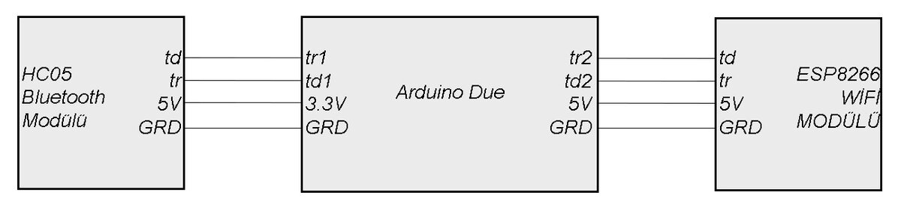
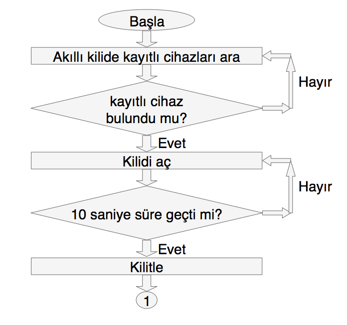
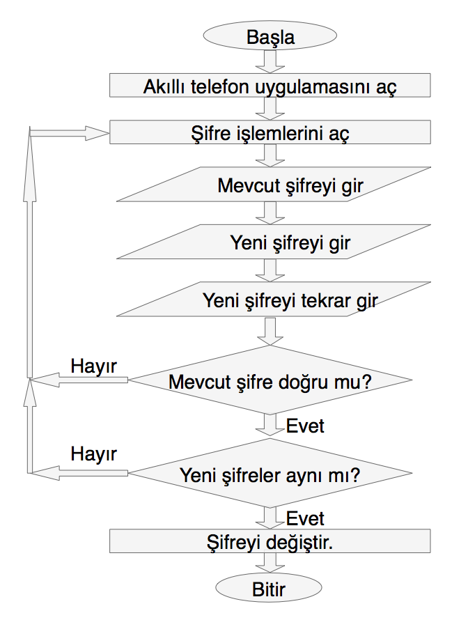
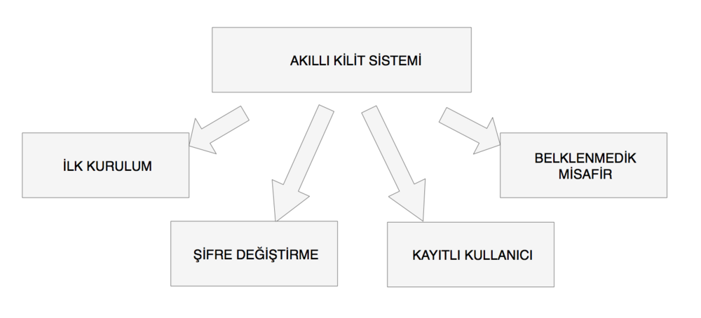

Bu yazı, Hasan Can Öztürk'ün Başkent Üniversitesi Elektrik-Elektronik Mühendisliği bölümünde **EEM491 Bitirme Projesi I** (2016 güz) ve **EEM492 Bitirme Projesi II** (2017 bahar) dersleri boyunca bir proje arkadaşıyla birlikte geliştirdiği **Akıllı Kilit Sistemi**ni anlatıyor. Hasan Can Öztürk projede grup lideriydi. Danışman **Yrd. Doç. Dr. Alparslan Çağrı Yapıcı**, jüri üyeleri **Prof. Dr. Murat Emin Akata** ve **Doç. Dr. Sedat Nazlıbilek**'ti.

Yazı; bitirme raporu, iki dönem sunumu, proje posteri, üç firmware sürümü, iki Android uygulaması (MIT App Inventor ve Java) ile tasarım klasöründeki diyagramlardan derlendi. Raporun (öğrenci numaraları, proje arkadaşının adı ve özgeçmiş sayfaları kapatılarak), posterin, tüm kodların ve diyagramların bulunduğu paket yazının sonunda indirilebilir.

. Proje arkadaşının adı ve e-postası posterden çıkarıldı.")

## Projenin amacı

Posterdeki tanımıyla amaç, *"ev ve işyerlerinin kapı kilitlerine geleneksel yöntemlere ek olarak akıllı teknolojiler ile kapıyı açıp kilitleyebileceğimiz cihaz yapmak"*. Mekanizma Wi-Fi ve Bluetooth teknolojileriyle kuruldu. Rapordaki Kavram Tanımlama ve İşletim Dokümanı (KTİD) sistemden beklenenleri şöyle sıralıyor:

1. Kapının yaklaşık **3 metre** yakınına gelindiğinde kilit cep telefonuyla **otomatik** açılacak.
1. Kilit şifresi değiştirilinceye kadar doğru şifrenin bir kez girilmiş olması yeterli olacak; şifreyi bilen her akıllı telefon kullanıcısı girebilecek.
1. Kilit **1 saniyeden kısa** sürede açılacak.
1. 3 metreden uzak mesafelerde kilit **internet bağlantısı** ve cep telefonuyla açılacak. Bu işlem kullanıcı adı ve parolayla, kullanıcıya atanan bir hesap üzerinden yapılacak.
1. Yakın mesafede otomatik açma için kullanılan şifre bu hesap üzerinden değiştirilebilecek.

Proje İsterleri Belirtimi Dokümanı (PİBD) bunu donanım ve yazılım işlerine böler: temassız iletişim teknolojileriyle bir kapı kilit kontrol devresi kurulması, devrenin Bluetooth ve Wi-Fi'ı desteklemesi, devrede koşacak yazılımın, telefon arayüzünün ve internetten kontrol için sunucu yazılımının geliştirilmesi, en sonda da alt birimler bütünleştirilerek seri üretime uygun ilk prototipin hazırlanması.

### Ev otomasyonundan akıllı kilide

Projenin ilk önerisi daha geniş bir başlık taşıyordu: **"Yakın ve Uzak Alan İletişimi ile Ev Otomasyon Sisteminin Geliştirilmesi"**. Öneri sunumunda yakından iletişim kurulduğunda şifreyi bilen her telefon kullanıcısının kilidi açabileceği, sistem yöneticisinin ise uzaktan açıp şifre atayabileceği bir yapı tarif ediliyor. Uzak bağlantı için sunucuda **MySQL** veritabanı, sunucuyla iletişimde **PHP**, tarayıcı arayüzü için **HTML**, Android için **Java**, iOS için **Swift** kullanılması planlanmıştı. Bağlantı sorunlarında şifreyi atamak için bir **LCD ve tuş takımı**, tüm enerjinin kesildiği durumlar için de **mekanik anahtar** "acil durum çözümü" olarak düşünülmüştü.

Proje ilerledikçe kapsam, ev otomasyonunun bir parçası olan **kapı kilidine** odaklandı: birinci dönem Bluetooth ile yakın mesafe kontrolü, ikinci dönem Wi-Fi ile ağ üzerinden kontrol ve gerçek kilit mekanizmasının motorla sürülmesi.

## Sistem mimarisi

")

Raporun "Gerçekleştirme" bölümüne göre sistem dört ana alt birimden oluşuyor:

1. **Bluetooth ile kapı kontrol birimi** — telefon kilide yaklaştığında yakın mesafeden bağlantı.
1. **Wi-Fi ile kapı kontrol birimi** — aynı ağdaki telefondan HTTP isteğiyle kontrol.
1. **Motor kontrol birimi** — Arduino'nun komutuyla motoru iki yöne süren sürücü.
1. **Fiziksel kilit birimi** — gömme kapı kilidinin içine yerleştirilen motorlu mekanizma.

Çalışma sırası raporda şöyle özetleniyor: önce geliştirme kartı, Bluetooth modülü ve akıllı cihaz işletim sistemi araştırılıp seçildi; Bluetooth modülü için Arduino yazılımı tamamlanıp modül test edildi; ardından Bluetooth modülüne veri gönderecek telefon uygulaması yazıldı; son olarak motor sürücü kartıyla kapı kilidini kontrol etmek için motor sürüldü.

### Kullanılan bileşenler

| Bileşen | Görevi | Not |
| --- | --- | --- |
| Arduino Due (1. dönem), Arduino Uno (2. dönem) | Kontrol merkezi; Bluetooth ve Wi-Fi'dan gelen komutları işleyip motoru sürer | Posterde işlemci ATmega328P (Uno) olarak geçiyor |
| HC-06 Bluetooth modülü | Telefonla yakın mesafe seri haberleşme (SPP), slave modda | Bluetooth 2.0 + EDR, 2,4 GHz; AT komutlarıyla ayarlanır. Bağlantı şemalarında HC-05 yazıyor |
| ESP8266 Wi-Fi modülü | Ağa bağlanıp 80 numaralı portta küçük bir web sunucusu açar | AT komut setiyle Arduino'nun seri portundan yönetilir |
| Motor sürücü + redüktörlü DC motor | Kilidin dilini iki yönde hareket ettirir | Arduino'nun 6 ve 7 numaralı pinleriyle sürülür |
| Kilit mekanizması | Fiziksel kapı kilidi | Bütçenin en büyük kalemi |
| LED | Birinci dönemde kilidin yerine, kapının açık/kapalı durumunu göstermek için | İkinci dönemde de durum göstergesi olarak kaldı |
| LCD ve numerik tuş takımı | Birinci dönemde şifre oluşturma ve acil durumda elle giriş | Final sunumunda "acil durum için kullanılan tuş takımı" |
| Batarya | Besleme | Posterde: "Sadece bir pil ile çalıştırmanız yeterli" |

Posterdeki enerji bölümüne göre cihazda güç tüketen parçalar ATmega328P işlemci, Wi-Fi modülü, Bluetooth modülü ve DC motordur. Her iki modül ve işlemcinin **uyku modunda** toplam tüketimi 4 mA'in altındadır. Motordaki redüktör sayesinde devre girişine 9 V uygulandığında **0,8 A** akım çekilir ve bu, cihazın bir pille ortalama **6 ayı aşkın** çalışabilmesini sağlar. Posterde bunu destekleyen "Maksimum Çıkış Akımı ve Giriş Voltajı Karşılaştırması" grafiği (9 V ve 12 V eğrileri) de yer alıyor.

*Not: Arşivdeki firmware sürümlerinde uyku moduna geçiren bir kod yok; posterdeki tüketim ve pil ömrü değerleri bir tasarım hedefi olarak okunmalı.*

## Donanım ve bağlantılar

Proje boyunca iki bağlantı düzeni kullanıldı. Birinci dönemde **Arduino Due**'nun birden fazla donanım seri portu sayesinde Bluetooth ve Wi-Fi modülleri ayrı portlara bağlandı:



İkinci dönemde kart **Arduino Uno**'ya değişti. Uno'da tek donanım seri portu olduğu için Wi-Fi modülü donanım seri portuna (0–1), Bluetooth modülü ise `SoftwareSerial` ile **10 ve 11 numaralı pinlere** bağlandı:

")

Tasarım klasöründe ayrıca motoru korumak için düşünülmüş bir **akım kesme devresi** var. Şemada Arduino Mega, 12 V araç aküsü, 12 V DC motor, tek kanallı röle modülü, akım sensörü ve bir anlık basmalı buton görülüyor. Motor kilit dilini sonuna kadar götürdüğünde akım yükselir; devre **3–5 A**'de motorun akımını kesecek şekilde düşünülmüş ("Max 3A – 5A to cut off").

")

*Not: Son firmware'de motor, akım ölçülerek değil süreyle (2,5 saniye) durduruluyor; akım kesme devresi koda yansımamış bir tasarım olarak kalmış.*

## Firmware

Arşivde Arduino kodunun üç sürümü var. Hepsi aynı iskeleti paylaşıyor: ESP8266'yı AT komutlarıyla ağa bağlayıp web sunucusu açmak, Bluetooth'tan gelen karakterlere göre kilidi yönetmek ve telefona düzenli "canlılık" sinyali göndermek.

| Sürüm | Tarih | Kart | Kilit | Farkı |
| --- | --- | --- | --- | --- |
| `SmartKey_ArduinoDue.ino` | Nisan 2017 | Arduino Due | LED | Bluetooth `Serial2` (9600 baud), ESP8266 `Serial1` (115200), hata ayıklama çıktısı `Serial3`. Web sayfasında ON/OFF düğmeleri |
| `SmartKey_ESP8266_v1_LED.ino` | Nisan 2017 | Arduino Uno | LED | Bluetooth `SoftwareSerial` (10, 11; 38400 baud). Telefona her 500 ms'de bir sinyal (`ping`) eklendi |
| `SmartKey_ESP8266_v2_Motor.ino` | Mayıs 2017 | Arduino Uno | Motor sürücü (pin 6–7) | LED yerine motor: kilit açma/kilitleme hareketleri, açılışta mekanizma testi |

### Son sürümün çalışma mantığı

**Açılış (`setup`)**

1. Wi-Fi modülü için seri port **115200**, Bluetooth için yazılımsal seri port **38400** baud ile açılır.
1. ESP8266'ya `AT` gönderilir; modül `OK` dönerse `AT+CWMODE=1` ile **istasyon (STA)** moduna alınır ve `AT+CWJAP_CUR` ile kablosuz ağa bağlanılır. Bağlantı sürerken LED yanar, `OK` gelince söner.
1. `AT+CWDHCP_CUR=1,0` ile DHCP kapatılıp `AT+CIPSTA_CUR` ile **sabit IP (192.168.1.20)** atanır. Böylece telefon uygulaması kilidi her zaman aynı adreste bulur.
1. `AT+CIPMUX=1` ile çoklu bağlantı açılıp `AT+CIPSERVER=1,80` ile **80 numaralı portta sunucu** başlatılır.
1. Motor kısa bir açma–kapama hareketi yapar (3 s açma yönünde, 200 ms kapama yönünde); mekanizmanın çalıştığı açılışta görülür.

**Ana döngü (`loop`)**

- **Wi-Fi:** ESP8266'dan `+IPD,` (gelen HTTP isteği) okunursa tarayıcıya kısa bir yanıt (`<head> Hello World </head>`) gönderilir, isteğin geri kalanı `led_yakma()` fonksiyonunda okunur: içinde `pin=on` varsa kilit **açılır**, `pin=off` varsa **kilitlenir**. Bağlantı `AT+CIPCLOSE=0` ile kapatılır.
- **Bluetooth:** yazılımsal seri portta veri varsa `kilit_kontrol_bt()` gelen her karaktere bakar:
  - `t` → LED yanar ve **30 saniyelik** bir sayaç başlar (telefon yaklaşıp otomatik bağlandığında gönderilir).
  - `n` → kilit **açılır**.
  - `f` → kilit **kilitlenir**, sayaç durur.
- **Sayaç:** sayaç açıkken geçen saniye Bluetooth'tan telefona yazılır; 30 saniye dolunca LED söner.
- **Canlılık sinyali:** her 500 ms'de bir telefona `500` yazılır. Telefon uygulaması bu veriyi alamadığında bağlantının koptuğunu, yani kullanıcının kapıdan uzaklaştığını anlar.

**Motor hareketi:** Açmak için `in2` HIGH / `in1` LOW yapılıp motor **2,5 saniye** döndürülür, ardından yön 300 ms ters çevrilip motor durdurulur. Kilitlemek için `in1` HIGH yapılıp motor 2,5 saniye ters yönde döndürülür.

### Kod: `SmartKey_ESP8266_v2_Motor.ino`

```cpp
#include <SoftwareSerial.h>
SoftwareSerial mySerial(10, 11); // RX, TX

#define ag_ismi "wireless"
#define ag_sifresi "********"
#define LED 8
#define LED1 13
#define bekleme_suresi 30000
#define ping_zamani 500

const int in1 = 7;
const int in2 = 6;
unsigned long simdikizaman = 0, oncekizaman = 0, ping = 0;
char sayac_acik = 0;
int fark = 0;

void setup()
{
  // mySerial.begin(115200);   //bluethoot icin
  Serial.begin(115200); //Seriport'u açıyoruz. Güncellediğimiz Wifi
  mySerial.begin(38400); //Seriport'u açıyoruz. Güncellediğimiz BT


  //ESP modülünün baudRate değeri 115200 olduğu için bizde Seriport'u 115200 şeklinde seçiyoruz
  Serial.println("AT"); //ESP modülümüz ile bağlantı kurulup kurulmadığını kontrol ediyoruz.
  pinMode(LED1, OUTPUT);
  pinMode(LED, OUTPUT);
  pinMode (in1, OUTPUT);
  pinMode (in2, OUTPUT);
  delay(3000); //ESP ile iletişim için 3 saniye bekliyoruz.

  if (Serial.find("OK")) {       //esp modülü ile bağlantıyı kurabilmişsek modül "AT" komutuna "OK" komutu ile geri dönüş yapıyor.
    Serial.println("AT+CWMODE=1"); //esp modülümüzün WiFi modunu STA şekline getiriyoruz. Bu mod ile modülümüz başka ağlara bağlanabilecek.
    digitalWrite(LED, HIGH);
    delay(2000);
    String baglantiKomutu = String("AT+CWJAP_CUR=\"") + ag_ismi + "\",\"" + ag_sifresi + "\"";
    Serial.println(baglantiKomutu);
    delay(5000);
    if (Serial.find("OK"))
      digitalWrite(LED, LOW);
  }

  Serial.println("AT+CWDHCP_CUR=1,0");    //DHCP yi kapat
  delay(500);
  Serial.println("AT+CIPSTA_CUR=\"192.168.1.20\",\"192.168.1.1\",\"255.255.255.0\"");   //static IP ata
  delay(500);

  Serial.println("AT+CIPMUX=1");
  delay(1000);
  Serial.println("AT+CIPSERVER=1,80");
  delay(1000);
  Serial.println("AT+CIPCLOSE=0");


  ping = millis();

  //-----------------------------------------------
    //Serial.begin(9600);  
    digitalWrite(in1, LOW); //açar
    digitalWrite(in2, HIGH);
    delay(3000);
    digitalWrite(in2, LOW); //kapar
    digitalWrite(in1, HIGH);
    delay(200);
    digitalWrite(in2, LOW);
    digitalWrite(in1, LOW);
    delay(1);
    //--------------------------------------------------
}


void loop() {
  if (Serial.available() > 0) {
    if (Serial.find("+IPD,")) {
      String metin = "<head> Hello World </head>";
      // metin += "<br><a href=\" ?pin=on\"><button type='button'>ON</button></a>";
      // metin += "<br><a href=\" ?pin=off\"><button type='button'>OFF</button></a>";
      String cipsend = "AT+CIPSEND=";
      cipsend += "0";
      cipsend += ",";
      cipsend += metin.length();
      cipsend += "\r\n";
      Serial.print(cipsend);
      delay(500);
      Serial.println(metin);
      led_yakma();
      Serial.println("AT+CIPCLOSE=0");

    }
  }

  if (mySerial.available() > 0) {
    kilit_kontrol_bt();
  }

  if (sayac_acik && millis() - oncekizaman > bekleme_suresi) {
    sayac_acik = 0;
    digitalWrite(LED, LOW);
  }

  if (sayac_acik && millis() - oncekizaman <= bekleme_suresi) {
    fark = (millis () - oncekizaman) / 1000;
    mySerial.print(fark);
    mySerial.print("\r");
  }

  if (millis() - ping >= ping_zamani)
  {
    ping = millis();
    mySerial.print(ping_zamani);
  }
}


void led_yakma() {
  String gelen = "";
  char serialdenokunan;
  int ii = 0;

  while (Serial.available() > 0) {
    serialdenokunan = Serial.read();
    gelen += serialdenokunan;
    ii++;
  }

  if ((gelen.indexOf("pin=on") > 1)) { //on butonuna basıldığında server adresinde /?pin=on var ise
    digitalWrite(LED, HIGH);                 //ledi yakar
     //-----------------------------------------------
      digitalWrite(in2, HIGH); //kilidi açar
      digitalWrite(in1, LOW);
      delay(2500);
      digitalWrite(in2, LOW); //kapar
      digitalWrite(in1, HIGH);
      delay(300);
      digitalWrite(in2, LOW);
      digitalWrite(in1, LOW);
      delay(1);
      //----------------------------------------

  }
  if ((gelen.indexOf("pin=off") > 1)) { // off butonuna basıldığında server adresinde /?pin=off var ise
    digitalWrite(LED, LOW);                   //ledi söndürür
    //-----------------------------------------------
      digitalWrite(in2, LOW); //kapar
      digitalWrite(in1, HIGH);
      delay(2500);
      digitalWrite(in2, LOW);
      digitalWrite(in1, LOW);
      delay(1);
      //-----------------------------------------------

  }
}

void kilit_kontrol_bt() {
  String gelenbt = "";
  char serialdenokunanbt;

  while (mySerial.available() > 0) {
    serialdenokunanbt = mySerial.read();
    gelenbt += serialdenokunanbt;

    if (serialdenokunanbt == 't') { //on butonuna basıldığında server adresinde blu=on var ise
      digitalWrite(LED, HIGH);                 //ledi yakar
      oncekizaman = millis();
      sayac_acik = 1;
    }

    if (serialdenokunanbt == 'n') { //on butonuna basıldığında server adresinde blu=on var ise
      digitalWrite(LED, HIGH);                 //ledi yakar
       //-----------------------------------------------
      digitalWrite(in2, HIGH); //kilidi açar
      digitalWrite(in1, LOW);
      delay(2500);
      digitalWrite(in2, LOW); //kapar
      digitalWrite(in1, HIGH);
      delay(300);
      digitalWrite(in2, LOW);
      digitalWrite(in1, LOW);
      delay(1);
      //----------------------------------------

    }

    if (serialdenokunanbt == 'f') { // off butonuna basıldığında server adresinde blu=off var ise
      digitalWrite(LED, LOW);                   //ledi söndürür
      //-----------------------------------------------
      digitalWrite(in2, LOW); //kapar
      digitalWrite(in1, HIGH);
      delay(2500);
      digitalWrite(in2, LOW);
      digitalWrite(in1, LOW);
      delay(1);
      //-----------------------------------------------

      sayac_acik = 0;
    }
  }

}
```

*Not: Koddaki Wi-Fi şifresi yayınlanan kopyada `********` ile değiştirildi. Komutlar karakter karakter işlendiği için Bluetooth'tan gelen mesajda geçen herhangi bir `n` kilidi açar. Uygulamanın gönderdiği `1234 blu=on 5678` bunu kullanıyor (`on` içindeki `n`), `1234 blu=off 5678` ise `f` sayesinde kilitliyor. Mesajın başındaki ve sonundaki `1234` / `5678` firmware'de doğrulanmıyor. Wi-Fi tarafında da istek kimlik doğrulamasız düz HTTP. Raporun güvenlik bölümü Bluetooth'un yalnız eşleşmiş cihazlar arasında veri aktarmasına ve frekans atlamasına dayanıyor; ağ tarafındaki hesap ve parola ile şifreli komut, KTİD'de hedeflenen ama arşivdeki kodda yer almayan adımlar olarak kaldı.*

## Android uygulaması

Projede iki ayrı Android uygulaması var.

### Birinci dönem: Java ile Bluetooth uygulaması

İlk sürüm Android Studio'da Java ile yazıldı (proje adı `deneme39`, Ocak 2017). Uygulama açılışta telefonun Bluetooth'unu kontrol eder (kapalıysa açılmasını ister), eşleşmiş cihazları listeler ve çevredeki cihazları tarar. Listede "(Eslesti)" etiketiyle görünen cihaza dokunulduğunda `ConnectThread` ile **RFCOMM soketi** açılır (seri port profili UUID'si `00001101-0000-1000-8000-00805F9B34FB`), bağlantı kurulunca `ConnectedThread` gelen veriyi okuyup ekranda gösterir. "Lambayı Aç" ve "Lambayı Kapat" düğmeleri modüle sırasıyla `1` ve `2` karakterlerini gönderir. Bu dönemde kilidin yerinde bir LED vardı.

```java
private class ConnectThread extends Thread {
    private final BluetoothSocket mmSocket;
    private final BluetoothDevice mmDevice;

    public ConnectThread(BluetoothDevice device) {
        BluetoothSocket tmp = null;
        mmDevice = device;
        try {
            tmp = device.createRfcommSocketToServiceRecord(mmuuid);
        } catch (IOException e) {
        }
        mmSocket = tmp;
    }

    public void run() {
        blt.cancelDiscovery();
        try {
            mmSocket.connect();
        } catch (IOException connectException) {
            try {
                mmSocket.close();
            } catch (IOException closeException) { }
            return;
        }
        mHandler.obtainMessage(baglanti, mmSocket).sendToTarget();
    }
}

public void ledon() throws IOException {
    outstream.write("1".getBytes());
}

public void ledoff() throws IOException {
    outstream.write("2".getBytes());
}
```

*Not: `1` / `2` komutları birinci dönemin LED devresine aittir; arşivdeki firmware sürümleri `t`, `n`, `f` karakterlerini işliyor. Birinci dönemin Arduino kodu arşivde bulunmuyor. Raporun eklerinde bu uygulamanın kodu, arayüz düzeni (`activity_main.xml`) ve manifest başlığı altında da yine arayüz düzeni yer alıyor.*

### İkinci dönem: App Inventor ile SmartLock

İkinci dönemde uygulama **MIT App Inventor**'da yeniden yapıldı (uygulama adı **SMARTLOCK**). Arşivde iki sürümü var (17 ve 18 Nisan 2017):

| Sürüm | Özellikler |
| --- | --- |
| v1 | "BT Modül Seç" listesinden modül elle seçilip bağlanılır; Network AÇ/KAPAT düğmeleri |
| v2 | Seçilen modülün adresi telefona kaydedilir (`TinyDB`); uygulama her açılışta kayıtlı modüle **otomatik bağlanmayı** dener. Bluetooth ve Network için ayrı AÇ/KAPAT düğmeleri, bağlantı durum düğmesi, kilit açık/kilitli görselleri |

")

v2'nin blok mantığı (App Inventor bloklarından metne aktarıldı):

1. **Açılış:** Durum düğmesi turuncu ve "Bağlantı yok" yazar, kilitli görseli gösterilir. Telefonda kayıtlı bir modül adresi varsa ekranda "Kaydedilen BT adresi" olarak yazılır, düğme "Bağlanıyor" olur ve 1 saniyelik **bağlanma zamanlayıcısı** (Clock1) başlar.
1. **Bağlanma zamanlayıcısı:** Bluetooth açıksa ve bağlantı yoksa kayıtlı adrese bağlanmayı dener. Başarılı olursa düğme yeşil "Bağlandı" olur, modüle **`1234 zxtr 5678`** gönderilir (içindeki `t` firmware'de LED'i yakıp 30 saniyelik sayacı başlatır), kilit açık görseli gösterilir ve **bağlantı izleme zamanlayıcısı** (Clock2) başlar. Başaramazsa düğme kırmızı "Bağlanamadı" olur ve bir sonraki saniye yeniden dener. Bluetooth kapalıysa "BT kapalı! Otomatik bağlantı durduruldu" uyarısı verir.
1. **Bağlantı izleme zamanlayıcısı:** Her saniye modülden veri gelip gelmediğine bakar. Firmware her 500 ms'de bir veri yolladığı için veri gelmiyorsa telefon menzil dışına çıkmıştır: bağlantı kapatılır ve bağlanma zamanlayıcısı yeniden başlar. Kullanıcı kapıya yaklaştığında uygulama böylece kendiliğinden yeniden bağlanır.
1. **Durum düğmesi:** Bağlantı yoksa eşleşmiş cihazları listeler ("Eşleşmiş cihaz yok, eşleme için cihaz ayarlarını kullanın" uyarısıyla), seçilen modüle bağlanıp adresini kaydeder. Bağlantı varsa "BT bağlantısını sonlandır" sorusunu sorar.
1. **Bluetooth AÇ / KAPAT:** modüle `1234 blu=on 5678` / `1234 blu=off 5678` gönderir ve kilit görselini değiştirir.
1. **Network AÇ / KAPAT:** `http://192.168.1.20/pin=on` / `pin=off` adresine HTTP PUT isteği gönderir; firmware istekte `pin=on` / `pin=off` ifadesini arar.

## Akış diyagramları

Tasarım aşamasında (Nisan 2017) sistemin dört akışı çizildi.

**Bluetooth ile kilit kontrolü.** Uygulama kayıtlı cihazları arar; kayıtlı cihaz bulunduğunda kilidi açar, 10 saniye sonra kilitler ve beklemeye geçer. Bluetooth bağlantısı devam ettiği sürece kullanıcının kilidi açmak isteyip istemediğine bakılır; bağlantı koptuğunda akış biter.



**Wi-Fi ile kilit kontrolü.** Uygulama sunucuya bağlanır; akıllı kilit sunucuya bağlı ve beklemede iken kullanıcı "1 – Kilidi aç" ya da "2 – Kilitle" seçer. İstek sunucuya kaydedilip akıllı kilide gönderilir ve kapı kilidi açılır ya da kilitlenir.


**Bluetooth ve Wi-Fi ile ilk bağlantı.** Bluetooth'ta akıllı kilit ve telefon açılır, uygulama Bluetooth cihazlarını arar, kullanıcı şifreyi girer; şifre doğruysa kilit telefona kaydedilir. Wi-Fi'da akıllı kilit, modem ve telefon açılır; kullanıcı adı ve şifre girilir, uygulama Wi-Fi ağlarını arar, ev ağı ve ağ şifresiyle akıllı kilit ağa kaydedilir.

 ve Wi-Fi (sağda) ile ilk bağlantı akışları")

**Şifre değiştirme.** Mevcut şifre, yeni şifre ve yeni şifrenin tekrarı girilir; mevcut şifre doğru ve iki yeni şifre aynıysa şifre değiştirilir.



Kullanım senaryoları diyagramında sistem dört işe ayrılıyor: **ilk kurulum**, **şifre değiştirme**, **kayıtlı kullanıcı** ve **beklenmedik misafir**.



## Birinci dönemin sonu

EEM491 final sunumunda (Ocak 2017) birinci dönemin durumu şöyle özetleniyor: kartta **Arduino Due**, haberleşmede **HC-06 Bluetooth**, şifre için **numerik tuş takımı ve LCD** kullanıldı; arayüzün çalıştığını denetlemek için kilit yerine bir **LED** konuldu. Mimari çizimde kapı üzerinde acil durum için tuş takımı ve manuel giriş, içeride Due ve HC-06'dan oluşan "kilidin iç yapısı" yer alıyor; ev sakini ve misafir telefonla bağlanıyor. Sunumdaki "Bu Yarıyıl İçin Hazırlanan Arayüz ve Devre" slaytında Java uygulamasının ekranı ve breadboard üzerinde kurulan Arduino–HC-06–LED devresinin fotoğrafı var.

Gelecek yarıyıl için konan hedefler:

1. Sistemde LED yerine kilit sistemi kullanılacak.
1. Birinci dönemdeki yakın mesafe kontrolüne ek olarak sisteme uzak mesafeden erişim sağlanacak.
1. Uzak mesafeden iletişimle şifre değiştirilebilecek.
1. Uzak mesafe iletişimi Wi-Fi kitiyle yapılacak.

Raporun "Sonuçlar" bölümünde birinci dönemin sonucu şöyle yazıyor: *"Akıllı kilit sisteminin ilk iki bölümünü tamamladık. Cihaza yaklaşan akıllı cihaz ve sistem uygulamasına sahip kişi, Bluetooth'un kapsama alanına girdiği zaman LED'i açıp kapatabilmektedir ve LCD ile tuş takımı ile şifre oluşturulabilmektedir."* İkinci dönemde bunun üzerine ESP8266 ile Wi-Fi kontrolü, motor sürücüyle gerçek kilit hareketi ve otomatik bağlanan App Inventor uygulaması eklendi.

## Proje yönetimi

### Proje uygulama takvimi

Birinci dönemin takvimi (raporun Çizelge 2'si):

| İş | Hafta |
| --- | --- |
| Proje konularının belirlenmesi | 1–4 |
| Danışmanla görüşülerek iş tanımının belirlenmesi | 5 |
| Akıllı evler için yakın alan iletişiminin araştırılması | 5–6 |
| Bluetooth ile veri aktarımının araştırılması | 7–8 |
| Mikrodenetleyicilerin araştırılması | 8–9 |
| Ara sınav sunum haftası | 10 |
| Güvenli kapı kilit sisteminin araştırılması | 11–12 |
| Sistemin yazılımı için araştırmaların yapılması | 12–14 |
| Arduino ve Bluetooth deneylerinin yapılması | 14–15 |
| Yarıyıl sonu sunum haftası | 16 |

İkinci dönemin takvimi (Nisan 2017):

| İş | Hafta |
| --- | --- |
| Bluetooth bağlantı sorunlarının giderilmesi | 1–3 |
| Wi-Fi modülünün yazılması | 3–5 |
| Akıllı telefon uygulamasının yazılması | 4–7 |
| Vize haftası | 8 |
| Sunum haftası | 9 |
| Mekanik düzeneğin tasarlanması | 10–11 |
| Sunucu yazılımının hazırlanması | 11–12 |
| Telefon uygulamasının geliştirilmesi | 12–14 |
| Sistemin birbirine entegre edilmesi | 14 |
| Final haftası | 15 |
| Sunum haftası | 16 |

### Maliyet analizi

| Malzeme / ürün | Tahmini maliyet | Gerçek maliyet |
| --- | --- | --- |
| Arduino Uno | 30 TL | 35 TL |
| Bluetooth kit | 30 TL | 27 TL |
| Wi-Fi modülü | 40 TL | 15 TL |
| Motor sürücü | 50 TL | 20 TL |
| Batarya | 20 TL | 10 TL |
| Kilit mekanizması | 150 TL | 200 TL |
| **Toplam** | **320 TL** | **307 TL** |

*Not: Toplam satırı rapordaki çizelgeye eklendi; çizelgede yalnız kalemler var.*

### Risk analizi

| Risk | Olasılık | Etkisi | Önlem | Gerçekleşme durumu |
| --- | --- | --- | --- | --- |
| Yurt dışından temin edilen donanımların ulaşımında aksaklık | Yüksek | Yüksek | Donanımlar daha maliyetli olarak Türkiye'den temin edildi | Gerçekleşme ihtimali çok düşük |
| Donanımların arızalı çıkması | Düşük | Yüksek | Malzemelerden ikişer tane satın alındı | Gerçekleşme ihtimali yüksek |

### Standartlar, kısıtlar ve disiplinler

- **Standartlar:** IEEE 802.15 (Bluetooth), Bluetooth 4.0, SWAP, IEEE 802.11 (Wi-Fi).
- **Kullanılan ders bilgileri:** Mikroişlemciler, Devre Teorisi I–II, Bilgisayar Ağları.
- **Güvenlik:** Bluetooth'ta veri aktarımı yalnız eşleşmiş cihazlar arasında yapılır; frekans bandındaki 79 kanalda saniyede 1600 kez frekans atlanarak iletişim kurulur.
- **Disiplinler arası çalışma:** Bilgisayar Mühendisliği, Makine Mühendisliği ve Elektrik-Elektronik Mühendisliği.

## Kaynaklar

Raporun kaynakçası:

1. 802.1X-2004 — Port Based Network Access Control.
1. NFC Forum (erişim 22.10.2016).
1. "Bluetooth Low Energy", Bluetooth.com (erişim 23.11.2016).
1. "AT Komutlarının Kullanılması", Maker.robotistan.com (erişim 01.11.2016).
1. HC-06 Bluetooth Kit Datasheet.
1. K. Y. Lee, J. W. Choi, "Remote-Controlled Home Automation System via Bluetooth Home Network", vol. 3, 2003, s. 2824–2829.
1. T. Tamura, A. Kawarada, M. Nambu, A. Tsukada, K. Sasaki, K. Yamakoshi, "E-Healthcare at an Experimental Welfare Techno House in Japan", *The Open Medical Informatics Journal*, vol. 1, 2007, s. 1–7.
1. D. J. Cook, M. Youngblood, E. O. Heierman, "MavHome: An Agent Based Smart Home", Arlington, VA: National Science Foundation.
1. H. Kanma, N. Wakabayashi, R. Kanazawa, H. Ito, "Home Appliance Control System over Bluetooth with a Cellular Phone", *IEEE Transactions on Consumer Electronics*, vol. 49, 2003, s. 1049–1053.

Proje klasöründe başvuru için tutulan belgeler (indirme paketine konmadı): ITead Studio *HC-05 Bluetooth to Serial Port Module* veri sayfası ve Karadeniz Teknik Üniversitesi Bilgisayar Mühendisliği Bölümü'nün *Arduino-RFID ile Kartlı Kapı Geçiş Sistemi* tasarım projesi raporu (2016).

## İndirme paketinin içeriği

| Klasör | İçerik |
| --- | --- |
| `rapor/` | Bitirme raporu, 34 sayfa (öğrenci numaraları, proje arkadaşının adı ve özgeçmiş bilgileri kapatıldı) |
| `poster/` | Proje posteri |
| `firmware/` | Üç Arduino sürümü: Due, Uno + ESP8266 (LED), Uno + ESP8266 + motor |
| `android/app-inventor/` | SmartLock v1 ve v2 (`.aia`, App Inventor'da *Import project* ile açılır) |
| `android/android-studio/` | Birinci dönemin Java Bluetooth uygulamasının kaynakları |
| `diyagramlar/` | Blok diyagram, iki bağlantı şeması, motor akım kesme devresi, akış diyagramları, kullanım senaryoları |

*Not: Projenin tanıtım videoları ve kurulabilir uygulama dosyaları (APK) pakete konmadı; final sunumundaki devre fotoğrafı da yayımlanmadı.*
