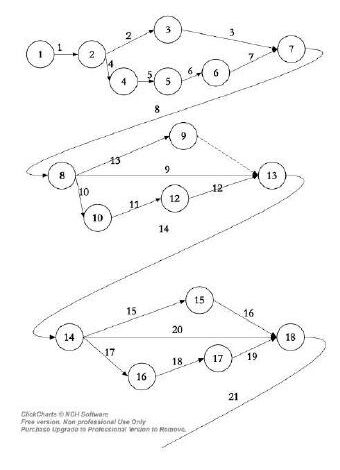
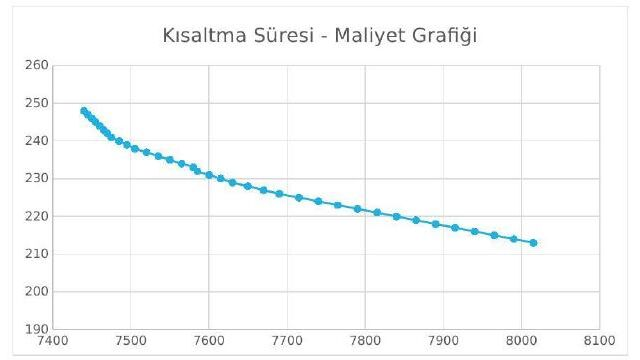

This post contains the project reports and assignments I prepared in November–December 2015 for the **END355 Project Management** course: the CPM network model, time-cost crashing analysis, and linear programming (LP) decision model for a 50-activity **software project**; a small 10-activity time-cost example; and solutions to two CPM/LP homework problems from Wayne L. Winston's *Operations Research*. The reports were prepared from Word files; PDFs with the student number redacted can be downloaded as a ZIP at the end of the post. (In one place in the reports the course code is written as "END-335"; the course code is END355.)

## Project: renewing the information management system of a company with dealerships

**Problem description:** The management information systems of a company that has a headquarters and dealerships will be renewed to fit the company's changing requirements and advancing technology. The project consists of 50 activities; for each activity, the predecessors, normal duration (days), cost (TL), minimum duration (days), and crashing cost (TL/day) are specified.

| Code | Activity | Predecessor | Duration | Cost | Min. duration | Crashing (TL/day) |
|---|---|---|---|---|---|---|
| 1 | Kick-off meeting and acceptance of the project definition document | – | 0 | 0 | 0 | 0 |
| 2 | Analysis of existing hardware | 1 | 2 | 60 | 1 | 5 |
| 3 | Analysis of existing software | 2 | 5 | 150 | 2 | 10 |
| 4 | Gathering dealer requirements | 3 | 10 | 300 | 7 | 10 |
| 5 | Gathering senior management reporting requirements | 4 | 2 | 60 | 1 | 5 |
| 6 | Customer relations department requirements | 4 | 2 | 60 | 1 | 5 |
| 7 | Sales and marketing department requirements | 4 | 2 | 60 | 1 | 5 |
| 8 | Creating the conceptual design document | 5,6,7 | 2 | 60 | 1 | 5 |
| 9 | Hardware design | 8 | 1 | 30 | 1 | – |
| 10 | Database design | 8 | 2 | 60 | 1 | 5 |
| 11 | Data transfer program design | 10 | 1 | 30 | 1 | – |
| 12 | Authorization design | 11 | 1 | 30 | 1 | 5 |
| 13 | User interface design | 8 | 10 | 300 | 7 | 20 |
| 14 | Report designs | 9,12,13 | 5 | 150 | 3 | 15 |
| 15 | Placing the order for the server to be used | 14 | 5 | 150 | 2 | 15 |
| 16 | Setting up the test server | 15 | 2 | 60 | 1 | 5 |
| 17 | Conceptual design presentation of the dealer module | 14 | 2 | 60 | 1 | 5 |
| 18 | Conceptual design presentation of the sales and marketing module | 17 | 1 | 30 | 1 | – |
| 19 | Conceptual design presentation of the customer relations module | 18 | 1 | 30 | 1 | – |
| 20 | Conceptual design presentation of the reporting module | 14 | 1 | 30 | 1 | – |
| 21 | Approval of the project management plan | 16,20,19 | 0 | 0 | 0 | – |
| 22 | Database development | 21 | 5 | 150 | 3 | 15 |
| 23 | Developing the data transfer program | 22 | 2 | 60 | 1 | 5 |
| 24 | Setting up the new server and converting the test server into a backup | 23 | 2 | 60 | 1 | 5 |
| 25 | Authorization development | 24 | 3 | 90 | 2 | 10 |
| 26 | User interface development | 24 | 50 | 1500 | 40 | 25 |
| 27 | Reporting development | 24 | 10 | 30 | 5 | 20 |
| 28 | Data transfer program tests | 24 | 10 | 30 | 5 | 20 |
| 29 | Authorization tests | 25 | 3 | 90 | 2 | 10 |
| 30 | User interface tests | 26 | 30 | 900 | 15 | 15 |
| 31 | Reporting tests | 27 | 10 | 300 | 5 | 20 |
| 32 | Completion of scope validation | 28,29,30,31 | 0 | 0 | 0 | – |
| 33 | Compiling the documents produced during the design, development, and testing phases | 32 | 2 | 60 | 1 | 5 |
| 34 | Preparing the training document and presenting it to users | 33 | 5 | 150 | 2 | 10 |
| 35 | Dealer training | 34 | 5 | 150 | 1 | 10 |
| 36 | Sales and marketing department training | 34 | 1 | 30 | 1 | – |
| 37 | Customer relations department training | 34 | 1 | 30 | 1 | – |
| 38 | Reporting training for management | 34 | 1 | 30 | 1 | – |
| 39 | Placing the server in the server room | 28,29,30,31 | 1 | 30 | 1 | – |
| 40 | Performing the final data transfer to the new server | 39 | 1 | 30 | 1 | – |
| 41 | Decommissioning the old server and taking its backups | 40 | 1 | 30 | 1 | – |
| 42 | Decommissioning the test server | 41 | 1 | 30 | 1 | – |
| 43 | Determining the support teams | 28,29,30,31 | 1 | 30 | 0 | 5 |
| 44 | Training the phone support team | 43 | 14 | 420 | 10 | 25 |
| 45 | Training the interactive support team | 43 | 5 | 150 | 3 | 15 |
| 46 | Training the on-site support team | 43 | 21 | 630 | 19 | 25 |
| 47 | Phone support | 44 | 2 | 60 | 1 | 5 |
| 48 | Interactive support | 45 | 2 | 60 | 1 | 5 |
| 49 | On-site support | 46 | 2 | 60 | 1 | 5 |
| 50 | Project closure | 44,45,46,35,36,37,38,42 | 0 | 0 | 0 | – |

**Critical path:** 1 – 4 – 5 – 6 – 7 – 8 – 13 – 14 – 15 – 16 – 21 – 22 – 23 – 24 – 26 – 30 – 43 – 46 – 49 – 50. **Total normal cost: 7440 TL.**

### Project network (layout)

### Time-cost crashing table

In the report, one-day reductions are applied in order starting from the cheapest activity, and the time-cost curve is plotted: first the activities with a crashing cost of 5 TL (5, 6, 7, 8, 16, 23, 24, 43, 49), then those at 10 TL (4 three times; the critical path does not change), those at 15 TL (14, 15; when activity 15 is crashed, the critical path becomes 17-18-19 instead of 15-16; when activity 17 is crashed, both 15-16 and 17-18-19 become critical), 22 (15 TL), 13 (20 TL), 26 (25 TL, nine days), and 43 (25 TL). On the graph, the horizontal axis shows the total cost (7400–8100 TL) and the vertical axis shows the project duration (≈190–260 days); as the duration shortens, the cost increases.

*Note: The report states "The cost decreased by a total of 585 TL and became 6885 TL." Since crashing costs are added, the cost would not be expected to decrease, and 7440 − 585 = 6855; the curve in the graph rises from 7440 TL to approximately 8015 TL. The sentence was probably meant to say "increased by 585 TL"; the text has been kept faithful to the source.*

### Decision model (LP)

For each activity, a crashing-days variable (variables such as A, B, C, … D2) and event times x₁…x₄₁ are defined; the objective is to minimize the total crashing cost. A precedence constraint is written for each activity, for example:

- x₂ ≥ x₁ + 0 − A
- x₃ ≥ x₂ + 2 − B
- x₄ ≥ x₂ + 10 − C
- x₇ ≥ x₃ + 3 − D
- x₅ ≥ x₄ + 2 − E, x₆ ≥ x₅ + 2 − F, x₇ ≥ x₆ + 2 − G, x₈ ≥ x₇ + 2 − H
- …
- x₄₀ ≥ x₃₂ + 2 − C2, x₄₁ ≥ x₄₀ + 0 − D2

The upper bounds of the variables are the maximum number of days each activity can be crashed (as in A0, B1, C3, D3, E1, F1, G1, H1, …).

## Project 2: Example of a 10-activity time-cost analysis

A sample time-cost analysis is performed with the first 10 activities (A–J) of the same project:

| Activity | Name | Predecessor | Normal duration | Normal cost (TL) | Shortest duration | Crashing (TL/day) |
|---|---|---|---|---|---|---|
| A | Kick-off meeting and acceptance of the project definition document | – | 0 | 80 | 0 | – |
| B | Existing hardware analysis | A | 2 | 10 | 1 | 2 |
| C | Existing software analysis | A | 5 | 20 | 3 | 6 |
| D | Gathering dealer requirements | B,C | 10 | 40 | 5 | 3 |
| E | Senior management reporting requirements | D | 2 | 60 | 2 | – |
| F | Customer relations department requirements | D | 2 | 30 | 2 | – |
| G | Sales and marketing department requirements | D | 2 | 10 | 2 | – |
| H | Conceptual design document | B,E,F | 2 | 50 | 1 | 20 |
| I | Hardware design | F | 1 | 70 | 1 | – |
| J | Setting up the test server | I,H,G | 2 | 90 | 1 | 20 |

Critical path A–C–D–E–H–J: total normal duration 0 + 5 + 10 + 2 + 2 + 2 = **21 days**, total cost 80 + 10 + 20 + 40 + 60 + 30 + 10 + 50 + 70 + 90 = **460 TL**. Crashes: activity C by 2 days (+12 TL), activity D by 5 days (+15 TL), activity H by 1 day (+20 TL; this also brings activity I onto the critical path), activity J by 1 day (+20 TL). There is no point in crashing activities B and G, since the critical path does not pass through them. Result: the duration is **shortened by 9 days to 12 days**, and the cost increases by 67 TL from 460 TL to **527 TL**.

In the second part of the report (the 2nd project report), the same 50 activities are also given as a table with activity codes and predecessor abbreviations (AI, A, B, …).

## Winston CPM–PERT and LP questions

Two solutions to problems assigned as homework from Wayne L. Winston, *Operations Research* (3rd edition, p. 431, Group A):

**Problem 4 – Rock concert.** The organizer of a rock concert in Indianapolis must complete the following tasks before the concert: A finding a site (no predecessor), B finding engineers (A), C hiring an opening band (A), D radio-TV advertisements (C), E ticket agencies (A), F electronics preparation (B), G printing advertisements (C), H arranging transportation (C), I rehearsal (F, H), J last-minute work (I). (a) Write the LP that can be set up to find the critical path of the project. In the solution, the network is drawn; the durations are read as A=3, B=2, C=6, D=2, E=3, F=3, G=5, H=1, I=1.5, J=2 days, and the constraints are written with x_j being the time at which node j occurs.

**Problem 5 – House construction.** A foundation (5 days), B walls and ceiling (A; 8), C roof (B; 10), D electrical installation (B; 5), E windows (B; 4), F exterior cladding (E; 6), G painting (C, F; 3). (a) Draw the project network, find the critical path, and compute the total and free float for each activity. (b) If the durations can be shortened with additional workers (daily costs: foundation $30 – at most 2 days, walls-ceiling $15 – 3, roof $20 – 1, electrical $40 – 2, windows $20 – 2, exterior cladding $30 – 3, painting $40 – 1), write the LP that minimizes the total cost of finishing the project in 20 days.

Solution (a): the ET/LT values are ET(1)=0, ET(2)=5, ET(3)=13, ET(4)=17, ET(5)=23, ET(6)=26 (the LTs are equal); both paths 1–2–3–5–6 and 1–2–3–4–5–6 are critical, and the project duration is **26 days**; for activity D (3,6), the total and free float are 8 days, and 0 for the others. In part (b), the LP is set up with a crashing-days variable for each activity and event times x_j.

The ZIP file also contains a "Resource Distribution by Day After Resource Planning" chart (a column chart of resource quantities over 12 days) taken from an Excel worksheet.
