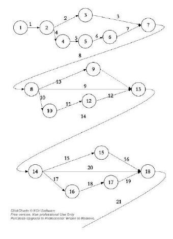
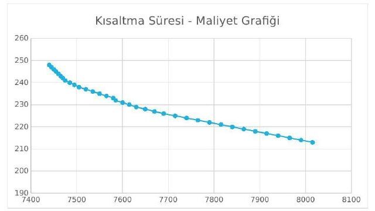

Bu yazı, **END355 Proje Yönetimi** dersi için Kasım–Aralık 2015'te hazırladığım proje raporlarını ve ödevlerini içeriyor: 50 işlemli bir **yazılım projesinin** CPM ağ modeli, süre-maliyet kısaltma analizi ve doğrusal programlama (LP) karar modeli; küçük bir 10 işlemli süre-maliyet örneği ve Wayne L. Winston'ın *Operations Research* kitabındaki iki CPM/LP ödev sorusunun çözümü. Raporlar Word dosyalarından hazırlanmıştır; öğrenci numarası kapatılmış PDF'leri yazının sonunda ZIP olarak indirilebilir. (Raporların bir yerinde ders kodu "END-335" diye yazılmış; dersin kodu END355'tir.)

## Proje: bayili bir firmanın bilgi yönetim sisteminin yenilenmesi

**Problemin tanımı:** Bir merkezi ve bayilikleri bulunan firmanın yönetim bilişim sistemleri, zamanla değişen firma gereksinimlerine ve ilerleyen teknolojiye uygun olarak yenilenecektir. Proje 50 işlemden oluşuyor; her işlem için önceki işlemler, normal süre (gün), maliyet (TL), minimum süre (gün) ve kısaltma maliyeti (TL/gün) belirlenmiştir.

| Kod | İşlem | Önceki | Süre | Maliyet | Min. süre | Kısaltma (TL/gün) |
|---|---|---|---|---|---|---|
| 1 | Başlangıç toplantısı ve proje tanımlama dokümanının kabulü | – | 0 | 0 | 0 | 0 |
| 2 | Mevcut donanımın analizi | 1 | 2 | 60 | 1 | 5 |
| 3 | Mevcut yazılımın analizi | 2 | 5 | 150 | 2 | 10 |
| 4 | Bayi gereksinimlerinin toplanması | 3 | 10 | 300 | 7 | 10 |
| 5 | Üst yönetim raporlama gereksinimlerinin toplanması | 4 | 2 | 60 | 1 | 5 |
| 6 | Müşteri ilişkileri departmanı gereksinimleri | 4 | 2 | 60 | 1 | 5 |
| 7 | Satış ve pazarlama departmanı gereksinimleri | 4 | 2 | 60 | 1 | 5 |
| 8 | Kavramsal tasarım dokümanının oluşturulması | 5,6,7 | 2 | 60 | 1 | 5 |
| 9 | Donanım tasarımı | 8 | 1 | 30 | 1 | – |
| 10 | Veri tabanı tasarımı | 8 | 2 | 60 | 1 | 5 |
| 11 | Veri aktarım programı tasarımı | 10 | 1 | 30 | 1 | – |
| 12 | Yetkilendirme tasarımı | 11 | 1 | 30 | 1 | 5 |
| 13 | Kullanıcı arayüzü tasarımı | 8 | 10 | 300 | 7 | 20 |
| 14 | Rapor tasarımları | 9,12,13 | 5 | 150 | 3 | 15 |
| 15 | Kullanılacak sunucunun siparişinin verilmesi | 14 | 5 | 150 | 2 | 15 |
| 16 | Test sunucusu kurulması | 15 | 2 | 60 | 1 | 5 |
| 17 | Bayi modülünün kavramsal tasarım sunumu | 14 | 2 | 60 | 1 | 5 |
| 18 | Satış ve pazarlama modülünün kavramsal tasarım sunumu | 17 | 1 | 30 | 1 | – |
| 19 | Müşteri ilişkileri modülünün kavramsal tasarım sunumu | 18 | 1 | 30 | 1 | – |
| 20 | Raporlama modülünün kavramsal tasarım sunumu | 14 | 1 | 30 | 1 | – |
| 21 | Proje yönetim planının onaylanması | 16,20,19 | 0 | 0 | 0 | – |
| 22 | Veri tabanı geliştirme | 21 | 5 | 150 | 3 | 15 |
| 23 | Veri aktarım programını geliştirme | 22 | 2 | 60 | 1 | 5 |
| 24 | Yeni sunucunun kurulması ve test sunucunun yedeğe dönüştürülmesi | 23 | 2 | 60 | 1 | 5 |
| 25 | Yetkilendirme geliştirme | 24 | 3 | 90 | 2 | 10 |
| 26 | Kullanıcı arayüzü geliştirme | 24 | 50 | 1500 | 40 | 25 |
| 27 | Raporlama geliştirme | 24 | 10 | 30 | 5 | 20 |
| 28 | Veri aktarım programı testleri | 24 | 10 | 30 | 5 | 20 |
| 29 | Yetkilendirme testleri | 25 | 3 | 90 | 2 | 10 |
| 30 | Kullanıcı arayüzü testleri | 26 | 30 | 900 | 15 | 15 |
| 31 | Raporlama testleri | 27 | 10 | 300 | 5 | 20 |
| 32 | Kapsam doğrulamanın tamamlanması | 28,29,30,31 | 0 | 0 | 0 | – |
| 33 | Tasarım, geliştirme ve test aşamalarında oluşan dokümanların derlenmesi | 32 | 2 | 60 | 1 | 5 |
| 34 | Eğitim dokümanının hazırlanması ve kullanıcılara sunulması | 33 | 5 | 150 | 2 | 10 |
| 35 | Bayi eğitimleri | 34 | 5 | 150 | 1 | 10 |
| 36 | Satış pazarlama departmanı eğitimi | 34 | 1 | 30 | 1 | – |
| 37 | Müşteri ilişkileri departmanı eğitimi | 34 | 1 | 30 | 1 | – |
| 38 | Yönetim için raporlama eğitimi | 34 | 1 | 30 | 1 | – |
| 39 | Sunucunun sistem odasına yerleştirilmesi | 28,29,30,31 | 1 | 30 | 1 | – |
| 40 | Yeni sunucuya son kez veri aktarımı yapılması | 39 | 1 | 30 | 1 | – |
| 41 | Eski sunucunun devre dışı bırakılması ve yedeklerinin alınması | 40 | 1 | 30 | 1 | – |
| 42 | Test sunucusunun devre dışı bırakılması | 41 | 1 | 30 | 1 | – |
| 43 | Destek ekiplerinin kararlaştırılması | 28,29,30,31 | 1 | 30 | 0 | 5 |
| 44 | Telefonda destek ekibinin eğitilmesi | 43 | 14 | 420 | 10 | 25 |
| 45 | İnteraktif destek ekibinin eğitilmesi | 43 | 5 | 150 | 3 | 15 |
| 46 | Yerinde destek ekibinin eğitilmesi | 43 | 21 | 630 | 19 | 25 |
| 47 | Telefonda destek | 44 | 2 | 60 | 1 | 5 |
| 48 | İnteraktif destek | 45 | 2 | 60 | 1 | 5 |
| 49 | Yerinde destek | 46 | 2 | 60 | 1 | 5 |
| 50 | Projenin kapatılması | 44,45,46,35,36,37,38,42 | 0 | 0 | 0 | – |

**Kritik yol:** 1 – 4 – 5 – 6 – 7 – 8 – 13 – 14 – 15 – 16 – 21 – 22 – 23 – 24 – 26 – 30 – 43 – 46 – 49 – 50. **Toplam normal maliyet: 7440 TL.**

### Proje ağı (serimi)

### Süre-maliyet kısaltma tablosu

Raporda en ucuz işten başlayarak birer günlük kısaltmalar sırayla uygulanıyor ve süre-maliyet eğrisi çiziliyor: önce kısaltma maliyeti 5 TL olan işlemler (5, 6, 7, 8, 16, 23, 24, 43, 49), sonra 10 TL'likler (4 üç kez; kritik yol değişmez), 15 TL'likler (14, 15; 15. işlem kısaltılınca kritik yol 15-16 yerine 17-18-19 olur; 17. işlem kısaltılınca hem 15-16 hem de 17-18-19 kritik olur), 22 (15 TL), 13 (20 TL), 26 (25 TL, dokuz gün) ve 43 (25 TL). Grafikte yatay eksen toplam maliyeti (7400–8100 TL), dikey eksen proje süresini (≈190–260 gün) gösterir; süre kısaldıkça maliyet artar.

*Not: Raporda "Maliyet toplamda 585 TL azaldı ve 6885 TL oldu" yazıyor. Kısaltma maliyeti eklendiğinden maliyetin azalması beklenmez ve 7440 − 585 = 6855'tir; grafikteki eğri 7440 TL'den yaklaşık 8015 TL'ye doğru artıyor. Cümle muhtemelen "585 TL arttı" anlamında yazılmıştır; metin kaynağa sadık bırakıldı.*

### Karar modeli (LP)

Her işlem için kısaltma günü (A, B, C, … D2 gibi değişkenler) ve olay zamanları x₁…x₄₁ tanımlanır; hedef toplam kısaltma maliyetini enküçüklemektir. Her işlem için bir öncelik kısıtı yazılır, örneğin:

- x₂ ≥ x₁ + 0 − A
- x₃ ≥ x₂ + 2 − B
- x₄ ≥ x₂ + 10 − C
- x₇ ≥ x₃ + 3 − D
- x₅ ≥ x₄ + 2 − E, x₆ ≥ x₅ + 2 − F, x₇ ≥ x₆ + 2 − G, x₈ ≥ x₇ + 2 − H
- …
- x₄₀ ≥ x₃₂ + 2 − C2, x₄₁ ≥ x₄₀ + 0 − D2

Değişkenlerin üst sınırları işlemlerin en fazla kısaltılabilecek gün sayısıdır (A0, B1, C3, D3, E1, F1, G1, H1, … şeklinde).

## Proje 2: 10 işlemli süre-maliyet analizi örneği

Aynı projenin ilk 10 işlemi (A–J) ile örnek bir süre-maliyet analizi yapılıyor:

| İşlem | Ad | Önceki | Normal süre | Normal maliyet (TL) | En kısa süre | Kısaltma (TL/gün) |
|---|---|---|---|---|---|---|
| A | Başlangıç toplantısı ve proje tanımlama dokümanının kabulü | – | 0 | 80 | 0 | – |
| B | Mevcut donanım analizi | A | 2 | 10 | 1 | 2 |
| C | Mevcut yazılım analizi | A | 5 | 20 | 3 | 6 |
| D | Bayi gereksinimlerinin toplanması | B,C | 10 | 40 | 5 | 3 |
| E | Üst yönetim raporlama gereksinimleri | D | 2 | 60 | 2 | – |
| F | Müşteri ilişkileri departmanı gereksinimleri | D | 2 | 30 | 2 | – |
| G | Satış ve pazarlama departmanı gereksinimleri | D | 2 | 10 | 2 | – |
| H | Kavramsal tasarım dokümanı | B,E,F | 2 | 50 | 1 | 20 |
| I | Donanım tasarımı | F | 1 | 70 | 1 | – |
| J | Test sunucusu kurulması | I,H,G | 2 | 90 | 1 | 20 |

Kritik yol A–C–D–E–H–J: toplam normal süre 0 + 5 + 10 + 2 + 2 + 2 = **21 gün**, toplam maliyet 80 + 10 + 20 + 40 + 60 + 30 + 10 + 50 + 70 + 90 = **460 TL**. Kısaltmalar: C işi 2 gün (+12 TL), D işi 5 gün (+15 TL), H işi 1 gün (+20 TL; böylece I işi de kritik yola girer), J işi 1 gün (+20 TL). B ve G işlerini kısaltmanın anlamı yoktur, çünkü kritik yol onlardan geçmez. Sonuç: süre **9 gün kısalarak 12 güne** iner, maliyet 460 TL'den 67 TL artarak **527 TL** olur.

Raporun ikinci kısmında (2. proje raporu) aynı 50 işlem, işlem kodları ve öncül kısaltmalarıyla (AI, A, B, …) bir tablo olarak da verilmiştir.

## Winston CPM–PERT ve LP soruları

Dersin ödev olarak verdiği, Wayne L. Winston *Operations Research* (3. baskı, s. 431, Grup A) sorularından iki çözüm:

**Soru 4 – Rock konseri.** Indianapolis'te bir rock konserinin organizatörü, konserden önce şu işleri yapmalıdır: A site bulma (öncül yok), B mühendis bulma (A), C açılış grubu tutma (A), D radyo-TV reklamları (C), E bilet acenteleri (A), F elektronik hazırlık (B), G reklam basımı (C), H ulaşım ayarlanması (C), I prova (F, H), J son dakika işleri (I). (a) Projenin kritik yolunu bulmak için kurulabilecek LP'yi yazınız. Çözümde ağ çizilir; süreler A=3, B=2, C=6, D=2, E=3, F=3, G=5, H=1, I=1,5, J=2 gün olarak okunur ve x_j, j düğümünün gerçekleştiği zaman olmak üzere kısıtlar yazılır.

**Soru 5 – Ev inşaatı.** A temel (5 gün), B duvar ve tavan (A; 8), C çatı (B; 10), D elektrik tesisatı (B; 5), E pencere (B; 4), F dış kaplama (E; 6), G boya (C, F; 3). (a) Proje ağını çizin, kritik yolu bulun, her işlem için toplam ve serbest bolluk (total float, free float) hesaplayın. (b) Süreler ek işçiyle kısaltılabiliyorsa (günlük maliyetler: temel 30 $ – en çok 2 gün, duvar-tavan 15 $ – 3, çatı 20 $ – 1, elektrik 40 $ – 2, pencere 20 $ – 2, dış kaplama 30 $ – 3, boya 40 $ – 1), projeyi 20 günde bitirmenin toplam maliyetini enküçükleyen LP'yi yazın.

Çözüm (a): ET/LT değerleri ET(1)=0, ET(2)=5, ET(3)=13, ET(4)=17, ET(5)=23, ET(6)=26 (LT'ler eşit); 1–2–3–5–6 ve 1–2–3–4–5–6 yollarının ikisi de kritiktir, proje süresi **26 gün**; D işi (3,6) için toplam ve serbest bolluk 8 gündür, diğerleri 0. (b) kısmında her işlemin kısaltma günü değişkeni ve x_j olay zamanları ile LP kurulur.

ZIP dosyasında ayrıca bir Excel çalışmasından alınan "Kaynak Planlaması Sonrası Günlere Göre Kaynak Dağılımı" grafiği (12 günlük kaynak miktarı sütun grafiği) bulunur.
