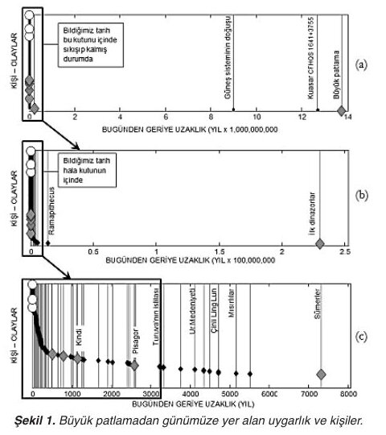
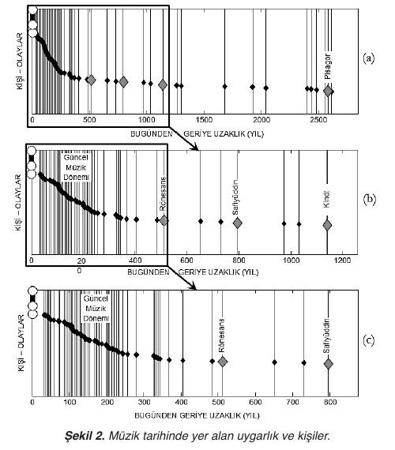
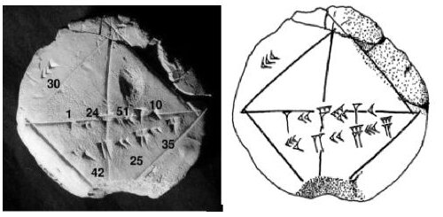
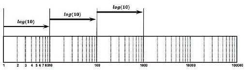
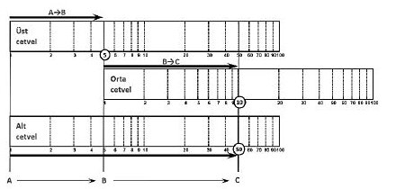

This post is a magazine article kept in the archive folder of the MAT151 Mathematics I course: **Prof. Dr. Süleyman Gökhun Tanyer** from the Department of Electrical and Electronics Engineering at Başkent University published it in **Bilim ve Ütopya** magazine under the heading *"Matematiğin Sesi"* (The Voice of Mathematics), titled **"The importance of the logarithm function in the perception of the outside world and its place in history"** (magazine pages 68–74). According to the file name, it appeared in the **January 2016** issue of the magazine; the issue number is not written on the pages. A 7-page PDF of the article can be downloaded at the end of the post.

*This content belongs to a third-party source; it is shared for archival and nostalgic purposes, with the source credited. It will be removed upon the request of the rights holder.*

> Whether it is a simple solution that explains the vast laws of physics governing the workings of the universe, or, on a much narrower scale, the solution to a simple problem encountered in daily life, throughout history people have always had quests and sources of curiosity; throughout history, in order to survive, humans have had to perceive, think, and question.

## Abstract

In this article, the stages of scientific thought are examined, and the importance of perception and observation, which come first among these stages, is emphasized. The logarithm function, which forms the basis of human imagination and makes it easier to perceive the outside world, and which is used naturally even in the ear's perception of the pitch of a sound, is examined.

## Introduction

Whether it is a simple solution that explains the vast laws of physics governing the workings of the universe, or, on a much narrower scale, the solution to a simple problem encountered in daily life, throughout history people have always had quests and sources of curiosity; throughout history, in order to survive, humans have had to perceive, think, and question. For example, we can imagine that the questioning of nature by the first humans, known as hunter-gatherers, who lived far back before known history, may have arisen with the stars that appeared at night.

In the periods when people managed to live in communities, with the sharing of tasks in many vital matters such as agriculture, individuals specialized in particular fields, which made it possible to discover new methods that would serve humanity. Human beings wanted to secure their lives and to produce more effective solutions to their daily problems. For this reason, they frequently found themselves in an examination-like situation. A solution produced for any need, that is, a *discovery*, can be any of many examples: the first sailing ship able to cross seas, the wheeled cart able to cover long distances, a better seed, new irrigation canals that can water much larger areas. The *discoverer*, the person who makes the discovery, managed to bring a new solution to a need, one step ahead of those before them. But why can only a limited group of people make discoveries? If they share a common trait, what might it be?

**We see that those who make discoveries are the people who, before chasing answers, first ask the right question.** That is, they observe very well the conditions under which the problem arises and can identify the source of the problem. From this we understand that a hypothesis, that is, a new solution proposal, can be formed only after good observation. As the name suggests, every proposal is only a proposal; it needs to be tested and verified. The test may reveal that the hypothesis has failed; success cannot be guaranteed, and first hypotheses are often wrong. Such situations are not a loss, but a gain, an intermediate step, a progress that makes it possible to produce much better hypotheses.

The following stages lie at the foundation of scientific thought:

1. *perception* (observation),
1. *questioning*,
1. *producing a solution*, proposing it (hypothesis),
1. and afterwards honestly *testing* this proposal, verifying it, that is, determining whether it is correct.

In the tests, the conditions under which the hypothesis is wrong or right are also determined. In this way, it becomes possible to produce a reliable solution, even if only partially. The spoon and the fork are partial solutions to the act of eating; it may sound like a joke, but it is true…

In this article, we will examine the first of the stages that form the basis of scientific thought, making observations, that is, being able to perceive the situation one is in. We will look at how difficult the conditions we need to perceive can be, and at one of the solutions humans use against these difficulties, a solution called the *logarithm* in mathematics.

## Where does the word logarithm come from?

When we examine the history of the words *algorithm* and *algebra*, which lie behind the logarithm, we come across **Abu Abdullah Muhammad ibn Musa al-Khwārizmī**, who lived between 780 and 850 CE and was born in the city of Khwarazm. The Hindu-Arabic numerals {0, 1, 2, …, 9} that we use today first reached the West and took root there through al-Khwārizmī's works. The meaning of his name: Abu Abdullah Muhammad, son of Musa al-Khwārizmī, with "Abu" meaning "father of." His name passed into Latin as "algorithm." Among his many books there is one that may interest you: *Ilm al-jabr wa'l-muqābala / al-Kitab al-Mukhtasar fi Hisab al-Jabr wa'l-Muqabala*, that is, the concise book on algebra and the calculation of equations. The word *jabr* is none other than the famous word *algebra* that we still use and have not forgotten!.. If you are wondering how we got from algorithm to logarithm, I suggest you read on. "Logic," that is, reasoning, will connect with words such as the power to imagine, perceive, interpret, and think in an orderly way, and perhaps you will say "the algebra of logic."

*(On the first page of the article there is a postage stamp issued by the Soviet Union on 6 September 1983 for the 1200th anniversary of al-Khwārizmī's birth.)*

## Do you think it is possible to perceive the universe completely?

Try answering the question given in the heading, if you like. Do you find the question too open-ended? Sometimes, instead of trying to solve a big problem, breaking it into small pieces and advancing with the crumbs inside it may seem to take much more time, yet it can be the most correct way to make progress. Let us start with a small question and proceed: Do you think our senses, or even our imagination, are sufficient for perceiving the durations expressed in the history of the universe? It seems a simple question. Let us see how helpless we can be in the face of very large and very small numbers.

According to the scientifically accepted view today, the age of the universe is approximately **13.75 billion years**, and its birth begins with the Big Bang. We are now in the year 2015. Let us try to imagine the span between them.

Visual shapes are very helpful in our perception of numbers. Figure 1 (a) may surprise you quite a bit: it is as if our known history happened today, with nothing in between. Then let us limit the past to 2.5 billion years; still not enough, it does not work (Figure 1 (b)). The third figure at the bottom goes back only 8000 years from today, to the Sumerians. Even if we get this close to the present, our recent history still looks jumbled together, doesn't it? It is clear that our imagination cannot perceive this time span. What we see is very simply this: **everything we know happened "now."**

The date shown with the number 2 on the bottom axis indicates 2 billion years before today. We can write 2 billion years as 2,000,000,000, or by carrying the 9 zeros up into the exponent of 10, as 2 × 10⁹; 10⁹ is actually the product of 9 tens, that is, 1 followed by 9 zeros. The age of the universe, 13.75 billion years, is an unimaginable duration. But would you believe that at the *Large Hadron Collider* at CERN the first 10⁻³⁴ seconds of the Big Bang are being studied? In this number there are exactly 34 zeros after the decimal point before reaching the 1. I do not know what would change if the number in our imagination had 28 zeros instead of 34; since we cannot compare them, there is no counterpart for it in our imagination either.

The troublesome numbers are, on one side, too large to imagine, and on the other, too small to imagine. If you ask how many times the span studied at CERN has passed during the life of the universe, you need to divide the age of the universe, 13.75 billion years, by 10⁻³⁴: roughly 10 followed by 43 zeros!.. We can only imagine as many numbers as we have fingers. [Silk (2012), pp. 77–97; for the study of the formation of the universe in stages, Hawking (2011); for the elementary particles produced in the explosion, Hooft (2012); for even more, Greene.]

Everything we know as history today is stuck inside a point located at 0 (zero), a point whose smallness we cannot even imagine. As we approach the present, the vertical lines showing events begin to separate; we see the Babylonian civilizations, and Ancient Greece seems as close as today. Here the author shares an observation: the Pythagorean period is shown in the West as the starting date of many scientific developments ("the Great" Pythagoras, Euclid, and Aristotle); yet it can be seen that scientific movements in the West took place quite recently compared with the Sumerian, Egyptian, Chinese, and Indian civilizations. When observations are made from different perspectives, views can also differ.

From this point on, examples from music history are used to simplify the figures. Figure 2 (a), which starts with Pythagoras, shows the West's present-day perspective on the history of science. When a window closer to the present is opened in Figure 2 (b), it becomes clear that al-Kindi and Safi al-Din may have influenced Renaissance music; since it starts with al-Kindi, regarded as the first Muslim music theorist, this figure is much more meaningful for many Arab music historians. Figure 2 (c), which starts with Safi al-Din, is quite suitable for looking at the Edvar tradition, which C. Güray describes as "the cycle that brought the makams into being" [Güray (2011)]. The window we look through affects our perspective.

## Very large and very small numbers

The next example is sound intensity:

| Sound (noise) sources and their distances | Sound intensity (W/m²) |
|---|---|
| Jet engine (50 m) | 100 |
| Threshold of pain | 10 |
| Discomfort threshold | 1 |
| Chainsaw (1 m) | 0.1 |
| Disco dance floor (1 m) | 0.01 |
| Diesel truck (10 m) | 0.001 |
| Busy roadside (5 m) | 0.000 1 |
| Vacuum cleaner (1 m) | 0.000 01 |
| Conversation (1 m) | 0.000 001 |
| Average home noise | 0.000 000 1 |
| Quiet library | 0.000 000 01 |
| Quiet bedroom (at night) | 0.000 000 001 |
| Television studio noise | 0.000 000 000 1 |
| Rustling leaves (from a distance) | 0.000 000 000 01 |
| Threshold of hearing | 0.000 000 000 001 |

*Table I. Intensity levels of different sound sources.*

Looking at Table I, you see that there are enormous ratios of magnitude. What does it mean that the intensity a jet engine creates at 50 meters is **10¹⁴ times** our threshold of hearing? If we cannot imagine it, what kind of solution might our ear have found for this? The main subject of this article is the examination of a miraculous solution to this difficult problem.

| Objects | Approximate sizes (m) |
|---|---|
| Computer desk | 1 |
| Mount Everest | 1 000 000 |
| Moon–Earth distance | 100 000 000 |
| Sun–Earth distance | 100 000 000 000 |
| Radius of the solar system | 1 (13 zeros) |
| Nearest star (Proxima Centauri) | 1 (18 zeros) |
| Milky Way | 1 (20 zeros) |
| Galaxy arm length | 1 (21 zeros) |
| Size of the observable universe | !.. |

*Table II. Examples of physical magnitude values.*

| Objects | Approximate sizes (m) |
|---|---|
| Computer desk | 1 |
| Mosquito | 0.01 |
| Thickness of a hair | 0.000 1 |
| Red blood cell, bacterium | 0.000 001 |
| Wavelength of red | 0.000 000 1 |
| Radius of an atom | 0.000 000 000 1 |
| Subatomic particles (electron, quark) | 0. (15 zeros) 1 |
| Neutrino | 0. (23 zeros) 1 |
| Planck length | 0. (34 zeros) 1 |

*Table III. Some shrinking physical values.*

We can be helpless when it comes to comparing magnitudes, and we cannot even imagine how large or small objects really are. Our observation is correct; now let us ask the right question: **Why do we have such difficulty imagining these numbers?**

### Bel and decibel

The numbers we encounter and are prepared for in daily life are about as many as the fingers of our hands. To compare very large and very small numbers, we can get somewhere by looking at how many zeros a number has; in fact, we cannot imagine them, we can only count the zeros. Today, in honor of Graham Bell, the number of zeros in a number is called the **bel**. By this rule, the number 10, having one zero, is 1 bel, 1000 is 3 bels, and 0.0001, being 1 divided by 10,000, is −4 bels. All other numbers lie between these values and can be calculated with the logarithm function: for every real number greater than zero there is a corresponding bel value.

If we multiply the bel value we obtain by 10, we arrive at the **decibel** (like the decimeter, which is 10 times smaller than the meter). For example, the number 2, frequently used in engineering, is approximately equal to 3 decibels, the number 0.5 = 1/2 is equal to −3 decibels, and 0 decibels corresponds to the value 1. Bel and decibel also give the ratio of a number relative to 1: if the number equals 1 the result is 0, if it is greater the value is positive, and if it is smaller the value is negative.

")

Returning to our first problem and ordering the years going back from today by their number of zeros (their bel value), the result obtained in Figure 3 (a) reflects almost exactly the perception we had imagined: at one end the Big Bang, at the other the days of this week, seen together. If we limit this observation to the span between the birth dates of Fazıl Say and Safi al-Din, two landmarks in our music, we see with Figure 3 (b) that we can indeed perceive better. In Table II, for the roughly 1,000,000 meters of Mount Everest we were able to arrive at the number 6; for small numbers this would be −6. Easy…

The operation that turns the factors making up large and small numbers into a sum is called the **logarithm** in the language of mathematics. The logarithm is the miracle function that allows us to understand nature better: it turns multiplication into addition, helps us compare very large and very small numbers, and is the only solution in many multiplications humanity has faced (especially when there were no calculators). The logarithm method provides great convenience in land calculations, the exchange of goods and property, trade, and especially astronomical calculations.

## The place of the logarithm in history

When you look at the history of the logarithm, you may encounter rather contradictory statements:

1. "We owe the present-day use of the logarithm to Leonhard Euler (1707–1783)."
1. "John Napier (1550–1617) truly used the logarithm, employing many different bases."
1. "Michael Stifel (1487–1567) was the first to define the logarithm of exponentiated numbers; he studied the powers of 2."
1. "Acharya Virasena (an 8th-century Indian mathematician) calculated the volume of a truncated pyramid in 816 CE and computed logarithms to bases two and three."

The list goes on and, understandably, confuses minds.

## The first known step of the logarithm idea: quarter-square multiplication

If you say "the basic philosophy of the logarithm is to turn the multiplication operation into a sum," this history extends much further back. Let the numbers we want to multiply be x and y. We can relate the product of these numbers to their sum and difference as follows:

- xy = ¼ [(x + y)² − (x − y)²]  (1)

Let us prove it backwards:

- ¼ [(x + y)² − (x − y)²] = ¼ [(x² + 2xy + y²) − (x² − 2xy + y²)] = ¼ (4xy) = xy  (2)

The convenience of this method becomes apparent with a table: under the numbers n, the values ⌊n²/4⌋ are written.

| n | 0 | 1 | 2 | 3 | 4 | 5 | 6 | 7 | 8 | 9 | 10 | 11 | 12 | 13 | 14 | 15 | 16 | 17 | 18 |
|---|---|---|---|---|---|---|---|---|---|---|---|---|---|---|---|---|---|---|---|
| n²/4 | 0 | 0 | 1 | 2 | 4 | 6 | 9 | 12 | 16 | 20 | 25 | 30 | 36 | 42 | 49 | 56 | 64 | 72 | 81 |

*Tables IV–V. Table method for finding a product by addition/subtraction.*

**10 × 3:** The first number to be multiplied, 10, is selected in the first row of the table. Using the other number, 3, the numbers 7 and 13, which lie 3 to the left and 3 to the right of 10, are marked. The difference of the numbers beneath them gives the product: **42 − 12 = 30 = 10 × 3**.

**6 × 4:** Let us first pick 6; since it will be multiplied by 4, let us move 4 steps to the right and to the left and find the numbers 10 and 2. The difference of the numbers beneath them: **25 − 1 = 24 = 6 × 4**. Let us not forget, a method that has not been tested has not been verified.

Although it may look like a primitive (it would be more correct to say ancient) method, it can be taught to a child who knows none of these subjects and knows only addition and subtraction. Today this calculation is called **quarter-square multiplication**. It may be hard to believe, but this method is thought to have been used for the first time around 2000–1600 BCE by the **Babylonians** to easily calculate the product of two numbers using only addition. Some also say it was first discovered by John Napier (1550–1617); this may be true for the West [Conner, p. 21]. It is no coincidence that this was a period when sailors needed a simpler calculation method.

### YBC 7289: the "square root of two tablet"

Figure 4 shows the cuneiform clay tablet numbered **YBC 7289** from the Babylonian civilization (this tablet, held in the Yale University Library, is called the "square root of two tablet"). On the side of the square is 30, and on the diagonal are, in order, the numbers 1, 24, 51, 10 and 42, 25, 35 [Fowler (1998)]. It is made so that it fits easily in the palm of the hand.

What is the number whose square is 2, that is, what is √2?

- √2 ≅ 1.414213…  (3)

In the solution given on the Babylonians' tablet (with base-60 numbers):

- 30 × √2 ≅ 42/1 + 25/60 + 35/3600 ≅ 42.426407…  (4)
- √2 ≅ 1/1 + 24/60 + 51/3600 + 10/216000 ≅ 1.414213…  (5)

is expressed. The error is less than 0.000 000 6; the error ratio is 0.000 424 per thousand. Even today this value can be considered exact.

*Note: The calculations were checked: 1 + 24/60 + 51/3600 + 10/216000 = 1.4142130 (√2 = 1.4142136), a difference of about 6 × 10⁻⁷, a relative error of about 4.24 × 10⁻⁷ (0.000 424 per thousand), as in the article. The sum 42 + 25/60 + 35/3600 in (4), however, equals 42.426389; the value 42.426407 is 30√2 itself.*

What would you do in those days? You have no computer, no mobile phone apps. You are like Imam al-Ghazali begging the bandit robbers to give back the notes they stole. What did the bandit say: "If nothing remains in your mind once your notes are gone, then you actually know nothing" [Zerrinkub (2007), p. 43]. We have always looked down on the ancients, yet we owe them almost everything we know. Which of us discovered how to make yogurt ourselves? What about pickles, jam, pastırma (cured beef)? Why did you divide a day into 24 hours, if I may ask? If you have no refrigerator, you have lots of produce, and a hard winter awaits you, then you sit down and are forced to discover something…

We said the basic aim of the logarithm is to turn the multiplication operation into addition and subtraction, and we realized that the Babylonians deserve at least a little respect.

## The slide rule

The author completes the subject by mentioning the slide rule that his father, **Prof. Dr. Kamil Tanyer**, gave him as a gift in his childhood. According to the Turkish Language Association (TDK) Turkish Dictionary (Eleventh Edition, Ankara, 2011, p. 456), *cetvel* (ruler): "a tool made of wood, plastic, or metal, graduated or ungraduated, used for drawing straight lines" and "list, table." The slide rule made it possible to find the product of two numbers by addition. If you add the logarithms of two numbers (x and y), you find the logarithm of their product:

- log(xy) = log(x) + log(y)  (6)

If both numbers are 10, then since 10 × 10 = 100:

- log(100) = log(10) + log(10)  (7)
- log(1000) = log(10) + log(10) + log(10)  (8)

Instead of multiplying by 10 each time, we perform addition on the logarithms. Whether the number we want to reach is 1 billion, 1 trillion, or even 10³⁴, by adding the necessary number of log(10) terms we can reach the logarithm of the number we want. This is exactly what "doing addition instead of multiplication" means.

At the top of the figure there are three arrows pointing right; each is as long as the logarithm of 10, and all three are equal. On the bottom axis there are numbers ordered from 1 to 100 thousand. Let the first number be 1 (the far left end). If we multiply it by 10, we should reach 10: advancing to the right by the length of the leftmost arrow, that is, by log(10), we reach 10. Advancing by the second arrow we reach 100, and repeating once more we reach 1000. It is now possible to get from one number to another not by multiplication but only by addition. With each addition of log(10) we advanced 10-fold; this is exactly what **proportional growth**, that is, **logarithmic growth**, is. How our ear knows and does this convenience is an entirely separate topic of discussion.

### 5 × 10 with the slide rule

If we substitute the numbers 5 and 10 into Equation (6):

- log(50) = log(5) + log(10)

To cut a long story short, instead of multiplying 5 and 10, we add their logarithms. In Figure 6 there are three slide rules stacked on top of each other. The logarithm of the point 1 on the topmost rule is 0, that is, point A, the start of the rule. For our first number, 5, we go from 1 to 5 and reach point B; this length is log(5). For our other number, 10, let us do the same on the second (middle) rule and reach C from B. If the lengths AB and BC are added, we get log(5) + log(10) = log(50). By measuring the total length between A and C on the third rule, we can reach the number 50. A small hint: the third rule is actually not needed, we could have used the first rule as well; two slide rules are enough.

The slide rule the author received from his father was a pair; when he moved the sliding transparent plastic strip holding the two together, he could reach the number 50 with the line at point C. The author says that this was perhaps the first of the small steps that led him to become an engineer today. Later, calculators that compute the logarithm with a single key (the LOG and LN keys) appeared; now it is possible to download them as mobile phone apps.

*Note: In the article, the log(50) equation is also given the number (7) (the log(100) equation is also (7)); the references to "Figure 7" and "Figure 11" in the text correspond to the slide rules in Figure 6 and the calculator photograph, respectively. In Table I, the "Busy roadside" value is printed as "0.000 1V"; the correct value is 0.000 1. In the in-text citations, Conner 2005 and Greene 2010 are written; in the bibliography these books appear with the 2012 and 2008 editions.*

## References

- Conner C. D. (2012), *Halkın Bilim Tarihi* (A People's History of Science), 2nd ed., Translation: Zeynep Çiftçi Kanburoğlu, TÜBİTAK Bilim Yayınları.
- Greene B. (2008), *Evrenin Dokusu* (The Fabric of the Cosmos), Translation: Alev M., TÜBİTAK Popüler Bilim Yayınları, Ankara.
- Güray C. (2011), *Bin Yılın Mirası*, Pan Yayıncılık.
- Hawking S. (2011), *Herşeyin Teorisi* (The Theory of Everything), 3rd ed., Translation: Kerem Işık, Şenocak Yayınları.
- Hooft G. (2012), *Maddenin Son Yapıtaşları* (The Ultimate Building Blocks of Matter), Translation: Mehmet Koca, Nazife Özdeş Koca, 11th ed., TÜBİTAK Yayınları, Ankara.
- Silk J. (2012), *Evrenin Kısa Tarihi* (A Short History of the Universe), Translation: Alev M., 14th ed., TÜBİTAK Popüler Bilim Yayınları, Ankara.
- Zerrinkub A. (2007), *Medreseden Kaçış* (Escape from the Madrasa), Translation: Hikmet Gök, 2nd ed., Ağaç Yayınları.
- en.wikipedia.org/wiki/Babylonian_mathematics (YBC 7289 image; accessed: 15 July 2015).

*Author's note (from the article): Chairman of the Board, Co-founder, Defense Engineering R&D Technology (SMART) Inc., Ankara.*
