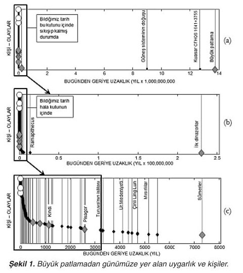
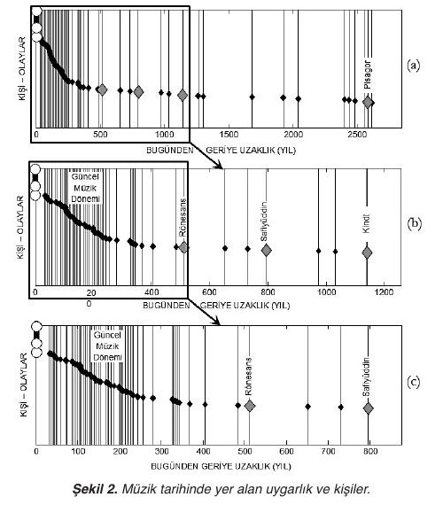
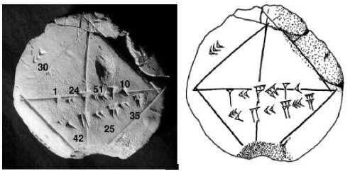
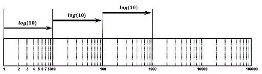
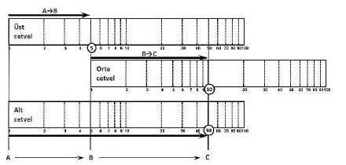

Bu yazı, MAT151 Matematik I dersinin arşiv klasöründe saklanan bir dergi makalesidir: Başkent Üniversitesi Elektrik-Elektronik Mühendisliği Bölümü'nden **Prof. Dr. Süleyman Gökhun Tanyer**'in **Bilim ve Ütopya** dergisinde *"Matematiğin Sesi"* başlığı altında yayımlanan **"Dış dünyanın algılanmasında logaritma fonksiyonunun önemi ve tarihteki yeri"** başlıklı yazısı (dergi sayfaları 68–74). Dosya adına göre derginin **Ocak 2016** sayısında yer alıyor; dergi sayı numarası sayfalarda yazmıyor. Makalenin 7 sayfalık PDF'i yazının sonunda indirilebilir.

*Bu içerik üçüncü taraf bir kaynağa aittir; arşiv ve nostalji amacıyla kaynak belirtilerek paylaşılmıştır. Hak sahibinin talebi hâlinde kaldırılır.*

> İster evrenin işleyişinde geçerli engin fizik kurallarını açıklayan sade bir çözüm, isterse çok daha dar kapsamda, günlük hayatta karşılaşılan basit bir sorunun çözümü olsun, tarih boyunca insanlar için bir takım arayışlar ve merak kaynakları hep var olmuştur; insan tarih boyunca hayatta kalabilmek için algılamak, düşünmek ve sorgulamak zorunda kalmıştır.

## Özet

Bu yazımızda, bilimsel düşüncenin aşamaları incelenmekte ve bu aşamalarda birinci sırada yer alan algılama ve gözlemin önemi vurgulanmaktadır. İnsanın hayal gücünü oluşturan ve dış dünyayı algılamasında kolaylık sağlayan, örneğin kulak ile sesin tonunun algılanmasında dahi doğal olarak kullanılan logaritma fonksiyonu incelenmektedir.

## Giriş

İster evrenin işleyişinde geçerli engin fizik kurallarını açıklayan sade bir çözüm, isterse çok daha dar kapsamda, günlük hayatta karşılaşılan basit bir sorunun çözümü olsun, tarih boyunca insanlar için bir takım arayışlar ve merak kaynakları hep var olmuştur; insan tarih boyunca hayatta kalabilmek için algılamak, düşünmek ve sorgulamak zorunda kalmıştır. Örneğin, avcı-toplayıcı adı verilen, bilinen tarihin oldukça gerisinde yaşamış olan ilk insanların doğa hakkındaki sorgulamalarının, geceleri beliren yıldızlar ile ortaya çıkmış olabileceğini hayal edebiliriz.

İnsanların topluluklar hâlinde yaşamayı becerebildikleri dönemlerde, tarım gibi hayati birçok konuda görevlerin paylaşılması ile birlikte, kişiler belirli konularda uzmanlaşmış ve insanlığa hizmet edecek yeni yöntemlerin keşfedilmesini mümkün kılmıştır. İnsanoğlu, hayatını güvenceye almak ve günlük sorunlarına ilişkin daha etkin çözümler üretebilmek istemiştir. Bu yüzden sıklıkla bir sınav ortamı ile karşılaşmıştır. Herhangi bir ihtiyaca yönelik üretilen bir çözüm, yani bir *keşif*; denizleri aşabilen ilk yelkenli, uzun yolları katedebilen tekerlekli yük arabası, daha iyi bir tohum, çok daha fazla alanı sulayabilen yeni sulama kanalları gibi birçok örnek olabilir. Keşfi yapan kişi olan *kâşif* ise bir ihtiyaca ilişkin, kendinden öncekilerine göre bir adım ileride yeni bir çözüm getirmeyi becerebilmiştir. Ama neden sadece sınırlı bir grup insan keşif yapabiliyor? Onların ortak bir özelliği varsa nedir acaba?

**Keşif yapan kişilerin, cevapların peşinde koşmadan önce ilk olarak doğru soruyu soran kişiler olduğunu görüyoruz.** Yani problemin ortaya çıktığı koşullarda çok iyi gözlem yapıyor ve sorunun kaynağını belirleyebiliyorlar. Bundan anladığımız, ancak iyi bir gözlem sonrasında hipotez oluşturulabilir, yani yeni bir çözüm önerilebilir. Her öneri adı üzerinde sadece bir öneridir, test edilmeye ve doğrulanmaya muhtaçtır. Test sonucunda hipotezin başarısız olduğu ortaya çıkabilir; başarı garantilenemez ve ilk hipotezler sıklıkla hatalıdır da. Bu tür durumlar bir kayıp değil, çok daha iyi hipotez üretebilmeyi sağlayan bir kazanım, bir ara adım, bir ilerlemedir.

Bilimsel düşüncenin temelinde şu aşamalar yatmaktadır:

1. *algılama* (gözlem),
1. *sorgulama*,
1. *çözüm üretme*, önerme (hipotez),
1. ve sonrasında dürüst bir şekilde bu öneriyi *test etme*, doğrulama, yani doğru olup olmadığını belirleme.

Testlerde, hipotezin hangi koşullar altında hatalı veya doğru olduğu da belirlenmektedir. Böylelikle, kısmen bile olsa güvenilir bir çözüm üretmek mümkün olabilmektedir. Kaşık ve çatal, yemek yeme işlemi için kısmi çözümlerdir; şaka gibi gelse de doğru…

Bu yazımızda, bilimsel düşüncenin temeli olan aşamaların birinci sırasında yer alan gözlem yapmayı, yani içinde bulunulan durumu algılayabilmeyi inceleyeceğiz. Algılamamız gereken koşulların ne kadar zor olabildiğini ve insanın bu zorluklar karşısında kullanmakta olduğu çözümlerden birisi olan, matematikteki adı *logaritma* olan bir çözümü inceleyeceğiz.

## Logaritma kelimesi nereden geldi?

Logaritmanın gerisinde yatan *algoritma* ve *cebir* kelimelerinin geçmişini incelediğimizde karşımıza, MS 780–850 yılları arasında yaşamış, Harezm şehrinde doğmuş olan **Ebu Abdullah Muhammed ibn Musa el-Hārizmī** çıkıyor. Bugün kullanmakta olduğumuz {0, 1, 2, …, 9} Hint-Arap sayıları, ilk defa Batı'ya Harizmi'nin eserleri ile ulaşıyor ve yerleşiyor. Adının anlamı: Musa el-Harizmi'nin oğlu, Baba (Ebu) Abdullah Muhammed. Adı Latinceye "algorithm", yani algoritma olarak geçmiş. Birçok kitabının arasında biri var ki ilginizi çekebilir: *İlm al-jabr wa'l-muḳābala / El-Kitab'ül-Muhtasar fi Hısab'il Cebri ve'l-Mukabele*, yani cebir ve denklem hesabı üzerine özet kitap. *Jabr* kelimesi, bugün kullandığımız, hâlâ unutulmamış olan meşhur kelime *cebir*!.. Algoritmadan logaritmaya nasıl geçildi diye soruyorsanız yazımızın devamını okuyun derim. "Logic" yani mantık; hayal edebilme, algılayabilme, yorumlayabilme, düzenli düşünebilme gücü gibi kelimelerle ilişki kuracak ve belki de "mantığın cebiri" diyeceksiniz.

*(Makalenin ilk sayfasında, Sovyetler Birliği'nin 6 Eylül 1983 tarihli, El-Harezmî'nin doğumunun 1200. yılı için çıkardığı posta pulu yer alıyor.)*

## Sizce evreni tam olarak algılayabilmek mümkün mü?

Başlıkta verilen soruyu cevaplamayı bir deneyin isterseniz. Soru sizce çok açık mı? Bazen büyük bir problemi çözmeye kalkışmak yerine, onu küçük parçalara ayırarak içindeki kırıntılarla ilerlemek, çok daha fazla zaman alıyor gibi görünse de en doğru ilerleme yöntemi olabiliyor. Küçük bir soru ile başlayıp ilerleyelim: Sizce evrenin tarihinde ifade edilen süreleri algılayabilmemizde duyularımız, hatta hayal gücümüz yeterli midir? Basit gibi görünen bir soru. Bizlerin çok büyük ve çok küçük sayılar karşısında aciz kalabildiğimizi bir görelim isterseniz.

Günümüzde bilimsel açıdan kabul edilen görüşe göre evrenin yaşı yaklaşık olarak **13,75 milyar yıl**, doğumu büyük patlama ile başlıyor. Bugün 2015 yılındayız. Haydi arasındaki süreyi bir hayal edelim bakalım.

Sayıları algılamamızda görsel şekillerin çok faydası var. Şekil 1 (a) oldukça şaşırtabilir sizi: bilinen tarihimiz bugün olmuş gibi, arası boş. O zaman geçmişi 2,5 milyar yıl ile sınırlandıralım; hâlâ yeterli değil, olmuyor (Şekil 1 (b)). En alttaki üçüncü şekil, bugünden sadece 8000 yıl öncesine, Sümerlere kadar gidiyor. Bu kadar günümüze yaklaşsak da yine de yakın tarihimiz birbirine girmiş gibi, değil mi? Bu zaman aralığını hayalimizin algılayamadığı ortada. Görülen çok basitçe şudur: **bildiğimiz her şey "şimdi" oldu.**

Alt eksende 2 sayısı ile gösterilen tarih bugünden 2 milyar yıl öncesini gösteriyor. 2 milyar yılı 2.000.000.000 sayısı ile veya 9 sıfırı 10'un üstüne taşıyıp 2 × 10⁹ şeklinde gösterebiliriz; 10⁹ aslında 9 tane 10 sayısının çarpımı, yani 1 yanında 9 tane sıfır demek. Evrenin yaşı olan 13,75 milyar yıl hayal edilemez bir süre. Ya peki CERN'deki *Büyük Hadron Çarpıştırıcısı*'nda Büyük Patlama'nın ilk 10⁻³⁴'üncü saniyesinin çalışılmakta olduğuna inanır mısınız? Bu sayıda virgülden sonra 1'e ulaşana kadar tam 34 tane sıfır var. Bizim hayalimizdeki sayıda 34 sıfır değil de 28 sıfır olsa ne değişir bilemiyorum; karşılaştıramadığımıza göre hayalimizde bir karşılığı da yok.

Sıkıntı yaratan sayılar bir tarafta hayal edilemeyecek kadar büyük, diğer tarafta ise hayal edilemeyecek kadar küçük. Evrenin hayatı boyunca CERN'de incelenen süreden kaç kere geçti derseniz, evrenin yaşı olan 13,75 milyar yılı 10⁻³⁴'e bölmeniz gerekir: yaklaşık olarak 10'un yanında 43 tane sıfır!.. Bizler elimizdeki parmaklar kadar sayıyı ancak hayal edebiliriz. [Silk (2012), s. 77–97; evrenin oluşumunun safhalar hâlinde incelenmesi için Hawking (2011); patlamada ortaya çıkan temel parçacıklar hakkında Hooft (2012); daha da fazlası için Greene.]

Bugün tarih olarak bildiğimiz her şey 0 (sıfır) konumunda bulunan ve ne kadar küçük olduğunu dahi hayal edemediğimiz bir noktanın içine sıkışıp kalmış durumda. Günümüze yaklaştıkça olayları gösteren dikey çizgiler ayrışmaya başlıyor; Babil medeniyetlerini görüyoruz, Eski Yunan sanki bugün gibi yakın. Yazar burada bir tespitini paylaşıyor: Batı'da birçok bilimsel gelişmenin başladığı tarih olarak Pisagor dönemi gösteriliyor ("Büyük" Pisagor, Öklid ve Aristo); oysa Batı'daki bilimsel hareketlerin Sümer, Mısır, Çin ve Hint uygarlıklarına göre oldukça yakın dönemde yaşandığı görülebiliyor. Yapılan gözlemler farklı bakış açılarına sahip olduğunda görüşlerde de farklılık yaşanabiliyor.

Bu noktadan sonra şekilleri sadeleştirmek için müzik tarihinden örnekler kullanılıyor. Pisagor ile başlatılan Şekil 2 (a) günümüzde Batı'nın bilim tarihi konusundaki bakış açısını gösteriyor. Günümüze daha yakın bir pencere Şekil 2 (b)'de açıldığında Kindi ile Safiyüddin'in Rönesans müziğini etkilemiş olabilecekleri anlaşılıyor; ilk Müslüman müzik kuramcısı olarak kabul edilen Kindi ile başladığı için bu şekil birçok Arap müzik tarihçisi için çok daha anlamlı. Safiyüddin ile başlayan Şekil 2 (c) ise C. Güray'ın "makamları var eden döngü" olarak tanımladığı Edvar geleneğine [Güray (2011)] bakış için oldukça uygun. Bakılan pencere aralığı bakış açımızı etkiliyor.

## Çok büyük ve çok küçük sayılar

Sıradaki örnek ses şiddeti:

| Ses (gürültü) kaynakları ve uzaklıkları | Ses şiddeti (W/m²) |
|---|---|
| Jet motoru (50 m) | 100 |
| Acı eşiği | 10 |
| Rahatsızlık sınırı | 1 |
| Zincirli testere (1 m) | 0,1 |
| Disko pisti (1 m) | 0,01 |
| Dizel kamyon (10 m) | 0,001 |
| Yoğun yol kenarı (5 m) | 0,000 1 |
| Elektrikli süpürge (1 m) | 0,000 01 |
| Sohbet konuşması (1 m) | 0,000 001 |
| Ortalama ev gürültüsü | 0,000 000 1 |
| Sessiz kütüphane | 0,000 000 01 |
| Sessiz yatak odası (gece) | 0,000 000 001 |
| Televizyon stüdyo gürültüsü | 0,000 000 000 1 |
| Sallanan yapraklar (uzaktan) | 0,000 000 000 01 |
| İşitme eşiği | 0,000 000 000 001 |

*Tablo I. Farklı ses kaynaklarının şiddet miktarları.*

Tablo I'e baktığınızda muazzam büyüklük oranlarının bulunduğunu görmektesiniz. Jet motorunun 50 metrede yarattığı şiddetin işitme eşiğimizin **10¹⁴ katı** olması ne anlama geliyor acaba? Biz hayal edemiyorsak, kulağımız bu konuda nasıl bir çözüm bulmuş olabilir? Bu yazının temel konusu bu zor probleme getirilen mucize bir çözümün incelenmesi.

| Nesneler | Yaklaşık boyutlar (m) |
|---|---|
| Bilgisayar masası | 1 |
| Everest dağı | 1 000 000 |
| Ay–Dünya uzaklığı | 100 000 000 |
| Güneş–Dünya uzaklığı | 100 000 000 000 |
| Güneş sisteminin yarıçapı | 1 (13 sıfır) |
| En yakın yıldız (Proxima Centauri) | 1 (18 sıfır) |
| Samanyolu | 1 (20 tane sıfır) |
| Galaksi kol uzunluğu | 1 (21 tane sıfır) |
| Görülebilen evrenin büyüklüğü | !.. |

*Tablo II. Fiziksel büyüklük değerlerine örnekler.*

| Nesneler | Yaklaşık boyutlar (m) |
|---|---|
| Bilgisayar masası | 1 |
| Sivrisinek | 0,01 |
| Saçın kalınlığı | 0,000 1 |
| Alyuvar, bakteri | 0,000 001 |
| Kırmızının dalga boyu | 0,000 000 1 |
| Bir atomun yarıçapı | 0,000 000 000 1 |
| Atom altı parçacıklar (elektron, kuark) | 0, (15 tane sıfır) 1 |
| Nötrino | 0, (23 tane sıfır) 1 |
| Planck uzunluğu | 0, (34 tane sıfır) 1 |

*Tablo III. Küçülen bazı fiziksel değerler.*

Büyüklükleri karşılaştırma konusunda aciz kalabiliyoruz ve nesnelerin gerçekte ne kadar büyük ya da küçük olduğunu hayal dahi edemiyoruz. Gözlemimiz doğru; şimdi doğru soruyu soralım: **Neden bu sayıları hayal etmede bu kadar çok zorlanıyoruz?**

### Bel ve desibel

Günlük yaşantımızda karşılaştığımız ve hazırlıklı olduğumuz sayılar elimizin parmakları kadar. Çok büyük ve çok küçük sayıları karşılaştırmak için sayıda kaç sıfır bulunduğuna bakarak bir yerlere ulaşabiliyoruz; aslında hayal edemiyor, sadece sıfırları sayabiliyoruz. Günümüzde Graham Bell onuruna sayılardaki sıfır sayısına **bel** adı verilmektedir. Bu kurala göre 10 sayısı bir adet sıfıra sahip olduğundan 1 bel, 1000 sayısı 3 bel, 0,0001 sayısı ise 10.000'e bölünmüş 1 olduğundan −4 bel oluyor. Tüm diğer sayılar bu değerlerin arasında bulunuyor ve logaritma fonksiyonu ile hesaplanabiliyor: sıfırdan büyük her gerçek sayı için karşılık gelen bir bel değeri var.

Elde ettiğimiz bel sayısını 10 ile çarparsak **desibel**'e ulaşırız (metrenin 10 kat küçüğü olan desimetre gibi). Örneğin mühendislikte sıklıkla kullanılan 2 sayısı yaklaşık olarak 3 desibel'e, 0,5 = 1/2 sayısı ise −3 desibel'e eşit; 0 desibel ise 1 değerine karşılık geliyor. Bel ve desibel aynı zamanda sayının 1'e göre oranını veriyor: sayı 1'e eşitse 0, büyükse pozitif, küçükse negatif değer çıkıyor.

 gösterimi")

İlk problemimize dönüp günümüzden geriye giden yılları sıfır sayılarına (bel değerine) göre sıralarsak, Şekil 3 (a)'da elde edilen sonuç neredeyse tam olarak hayalimizde kurduğumuz algılamayı yansıtıyor: bir uçta büyük patlama, diğer uçta bu haftanın günleri bir arada görülebiliyor. Bu gözlemi müziğimizdeki iki mihenk noktası olan Fazıl Say ile Safiyüddin'in doğum tarihleri arasıyla sınırlarsak Şekil 3 (b) ile gerçekten daha iyi algılayabildiğimizi görürüz. Tablo II'de Everest dağının kabaca 1.000.000 metresi için 6 sayısına ulaşabildik; küçük sayılarda bu sayı −6 olacaktı. Kolaymış…

Büyük ve küçük sayıları oluşturan çarpanları toplam hâline getiren işleme matematik dilinde **logaritma** denmektedir. Logaritma doğayı daha iyi anlamamızı sağlayan mucize fonksiyondur: çarpmayı toplamaya çevirir, çok büyük ve çok küçük sayıları karşılaştırmamıza yardımcı olur, insanlığın karşılaştığı birçok çarpma işleminde (özellikle hesap makinesi olmadığı zamanlarda) tek çözümdür. Logaritma yöntemi arazi hesaplamaları, mal-mülk değişimi, ticaret ve özellikle astronomi hesaplamalarında çok kolaylık sağlar.

## Logaritmanın tarihteki yeri

Logaritmanın tarihine baktığınızda oldukça çelişkili ifadelerle karşılaşabilirsiniz:

1. "Bugünkü logaritmanın kullanımını Leonhard Euler (1707–1783)'e borçluyuz."
1. "Farklı birçok tabanı kullanarak logaritmayı gerçek anlamda John Napier (1550–1617) kullandı."
1. "Michael Stifel (1487–1567) üslü sayıların logaritmasını ilk tanımlayandı; 2'nin kuvvetlerini inceledi."
1. "Acharya Virasena (8. yy Hintli matematikçi) MS 816 yılında ucu kesik piramidin hacmini hesapladı ve iki ile üç tabanına göre logaritma hesabı yaptı."

Liste uzayıp gidiyor ve kafaları haklı olarak karıştırıyor.

## Logaritma fikrinin bilinen ilk adımı: çeyrek kare çarpımı

"Logaritmanın temel felsefesi çarpma işlemini toplam hâline getirmektir" derseniz bu tarih çok daha gerilere uzayacaktır. Çarpmak istediğimiz sayılar x ve y olsun. Bu sayıların çarpımını toplamları ve farkları cinsinden şöyle ilişkilendirebiliriz:

- xy = ¼ [(x + y)² − (x − y)²]  (1)

Tersten ispat edelim:

- ¼ [(x + y)² − (x − y)²] = ¼ [(x² + 2xy + y²) − (x² − 2xy + y²)] = ¼ (4xy) = xy  (2)

Bu yöntemin kolaylığı bir tabloyla ortaya çıkıyor: n sayılarının altına ⌊n²/4⌋ değerleri yazılır.

| n | 0 | 1 | 2 | 3 | 4 | 5 | 6 | 7 | 8 | 9 | 10 | 11 | 12 | 13 | 14 | 15 | 16 | 17 | 18 |
|---|---|---|---|---|---|---|---|---|---|---|---|---|---|---|---|---|---|---|---|
| n²/4 | 0 | 0 | 1 | 2 | 4 | 6 | 9 | 12 | 16 | 20 | 25 | 30 | 36 | 42 | 49 | 56 | 64 | 72 | 81 |

*Tablo IV–V. Çarpımı toplama/çıkarma ile bulmak için tablo yöntemi.*

**10 × 3:** Çarpılacak ilk sayı olan 10 tabloda ilk satırda seçilir. Diğer sayı olan 3 kullanılarak, 10'un 3 solunda ve 3 sağında bulunan 7 ve 13 işaretlenir. Altlarındaki sayıların farkı çarpımı verir: **42 − 12 = 30 = 10 × 3**.

**6 × 4:** Önce 6'yı seçelim; 4 ile çarpılacağı için sağdan ve soldan 4 adım ilerleyerek 10 ve 2 sayılarını bulalım. Altlarındaki sayıların farkı: **25 − 1 = 24 = 6 × 4**. Unutmayalım, test edilmeyen yöntem doğrulanmamıştır.

İlkel (eski demek daha doğru olur) bir yöntem gibi görünse de, bu konuları hiç bilmeyen ve sadece toplama ile çıkarma bilen bir çocuğa öğretilebilir. Bugün bu hesaplama **çeyrek kare çarpımı** olarak adlandırılmaktadır. İnanması zor gelebilir ama bu yöntemin ilk defa MÖ 2000–1600 yıllarında **Babilliler** tarafından, iki sayının çarpımını sadece toplama işlemi ile kolayca hesaplamak için kullanıldığı tahmin edilmektedir. İlk defa John Napier (1550–1617) tarafından keşfedildiğini ifade edenler de var; bu Batı için doğru olabilir [Conner, s. 21]. Gemicilerin daha basit bir hesaplama yöntemine ihtiyaç duyduğu bir dönemde olması boşuna değil.

### YBC 7289: "kök iki tableti"

Şekil 4, Babil medeniyetine ait **YBC 7289** numaralı çivi yazılı kil tableti gösteriyor (Yale Üniversitesi Kütüphanesi'nde bulunan bu tablet "kök iki tableti" olarak adlandırılmaktadır). Karenin kenarında 30, köşegende ise sırayla 1, 24, 51, 10 ve 42, 25, 35 sayıları yer almaktadır [Fowler (1998)]. Avuca kolay sığacak şekilde yapılmıştır.

Karesi 2 olan sayı nedir, yani √2 nedir?

- √2 ≅ 1,414213…  (3)

Babillerin tabletinde verilen çözümde (60 tabanlı sayılarla):

- 30 × √2 ≅ 42/1 + 25/60 + 35/3600 ≅ 42,426407…  (4)
- √2 ≅ 1/1 + 24/60 + 51/3600 + 10/216000 ≅ 1,414213…  (5)

şeklinde ifade edilmektedir. Hata miktarı 0,000 000 6'dan küçük; hata oranı binde 0,000 424. Bugün bile bu değer kesin değer sayılabilir.

*Not: Hesaplar kontrol edildi: 1 + 24/60 + 51/3600 + 10/216000 = 1,4142130 (√2 = 1,4142136), fark yaklaşık 6 × 10⁻⁷, bağıl hata yaklaşık 4,24 × 10⁻⁷ (binde 0,000 424), makaledeki gibi. (4)'teki 42 + 25/60 + 35/3600 toplamı ise 42,426389 eder; 42,426407 değeri 30√2'nin kendisidir.*

O günlerde siz olsanız ne yapardınız? Bilgisayarınız, cep telefonu uygulamalarınız yok. Soyguncu eşkıyalara çaldıkları notlarını geri vermesi için yalvaran İmam Gazali gibisiniz. Eşkıya ne demiş: "Eğer notların gidince aklında bir şey kalmadıysa sen aslında hiçbir şey bilmiyorsun" [Zerrinkub (2007), s. 43]. Hep eskileri küçük görmüşüzdür, ama bildiğimiz neredeyse her şeyi onlara borçluyuz. Hangimiz yoğurt yapmayı kendisi keşfetti? Ya turşu, reçel, pastırma? Neden bir günü 24 saate böldünüz dersem? Eğer buzdolabın yok, bir sürü ürünün var ve önünde zor bir kış seni bekliyorsa, o zaman oturur bir şeyler keşfetmek zorunda kalırsın…

Logaritmanın temel amacı olan çarpım işlemini toplama ve çıkarmaya dönüştürmek dedik ve Babillere biraz olsun saygı duyulması gerektiğinin farkına vardık.

## Logaritma cetveli

Yazar, çocukluğunda babası **Prof. Dr. Kamil Tanyer**'in hediye ettiği logaritma cetvelinden söz ederek konuyu tamamlıyor. Türk Dil Kurumu Türkçe Sözlüğü'ne göre (On Birinci Baskı, Ankara, 2011, s. 456) *cetvel*: "doğru çizgileri çizmeye yarayan, dereceli veya derecesiz, tahtadan, plastikten, madenden yapılmış araç, çizgilik" ve "liste, çizelge" anlamlarına gelmektedir. Logaritma cetveli iki sayının çarpımını toplama yoluyla bulmayı sağlıyordu. İki sayının (x ve y) logaritmalarını toplarsanız, çarpımlarının logaritmasını bulursunuz:

- log(xy) = log(x) + log(y)  (6)

İki sayı da 10 olursa 10 × 10 = 100 olacağından:

- log(100) = log(10) + log(10)  (7)
- log(1000) = log(10) + log(10) + log(10)  (8)

Her seferinde 10 ile çarpmak yerine logaritmalarda toplama yapıyoruz. Ulaşmak istediğimiz sayı ister 1 milyar, ister 1 trilyon, hatta 10³⁴ olsun, gerekli sayıda log(10) ekleyerek istediğimiz sayının logaritmasına ulaşabiliriz. İşte "çarpma yerine toplama yapmak" tam olarak bu.

Şeklin üst kısmında sağa doğru üç ok var; her biri 10 sayısının logaritması kadar uzun ve üçü de eşit. Alt eksende 1'den 100 bine kadar sıralanmış sayılar var. İlk sayı 1 olsun (en sol baş). Bunu 10 ile çarparsak 10'a ulaşmamız lazım: en soldaki ok kadar, yani log(10) kadar sağa ilerleyince 10'a ulaşıyoruz. İkinci ok kadar ilerleyerek 100'e, bir kez daha tekrarlayarak 1000'e ulaşıyoruz. Bir sayıdan bir başkasına çarpma ile değil, sadece toplama ile ulaşmak artık mümkün. Her log(10) toplamında 10 kat ilerledik; işte **oransal artış**, yani **logaritmik artış** tam olarak budur. Kulağımız bu kolaylığı nasıl biliyor da yapıyor, o tamamen ayrı bir tartışma konusu.

### Logaritma cetveliyle 5 × 10

Eşitlik (6)'ya 5 ve 10 sayılarını yerleştirirsek:

- log(50) = log(5) + log(10)

Uzun lafın kısası, 5 ile 10'u çarpmak yerine logaritmalarını topluyoruz. Şekil 6'da üst üste üç logaritma cetveli bulunuyor. En üstteki cetvelin 1 noktasının logaritması 0, yani cetvelin başlangıcı olan A noktası. İlk sayımız 5 için 1'den 5'e giderek B noktasına ulaşıyoruz; bu uzunluk log(5). Diğer sayımız 10 için aynısını ikinci (orta) cetvelde yaparak B'den C'ye ulaşalım. AB ve BC uzunlukları toplanırsa log(5) + log(10) = log(50) elde edilir. Üçüncü cetvelde A ile C arasındaki toplam uzunluğu ölçerek 50 sayısına ulaşabiliriz. Ufak bir ipucu: üçüncü cetvele aslında gerek yok, birinci cetveli de kullanabilirdik; iki logaritma cetveli yeterli.

Yazarın babasından hediye logaritma cetveli ikiliydi; ikisini bir arada tutan, kaydırılabilen şeffaf plastik bandı hareket ettirdiğinde C noktasındaki çizgi ile 50 sayısına ulaşabiliyordu. Yazar, bugün mühendis olmasına neden olan küçük adımların belki de ilkinin bu olduğunu söylüyor. Sonra logaritmayı tek tuşla hesaplayan hesap makineleri (LOG ve LN tuşları) çıktı; şimdi de bunları cep telefonu uygulaması olarak indirmek mümkün.

*Not: Makalede log(50) eşitliği de (7) numarasıyla verilmiş (log(100) eşitliği de (7)); metinde geçen "Şekil 7" ve "Şekil 11" göndermeleri sırasıyla Şekil 6'daki logaritma cetvellerine ve hesap makinesi fotoğrafına karşılık geliyor. Tablo I'de "Yoğun yol kenarı" değeri "0.000 1V" olarak basılmış; doğrusu 0,000 1. Metin içi göndermelerde Conner 2005 ve Greene 2010 yazıyor; kaynakçada bu kitaplar 2012 ve 2008 baskılarıyla geçiyor.*

## Kaynakça

- Conner C. D. (2012), *Halkın Bilim Tarihi*, 2. Basım, Çeviri: Zeynep Çiftçi Kanburoğlu, TÜBİTAK Bilim Yayınları.
- Greene B. (2008), *Evrenin Dokusu*, Çeviri: Alev M., TÜBİTAK Popüler Bilim Yayınları, Ankara.
- Güray C. (2011), *Bin Yılın Mirası*, Pan Yayıncılık.
- Hawking S. (2011), *Herşeyin Teorisi*, 3. Baskı, Çeviri: Kerem Işık, Şenocak Yayınları.
- Hooft G. (2012), *Maddenin Son Yapıtaşları*, Çeviri: Mehmet Koca, Nazife Özdeş Koca, 11. Basım, TÜBİTAK Yayınları, Ankara.
- Silk J. (2012), *Evrenin Kısa Tarihi*, Çeviri: Alev M., 14. Baskı, TÜBİTAK Popüler Bilim Yayınları, Ankara.
- Zerrinkub A. (2007), *Medreseden Kaçış*, Çeviri: Hikmet Gök, 2. Basım, Ağaç Yayınları.
- en.wikipedia.org/wiki/Babylonian_mathematics (YBC 7289 görseli; erişim: 15 Temmuz 2015).

*Yazar notu (makaleden): Yönetim Kurulu Başkanı, Kurucu ortak, Savunma Mühendislik Ar-Ge Teknoloji (SMART) San. ve Tic. A.Ş., Ankara.*
