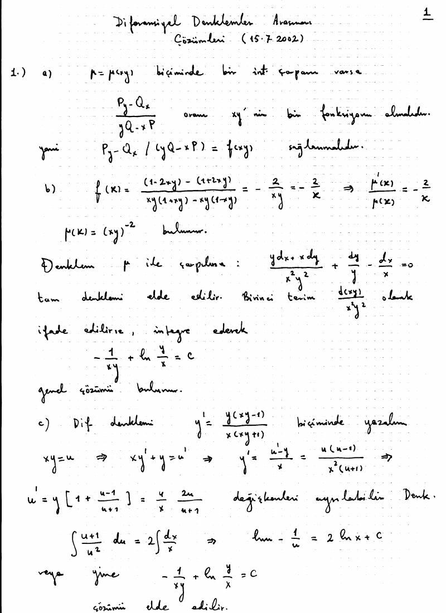
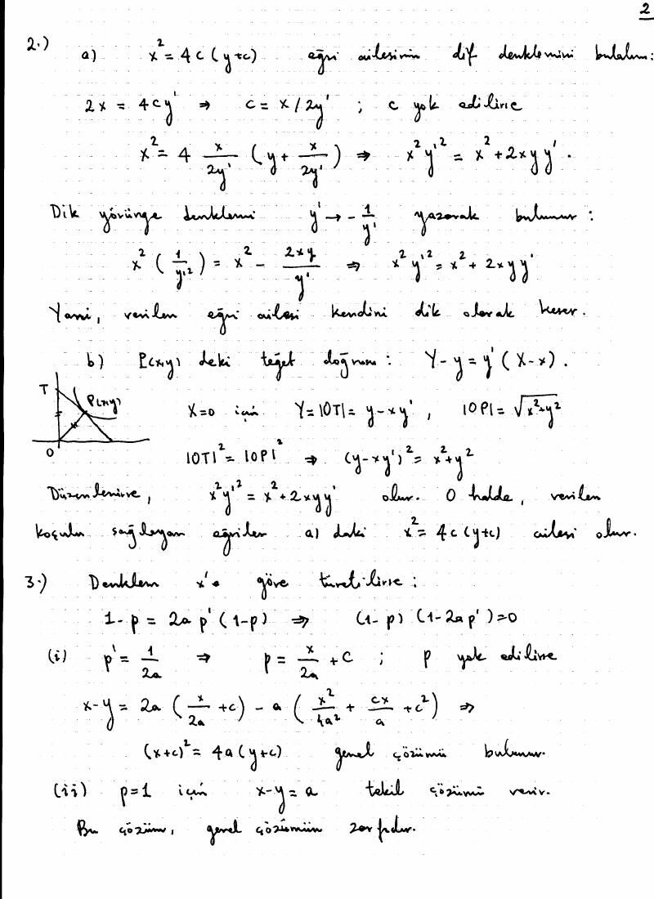
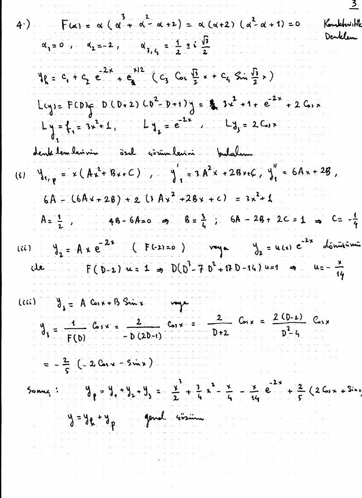
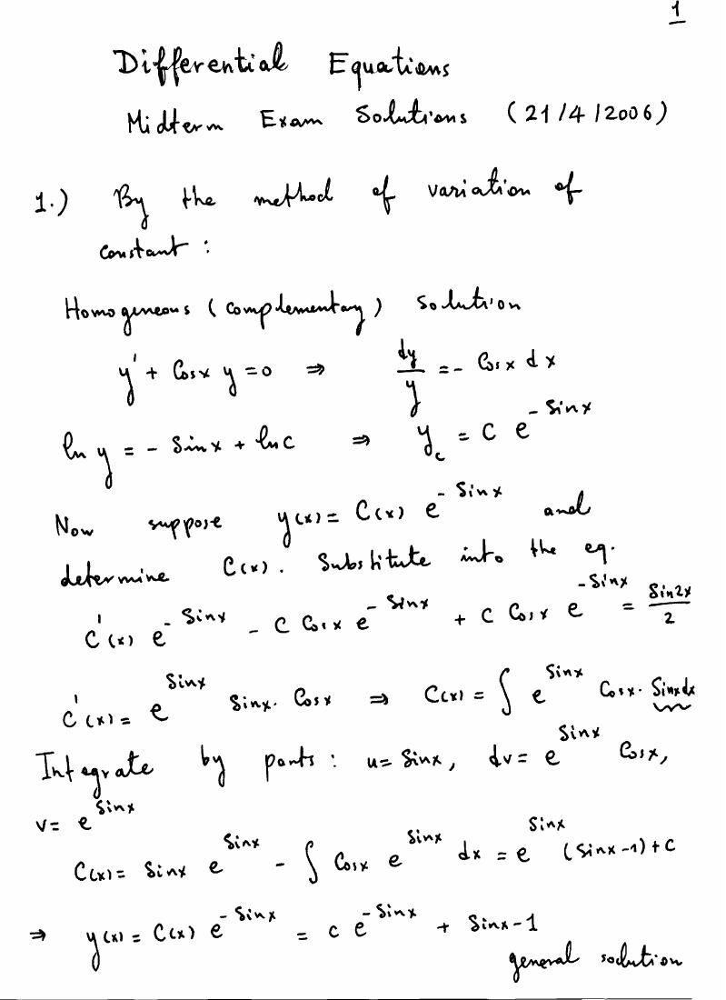
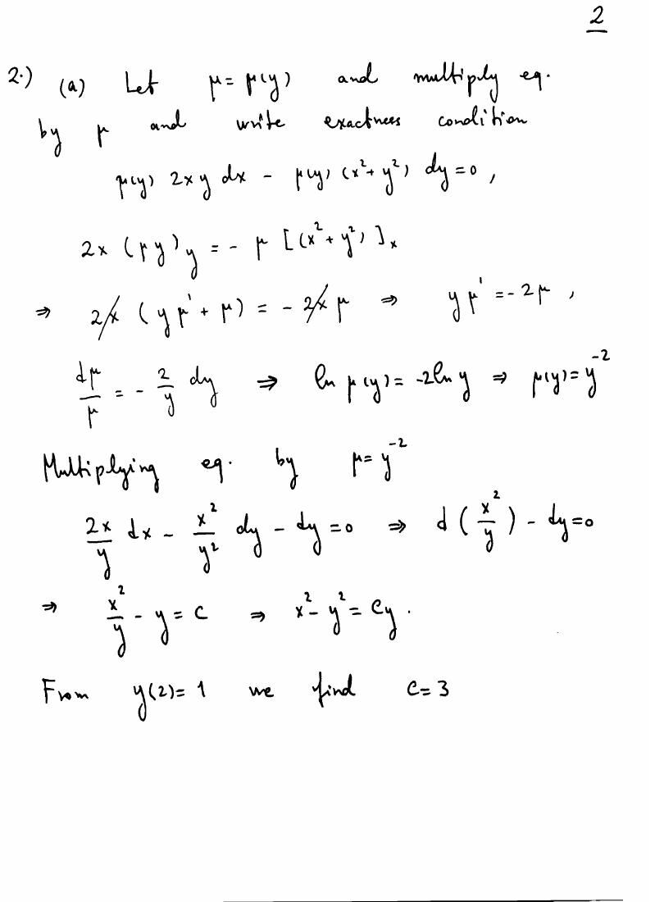
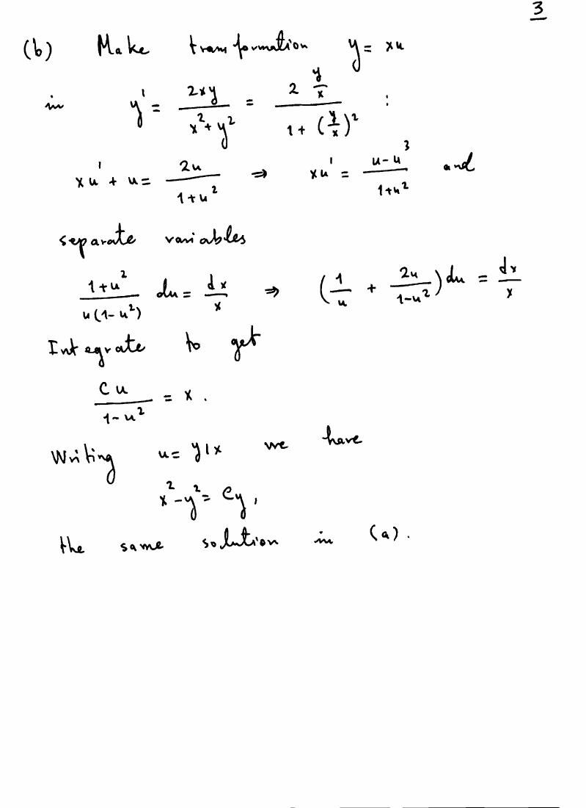
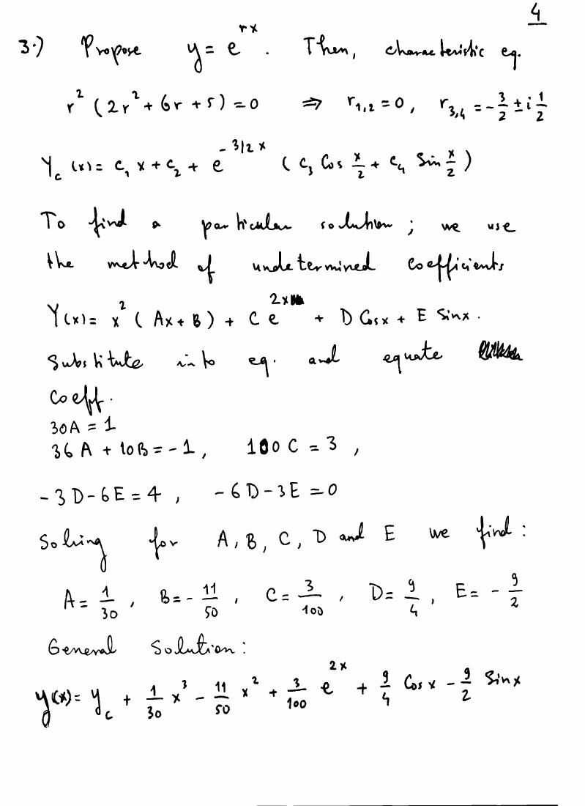
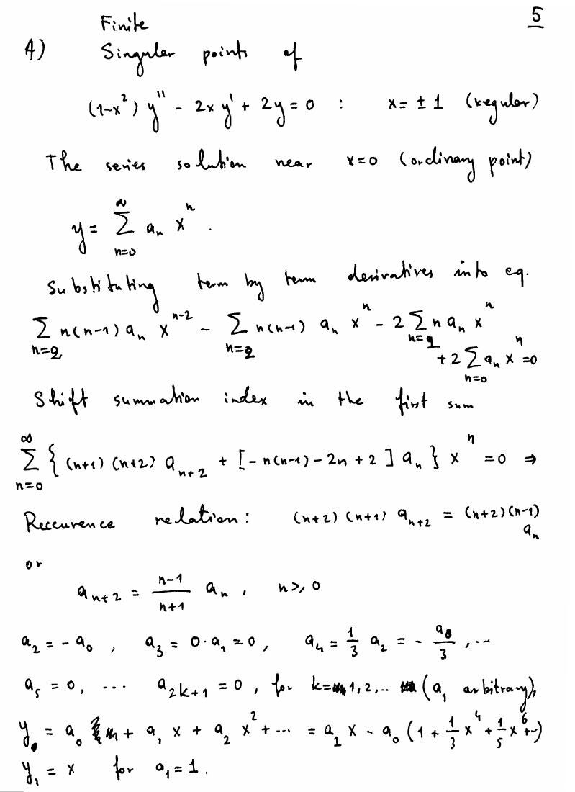
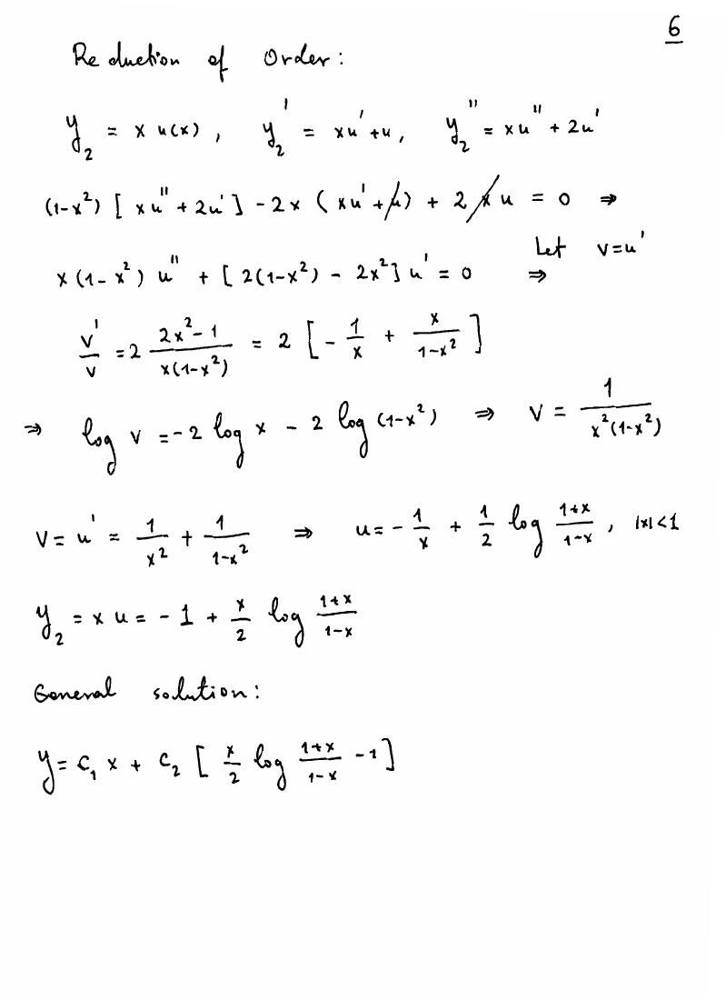

This post brings together the midterm exams of **28 April 1999, 17 July 2002, 17 April 2003, and 21 April 2006** kept in the MAT222 folder. The documents contain the phrases "Mathematics Engineering," MAT201, and MAT201E; they do not state the university or the preparer. Ege University as the source could not be verified. The questions and solution results have been transcribed into text; the handwritten solution pages are also included. The four original PDFs can be downloaded as a ZIP at the end of the post.

*Note: This content belongs to a third-party source; it is shared for archival and nostalgic purposes with the source credited. It will be removed upon the request of the rights holder.*

## 28 April 1999: Mathematics Engineering

1. For the equation (3y + 2xy⁴) dx + (x²y³ − x) dy = 0, find an integrating factor of the form µ = xᵐyⁿ and one that is homogeneous of degree zero, and integrate the equation.
2. Solve the equation yy″ + (y′)² + 2a²y² = 0 by order reduction, as a homogeneous equation, and by linearizing it with the transformation u = y²; compare the results.
3. What must a be for the equation xy″ + 2xy′ + (x + 1/(4x))y = 0 to have a solution of the form y = xᵃe⁻ˣ? Find the general solution by order reduction and by the normal form.
4. Solve the equation y‴ − 5y″ + 11y′ − 15y = eˣ(sin x + 2 cos 3x).
5. Find the Frobenius solution of the equation x²y″ − (1 + 2x)xy′ + y = 0 and a second independent solution; express them in terms of elementary functions.

This one-page document has no answer key.

## 17 July 2002: MAT201

### Integrating factor

Find the condition for the equation P dx + Q dy = 0 to have an integrating factor µ(xy). Then solve the equation (y − xy²) dx + (x + x²y) dy = 0 both with an integrating factor and with the transformation u = xy.

In the solution, the relation µ′/µ = (Pᵧ − Qₓ)/(yQ − xP) is used for z = xy. The right-hand side must depend on z only. In the given example µ = (xy)⁻² and the result is:

−1/(xy) + ln|y/x| = C.

### Orthogonal trajectories and singular solution

- Determine the orthogonal trajectories of the family x² = 4c(y + c).
- Find the curves for which, at every point, the length of the segment that the tangent cuts off from the y-axis equals the distance of that point from the origin.
- With p = y′, solve the equation x − y = 2ap − ap²; interpret the singular solution geometrically.

In the solution pages, families of parabolas are obtained for the first two problems. In the third question, the general family is written as (x − C)² = 4a(y − C), and the singular line as y = x − a.

### Constant-coefficient equation

Problem statement: y⁽⁴⁾ + y‴ − y″ + 2y′ = 3x² + 1 + e⁻²ˣ + 2 cos x.

*Note: The handwritten solution takes the coefficient of the y″ term on the left as +1 and uses F(r) = r(r + 2)(r² − r + 1). This is not the same equation as the −y″ on the question sheet; the solution key cannot be used directly as the answer to the question.*

## 17 April 2003: MAT201

### Homogenization by translation

For the equation (x + y + 3)²y′ = 2(y + 1)², the transformations x = X − 2, y = Y − 1, and Y = XU are applied. The result in the source is:

ln(y + 1) + 2 arctan((y + 1)/(x + 2)) = C.

Written with absolute value it becomes ln|y + 1|; the regions where division is performed must be taken into account, as well as the solution y = −1.

### Bernoulli equation

For x²y′ + xy + √y = 0, take u = √y. Then u′ + u/(2x) = −1/(2x²), and in the source, in the region x > 0:

y = (1 + C√x)²/x².

The condition u = √y ≥ 0 must be preserved; in addition, y = 0 is a solution.

### Orthogonal trajectories

For the family x²/c + y² = 1/(c − 1), eliminating the parameter gives (y − xy′)(x + yy′) = y′. When y′ is replaced by −1/y′, the same differential equation is obtained.

### Initial condition check

yy″ + (y′)² + 2y² = 0, y(0) = 1, y′(0) = 1/2.

After finding y² = A cos 2x + B sin 2x, the source writes B = 2 and y = √(cos 2x + 2 sin 2x).

*Note: The equality 2y(0)y′(0) = 2B gives B = 1/2. The local solution satisfying the initial conditions is y = √(cos 2x + (1/2)sin 2x). The result in the source gives y′(0) = 2. In the earlier integral line, ln(y/C) = (1/2)cos(C₁ − 2x) is also written; the right-hand side should be (1/2)ln|cos(C₁ − 2x)|.*

### Third-order equation

y‴ − 3y′ + 2y = e⁻²ˣ(x + sin x).

F(r) = (r − 1)²(r + 2). The general solution in the source:

y = eˣ(C₁ + C₂x) + C₃e⁻²ˣ + e⁻²ˣ[x²/18 + 2x/27 + (−4 cos x + 3 sin x)/50].

This result was checked by substituting it along with its derivatives.

## 21 April 2006: MAT201E

The source is in English; the questions and solution results below retain that language.

1. Find the general solution of 2y′ + 2(cos x)y = sin 2x. The solution sheet gives y = Ce^(−sin x) + sin x − 1.
2. Solve 2xy − (x² + y²)y′ = 0 through (2,1), both by an integrating factor and as a homogeneous equation. The integrating factor is µ(y) = y⁻² and the result is x² − y² = 3y.
3. Solve 2y⁽⁴⁾ + 6y‴ + 5y″ = x − 1 + 3e²ˣ + 4 cos x. The characteristic roots are 0 (double) and −3/2 ± i/2. The sheet gives y_h = C₁ + C₂x + e^(−3x/2)[C₃ cos(x/2) + C₄ sin(x/2)] and y_p = x³/30 − 11x²/50 + 3e²ˣ/100 + (9/4)cos x − (9/2)sin x.
4. Classify the singular points of (1 − x²)y″ − 2xy′ + 2y = 0. Find a series solution at x = 0 and obtain another by reduction of order. The regular singular points are ±1; one solution is x and the other is (x/2)ln((1 + x)/(1 − x)) − 1 for |x| < 1.

*Note: The coefficients in the particular solution of the third question's handwritten solution do not satisfy the equation. A substitution check gives y_p = x³/30 − 11x²/50 + 3e²ˣ/100 − (4/15)cos x − (8/15)sin x. The homogeneous solution is correct.*

