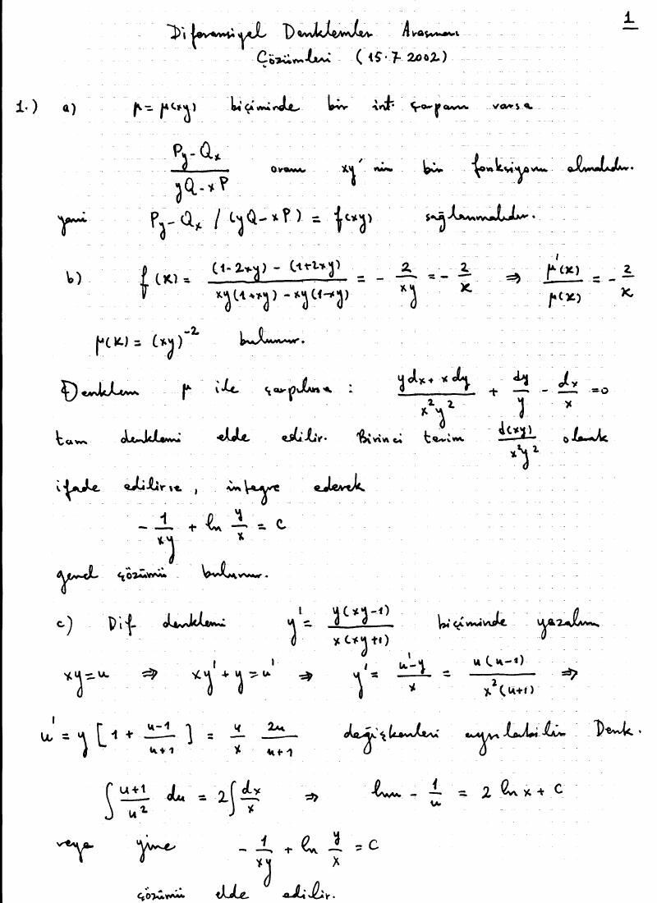
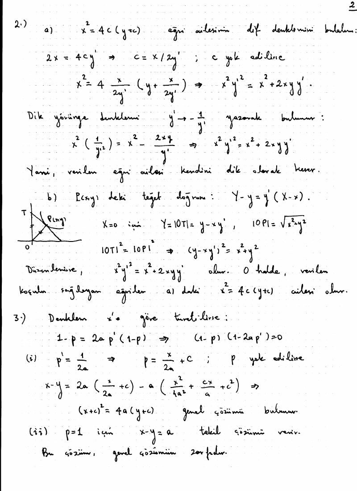
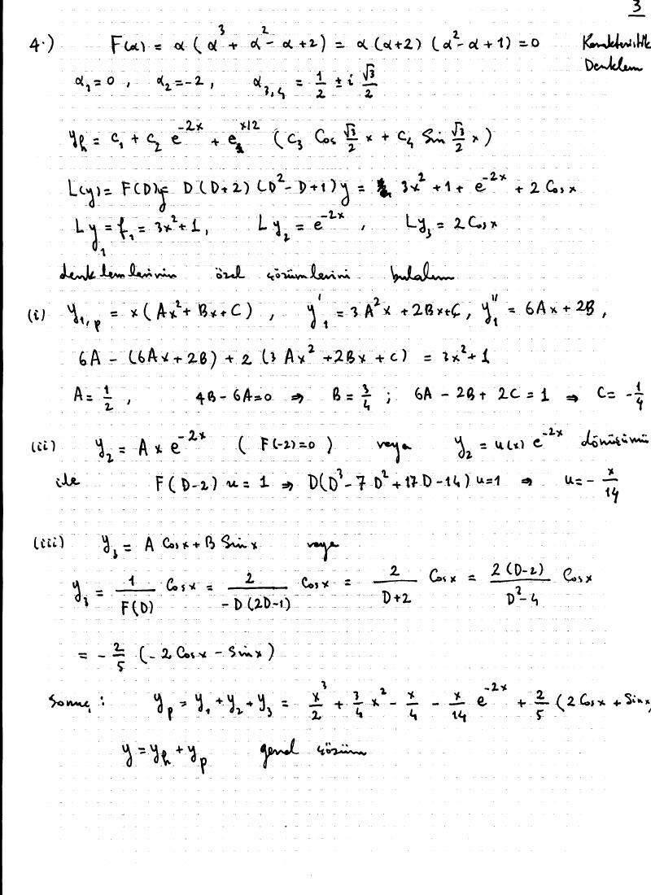
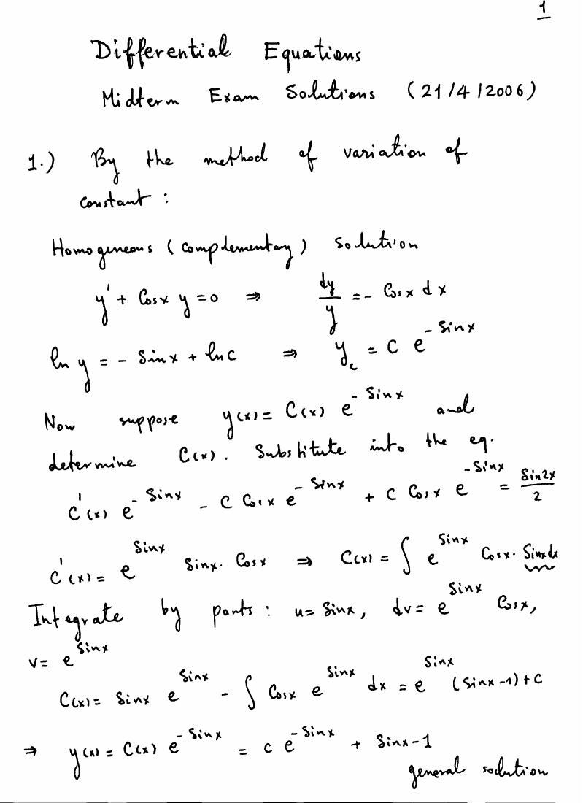
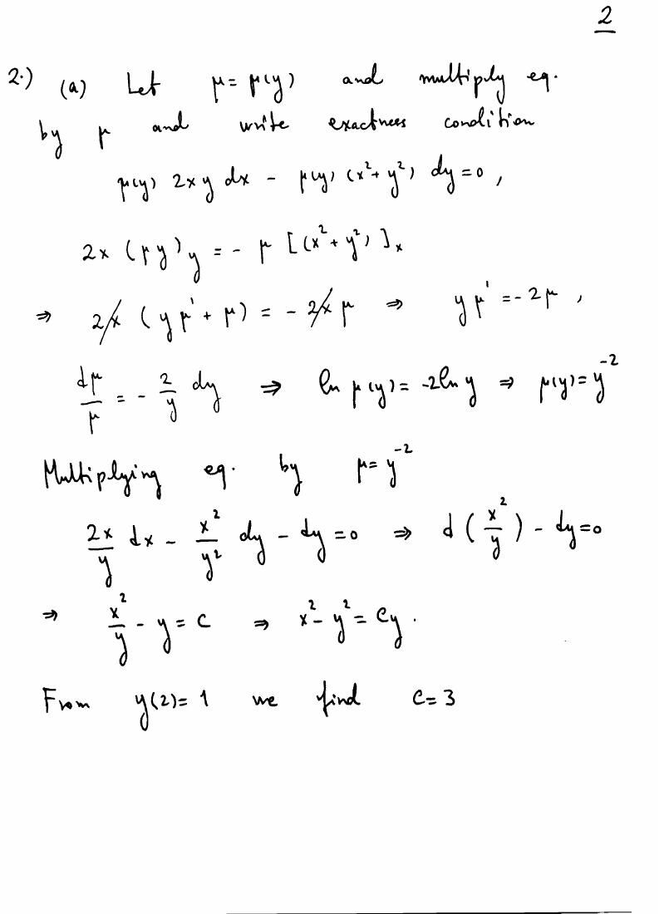
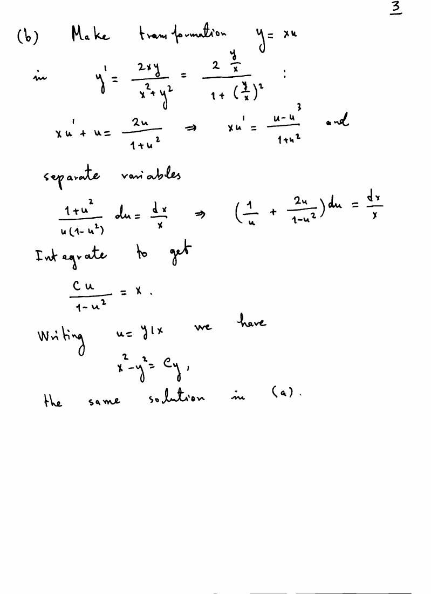
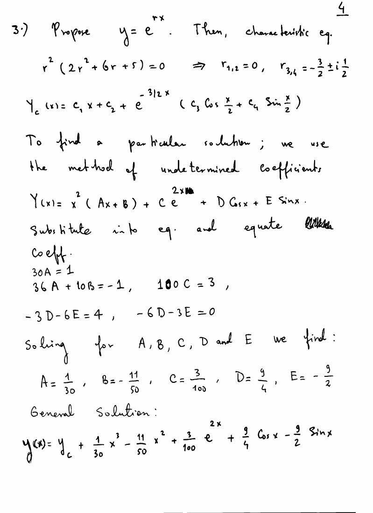
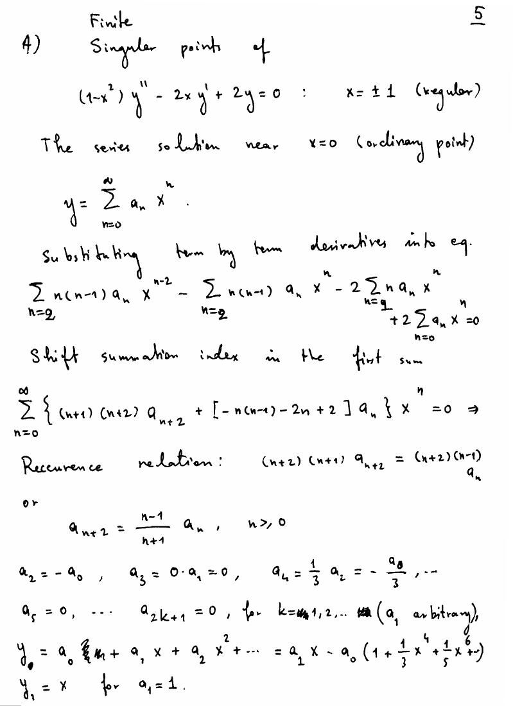
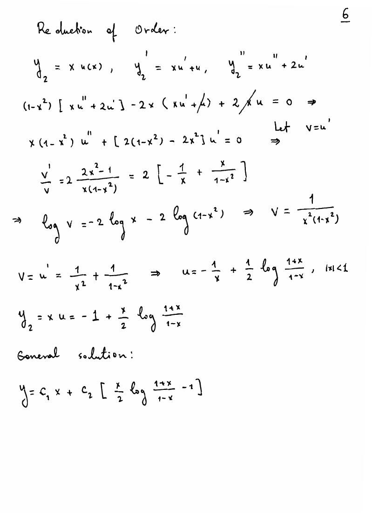

Bu yazı, MAT222 klasöründe saklanan **28 Nisan 1999, 17 Temmuz 2002, 17 Nisan 2003 ve 21 Nisan 2006** ara sınavlarını bir araya getiriyor. Belgelerde “Matematik Mühendisliği”, MAT201 ve MAT201E ibareleri var; üniversite ve hazırlayan adı açıkça yazmıyor. Ege Üniversitesi kaynaklığı doğrulanamadı. Sorular ve çözüm sonuçları metne aktarıldı; el yazısı çözüm sayfaları da eklendi. Dört orijinal PDF yazının sonunda ZIP olarak indirilebilir.

*Bu içerik üçüncü taraf bir kaynağa aittir; arşiv ve nostalji amacıyla kaynak belirtilerek paylaşılmıştır. Hak sahibinin talebi hâlinde kaldırılır.*

## 28 Nisan 1999: Matematik Mühendisliği

1. (3y + 2xy⁴) dx + (x²y³ − x) dy = 0 denklemi için µ = xᵐyⁿ biçiminde ve sıfırıncı dereceden homojen integrasyon çarpanı bularak integre ediniz.
2. yy″ + (y′)² + 2a²y² = 0 denklemini mertebe düşürerek, homojen denklem olarak ve u = y² dönüşümüyle lineerleştirerek çözünüz; sonuçları karşılaştırınız.
3. xy″ + 2xy′ + (x + 1/(4x))y = 0 denkleminin y = xᵃe⁻ˣ biçiminde çözümü olması için a ne olmalıdır? Mertebe düşürme ve normal formla genel çözümü bulunuz.
4. y‴ − 5y″ + 11y′ − 15y = eˣ(sin x + 2 cos 3x) denklemini çözünüz.
5. x²y″ − (1 + 2x)xy′ + y = 0 denkleminin Frobenius çözümünü ve ikinci bağımsız çözümünü bulunuz; elemanter fonksiyonlarla ifade ediniz.

Bu bir sayfalık belgede çözüm anahtarı yoktur.

## 17 Temmuz 2002: MAT201

### İntegrasyon çarpanı

P dx + Q dy = 0 denkleminin µ(xy) integrasyon çarpanına sahip olması için koşulu bulunuz. Ardından (y − xy²) dx + (x + x²y) dy = 0 denklemini hem integrasyon çarpanıyla hem u = xy dönüşümüyle çözünüz.

Çözümde z = xy için µ′/µ = (Pᵧ − Qₓ)/(yQ − xP) bağıntısı kullanılıyor. Sağ taraf yalnız z'ye bağlı olmalıdır. Verilen örnekte µ = (xy)⁻² ve sonuç:

−1/(xy) + ln|y/x| = C.

### Dik yörüngeler ve tekil çözüm

- x² = 4c(y + c) ailesinin dik yörüngelerini belirleyiniz.
- Her noktasında teğetin y ekseninden ayırdığı parçanın uzunluğu o noktanın orijine uzaklığına eşit olan eğrileri bulunuz.
- p = y′ olmak üzere x − y = 2ap − ap² denklemini çözünüz; tekil çözümü geometrik olarak yorumlayınız.

Çözüm sayfalarında ilk iki problem için parabol aileleri elde ediliyor. Üçüncü soruda genel aile (x − C)² = 4a(y − C), tekil doğru y = x − a olarak yazılmış.

### Sabit katsayılı denklem

Soru metni: y⁽⁴⁾ + y‴ − y″ + 2y′ = 3x² + 1 + e⁻²ˣ + 2 cos x.

*Not: El yazısı çözüm, soldaki y″ teriminin katsayısını +1 alarak F(r) = r(r + 2)(r² − r + 1) kullanıyor. Bu, soru sayfasındaki −y″ ile aynı denklem değildir; çözüm anahtarı doğrudan sorunun cevabı olarak kullanılamaz.*

## 17 Nisan 2003: MAT201

### Öteleme ile homojenleştirme

(x + y + 3)²y′ = 2(y + 1)² denklemi için x = X − 2, y = Y − 1 ve Y = XU dönüşümleri uygulanıyor. Kaynakta sonuç:

ln(y + 1) + 2 arctan((y + 1)/(x + 2)) = C.

Mutlak değerle yazımı ln|y + 1| olur; bölme yapılan bölgeler ve ayrıca y = −1 çözümü dikkate alınmalıdır.

### Bernoulli denklemi

x²y′ + xy + √y = 0 için u = √y seçilir. u′ + u/(2x) = −1/(2x²) ve kaynakta x > 0 bölgesinde:

y = (1 + C√x)²/x².

u = √y ≥ 0 koşulu korunmalıdır; ayrıca y = 0 çözümü vardır.

### Dik yörüngeler

x²/c + y² = 1/(c − 1) ailesi için parametre yok edilince (y − xy′)(x + yy′) = y′ bulunur. y′ yerine −1/y′ konulduğunda aynı diferansiyel denklem elde edilir.

### Başlangıç koşulu kontrolü

yy″ + (y′)² + 2y² = 0, y(0) = 1, y′(0) = 1/2.

Kaynak y² = A cos 2x + B sin 2x bulduktan sonra B = 2 ve y = √(cos 2x + 2 sin 2x) yazıyor.

*Not: 2y(0)y′(0) = 2B eşitliği B = 1/2 verir. Başlangıç koşullarını sağlayan yerel çözüm y = √(cos 2x + (1/2)sin 2x)'tir. Kaynaktaki sonuç y′(0) = 2 verir. Önceki integral satırında da ln(y/C) = (1/2)cos(C₁ − 2x) yazılmış; sağda (1/2)ln|cos(C₁ − 2x)| bulunmalıdır.*

### Üçüncü mertebeden denklem

y‴ − 3y′ + 2y = e⁻²ˣ(x + sin x).

F(r) = (r − 1)²(r + 2). Kaynaktaki genel çözüm:

y = eˣ(C₁ + C₂x) + C₃e⁻²ˣ + e⁻²ˣ[x²/18 + 2x/27 + (−4 cos x + 3 sin x)/50].

Bu sonuç türevleriyle yerine koyularak kontrol edildi.

## 21 April 2006: MAT201E

The source is in English; the questions and solution results below retain that language.

1. Find the general solution of 2y′ + 2(cos x)y = sin 2x. The solution sheet gives y = Ce^(−sin x) + sin x − 1.
2. Solve 2xy − (x² + y²)y′ = 0 through (2,1), both by an integrating factor and as a homogeneous equation. The integrating factor is µ(y) = y⁻² and the result is x² − y² = 3y.
3. Solve 2y⁽⁴⁾ + 6y‴ + 5y″ = x − 1 + 3e²ˣ + 4 cos x. The characteristic roots are 0 (double) and −3/2 ± i/2. The sheet gives y_h = C₁ + C₂x + e^(−3x/2)[C₃ cos(x/2) + C₄ sin(x/2)] and y_p = x³/30 − 11x²/50 + 3e²ˣ/100 + (9/4)cos x − (9/2)sin x.
4. Classify the singular points of (1 − x²)y″ − 2xy′ + 2y = 0. Find a series solution at x = 0 and obtain another by reduction of order. The regular singular points are ±1; one solution is x and the other is (x/2)ln((1 + x)/(1 − x)) − 1 for |x| < 1.

*Not: Üçüncü sorunun el yazısı özel çözümündeki katsayılar denklemi sağlamıyor. Yerine koyma kontrolüyle y_p = x³/30 − 11x²/50 + 3e²ˣ/100 − (4/15)cos x − (8/15)sin x bulunur. Homojen çözüm doğrudur.*

