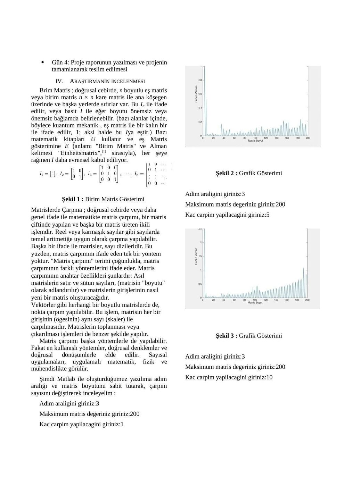
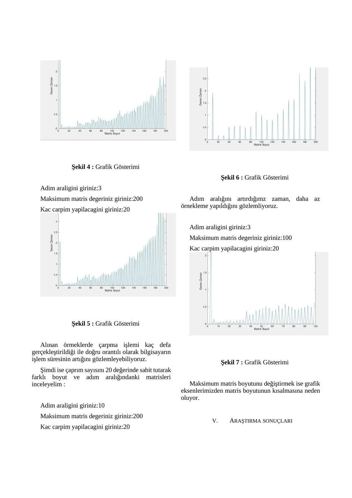

This post is the 2016 project report titled **"Measuring the Run Time of Matrix Multiplication"**, which **I prepared together with two friends** at Başkent University. In the work, which I kept in my MAT222 folder, we examined the multiplication times of identity matrices of different sizes using MATLAB. Personal information has been removed; at the end of the post, only the **masked PDF** can be downloaded.

*Note: The report does not state a course code or a submission date. The MAT222 classification is based on the archive folder; the date of 6 May 2016 was taken from the creation information of the original Word file. The last-modified date of the same file is 11 May 2016.*

## Concept and Operation

The program takes three values from the user:

- Upper limit of the matrix size: **MAXN**
- The increment by which the size grows: **deltaN**
- How many times the matrix is multiplied by itself at each size: **KERE**

An identity matrix is always used in the comparisons. A matrix is created for each size; the duration of the multiplication operations is measured, and it depends on the computer's hardware and installed software. With the collected data, the relationship between matrix size and elapsed time is plotted. In preparation, we researched the concepts of the identity matrix and matrix multiplication, and evaluated the algorithm and the graphs using this information.

## Work Breakdown and Implementation Schedule

The preparation phase consists of researching the concepts, designing the MATLAB algorithm, and relating the research results to the algorithm. The implementation includes creating the variables and graphs, writing the code, testing, and preparing the research results.

| Day | Task |
| --- | --- |
| 1 | Completing the preparation phase |
| 2 | Creating the MATLAB code |
| 3 | Testing the code, fixing errors, and observations |
| 4 | Writing the report and submitting the project |

## Identity Matrix and Matrix Multiplication

In the report, the identity matrix is introduced as an n × n square matrix; it is denoted by I_n, or by I if its size is known from context. Figure 1 shows the examples I₁ = [1], I₂ = [1, 0; 0, 1], and I₃ = [1, 0, 0; 0, 1, 0; 0, 0, 1].

*Note: The source's definition of the identity matrix is linguistically flawed and does not state the diagonal values explicitly. As seen in the figure, the main diagonal is 1 and the other elements are 0.*

Matrix multiplication is described as an operation that produces a new matrix from two matrices. The importance of the numbers of rows and columns and of how the elements are combined is emphasized; linear equations, linear transformations, and applications in physics and engineering are mentioned.

*Note: In the report, multiplying every element by the same scalar is called a "dot product." This operation is scalar multiplication; it is not the same as matrix multiplication or the inner product of vectors.*

## Experiments and Graphs

In the first experiments, the step interval is held fixed at 3 and the largest matrix size at 200, while the number of multiplications is varied. Then, with the number of multiplications fixed at 20, the step interval and the upper size limit are examined.

| Figure | Step interval | Largest size | Number of multiplications |
| --- | --- | --- | --- |
| 2 | 3 | 200 | 1 |
| 3 | 3 | 200 | 5 |
| 4 | 3 | 200 | 10 |
| 5 | 3 | 200 | 20 |
| 6 | 10 | 200 | 20 |
| 7 | 3 | 100 | 20 |

Example program input:

```
Adim araligini giriniz:3
Maksimum matris degeriniz giriniz:200
Kac carpim yapilacagini giriniz:20
```

The report states that as the number of repetitions increases, the run time increases; as the step interval grows, fewer samples are taken; and as the largest matrix size is reduced, the range examined in the graph narrows.





*Note: In the converted PDF, the right part of the identity matrix image, the upper parts of the graphs, and some axis scales are cropped; the caption of Figure 6 is also cropped. Compared with the images in the original Word file, these details were not carried over to the PDF completely. For this reason, no exact numerical times were extracted from the graphs. The images above were taken from the masked PDF.*

## Research Results

The report explains that, in order to isolate the effect of the three variables, we changed one variable in each experiment while keeping the others constant. An identity matrix was used so that the matrix values would not affect the result. It is stated that the times depend on the computer's hardware and software, and that an excessively large size or number of repetitions can cause the program to stop responding.

In the source's evaluation, it is stated that the run time increases "in direct proportion" to the matrix size.

*Note: The increase in the graphs alone is not proof of a linear proportion. Moreover, since the code assigns a t(i) value only at the selected indices and then plots plot(t), the unmeasured indices in between may remain zero; the sawtooth appearance of the graphs should not be interpreted entirely as real measurement fluctuation.*

## MATLAB Source Code

The code below was transcribed from the report; comments containing personal information were removed, and introductory texts that were split by the page layout were merged into a single line. The problematic `g t = zeros(0,MAXN);` line in the report is preserved.

```matlab
%% Meta Bilgileri %%
%Version : sürüm 1

%Not: Grafikleri bilgisayarınızda tam ekran yaparak incelemeniz tavsiye edilir.

%% Parametreler 1%%
deltaN = input ('Adim araligini giriniz:');
MAXN = input ('Maksimum matris degeriniz giriniz:');
KERE = input ('Kac carpim yapilacagini giriniz:');

%% Parametreler 2%%
g t = zeros(0,MAXN);

%% İşlemleri uygula 2%%
for i = deltaN:deltaN:MAXN
    A = eye(i,i);
    tic;
    for j = 1:KERE
        A = A*A;
    end
    t(i) = toc;
end

%% Grafiği Çiz %%
plot(t)
title('Geçen Zaman - Matris Boyut')
xlabel('Matris Boyut')
ylabel('Gecen Zaman')
```

*Note: "g t = …" is not a valid assignment to t; moreover, zeros(0,MAXN) creates an empty array with zero rows instead of a measurement row. This code was not run; it was preserved as a document example. The operation A = A*A squares the current matrix in each loop iteration. Since the result is again I for an identity matrix, the values do not change in this part of the experiment.*

*Note: For deltaN = 3 and MAXN = 200, the last size tried is 198; for MAXN = 100, it is 99. These are the values reached according to the loop step; the upper limit is not always sampled.*

## References in the Report

The report lists Wikipedia, Matlab Akademi, Tureng, Encyclopaedia Britannica, and MathWorks, along with access dates. The last source is given as the book **MATLAB Matrix Algebra** by César Pérez López (Apress, 2013). This post contains the student-era project report; the book's content was not included.

*Note: The references contain bibliographic inconsistencies, such as a different domain name written under the Wikipedia entry and phrases like "worst since"; these entries should not be taken as verified source citations.*
