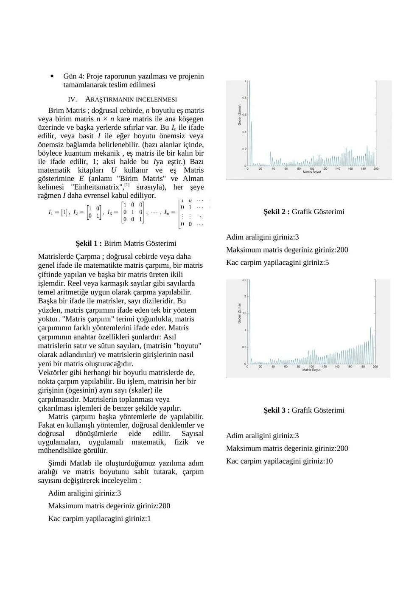
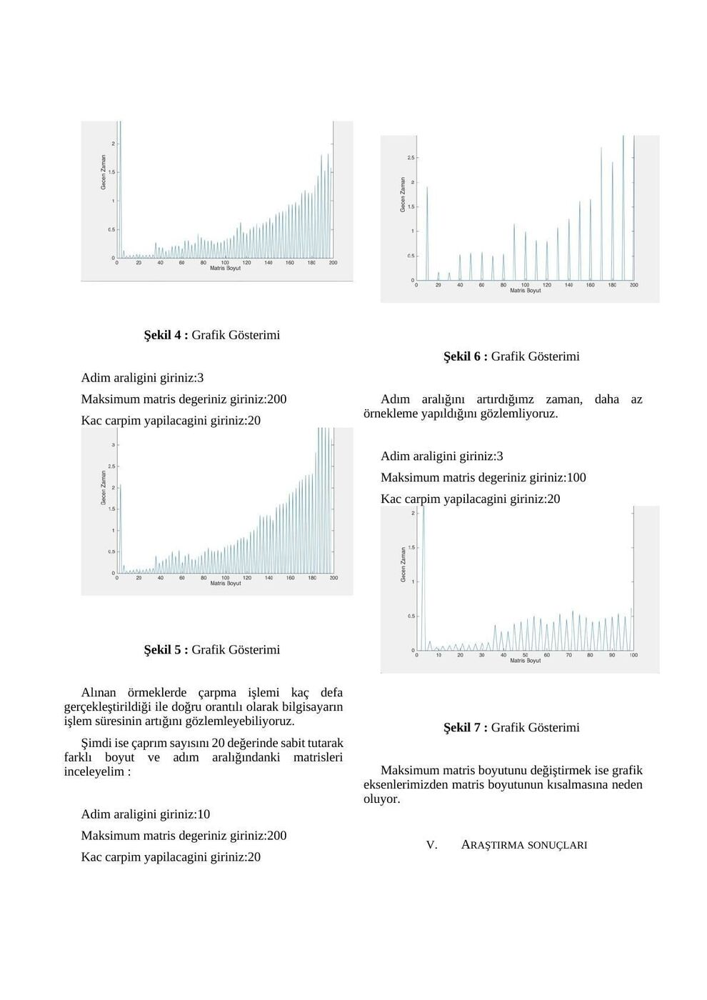

Bu yazı, Başkent Üniversitesi'nde **iki arkadaşımla birlikte hazırladığımız “Matris Çarpımının Koşum Zaman Ölçülmesi”** başlıklı 2016 tarihli proje raporudur. MAT222 klasörümde sakladığım çalışmada MATLAB ile farklı boyutlardaki birim matrislerin çarpım sürelerini inceledik. Kişisel bilgiler çıkarıldı; yazının sonunda yalnız **maskelenmiş PDF** indirilebilir.

*Not: Raporda ders kodu ve teslim tarihi yazmıyor. MAT222 sınıflandırması arşiv klasörüne dayanıyor; 6 Mayıs 2016 tarihi özgün Word dosyasının oluşturulma bilgisinden alındı. Aynı dosyanın son değiştirilme tarihi 11 Mayıs 2016'dır.*

## Kavram ve işletim

Program kullanıcıdan üç değer alıyor:

- Matris boyutunun üst sınırı: **MAXN**
- Boyutun kaçar kaçar artacağı: **deltaN**
- Her boyutta matrisin kendisiyle kaç kez çarpılacağı: **KERE**

Karşılaştırmalarda daima birim matris kullanılıyor. Her boyut için matris oluşturuluyor; çarpma işlemlerinin süresi bilgisayarın donanımına ve yüklü yazılımlarına bağlı olarak ölçülüyor. Toplanan verilerle matris boyutu ve geçen zaman arasındaki ilişki çizdiriliyor. Hazırlıkta birim matris ve matris çarpımı kavramlarını araştırıp algoritmayı ve grafikleri bu bilgilerle değerlendirdik.

## İş kırılımı ve uygulama takvimi

Hazırlık aşaması; kavramların araştırılması, MATLAB algoritmasının tasarlanması ve araştırma sonuçlarıyla algoritmanın ilişkilendirilmesinden oluşuyor. Uygulamada değişkenlerin ve grafiklerin oluşturulması, kodun yazılması, testler ve araştırma sonuçlarının hazırlanması var.

| Gün | İş |
| --- | --- |
| 1 | Hazırlık aşamasının tamamlanması |
| 2 | MATLAB kodlarının oluşturulması |
| 3 | Kodların test edilmesi, hataların giderilmesi ve gözlemler |
| 4 | Raporun yazılması ve projenin teslimi |

## Birim matris ve matris çarpımı

Raporda birim matris n × n boyutlu kare matris olarak tanıtılıyor; I_n veya boyutu bağlamdan biliniyorsa I ile gösteriliyor. Şekil 1'de I₁ = [1], I₂ = [1, 0; 0, 1] ve I₃ = [1, 0, 0; 0, 1, 0; 0, 0, 1] örnekleri var.

*Not: Kaynağın birim matris tanımı dil açısından bozuk ve köşegendeki değerleri açık söylemiyor. Şekilde görüldüğü gibi ana köşegen 1, diğer elemanlar 0'dır.*

Matris çarpımı iki matristen yeni bir matris üreten işlem olarak anlatılıyor. Satır ve sütun sayılarının ve elemanların nasıl birleştirildiğinin önemi vurgulanıyor; doğrusal denklemler, doğrusal dönüşümler, fizik ve mühendislik uygulamalarından söz ediliyor.

*Not: Raporda her elemanın aynı skalerle çarpılması “nokta çarpım” olarak adlandırılmış. Bu işlem skalerle çarpmadır; matris çarpımı veya vektörlerin iç çarpımıyla aynı işlem değildir.*

## Deneyler ve grafikler

İlk deneylerde adım aralığı 3, en büyük matris boyutu 200 olarak sabit tutulup çarpım sayısı değiştiriliyor. Ardından çarpım sayısı 20'de sabitlenerek adım aralığı ve üst boyut sınırı inceleniyor.

| Şekil | Adım aralığı | En büyük boyut | Çarpım sayısı |
| --- | --- | --- | --- |
| 2 | 3 | 200 | 1 |
| 3 | 3 | 200 | 5 |
| 4 | 3 | 200 | 10 |
| 5 | 3 | 200 | 20 |
| 6 | 10 | 200 | 20 |
| 7 | 3 | 100 | 20 |

Örnek program girdisi:

```
Adim araligini giriniz:3
Maksimum matris degeriniz giriniz:200
Kac carpim yapilacagini giriniz:20
```

Rapor, tekrar sayısı arttığında işlem süresinin arttığını; adım aralığı büyüdüğünde daha az örnek alındığını; en büyük matris boyutu küçültüldüğünde grafikte incelenen aralığın daraldığını belirtiyor.





*Not: Dönüştürülmüş PDF'de birim matris görselinin sağ kısmı, grafiklerin üst kısımları ve bazı eksen ölçekleri kırpılmış; Şekil 6'nın altyazısında da kırpılma var. Özgün Word içindeki görsellerle karşılaştırıldığında bu ayrıntıların PDF'ye tam geçmediği görülüyor. Bu nedenle grafiklerden kesin sayısal süreler çıkarılmadı. Yukarıdaki görseller maskelenmiş PDF'den alındı.*

## Araştırma sonuçları

Raporda üç değişkenin etkisini ayırmak için her deneyde bir değişkeni değiştirip diğerlerini sabit tuttuğumuz anlatılıyor. Matris değerlerinin sonucu etkilememesi için birim matris kullanıldı. Sürelerin bilgisayarın donanım ve yazılımına bağlı olduğu, aşırı büyük boyut veya tekrar sayısının programın yanıt vermemesine yol açabildiği belirtiliyor.

Kaynağın değerlendirmesinde işlem süresinin matris boyutuyla “doğru orantılı” arttığı söyleniyor.

*Not: Grafiklerdeki artış tek başına doğrusal orantı kanıtı değildir. Ayrıca kod yalnız seçilen indislerde t(i) değeri atayıp plot(t) çizdirdiği için aradaki ölçülmemiş indisler sıfır kalabilir; grafiklerin testere dişi görünümü tümüyle gerçek ölçüm dalgalanması olarak yorumlanmamalıdır.*

## MATLAB kaynak kodu

Aşağıdaki kod rapordan aktarıldı; kişisel bilgi içeren yorumlar çıkarıldı, sayfa yerleşimi nedeniyle bölünen giriş metinleri tek satırda birleştirildi. Rapordaki sorunlu `g t = zeros(0,MAXN);` satırı korunuyor.

```matlab
%% Meta Bilgileri %%
%Version : sürüm 1

%Not: Grafikleri bilgisayarınızda tam ekran yaparak incelemeniz tavsiye edilir.

%% Parametreler 1%%
deltaN = input ('Adim araligini giriniz:');
MAXN = input ('Maksimum matris degeriniz giriniz:');
KERE = input ('Kac carpim yapilacagini giriniz:');

%% Parametreler 2%%
g t = zeros(0,MAXN);

%% İşlemleri uygula 2%%
for i = deltaN:deltaN:MAXN
    A = eye(i,i);
    tic;
    for j = 1:KERE
        A = A*A;
    end
    t(i) = toc;
end

%% Grafiği Çiz %%
plot(t)
title('Geçen Zaman - Matris Boyut')
xlabel('Matris Boyut')
ylabel('Gecen Zaman')
```

*Not: “g t = …” geçerli bir t ataması değildir; ayrıca zeros(0,MAXN) bir ölçüm satırı yerine sıfır satırlı boş dizi oluşturur. Bu kod çalıştırılmadı; belge örneği olarak korundu. A = A*A işlemi her döngüde mevcut matrisi karesine yükseltir. Birim matris için sonuç yine I olduğundan deneyin bu kısmında değerler değişmez.*

*Not: deltaN = 3 ve MAXN = 200 için son denenen boyut 198'dir; MAXN = 100 için 99'dur. Bunlar döngünün adımına göre ulaşılan değerlerdir; üst sınır her zaman örneklenmez.*

## Rapordaki kaynakça

Raporda Wikipedia, Matlab Akademi, Tureng, Encyclopaedia Britannica ve MathWorks adları ile erişim tarihleri yer alıyor. Son kaynak César Pérez López'in **MATLAB Matrix Algebra** (Apress, 2013) kitabı olarak verilmiş. Bu yazı öğrencilik dönemindeki proje raporunu içeriyor; kitap içeriği eklenmedi.

*Not: Kaynakçada Wikipedia adı altında farklı bir alan adı yazılması ve “worst since” ifadeleri gibi bibliyografik tutarsızlıklar var; bu kayıtlar doğrulanmış kaynak künyeleri olarak alınmamalıdır.*
