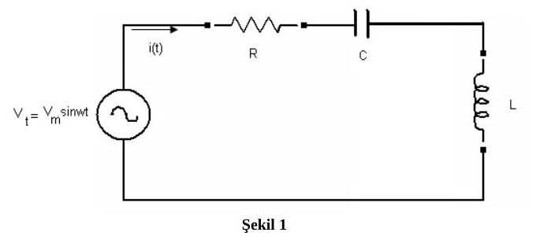
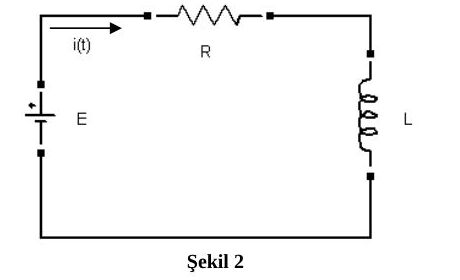

This post contains the midterm questions and solutions for differential equations dated **30 November 2006**, prepared by **Prof. Dr. Uğur Arifoğlu** for the **Sakarya University Faculty of Engineering, Department of Electrical and Electronics Engineering**. The equations and solution steps of the five-page document in my MAT222 archive have been transcribed into text. The PDF converted from Word can be downloaded at the end of the post.

*This content belongs to a third-party source; it is shared for archival and nostalgic purposes with the source credited. It will be removed upon request from the rights holder.*

The exam duration is **100 minutes**. The document states that only course notes are allowed, that other notes and explanations will be removed, and that students keep the question papers. The points for the seven questions are 15, 15, 20, 5, 15, 15 and 15, respectively.

*Note: The equations and circuit drawings are preserved in the PDF pages; mathematical expressions that did not appear in the automatic text dump were read from the images.*

## Question 1: Series RLC circuit with a sinusoidal source — 15 points

In the series circuit in Figure 1, **R = 2 Ω, L = 1 H, C = 1 F, V_m = 220√2 V** and **ω = 2π·50 rad/s** are given. The source is v(t) = V_m sin(ωt). Find the general solution for the current i(t) flowing in the circuit.

### Solution

L i′(t) + R i(t) + (1/C)∫i(t)dt = V_m sin(ωt)

Differentiating both sides and substituting the parameters gives the following equation for the source:

i″(t) + 2i′(t) + i(t) = 9.77·10⁴ cos(ωt)

For the homogeneous equation, the characteristic polynomial is α² + 2α + 1 = (α + 1)², so:

i_h(t) = C₁e^(−t) + tC₂e^(−t)

The particular solution is assumed to be i_p = A sin(ωt) + B cos(ωt). The derivatives are:

- i_p′ = Aω cos(ωt) − Bω sin(ωt)
- i_p″ = −Aω² sin(ωt) − Bω² cos(ωt)

The sine and cosine coefficients are equated. The numerical equations in the source are:

- −98696A − 628B + A = 0
- −98696B + 628A + B = 9.77·10⁴

The document finds **A = 0.63·10⁻²**, **B = −0.98** and gives the result as:

i_g(t) = C₁e^(−t) + tC₂e^(−t) + 0.63·10⁻² sin(ωt) − 0.98 cos(ωt)

*Note: In the source, the transition to the second coefficient equation reads "−Bω² + 2Aω + B = −1"; the rest of the same line and the actual equation show that the right-hand side is ωV_m ≈ 97743.42. With the exact parameters, A ≈ 0.00630462 and B ≈ −0.990318 are obtained. The source's value of −0.98 and the rounded result are preserved above.*

## Question 2: RL circuit with a DC voltage source — 15 points

In the series circuit in Figure 2, **E = 100 V, R = 2 Ω, L = 4 H** and **i(0) = 3 A**. Find the complete solution for the current such that no unknown constants remain.

### Solution

E = Li′ + Ri ⇒ 100 = 4i′ + 2i ⇒ 50 = 2i′ + i

The homogeneous solution is i_h = C₁e^(−0.5t); the constant particular solution is i_p = 50. The general solution is:

i_g(t) = C₁e^(−0.5t) + 50

The condition i(0) = 3 gives 3 = C₁ + 50, that is, C₁ = −47:

**i(t) = −47e^(−0.5t) + 50 A**

## Question 3: State equations — 20 points

The following system is given for the state variables v_C(t) and i_L(t):

- v_C′ = −(G/C)v_C − ((1 − G)/C)i_L + (1/C)i_k(t)
- i_L′ = (1/L)v_C − (1/L)i_L

**G = 1 mho, C = 1 F, L = 1 H**. The source graph is a step that rises to 5 A at t = 0: i_k(t) = 5u(t). Find the general solutions for the state variables.

### Solution

Substituting the parameters, the system matrix is A = [−1, 0; 1, −1] and the input vector is (1, 0)ᵀ. The characteristic equation is:

det(αI − A) = (α + 1)² = 0

In the source, the homogeneous solution is first tried as (C₁, C₂)ᵀe^(−t) + (C₃, C₄)ᵀte^(−t). Substituting into the system gives:

−C₁ = −C₁ + C₃ ⇒ C₃ = 0

C₁ − C₂ = −C₂ + C₄ ⇒ C₄ = C₁

Thus:

- v_C,h = C₁e^(−t)
- i_L,h = C₂e^(−t) + C₁te^(−t)

For the constant source, the particular solution is taken as (A₁, A₂)ᵀ. The equations 0 = −A₁ + 5 and 0 = A₁ − A₂ give **A₁ = A₂ = 5**. The components of the general solution in the document are:

- v_C,g(t) = C₁e^(−t) + 5u(t)
- i_L,g(t) = C₂e^(−t) + C₁te^(−t) + 5u(t)

*Note: These expressions satisfy the equations for t > 0 with the constant 5 A input. Reading the step-augmented form as a global solution that includes t = 0 produces impulses in the derivatives that are not present in the system; the switching instant should be treated separately with the initial conditions. The source writes "Ampere" for the entire particular solution vector; the unit of v_C is volts and the unit of i_L is amperes. The derivative expansion in intermediate equation (8) also contains sign/term errors; the subsequently obtained relations C₃ = 0, C₄ = C₁ and the homogeneous solution in equation (9) are correct.*

## Question 4: Differential equation of a family of curves — 5 points

Find the differential equation of the family **y = Ax + B/x**.

### Solution

xy = Ax² + B

y + xy′ = 2Ax

2y′ + xy″ = 2A

Eliminating A from the last two relations:

(y + xy′)/(2x) = (2y′ + xy″)/2

**x²y″ + xy′ − y = 0**

*Note: The source refers to the last two relations as "(12) and (12)"; the second reference should be (13). The family is defined for x ≠ 0.*

## Question 5: Exact differential equation and integrating factor — 15 points

(x² + 2xy + y²) dx + (x² − y²) dy = 0

Is the equation exact? If not, make it exact by taking **μ = μ(x + y) = μ(v)** and find the general solution.

### Solution

For M = x² + 2xy + y² and N = x² − y², M_y = 2x + 2y and N_x = 2x. The equation is not exact. Taking v = x + y:

μ′/μ = (N_x − M_y)/(Mv_y − Nv_x) = −2y/(2xy + 2y²) = −1/(x + y)

μ′(v)/μ(v) = −1/v ⇒ μ = 1/v = 1/(x + y)

Multiplying the equation by μ gives:

(x + y) dx + (x − y) dy = 0

For the new coefficients, M_y = N_x = 1. The potential function is computed:

u_x = x + y ⇒ u = x²/2 + xy + C(y)

u_y = x + C′(y) = x − y ⇒ C′(y) = −y

u = x²/2 + xy − y²/2 + C₁

The source gives the last line as **u(x, y) = x² + 2xy − y² + C₁**.

*Note: In the last line, the variable part of the potential function has been multiplied by two; the equality is not correct as the same function u. By renaming the constant, the solution family can be written as x² + 2xy − y² = C. μ = 1/(x + y) can be used only in the region x + y ≠ 0; the original equation additionally has the solution y = −x. The logarithmic integration steps should be read in the appropriate sign region or with absolute values.*

## Question 6: The substitution u = e^y — 15 points

Find the general solution of the equation **e^y y′ + e^y = 4e^(−x) sin x** using the substitution u = e^y.

### Solution

Since u′ = e^y y′, the equation becomes u′ + u = 4e^(−x) sin x. The homogeneous solution is:

u_h = Ce^(−x)

By variation of constants, C = C(x) is taken:

C′e^(−x) = 4e^(−x) sin x ⇒ C′ = 4 sin x ⇒ C = −4 cos x + C₁

The general solution in the source:

**e^y = −4e^(−x) cos x + C₁e^(−x)**

*Note: For real y, the right-hand side must be positive; the equivalent explicit solution can be written as y = −x + ln(C₁ − 4 cos x) with the condition C₁ − 4 cos x > 0.*

## Question 7: Euler differential equation — 15 points

Find the general solution of the equation **2x²y″ + 8xy′ + 4y = 2x²**.

### Solution

Dividing by two and applying the substitution x = e^t:

x²y″ + 4xy′ + 2y = x²

dy/dx = e^(−t)dy/dt

d²y/dx² = e^(−2t)d²y/dt² − e^(−2t)dy/dt

Thus, with respect to the variable t, the equation becomes:

y_tt + 3y_t + 2y = e^(2t)

The characteristic equation is α² + 3α + 2 = 0; the roots are −1 and −2. The homogeneous solution is C₁e^(−t) + C₂e^(−2t). Trying the particular solution Ae^(2t):

4Ae^(2t) + 6Ae^(2t) + 2Ae^(2t) = e^(2t) ⇒ A = 1/12

y = C₁e^(−t) + C₂e^(−2t) + e^(2t)/12

Substituting t = ln x:

**y(x) = C₁/x + C₂/x² + x²/12**

*Note: The source's substitution x = e^t, t = ln x is valid for x > 0. The final expression also satisfies the equation on intervals where x < 0; x = 0 is a singular point.*
