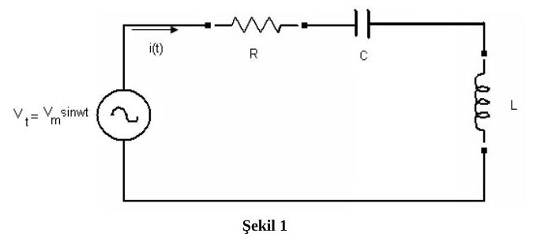
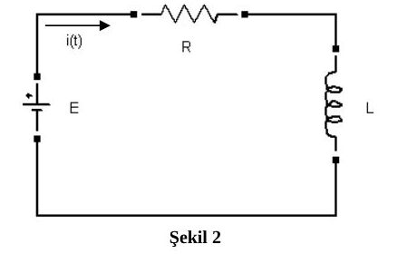

Bu yazı, **Sakarya Üniversitesi Mühendislik Fakültesi Elektrik-Elektronik Mühendisliği Bölümü** için **Prof. Dr. Uğur Arifoğlu** tarafından hazırlanan **30 Kasım 2006** tarihli diferansiyel denklemler vize sorularını ve çözümlerini içeriyor. MAT222 arşivimde bulunan beş sayfalık belgenin denklemleri ve çözüm adımları metne aktarıldı. Word'den dönüştürülen PDF yazının sonunda indirilebilir.

*Bu içerik üçüncü taraf bir kaynağa aittir; arşiv ve nostalji amacıyla kaynak belirtilerek paylaşılmıştır. Hak sahibinin talebi hâlinde kaldırılır.*

Sınav süresi **100 dakika**. Belgede yalnız ders notlarının açık olduğu, diğer not ve açıklamaların kaldırılacağı ve soru kâğıtlarının öğrencide kalacağı belirtiliyor. Yedi sorunun puanları sırasıyla 15, 15, 20, 5, 15, 15 ve 15.

*Not: PDF sayfalarında denklemler ve devre çizimleri korunmuş; otomatik metin dökümünde çıkmayan matematik ifadeleri görsellerden okunmuştur.*

## Soru 1: Sinüzoidal kaynaklı seri RLC devresi — 15 puan

Şekil 1'deki seri devrede **R = 2 Ω, L = 1 H, C = 1 F, V_m = 220√2 V** ve **ω = 2π·50 rad/s** veriliyor. Kaynak v(t) = V_m sin(ωt). Devreden akan i(t) akımının genel çözümünü bulunuz.

### Çözüm

L i′(t) + R i(t) + (1/C)∫i(t)dt = V_m sin(ωt)

Her iki tarafın türevi alınıp parametreler yerleştirildiğinde kaynakta şu denklem elde ediliyor:

i″(t) + 2i′(t) + i(t) = 9,77·10⁴ cos(ωt)

Homojen denklem için karakteristik polinom α² + 2α + 1 = (α + 1)² olduğundan:

i_h(t) = C₁e^(−t) + tC₂e^(−t)

Özel çözüm tahmini i_p = A sin(ωt) + B cos(ωt). Türevler:

- i_p′ = Aω cos(ωt) − Bω sin(ωt)
- i_p″ = −Aω² sin(ωt) − Bω² cos(ωt)

Sinüs ve kosinüs katsayıları eşitleniyor. Kaynaktaki sayısal denklemler:

- −98696A − 628B + A = 0
- −98696B + 628A + B = 9,77·10⁴

Belgede **A = 0,63·10⁻²**, **B = −0,98** bulunarak sonuç şöyle veriliyor:

i_g(t) = C₁e^(−t) + tC₂e^(−t) + 0,63·10⁻² sin(ωt) − 0,98 cos(ωt)

*Not: Kaynakta ikinci katsayı denklemine geçişte “−Bω² + 2Aω + B = −1” yazıyor; aynı satırın devamı ve asıl denklem sağ tarafın ωV_m ≈ 97743,42 olduğunu gösteriyor. Tam parametrelerle A ≈ 0,00630462 ve B ≈ −0,990318 bulunur. Kaynağın −0,98 değeri ve yuvarlatılmış sonuç yukarıda korundu.*

## Soru 2: Doğru gerilim kaynaklı RL devresi — 15 puan

Şekil 2'deki seri devrede **E = 100 V, R = 2 Ω, L = 4 H** ve **i(0) = 3 A**. İçinde belirsiz sabit kalmayacak biçimde akımın tam çözümünü bulunuz.

### Çözüm

E = Li′ + Ri ⇒ 100 = 4i′ + 2i ⇒ 50 = 2i′ + i

Homojen çözüm i_h = C₁e^(−0,5t); sabit özel çözüm i_p = 50. Genel çözüm:

i_g(t) = C₁e^(−0,5t) + 50

i(0) = 3 koşulu 3 = C₁ + 50, yani C₁ = −47 verir:

**i(t) = −47e^(−0,5t) + 50 A**

## Soru 3: Durum denklemleri — 20 puan

Durum değişkenleri v_C(t) ve i_L(t) için aşağıdaki sistem veriliyor:

- v_C′ = −(G/C)v_C − ((1 − G)/C)i_L + (1/C)i_k(t)
- i_L′ = (1/L)v_C − (1/L)i_L

**G = 1 mho, C = 1 F, L = 1 H**. Kaynak grafiği t = 0'da 5 A'e çıkan bir basamak: i_k(t) = 5u(t). Durum değişkenlerinin genel çözümlerini bulunuz.

### Çözüm

Parametreler yerleştirilince sistemin matrisi A = [−1, 0; 1, −1] ve giriş vektörü (1, 0)ᵀ olur. Karakteristik denklem:

det(αI − A) = (α + 1)² = 0

Kaynakta homojen çözüm önce (C₁, C₂)ᵀe^(−t) + (C₃, C₄)ᵀte^(−t) olarak deneniyor. Sistemde yerine konduğunda:

−C₁ = −C₁ + C₃ ⇒ C₃ = 0

C₁ − C₂ = −C₂ + C₄ ⇒ C₄ = C₁

Böylece:

- v_C,h = C₁e^(−t)
- i_L,h = C₂e^(−t) + C₁te^(−t)

Sabit kaynak için özel çözüm (A₁, A₂)ᵀ olarak alınıyor. 0 = −A₁ + 5 ve 0 = A₁ − A₂ denklemleri **A₁ = A₂ = 5** veriyor. Belgedeki genel çözümün bileşenleri:

- v_C,g(t) = C₁e^(−t) + 5u(t)
- i_L,g(t) = C₂e^(−t) + C₁te^(−t) + 5u(t)

*Not: Bu ifadeler t > 0 bölgesinde sabit 5 A girişle denklemleri sağlar. Basamak eklenmiş hâlini t = 0'ı da içeren küresel çözüm olarak okumak, türevlerde kaynak sistemde bulunmayan dürtüler üretir; anahtarlama anı başlangıç koşullarıyla ayrıca ele alınmalıdır. Kaynak özel çözüm vektörünün tamamına “Amper” yazmış; v_C'nin birimi volt, i_L'nin birimi amperdir. (8) numaralı ara eşitlikte türev açılımında da işaret/terim hataları vardır; ardından bulunan C₃ = 0, C₄ = C₁ ilişkileri ve (9) numaralı homojen çözüm doğrudur.*

## Soru 4: Eğri ailesinin diferansiyel denklemi — 5 puan

**y = Ax + B/x** ailesinin diferansiyel denklemini bulunuz.

### Çözüm

xy = Ax² + B

y + xy′ = 2Ax

2y′ + xy″ = 2A

Son iki bağıntıdan A yok edilince:

(y + xy′)/(2x) = (2y′ + xy″)/2

**x²y″ + xy′ − y = 0**

*Not: Kaynak son iki bağıntıya “(12) ve (12)” diye atıf yapıyor; ikinci atıf (13) olmalıdır. Aile x ≠ 0 için tanımlıdır.*

## Soru 5: Tam diferansiyel denklem ve integrasyon çarpanı — 15 puan

(x² + 2xy + y²) dx + (x² − y²) dy = 0

Denklem tam mıdır? Değilse **μ = μ(x + y) = μ(v)** alarak tam hâle getiriniz ve genel çözümü bulunuz.

### Çözüm

M = x² + 2xy + y² ve N = x² − y² için M_y = 2x + 2y, N_x = 2x. Denklem tam değildir. v = x + y alınırsa:

μ′/μ = (N_x − M_y)/(Mv_y − Nv_x) = −2y/(2xy + 2y²) = −1/(x + y)

μ′(v)/μ(v) = −1/v ⇒ μ = 1/v = 1/(x + y)

Denklem μ ile çarpıldığında:

(x + y) dx + (x − y) dy = 0

Yeni katsayılar için M_y = N_x = 1. Potansiyel fonksiyon hesaplanıyor:

u_x = x + y ⇒ u = x²/2 + xy + C(y)

u_y = x + C′(y) = x − y ⇒ C′(y) = −y

u = x²/2 + xy − y²/2 + C₁

Kaynak son satırı **u(x, y) = x² + 2xy − y² + C₁** biçiminde veriyor.

*Not: Son satırda potansiyel fonksiyonun değişkenli kısmı ikiyle çarpılmıştır; aynı u fonksiyonu olarak eşitlik doğru değildir. Sabitin yeniden adlandırılmasıyla çözüm ailesi x² + 2xy − y² = C biçiminde yazılabilir. μ = 1/(x + y) yalnız x + y ≠ 0 bölgesinde kullanılabilir; özgün denklemde ayrıca y = −x çözümü vardır. Logaritmalı integrasyon adımları uygun işaret bölgesinde veya mutlak değerlerle okunmalıdır.*

## Soru 6: u = e^y dönüşümü — 15 puan

**e^y y′ + e^y = 4e^(−x) sin x** denkleminin genel çözümünü u = e^y dönüşümüyle bulunuz.

### Çözüm

u′ = e^y y′ olduğundan denklem u′ + u = 4e^(−x) sin x olur. Homojen çözüm:

u_h = Ce^(−x)

Sabitin değişimiyle C = C(x) alınır:

C′e^(−x) = 4e^(−x) sin x ⇒ C′ = 4 sin x ⇒ C = −4 cos x + C₁

Kaynağın genel çözümü:

**e^y = −4e^(−x) cos x + C₁e^(−x)**

*Not: Gerçek y için sağ taraf pozitif olmalıdır; eşdeğer açık çözüm y = −x + ln(C₁ − 4 cos x), C₁ − 4 cos x > 0 koşuluyla yazılabilir.*

## Soru 7: Euler diferansiyel denklemi — 15 puan

**2x²y″ + 8xy′ + 4y = 2x²** denkleminin genel çözümünü bulunuz.

### Çözüm

İkiye bölünüp x = e^t dönüşümü yapılır:

x²y″ + 4xy′ + 2y = x²

dy/dx = e^(−t)dy/dt

d²y/dx² = e^(−2t)d²y/dt² − e^(−2t)dy/dt

Böylece t değişkenine göre denklem:

y_tt + 3y_t + 2y = e^(2t)

Karakteristik denklem α² + 3α + 2 = 0; kökler −1 ve −2. Homojen çözüm C₁e^(−t) + C₂e^(−2t). Özel çözüm Ae^(2t) denenirse:

4Ae^(2t) + 6Ae^(2t) + 2Ae^(2t) = e^(2t) ⇒ A = 1/12

y = C₁e^(−t) + C₂e^(−2t) + e^(2t)/12

t = ln x yerine konularak:

**y(x) = C₁/x + C₂/x² + x²/12**

*Not: Kaynağın x = e^t, t = ln x dönüşümü x > 0 içindir. Son ifade x < 0 aralıklarında da denklemi sağlar; x = 0 tekil noktadır.*
