13 pages of the handwritten **Probability and Statistics homework solutions** prepared by Instructor **Pelin Toktaş** at Başkent University (Homework 1: 5 pages, Homework 2: 4 pages, Homework 3: 4 pages). The page headers show the course code as "MAT 250" (it was placed here because it was found in the MAT340 folder of the archive); the boxed numbers next to the solutions (1-10, 2-45, 4.57, 6-22, etc.) are the problem numbers in the textbook. The scanned pages are below; for easy searching, the problems and main results of each homework have also been transcribed into text. JPEGs of all the pages can be downloaded as a ZIP at the end of the post.

## Homework 1: counting, probability, conditional probability

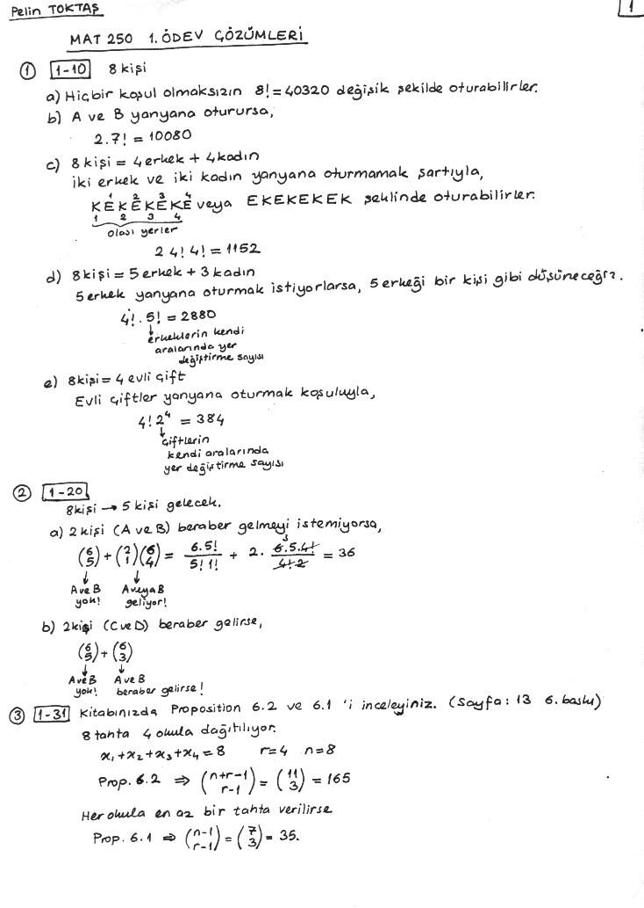
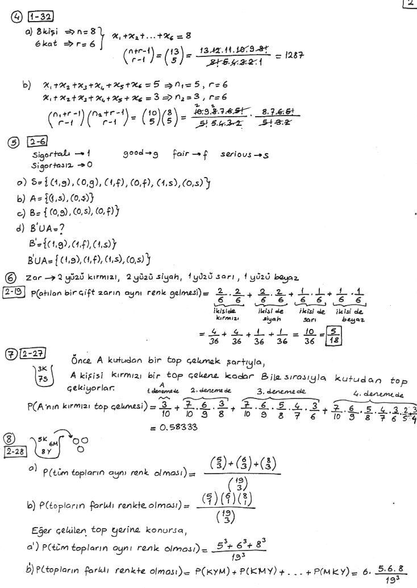

1. **(1-10) Arrangement of 8 people.** Without restrictions 8! = 40320; A and B next to each other: 2·7! = 10080; 4 men and 4 women, no two men and no two women sitting next to each other: 2·4!·4! = 1152; 5 men next to each other: 4!·5! = 2880; 4 married couples each sitting together: 4!·2⁴ = 384.
2. **(1-20) 5 of 8 people attending.** If A and B do not want to attend together, C(6,5) + 2·C(6,4) = 36 ways; if C and D will attend together, C(6,5) + C(6,3) = 26 ways.
3. **(1-31) 8 blackboards, 4 schools (Proposition 6.2 and 6.1).** Without restrictions C(11,3) = 165; if every school is given at least one blackboard, C(7,3) = 35.
4. **(1-32) Distribution over the floors of a building.** 8 people on 6 floors: C(13,5) = 1287; with different constraints on the number of floors C(10,5)·C(8,5).
5. **(2-6) Insured/uninsured and health status:** sample space and the event B'∪A.
6. **(2-19) Dice:** 2 faces red, 2 faces black, 1 face yellow, 1 face white; probability that two dice show the same color = 4/36 + 4/36 + 1/36 + 1/36 = 10/36 = 5/18.
7. **(2-27)** Probability that person A is the first to draw a red ball: P = 3/10 + (7/10)(6/9)(3/8) + … = **0.58333**.
8. **(2-28)** 5 red, 6 blue, 8 green balls; 3 balls are drawn. All the same color: [C(5,3) + C(6,3) + C(8,3)] / C(19,3); all different colors: C(5,1)C(6,1)C(8,1)/C(19,3). If the balls are replaced: (5³ + 6³ + 8³)/19³ and 6·5·6·8/19³.

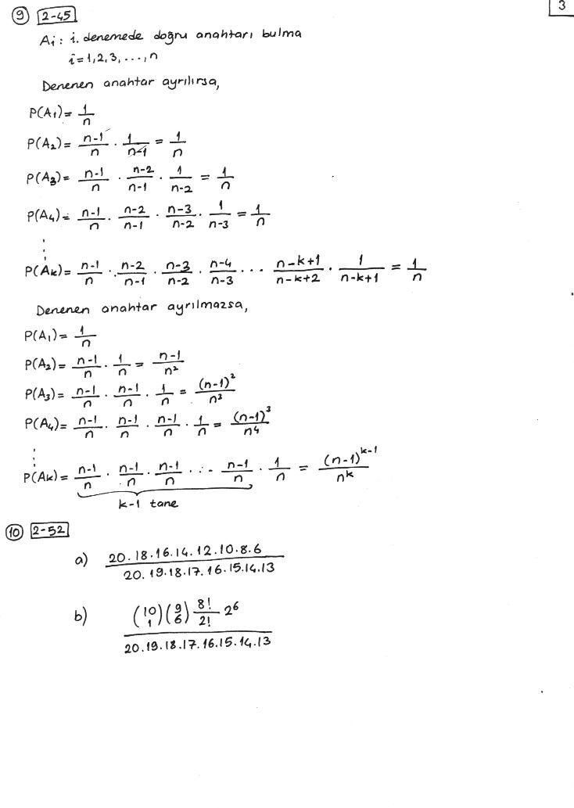
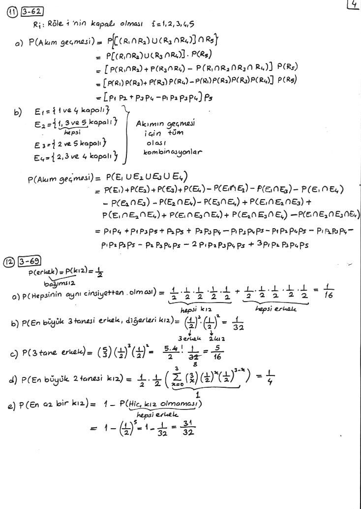
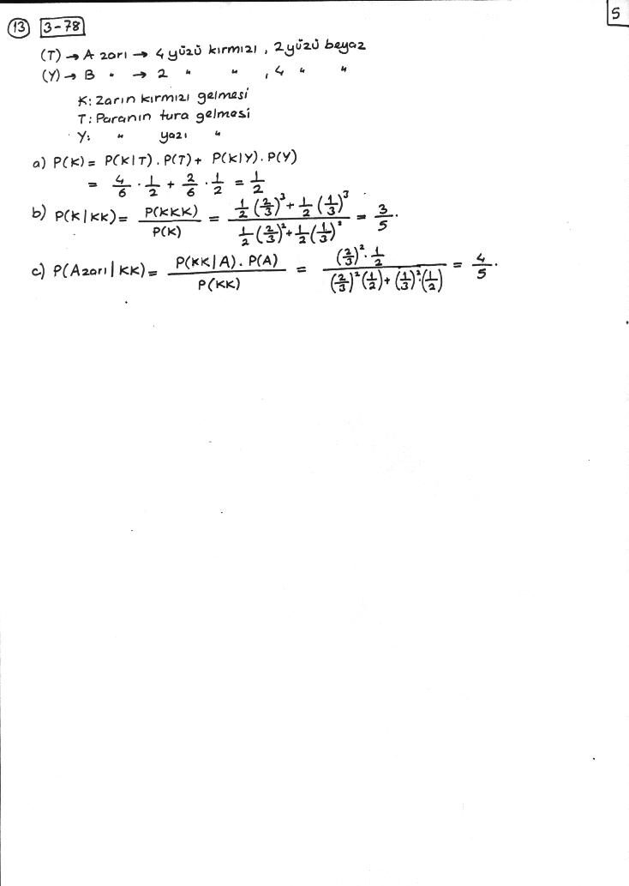

9. **(2-45) Finding the right key (n keys).** If a key that has been tried is set aside, P(A_k) = 1/n for every k; if it is not set aside, P(A_k) = (n−1)^(k−1)/n^k.
10. **(2-52)** (a) 20·18·16·14·12·10·8·6 / (20·19·18·17·16·15·14·13); (b) C(10,1)·C(9,6)·(8!/2!)·2⁶ / (20·19·…·13).
11. **(3-62) Circuit (5 relays).** R_i is the event that the i-th relay is closed. For current to flow, either path (1 and 2) or path (3 and 4), together with relay 5: P = [p₁p₂ + p₃p₄ − p₁p₂p₃p₄]·p₅. The second method uses inclusion-exclusion for the union of events: p₁p₄ + p₁p₃p₅ + p₂p₅ + p₂p₃p₄ − …
12. **(3-69) 5 children, probability of girl/boy 1/2.** (a) All of the same sex: 2·(1/2)⁵ = 1/16; (b) the oldest 3 are boys, the others girls: 1/32; (c) exactly 3 boys: C(5,3)/32 = 5/16; (d) the oldest 2 are girls: 1/4; (e) at least one girl: 1 − 1/32 = **31/32**.
13. **(3-78) Coin and die.** If heads comes up, die A (4 faces red, 2 white); if tails, die B (2 red, 4 white). (a) P(R) = 1/2; (b) P(R | RR) = 3/5 (see the handwritten calculation); (c) P(die A | RR) = 4/5.

## Homework 2: discrete random variables

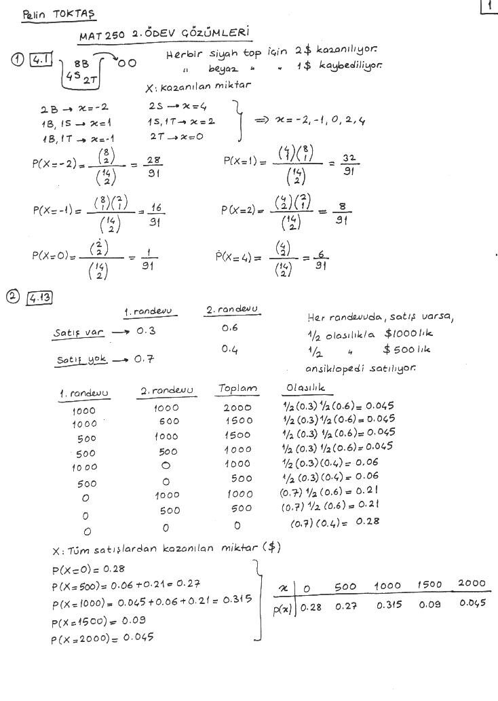
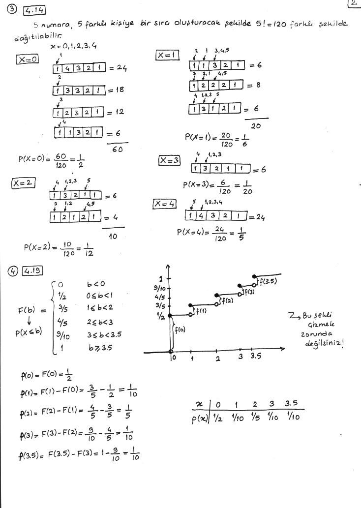
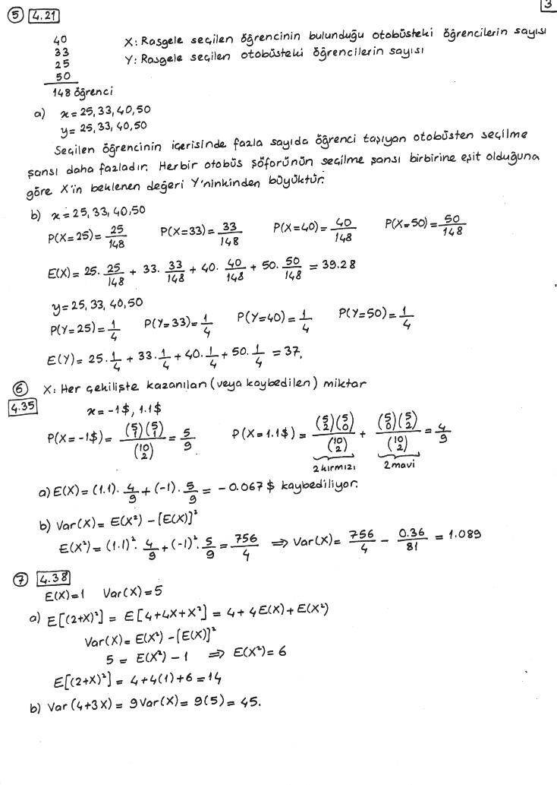
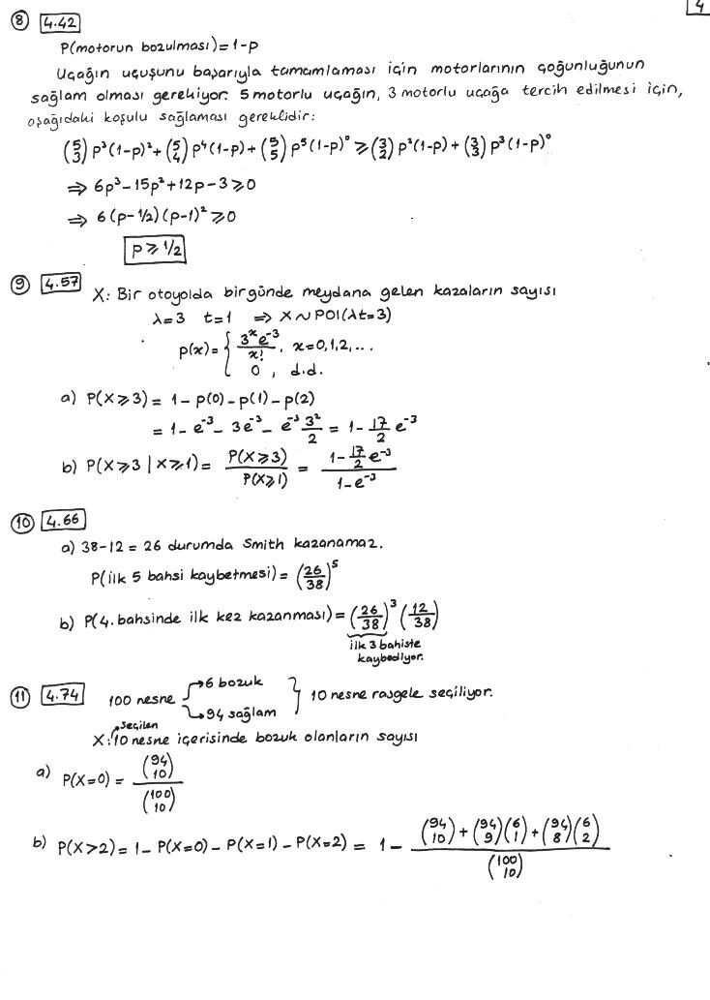

1. **(4.1) 8 white, 4 black, 2 orange balls; 2 balls are drawn, +$2 for each black ball, −$1 for each white ball.** X ∈ {−2, −1, 0, 2, 4}: P(−2) = 28/91, P(−1) = 16/91, P(0) = 1/91, P(1) = 32/91, P(2) = 8/91, P(4) = 6/91 (the value x = 1 is also listed).
2. **(4.13) Encyclopedia sales (two appointments).** The probability of a sale at each appointment is 0.3 and 0.6; if a sale is made, with probability 1/2 it is $1000 and with probability 1/2 it is $500. X is the total winnings: P(0) = 0.28; P(500) = 0.27; P(1000) = 0.315; P(1500) = 0.09; P(2000) = 0.045.
3. **(4.14) 5 numbers, 5 people.** There are 5! = 120 distributions forming an arrangement; match counts: P(X=0) = 1/2, P(X=1) = 1/6, P(X=2) = 1/12, P(X=3) = 1/20, P(X=4) = 1/5 (using the counts on the page).
4. **(4.19) F(b) is given:** 0 (b<0), 1/2 (0≤b<1), 3/5 (1≤b<2), 4/5 (2≤b<3), 9/10 (3≤b<3.5), 1 (b≥3.5). Mass function: p(0) = 1/2, p(1) = 1/10, p(2) = 1/5, p(3) = 1/10, p(3.5) = 1/10 (drawing the step graph is not required).
5. **(4.21) School buses (25, 33, 40, 50 students; 148 students).** X is the number of students on the bus of a randomly chosen student: E(X) = 39.28; Y is the number of students on a randomly chosen bus: E(Y) = 37; E(X) > E(Y).
6. **(4.35)** X = ±1.1 $ and −1 $: P(−1) = 5/9, P(1.1) = 4/9; E(X) = −0.067 $ ("a loss"), Var(X) = 1.089.
7. **(4.38) E(X) = 1, Var(X) = 5.** (a) E[(2+X)²] = 4 + 4E(X) + E(X²) = 14 (E(X²) = 6); (b) Var(4+3X) = 9·5 = 45.
8. **(4.42) A 5-engine plane or a 3-engine plane?** If a majority of the engines must be working: C(5,3)p³(1−p)² + C(5,4)p⁴(1−p) + p⁵ ≥ C(3,2)p²(1−p) + p³ ⇒ 6p³ − 15p² + 12p − 3 ≥ 0 ⇒ 6(p − 1/2)(p − 1)² ≥ 0 ⇒ **p ≥ 1/2**.
9. **(4.57) Poisson (λ = 3 accidents/day).** (a) P(X ≥ 3) = 1 − e⁻³ − 3e⁻³ − (9/2)e⁻³ = 1 − (17/2)e⁻³; (b) P(X ≥ 3 | X ≥ 1) = (1 − (17/2)e⁻³)/(1 − e⁻³).
10. **(4.66)** If Smith wins on 12 of 38 numbers, the probability of losing the first 5 bets is (26/38)⁵; of winning for the first time on the 4th bet, (26/38)³(12/38).
11. **(4.74) 100 objects (6 defective, 94 good), 10 are selected.** (a) P(X = 0) = C(94,10)/C(100,10); (b) P(X > 2) = 1 − [C(94,10) + C(94,9)C(6,1) + C(94,8)C(6,2)]/C(100,10).

## Homework 3: continuous and joint distributions

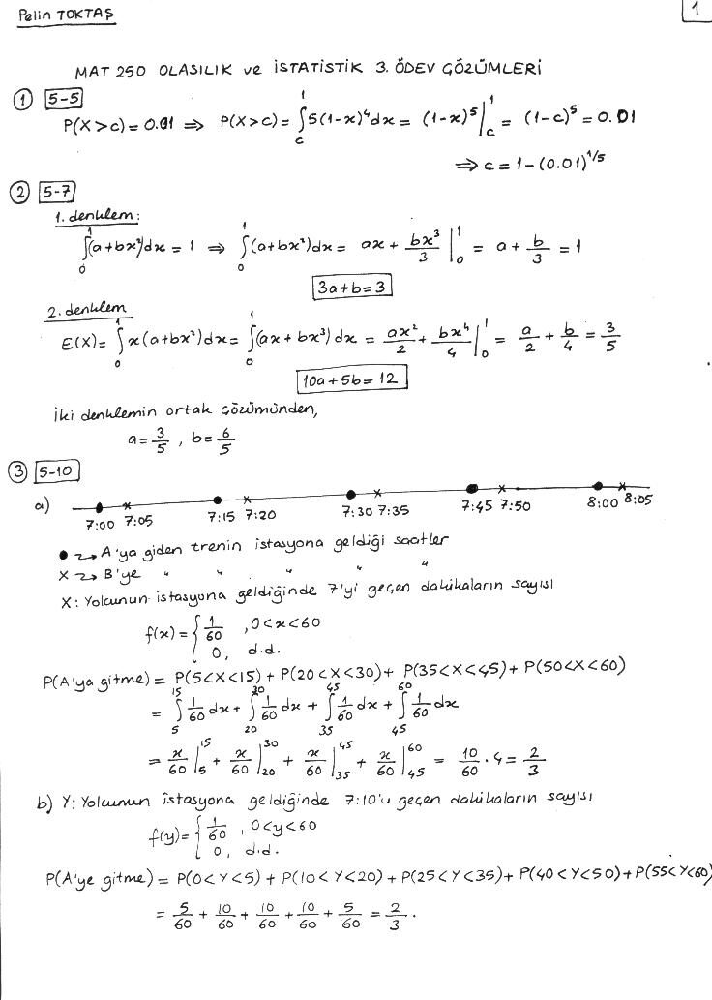
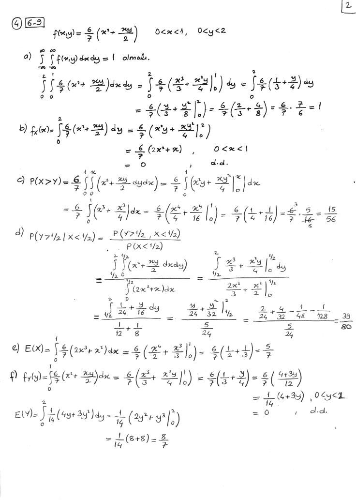
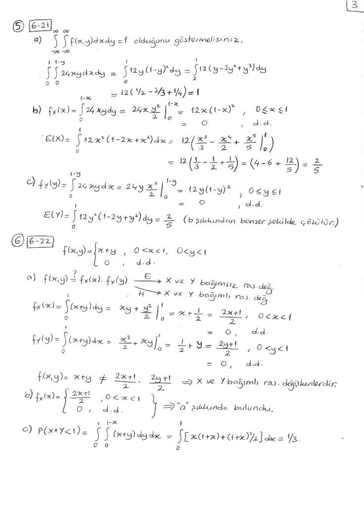
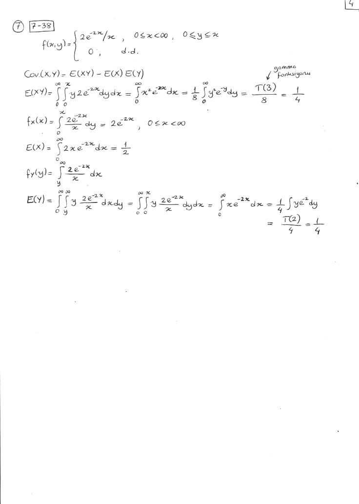

1. **(5-5)** P(X > c) = ∫_c^1 5(1−x)⁴ dx = (1−c)⁵ = 0.01 ⇒ c = 1 − (0.01)^(1/5).
2. **(5-7)** f(x) = a + bx², 0 < x < 1; ∫f = 1 ⇒ 3a + b = 3; E(X) = 3/5 ⇒ 10a + 5b = 12; solution **a = 3/5, b = 6/5**.
3. **(5-10) Train/station probabilities.** The passenger's arrival minute is uniformly distributed (f = 1/60); for the train going to A, P = 10/60 · 4 = **2/3**; in the second case (the minutes after 7:10) it is also 2/3.
4. **(6-9) f(x, y) = (6/7)(x² + xy/2), 0 < x < 1, 0 < y < 2.** (a) ∫∫ f = 1 is shown; (b) f_X(x) = (6/7)(2x² + x); (c) P(X > Y) = **15/56**; (d) P(Y > 1/2 | X < 1/2) = **39/80**; (e) E(X) = **5/7**; (f) f_Y(y) = (1/14)(4 + 3y), E(Y) = **8/7**.
5. **(6-21) f(x, y) = 24xy, x, y > 0, x + y < 1.** ∫∫ f = 1; f_X(x) = 12x(1−x)², E(X) = **2/5**; f_Y(y) = 12y(1−y)², E(Y) = **2/5**.
6. **(6-22) f(x, y) = x + y, 0 < x, y < 1.** f_X = (2x+1)/2 and f_Y = (2y+1)/2; since f(x, y) ≠ f_X f_Y, X and Y are **dependent**; P(X + Y < 1) = **1/3**.
7. **(7-38) f(x, y) = 2e^(−2x)/x, 0 ≤ y ≤ x < ∞.** E(XY) = Γ(3)/8 = 1/4, f_X(x) = 2e^(−2x), E(X) = 1/2, E(Y) = Γ(2)/4 = 1/4, so Cov(X, Y) = E(XY) − E(X)E(Y) = 1/4 − 1/8 = **1/8**.

*Note: The numerical results in the solutions were transcribed by reading them from the pages; a few intermediate steps where the handwriting was illegible have been skipped.*
