Başkent Üniversitesi'nde Öğr. Gör. **Pelin Toktaş**'ın el yazısıyla hazırladığı **Olasılık ve İstatistik ödev çözümlerinin** 13 sayfası (Ödev 1: 5 sayfa, Ödev 2: 4 sayfa, Ödev 3: 4 sayfa). Sayfa başlıklarında dersin kodu "MAT 250" yazıyor (arşivdeki MAT340 klasöründe bulunduğundan buraya konuldu); çözümlerin yanındaki kutulu numaralar (1-10, 2-45, 4.57, 6-22 gibi) ders kitabındaki soru numaralarıdır. Taranmış sayfalar aşağıda; kolay aranabilmesi için her ödevin soruları ve ana sonuçları da metne dökülmüştür. Tüm sayfaların JPEG'leri yazının sonunda ZIP olarak indirilebilir.

## Ödev 1: sayma, olasılık, koşullu olasılık

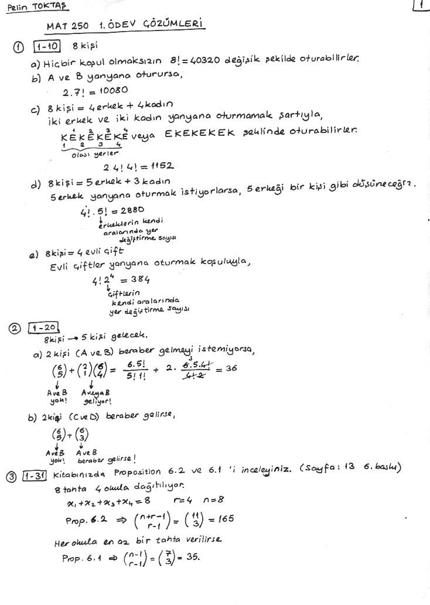
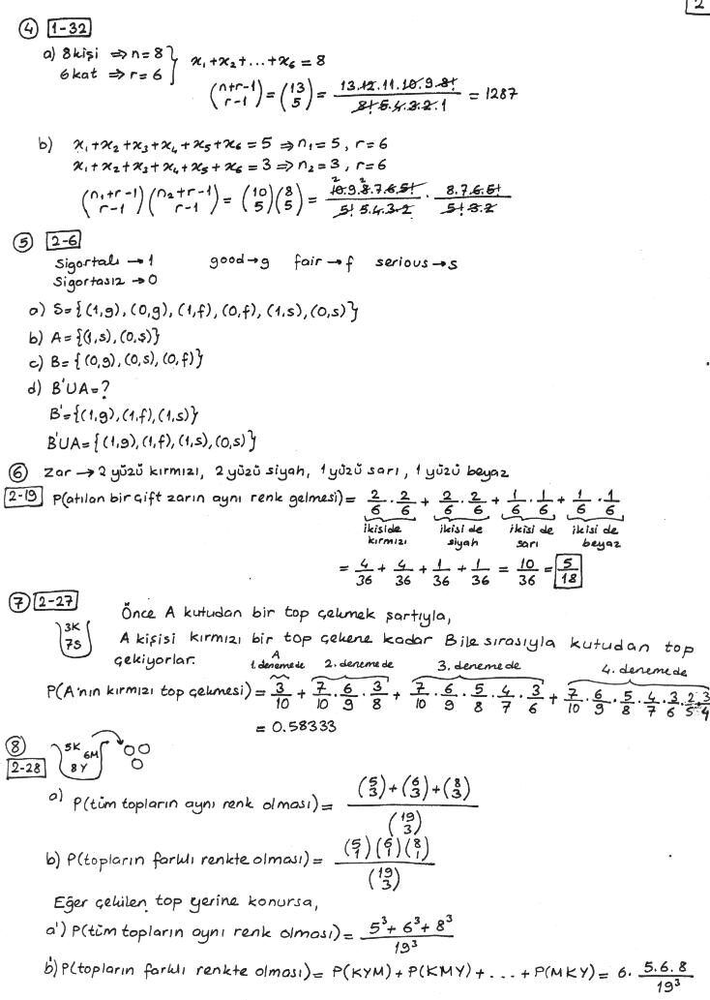

1. **(1-10) 8 kişinin dizilişi.** Koşulsuz 8! = 40320; A ve B yan yana: 2·7! = 10080; 4 erkek 4 kadın, iki erkek ve iki kadın yan yana oturmayacak: 2·4!·4! = 1152; 5 erkek yan yana: 4!·5! = 2880; 4 evli çift yan yana: 4!·2⁴ = 384.
2. **(1-20) 8 kişiden 5'inin gelmesi.** A ve B birlikte gelmek istemiyorsa C(6,5) + 2·C(6,4) = 36 yol; C ve D birlikte gelecekse C(6,5) + C(6,3) = 26 yol.
3. **(1-31) 8 tahta, 4 okul (Proposition 6.2 ve 6.1).** Koşulsuz C(11,3) = 165; her okula en az bir tahta verilirse C(7,3) = 35.
4. **(1-32) Bina kat dağılımı.** 8 kişi 6 kata: C(13,5) = 1287; kat sayısı farklı kısıtlarla C(10,5)·C(8,5).
5. **(2-6) Sigortalı/sigortasız ve sağlık durumu** için örnek uzay ve B'∪A olayı.
6. **(2-19) Zar:** 2 yüzü kırmızı, 2 yüzü siyah, 1 yüzü sarı, 1 yüzü beyaz; iki zarın aynı renk gelme olasılığı = 4/36 + 4/36 + 1/36 + 1/36 = 10/36 = 5/18.
7. **(2-27)** A kişisinin ilk kırmızı top çeken olması: P = 3/10 + (7/10)(6/9)(3/8) + … = **0,58333**.
8. **(2-28)** 5 kırmızı, 6 mavi, 8 yeşil top; 3 top çekiliyor. Tümü aynı renk: [C(5,3) + C(6,3) + C(8,3)] / C(19,3); farklı renk: C(5,1)C(6,1)C(8,1)/C(19,3). Geri konulursa: (5³ + 6³ + 8³)/19³ ve 6·5·6·8/19³.

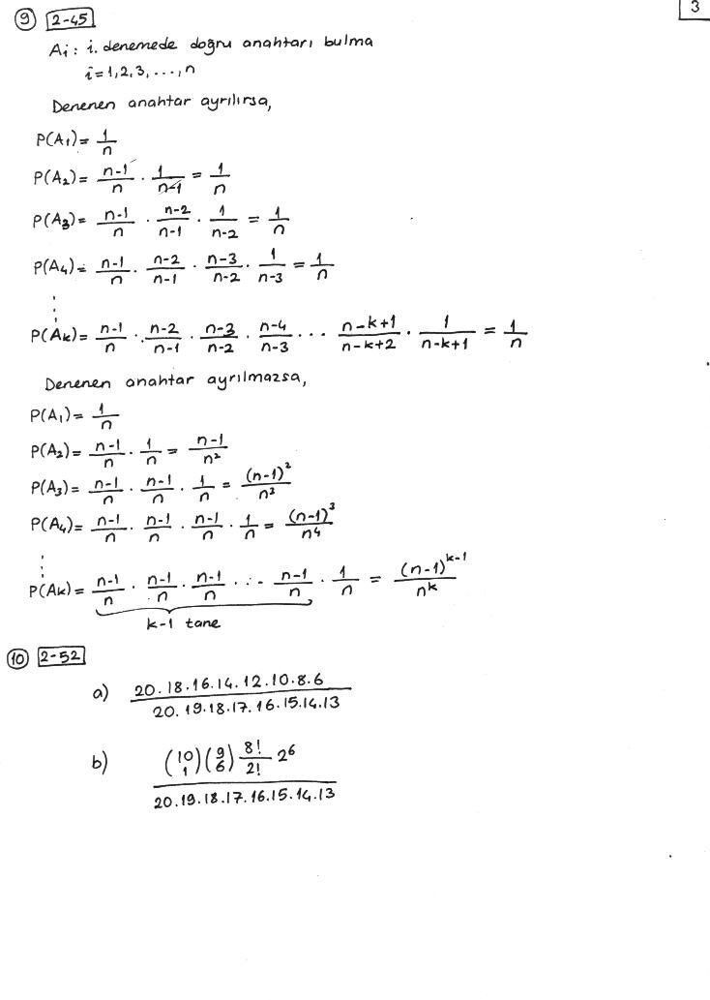
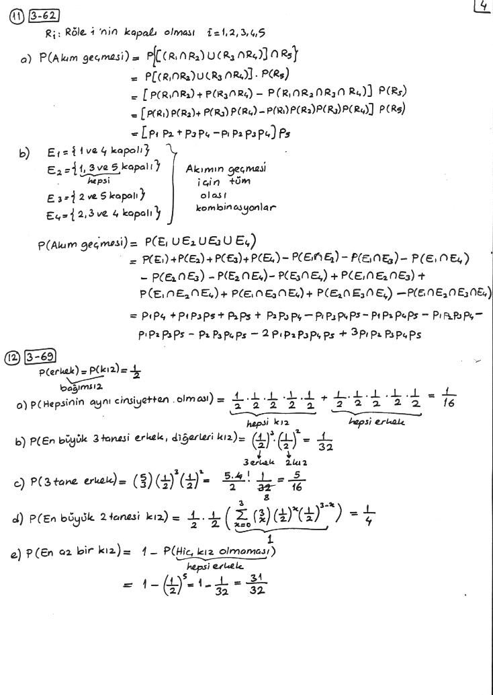
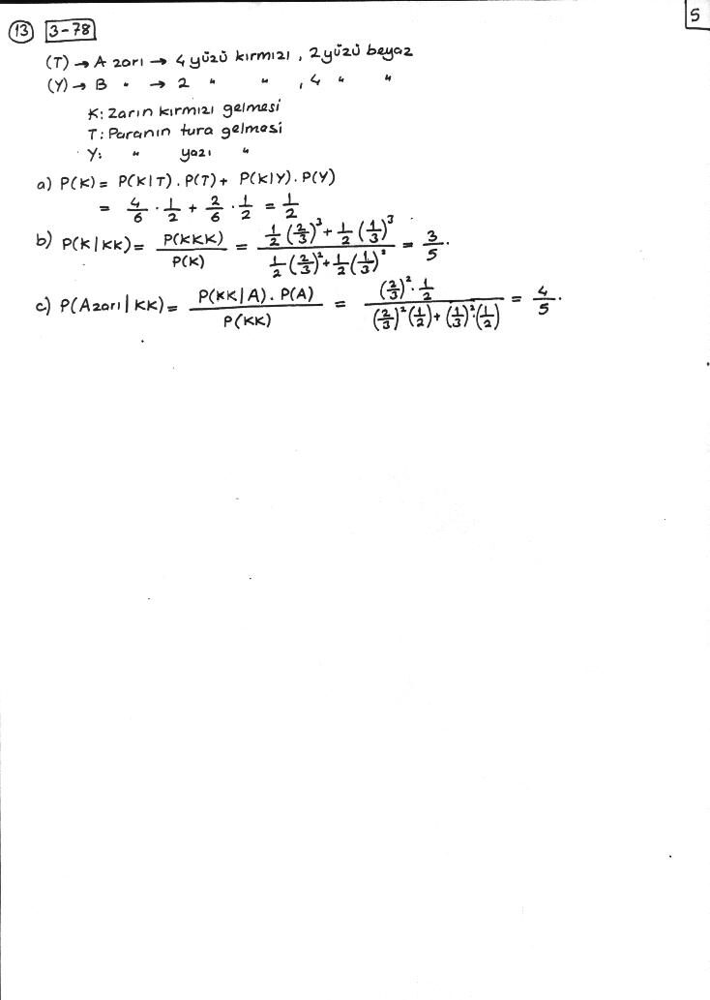

9. **(2-45) Doğru anahtarı bulma (n anahtar).** Denenen anahtar ayrılırsa P(A_k) = 1/n her k için; ayrılmazsa P(A_k) = (n−1)^(k−1)/n^k.
10. **(2-52)** (a) 20·18·16·14·12·10·8·6 / (20·19·18·17·16·15·14·13); (b) C(10,1)·C(9,6)·(8!/2!)·2⁶ / (20·19·…·13).
11. **(3-62) Devre (5 röle).** R_i, i. rölenin kapalı olması. Akımın geçmesi için (1 ve 2) veya (3 ve 4) yolu ile 5. röle: P = [p₁p₂ + p₃p₄ − p₁p₂p₃p₄]·p₅. İkinci yöntemde olayların birleşimi için dahil etme-dışlama kullanılıyor: p₁p₄ + p₁p₃p₅ + p₂p₅ + p₂p₃p₄ − …
12. **(3-69) 5 çocuk, kız/erkek olasılığı 1/2.** (a) Hepsinin aynı cinsiyet: 2·(1/2)⁵ = 1/16; (b) en büyük 3'ü erkek, diğerleri kız: 1/32; (c) tam 3 erkek: C(5,3)/32 = 5/16; (d) en büyük 2'si kız: 1/4; (e) en az bir kız: 1 − 1/32 = **31/32**.
13. **(3-78) Para ve zar.** Yazı gelirse A zarı (4 yüzü kırmızı, 2 beyaz), tura gelirse B zarı (2 kırmızı, 4 beyaz). (a) P(K) = 1/2; (b) P(K | KK) = 3/5 (bkz. el yazısı hesap); (c) P(A zarı | KK) = 4/5.

## Ödev 2: kesikli rassal değişkenler

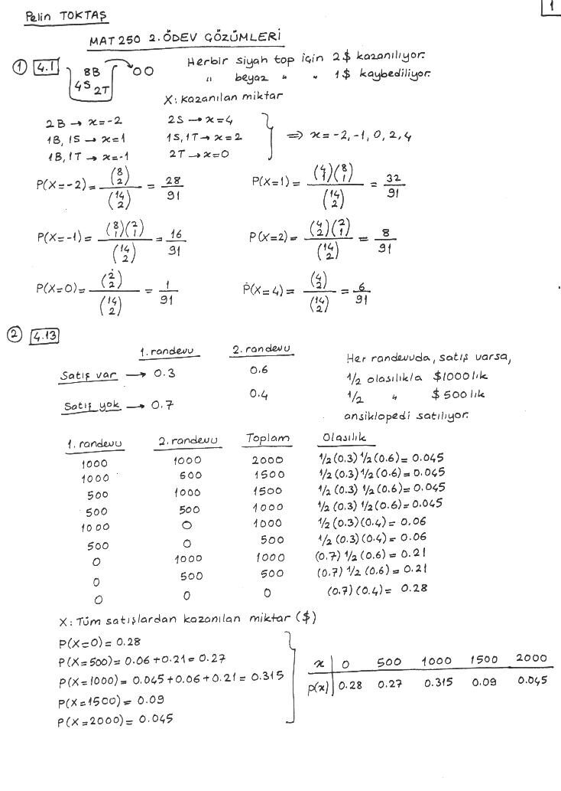
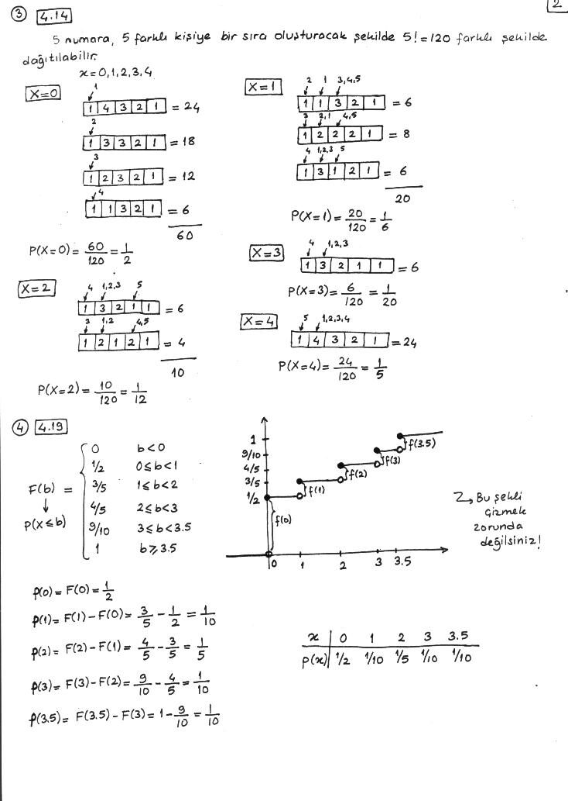
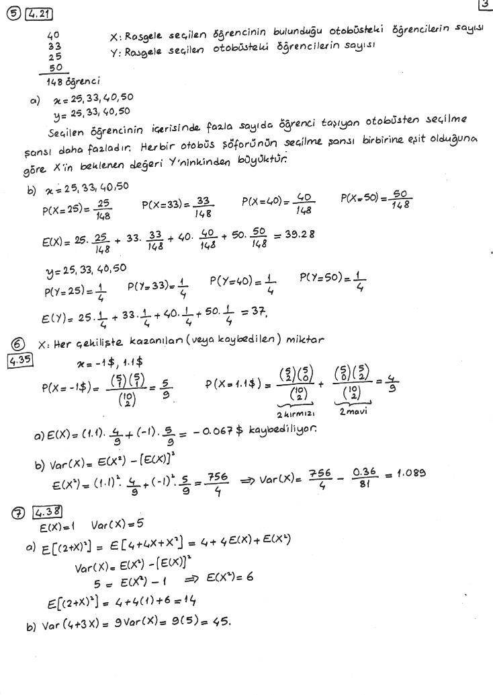
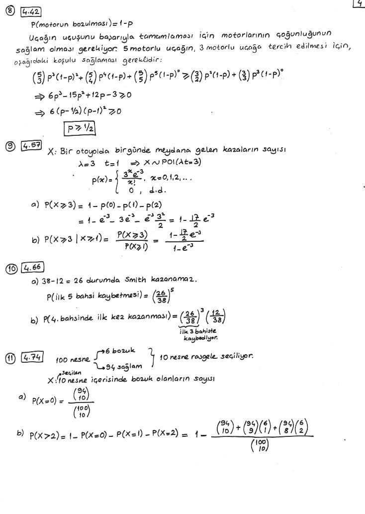

1. **(4.1) 8 beyaz, 4 siyah, 2 turuncu top; 2 top çekiliyor, siyah için +2 $, beyaz için −1 $.** X ∈ {−2, −1, 0, 2, 4}: P(−2) = 28/91, P(−1) = 16/91, P(0) = 1/91, P(1) = 32/91, P(2) = 8/91, P(4) = 6/91 (x = 1 değeri de listededir).
2. **(4.13) Ansiklopedi satışı (iki randevu).** Her randevuda satış olasılığı 0,3 ve 0,6; satış olursa 1/2 olasılıkla 1000 $, 1/2 olasılıkla 500 $. X toplam kazanç: P(0) = 0,28; P(500) = 0,27; P(1000) = 0,315; P(1500) = 0,09; P(2000) = 0,045.
3. **(4.14) 5 numara, 5 kişi.** Bir sıra oluşturacak şekilde 5! = 120 dağıtım; eşleşme sayıları: P(X=0) = 1/2, P(X=1) = 1/6, P(X=2) = 1/12, P(X=3) = 1/20, P(X=4) = 1/5 (sayfadaki sayımlarla).
4. **(4.19) F(b) verilmiş:** 0 (b<0), 1/2 (0≤b<1), 3/5 (1≤b<2), 4/5 (2≤b<3), 9/10 (3≤b<3,5), 1 (b≥3,5). Kütle fonksiyonu: p(0) = 1/2, p(1) = 1/10, p(2) = 1/5, p(3) = 1/10, p(3,5) = 1/10 (basamak grafiği çizmek zorunlu değil).
5. **(4.21) Okul otobüsleri (25, 33, 40, 50 öğrenci; 148 öğrenci).** X rasgele seçilen öğrencinin otobüsündeki öğrenci sayısı: E(X) = 39,28; Y rasgele seçilen otobüsteki öğrenci sayısı: E(Y) = 37; E(X) > E(Y).
6. **(4.35)** X = ±1,1 $ ve −1 $: P(−1) = 5/9, P(1,1) = 4/9; E(X) = −0,067 $ ("kaybediliyor"), Var(X) = 1,089.
7. **(4.38) E(X) = 1, Var(X) = 5.** (a) E[(2+X)²] = 4 + 4E(X) + E(X²) = 14 (E(X²) = 6); (b) Var(4+3X) = 9·5 = 45.
8. **(4.42) 5 motorlu uçak mı, 3 motorlu mu?** Motorların çoğunluğunun sağlam olması gerekirse: C(5,3)p³(1−p)² + C(5,4)p⁴(1−p) + p⁵ ≥ C(3,2)p²(1−p) + p³ ⇒ 6p³ − 15p² + 12p − 3 ≥ 0 ⇒ 6(p − 1/2)(p − 1)² ≥ 0 ⇒ **p ≥ 1/2**.
9. **(4.57) Poisson (λ = 3 kaza/gün).** (a) P(X ≥ 3) = 1 − e⁻³ − 3e⁻³ − (9/2)e⁻³ = 1 − (17/2)e⁻³; (b) P(X ≥ 3 | X ≥ 1) = (1 − (17/2)e⁻³)/(1 − e⁻³).
10. **(4.66)** Smith'in 38 sayıdan 12'sinde kazanması durumunda ilk 5 bahsi kaybetme olasılığı (26/38)⁵; ilk kez 4. bahiste kazanması (26/38)³(12/38).
11. **(4.74) 100 nesne (6 bozuk, 94 sağlam), 10'u seçiliyor.** (a) P(X = 0) = C(94,10)/C(100,10); (b) P(X > 2) = 1 − [C(94,10) + C(94,9)C(6,1) + C(94,8)C(6,2)]/C(100,10).

## Ödev 3: sürekli ve bileşik dağılımlar

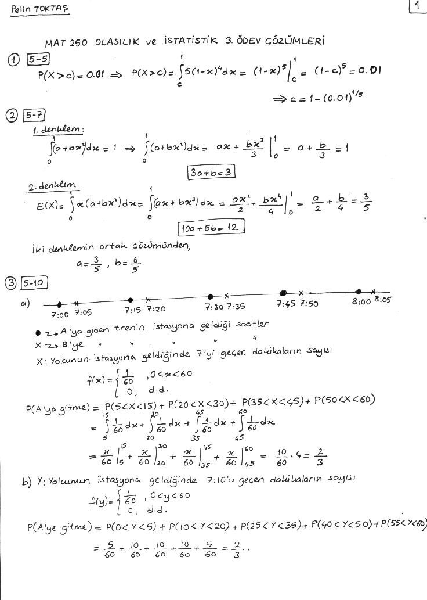
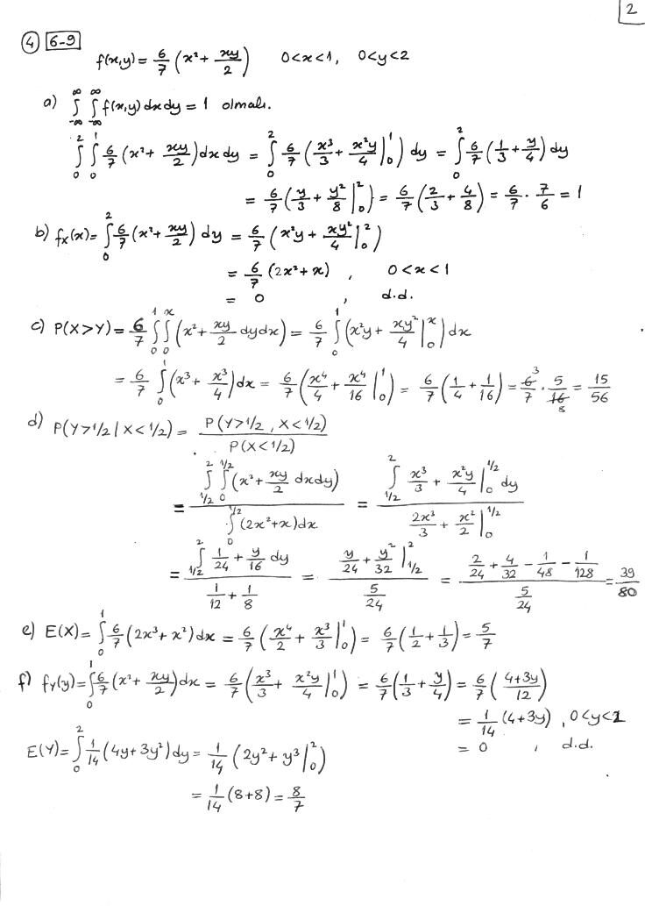
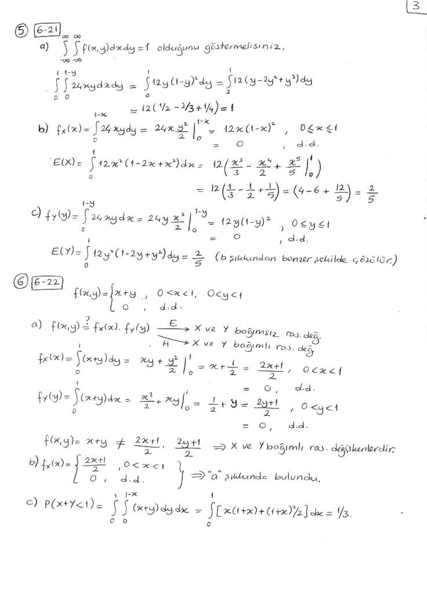
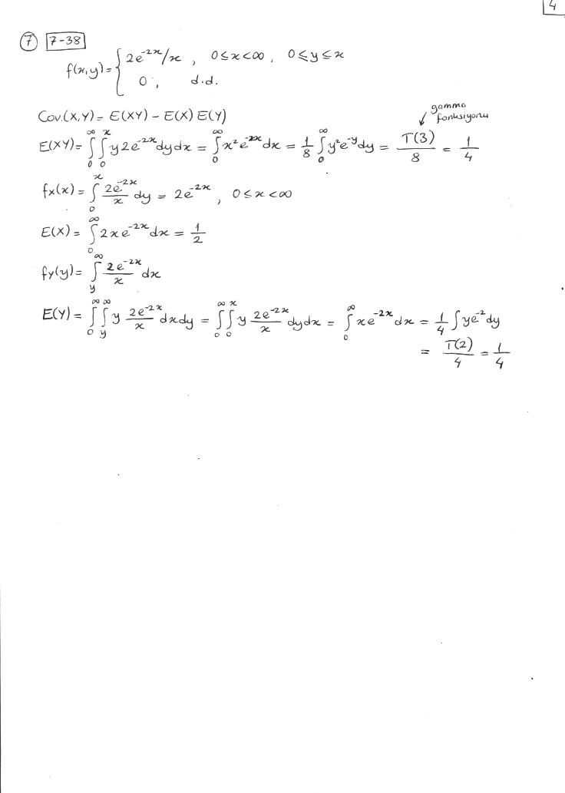

1. **(5-5)** P(X > c) = ∫_c^1 5(1−x)⁴ dx = (1−c)⁵ = 0,01 ⇒ c = 1 − (0,01)^(1/5).
2. **(5-7)** f(x) = a + bx², 0 < x < 1; ∫f = 1 ⇒ 3a + b = 3; E(X) = 3/5 ⇒ 10a + 5b = 12; çözüm **a = 3/5, b = 6/5**.
3. **(5-10) Tren/istasyon olasılıkları.** Yolcunun geliş dakikası düzgün dağılımlıdır (f = 1/60); A'ya giden tren için P = 10/60 · 4 = **2/3**; ikinci durumda (7:10'dan sonraki dakikalar) de 2/3.
4. **(6-9) f(x, y) = (6/7)(x² + xy/2), 0 < x < 1, 0 < y < 2.** (a) ∫∫ f = 1 gösterilir; (b) f_X(x) = (6/7)(2x² + x); (c) P(X > Y) = **15/56**; (d) P(Y > 1/2 | X < 1/2) = **39/80**; (e) E(X) = **5/7**; (f) f_Y(y) = (1/14)(4 + 3y), E(Y) = **8/7**.
5. **(6-21) f(x, y) = 24xy, x, y > 0, x + y < 1.** ∫∫ f = 1; f_X(x) = 12x(1−x)², E(X) = **2/5**; f_Y(y) = 12y(1−y)², E(Y) = **2/5**.
6. **(6-22) f(x, y) = x + y, 0 < x, y < 1.** f_X = (2x+1)/2 ve f_Y = (2y+1)/2; f(x, y) ≠ f_X f_Y olduğundan X ve Y **bağımlıdır**; P(X + Y < 1) = **1/3**.
7. **(7-38) f(x, y) = 2e^(−2x)/x, 0 ≤ y ≤ x < ∞.** E(XY) = Γ(3)/8 = 1/4, f_X(x) = 2e^(−2x), E(X) = 1/2, E(Y) = Γ(2)/4 = 1/4, böylece Cov(X, Y) = E(XY) − E(X)E(Y) = 1/4 − 1/8 = **1/8**.

*Not: Çözümlerde yer alan sayısal sonuçlar sayfalardan okunarak aktarılmıştır; el yazısı okunaksız olan birkaç ara adım atlanmıştır.*
