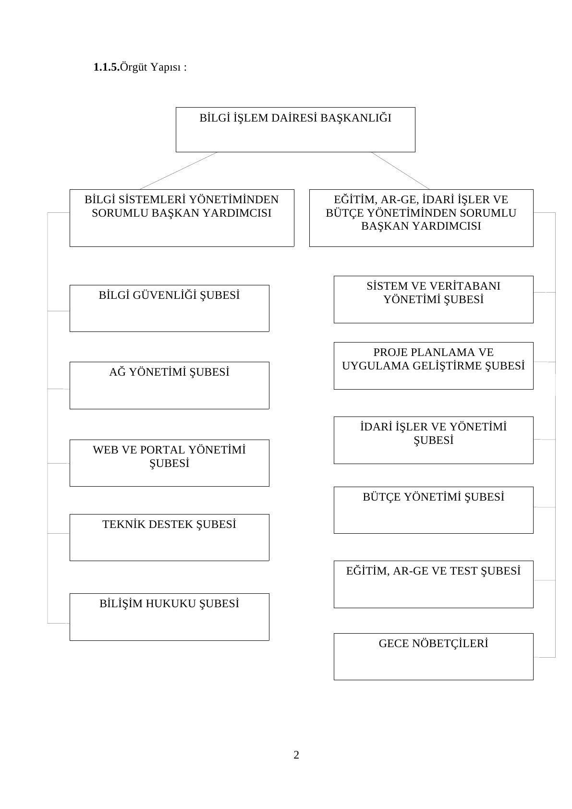
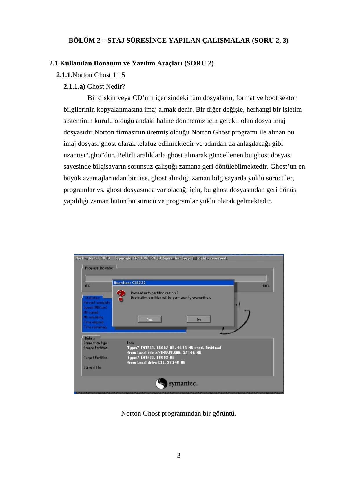
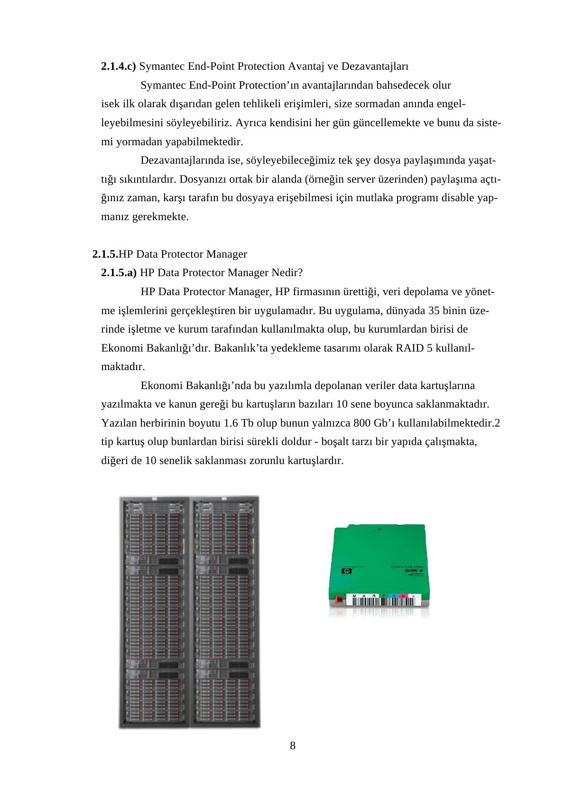
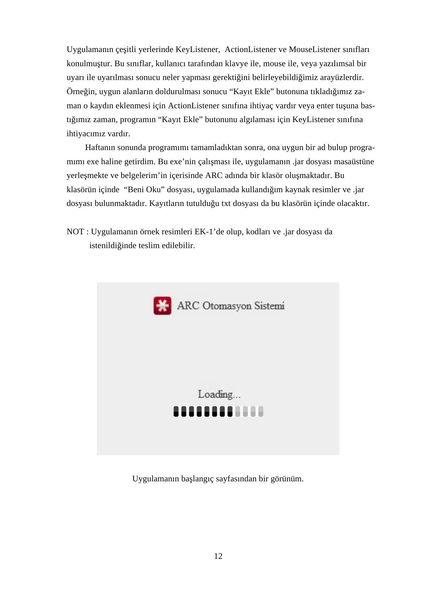

This post is the report of the **BİL300 internship** for Başkent University Computer Engineering, carried out at the Republic of Türkiye **Ministry of Economy, IT Department** (Ankara) between 1 and 26 July 2013. The report was prepared by a friend; the name, student number, address, and phone details (cover page) have been removed, and only the body of the report (15 pages) is included. The report covers an introduction to the organization, the hardware and software tools used at the ministry (Ghost, Oracle Database, WebLogic, Symantec, HP Data Protector), the weekly activities, and the outcomes gained. The original pages can be downloaded as a PDF at the end of the post.

## Section 1: General Introduction to the Organization

### 1.1. Information About the Internship Organization

### 1.1.1. Name and Address of the Organization:

Republic of Türkiye Ministry of Economy, İnönü Bulvarı No: 36, PK: 06510 Emek/ANKARA

### 1.1.2. Brief History of the Organization:

The Council of Ministers formed in the Grand National Assembly of Türkiye, which convened on 2 May 1920, included a Ministry of Economy that also handled trade affairs. With Law No. 2450, adopted on 27 May 1934, the units related to foreign trade were gathered under the name Directorate of Foreign Trade within the newly established Ministry of Commerce. Although this organization was separated from the Ministry of Commerce on 26 March 1971 and became the Ministry of Foreign Economic Relations, it soon continued its duties under the name General Secretariat of Foreign Trade within the restructured Ministry of Commerce. With Decree-Law No. 188 dated 13 December 1983, the Undersecretariat of Treasury and Foreign Trade was established. The Undersecretariat of Treasury and Foreign Trade was split into two separate organizations, the Undersecretariat of Treasury and the Undersecretariat of Foreign Trade, with Law No. 4059, adopted on 19 December 1994. With the Decree-Law dated 8 June 2011, all service units of the Undersecretariat of Foreign Trade were merged with the General Directorates of Incentive Implementation and Foreign Capital of the Undersecretariat of Treasury, and the Ministry of Economy was established.

### 1.1.3. Definitions of Final Output Products:

SBBUP (Free Zones Computer Application Program): A database system used in free zones that operates via e-signature.

DİR (Inward Processing Regime): A project to move the Inward Processing Regime to an electronic environment.

DTVS (Foreign Trade Data System): A web-based software that enables import and export inspections to be carried out on a risk-based approach.

### 1.1.4. Number and Qualifications of Employees:

The Ministry of Economy IT Department has 47 staff members: 10 programmers, 10 contract staff, 9 branch managers, 6 computer operators, 3 V.H.K.İ. (Data Preparation and Control Operators), 2 analysts, 2 technicians, 2 Deputy Heads of Department, 2 Heads of Department, and 1 technician (tekniker).

### 1.1.5. Organizational Structure:

IT DEPARTMENT HEAD'S OFFICE DEPUTY HEAD RESPONSIBLE FOR INFORMATION SYSTEMS MANAGEMENT DEPUTY HEAD RESPONSIBLE FOR TRAINING, R&D, ADMINISTRATIVE AFFAIRS AND BUDGET MANAGEMENT SYSTEM AND DATABASE MANAGEMENT BRANCH INFORMATION SECURITY BRANCH PROJECT PLANNING AND APPLICATION DEVELOPMENT BRANCH NETWORK MANAGEMENT BRANCH ADMINISTRATIVE AFFAIRS AND MANAGEMENT BRANCH WEB AND PORTAL MANAGEMENT BRANCH BUDGET MANAGEMENT BRANCH TECHNICAL SUPPORT BRANCH TRAINING, R&D AND TESTING BRANCH INFORMATION TECHNOLOGY LAW BRANCH

## Section 2: Activities Carried Out During the Internship

### 2.1. Hardware and Software Tools Used

### 2.1.1. Norton Ghost 11.5

**What is Ghost?**

Copying all the files, format, and boot sector information of a disk or CD is called imaging. In other words, an image file is the file needed to return a computer to the state it was in when an operating system was installed. The image file created with the Norton Ghost program, produced by Norton, is called a "ghost", and as its name suggests, its extension is ".gho". Thanks to this ghost file, which is updated by taking a new ghost at regular intervals, the computer can be returned to a time when it worked without problems. One of Ghost's biggest advantages is that, since the drivers, programs, etc. installed on the computer at the time of imaging are included in the ghost file, they all come back installed when restoring from this ghost file.

A screenshot from the Norton Ghost program.

**Using Norton Ghost.** Before using Norton Ghost, some BIOS settings must be made. First, enter the computer's BIOS menu and set the CD or DVD-ROM as the first device in the boot order. Then select IDE in the SATA Mode section. After these steps are completed, insert the Norton Ghost CD and boot the system. When the system restarts and boots from the Norton Ghost CD, select Dos Programs from the menu that appears, and a menu with several options follows. Here, by selecting Backup Tools / Norton Ghost 11.5 / Ghost (Normal) in order, we reach the interface of the program. Once in the interface, what we do next matters. There are two options: the first is to create an image file from the computer, and the second is to load an image file onto the computer. To create an image file, select Local / Partition / to Image in order from the interface, then select the partition to be imaged (e.g., C: or D:), and the image file starts being created successfully. To load an image file onto the computer, select the from Image option instead of the to Image option chosen when creating the image, and again select the partition to load the image onto, and the image file starts loading successfully. When loading an image, the image file to be loaded can be on an external drive or on a partition of the computer. This choice is also made after selecting the from Image option.

Another advantage offered by Norton Ghost is that we can perform this image loading and image creation disk to disk. This process is called cloning. The difference between cloning and normal imaging is that all the information and partitions on one hard disk are copied identically to another disk. From a disk containing a healthy image, installation to another disk can easily be done. For this operation, the disk option is selected instead of the partition option chosen for normal image creation and loading, and the ghost process is completed with all other steps being the same.

### 2.1.2. Oracle Database

**What is a database?**

A database is a large and organized collection of information used by many users. Database management systems are produced by many vendors for organizing, storing, and querying this large data set. Examples of these systems include Oracle Database, Microsoft Access, Microsoft SQL Server, and Sybase. The common feature of these systems is that they use relational database technology. In relational database systems, data is kept in tables as rows and columns, and these systems provide high data consistency. 2.1.2.b) What is Oracle Database?

Oracle Database is a relational database management system and is currently used at the Ministry of Economy. This system has 3 editions: Standard, Standard One, and Enterprise. The Enterprise edition is used at the Ministry of Economy. This database management system is Java-based, but the commands are in SQL. For example, "SHUTDOWN NORMAL" is a command in SQL and is used in this system. Oracle Database Command Entry Section 2.1.2.c) Features of Oracle Database Enterprise Edition

- The ability to hold large amounts of data and to configure the storage areas where data is kept. The ability to keep running without being shut down for long periods. High protection and high data reliability against server, environment, and user errors. The ability to control access privileges and prevent unauthorized access. The ability to work compatibly with all operating systems and data access languages. Inclusion of high-performance data storage and data mining applications. Providing unique row-level security.

### 2.1.3. Oracle WebLogic

**What is Oracle WebLogic?**

Oracle WebLogic is an application server and is currently the most preferred enterprise Java-based application server in the world. It is always at the forefront of the choices of organizations that require high mission-criticality, continuity, and high performance. With the high performance and efficiency it provides compared to its competitors, it helps businesses reduce their costs.

**Features of Oracle WebLogic**

- Oracle WebLogic Application Servers have much higher performance and efficiency than their competitors. They speed up applications with JRockit, which has high stress tolerance. With .NET support, they can work compatibly with web services. Thanks to Web Open Source support, they can be easily managed over the web. They provide high availability. They can work integrated with development tools (Developing Kit). In independent studies, Oracle WebLogic was the best application server in terms of performance and efficiency among the application servers compared using the same hardware configuration.

### 2.1.4. Symantec End-Point Protection

**What is Symantec End-Point Protection?**

Symantec End-Point Protection is an antivirus and personal firewall released by Symantec, a company focused on security and information management. Symantec End-Point Protection is used as the security system at the Ministry of Economy. For example, thanks to the firewalls used on web servers, harmful content is blocked.

WEB SERVER APPLICATION SERVER FIREWALL FIREWALL Distribution of firewalls in the network 2.1.4.b) Features of Symantec End-Point Protection

- Integration with cloud systems. High security at network access points. Centralized management. A structure that can protect servers and computers together. DATABASE 2.1.4.c) Advantages and Disadvantages of Symantec End-Point Protection Regarding the advantages of Symantec End-Point Protection, the first thing we can say is that it can instantly block dangerous external access without asking you. It also updates itself every day and does so without straining the system. As for its disadvantages, the only thing we can say is the trouble it causes in file sharing. When you share your file in a common area (for example, on a server), you must disable the program for the other party to access this file.

### 2.1.5. HP Data Protector Manager

**What is HP Data Protector Manager?**

HP Data Protector Manager is an application produced by HP that performs data storage and management operations. This application is used by more than 35 thousand businesses and institutions worldwide, one of which is the Ministry of Economy. RAID 5 is used as the backup design at the Ministry. At the Ministry of Economy, the data stored with this software is written to data cartridges, and by law some of these cartridges are kept for 10 years. Each cartridge written has a size of 1.6 TB, of which only 800 GB is usable. There are 2 types of cartridges: one works in a continuous fill-and-empty fashion, and the other is the cartridges that must be kept for 10 years.

### 2.2. Work Carried Out During the Internship

### 2.2.1. System and Database Management (1–5 July)

In the first week after I started my internship, I was assigned to the System and Database Management Branch. This unit controls the database management system in which the data of the entire ministry and of the people engaged in trade in the Free Zones is kept, and intervenes in emergencies. First, I was asked to do research on databases. I was told to focus especially on relational database systems and triggers. In relational database systems, large amounts of data are kept in tables as rows and columns, and access is provided to multiple users at the same time. Trigger code, on the other hand, is code that runs on relational databases; it can run before or after insert, delete, or update operations and performs specific operations as coded.

In this unit, backups are taken every evening and every month separately. On my first day, the backup that needed to be taken at the beginning of the month was started, but the backup process was taking very long, and even after 2–3 days it had not been completed. In addition to this problem, there were also some problems especially on the server where the SSBUP program resides. Users generally reported receiving EJB errors. For errors like these, we first checked the system logs. The system logs show which servers are running and which are not, and their details (e.g., processing time) can be examined. When an error was encountered on the server where the SSBUP program resides and could not be fixed, the program was moved to another server. In the discussions and evaluations, the opinion emerged that the servers had not been rebooted for a long time and that the problem might stem from this, but a network failure was generally the main focus.

Another error I generally encountered in the logs we examined after a failure in the system was the "connection timeout" error. This error means that a user wants to connect to the system but the system exceeds the specified response time and does not respond. These errors are generally encountered in applications that use e-signatures. There was no long period of downtime in the problems we encountered, only short-term interruptions. This showed that the problems were not caused by the application.

This week I also went to the server room and had the opportunity to closely examine the backup systems, database servers, and other hardware there. There is a fingerprint recognition system at the entrance of the server room, and unauthorized people cannot enter. One of the important features of a server room is the cooling and fire suppression systems. When I inspected the server room, all of these were complete, and the cable management was also very good. A requested cable could be found easily. The inside of the room was recorded by permanently operating security cameras. Since cold air flow takes place through the floor, cables must not cover the floor. In the ministry's server room, too, the cables were routed through the ceiling rather than the floor. During this week we checked the data cartridges in the database unit and found that 1 slot was empty and that 5 data cartridges were full. I went down to the server room with a staff member and replaced the cartridges. The cartridges are divided into two kinds here. The first are the cartridges that are continuously filled and emptied; the other are the cartridges that must be kept for 10 years once full. After replacing these cartridges, we put the cartridges that must be retained in their places and checked the cartridges from the HP Data Protector program. There was no problem with the cartridges; all of them were visible. What we needed to do now was format them. During this formatting process, the cartridge is formatted according to the type of backup being taken on it, and this format is selected during the formatting settings. We made the necessary settings and completed the formatting.

To explain the logic of the backup taken every day, we can call it an incremental backup. In this type of backup, files that have been determined not to have been backed up since the last backup (Archive attribute) are backed up. For the backups taken at the beginning of each month, we can call it a differential backup. In this type of backup, files that have not been backed up since the last full backup are examined and backed up. For this type of backup, a full backup must be taken once.

### 2.2.2. Project Planning and Application Development Branch (8–12 July)

In the second week of my internship, I came to the Project Planning and Application Development Branch. In this branch, the planning and development of the applications affiliated with the ministry (DİR, SBBUP, etc.) take place. Some of the work in this unit is carried out jointly with the software company CyberSoft. The applications and programs developed are prepared on a Java basis. This week I was asked to develop a Java application. I wondered what kind of application I could develop with Java. The application had to be both something users could benefit from in daily life and pleasant in design. After weighing these together, I decided to do graphical design for Java applications. For this, I used the Swing library, a huge set of components developed by Sun for Java. With Swing, a Java-based application with a graphical interface can be built. In addition, one of the most important features of the Swing library is that it does not depend on the APIs (Application Programming Interfaces) provided by operating systems. That is, an application developed with Swing looks the same on Windows, Linux, and Mac OS.

Regarding my program: when the program is run, after the "Loading" text appears, a page for logging in with a username and password comes up. The username and password used on this page are defined in the program, but it is suitable for developing user-based accounts. After that, there are simple fields for entering information. After the inputs are completed and the "Add Record" button is clicked, the record is added. These records are saved to a txt file within My Documents. In the information viewing section, the desired information is typed into the search field and the records containing the typed word appear on the screen. If no information is entered in the search field, all records appear on the screen. I used the Eclipse IDE for coding my application. For testing and compiling small pieces of code, I used the NetBeans IDE.

The application generally consists of 5 classes. These classes contain the start page frame, the user login page frame, the add-record frame, the information viewing frame, and the license agreement frame. Each class contains a textbox, combobox, textarea, button, and textfield according to their usage. The ability of the frames to be made full screen has been disabled with the setResizable() function. In each class, after adding the panel, the layout was cleared with the setLayout() function and each added component was placed in its appropriate position with the setBounds() function. KeyListener, ActionListener, and MouseListener classes are placed in various parts of the application. These classes are interfaces through which we can determine what the program should do when triggered by the user with the keyboard, the mouse, or by a software event. For example, when we click the "Add Record" button after the appropriate fields are filled in, the ActionListener class is needed for that record to be added, or when we press the Enter key, we need the KeyListener class for the program to detect the "Add Record" button.

At the end of the week, after completing my program, I found a suitable name for it and turned it into an exe. When this exe is run, the application's .jar file is placed on the desktop and a folder named ARC is created within My Documents. This folder contains the "Read Me" file, the source images I used in the application, and the .jar file. The txt file in which the records are kept will also be in this folder. NOTE: Sample screenshots of the application are in Appendix 1, and its code and .jar file can be submitted upon request.

A view of the application's start page.

### 2.2.3. Technical Support Branch (15–26 July)

I spent the last two weeks of my internship in the Technical Support Branch. In this branch, the technical problems experienced on computers within the ministry are resolved. Examples of these problems include, in particular, a problem occurring on the HP 8000 series, where the operating system crashes along with a power outage, and hardware problems.

In my first week in this unit, I learned what ghost is and how it is done. Ghost, which is used to return a computer to working condition after a failure in its operating system, provides a great time saving because the drivers and programs come back installed. (Ghost usage is in 2.1.1.b.) After restoring with ghost, adding the computer to the domain, mail configuration, antivirus, and Windows updates are carried out. To add a user to the domain, the username of the staff member who owns the computer and the computer name must first be known. A staff member's username is generally the surname followed by the first letter of the first name. The computer name is the name of the unit where it is used followed by a three-digit number (e.g., PER140). After these steps, the computer is first placed in the workgroup XX, and then, by selecting Network ID from the System Properties/Computer Name options, the necessary settings are made and the computer is added to the domain. I performed these steps in the computer setups I did in my first and second weeks in this unit. Another task I did in this unit was removing, examining, and then reassembling the RAM, hard disk, motherboard, and discrete graphics cards by reconnecting the appropriate cables and mounting them in the computer case. For example, in my second week, a computer from the executive floor had no display output. The computer used a discrete graphics card. First, I checked whether the discrete graphics card was fully seated in the sockets on the motherboard, but there was no problem; then I noticed that the RAM modules were not fully seated in their slots on the motherboard, and after seating the RAM modules properly in their slots, the computer's display started working. In my second week, a computer likewise came from the executive floor. This computer had a problem with not being able to connect to the network. I removed the motherboard in order to hand it over to the authorized service. For this removal, I first unplugged the cables from the sockets on the motherboard, then removed the screws of the CPU fan, then removed the screws of the motherboard, and we handed the motherboard over to the service.

Another thing I did in my second week in this unit was cracking a computer's administrator password. For this, we first insert the admin-cracking CD and boot the computer from the CD. On the screen that appears, after accepting the license terms, we proceed with Next, uncheck the "Account Disabled" checkbox, and proceed with Save, and the password has been cracked.

When operating systems are installed on the computers at the ministry, the system files are installed on the C: partition. The image file and drivers are placed on the D: partition. Users are warned to keep their data on the D: partition. However, some users who do not heed this warning cannot access their data when the operating system crashes due to a power outage. In my second week I encountered such a situation as well. The user wanted to recover their data. For this, I first removed the hard disk from the user's computer. While doing this, I first unplugged the power cable, then removed the SATA cables of the hard disk, and took the hard disk out of its bay. Then I placed the hard disk into an enclosure that lets us read hard disks over USB, and booted the computer to which I had connected the USB cable from USB. The operating system started normally, and the user selected and recovered their data themselves.

## Section 3: General Evaluation of the Internship, Outcomes

### 3.1. Benefits and Outcomes Gained from the Internship

### 3.1.1. General Evaluation of What Was Done During the Internship

To summarize all the work I did during my internship:

- Examining the system logs of the database management system.
- Research on triggers, relational database systems, and EJB errors.
- Getting to know the hardware in the server room.
- Replacing data cartridges on the backup server.
- Application development with the Java programming language.
- Getting to know the computer's hardware components and the operations I performed with them.
- Returning to a working system with Ghost.
- Data recovery.

### 3.1.2. Benefits Gained from the Internship

During this internship, I learned about hardware components that I did not have the opportunity to get to know by testing at school. In addition, thanks to the application I developed in Java, I made progress in this programming language. Moreover, I gained a great deal of knowledge about databases and database system management, and I understood how IT departments operate. I saw the working environment of these units and learned important things about the software and hardware used. Another positive aspect of this internship is that I put the knowledge I learned at school into practice.
