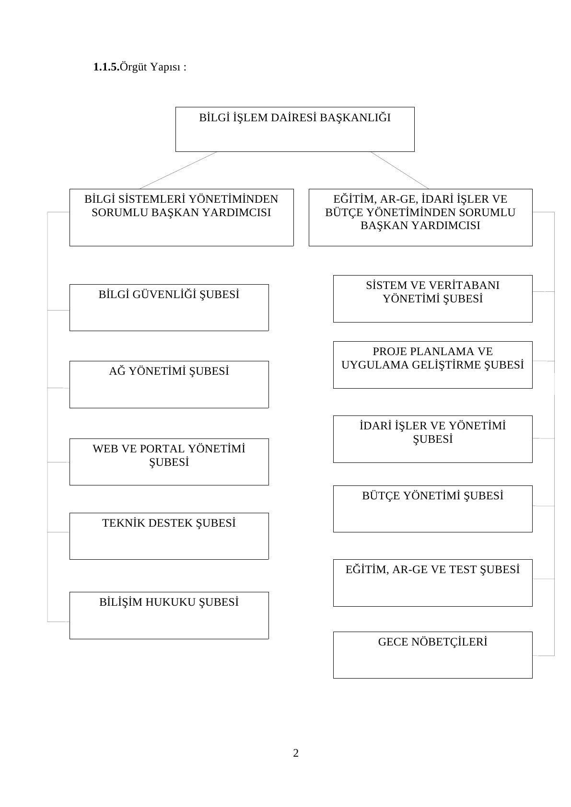
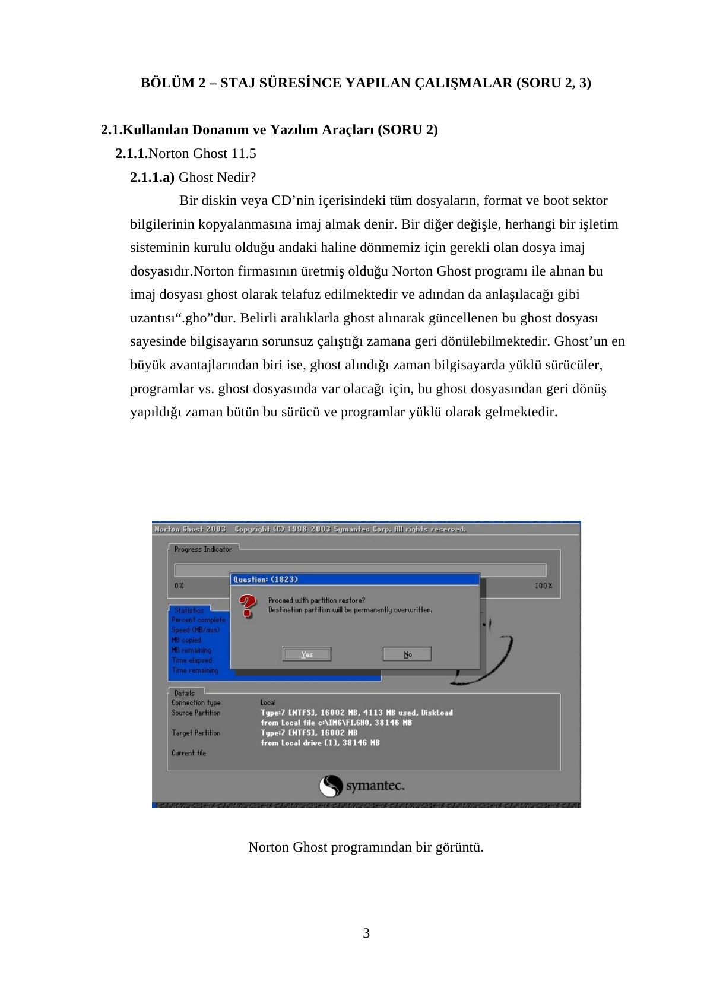
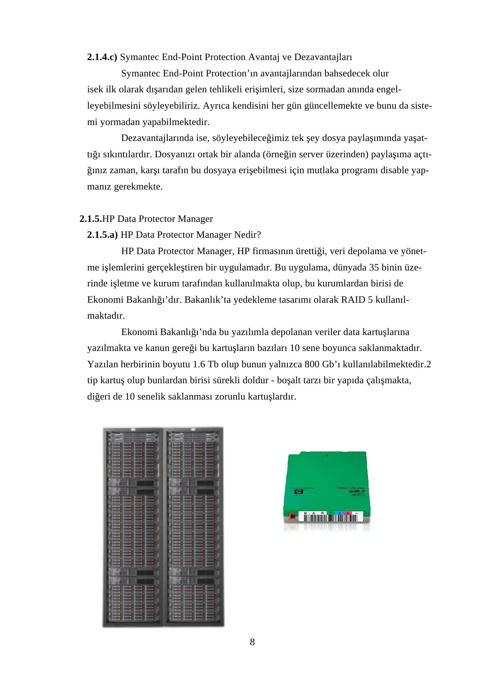
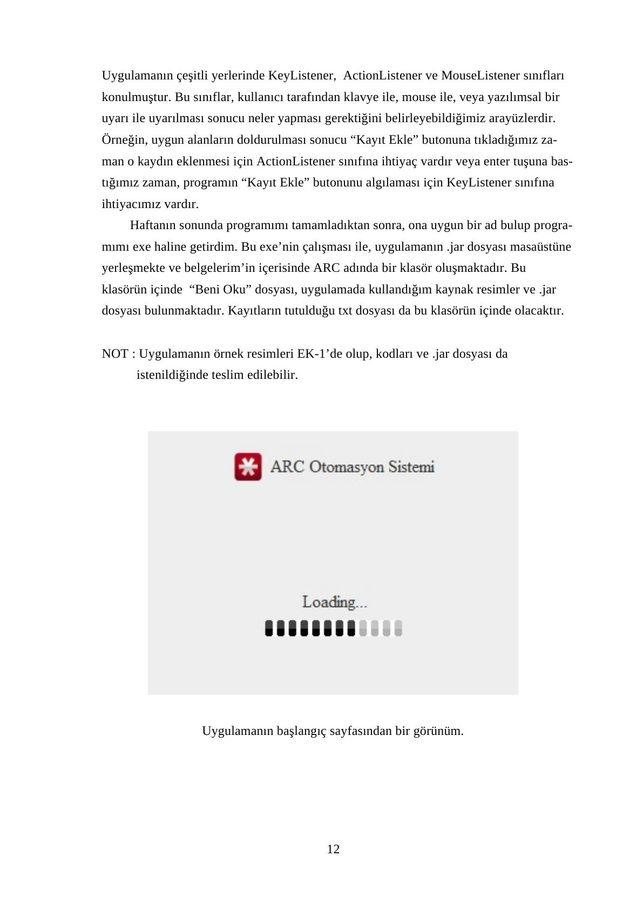

Bu yazı, Başkent Üniversitesi Bilgisayar Mühendisliği **BİL300 stajı** için T.C. **Ekonomi Bakanlığı Bilgi İşlem Dairesi**'nde (Ankara) 1–26 Temmuz 2013 arasında yapılan stajın raporudur. Raporu bir arkadaş hazırlamış; ad, numara, adres ve telefon bilgileri (kapak sayfası) çıkarıldı, yalnızca rapor gövdesi (15 sayfa) alındı. Rapor; kuruluşun tanıtımı, bakanlıkta kullanılan donanım ve yazılım araçları (Ghost, Oracle Database, WebLogic, Symantec, HP Data Protector), haftalık çalışmalar ve kazanımları anlatır. Orijinal sayfalar yazının sonunda PDF olarak indirilebilir.

## Bölüm 1: Kuruluşun genel tanıtımı

### 1.1. Staj yapılan Kuruluşla İlgili Bilgiler

### 1.1.1.Kuruluşun Adı ve Adresi :

Türkiye Cumhuriyeti Ekonomi Bakanlığı İnönü Bulvarı No : 36 Pk : 06510 Emek/ANKARA

### 1.1.2.Kuruluşun Kısa Tarihçesi :

2 Mayıs 1920 tarihinde toplanan Türkiye Büyük Millet Meclisi’nde oluşturulan Bakanlar Kurulu’nda ticaret işlerini de yürüten İktisat Bakanlığı bulunmakta idi. 27 Mayıs 1934 tarihinde kabul edilen 2450 sayılı kanun ile dış ticaret ile alakalı birimler, yeni kurulan Ticaret Bakanlığı bünyesinde Dış Ticaret Reisliği adı altında toplanmıştır. 26 Mart 1971 tarihinde Ticaret Bakanlığı’ndan ayrılan bu kuruluş Dış Ekonomik İlişkiler Bakanlığı haline gelmiş olsa da, kısa zaman içerisinde yeniden yapılanan Ticaret Bakanlığı bünyesinde Dış Ticaret Genel Sekreterliği ismi ile görevini sürdürmüştür. 13 Aralık 1983 tarihli ve 188 sayılı Kanun Hükmünde Kararname ile, Hazine ve Dış Ticaret Müsteşarlığı kurulmuştur. Hazine ve Dış Ticaret Müsteşarlığı, 19 Aralık 1994 tarihinde kabul edilen 4059 sayılı Kanunla Hazine Müsteşarlığı ve Dış Ticaret Müsteşarlığı olarak iki ayrı kuruluş haline getirilmiştir. 8 Haziran 2011 tarihli Kanun Hükmünde Kararname ile Dış Ticaret Müsteşarlığı’nın tüm hizmet birimleri ile Hazine Müsteşarlığı’nın Teşvik Uygulama ve Yabancı Sermaye Genel Müdürlükleri birleştirilerek Ekonomi Bakanlığı kurulmuştur.

### 1.1.3.Son Çıktı Ürünü Tanımları :

SBBUP (Serbest Bölgeler Bilgisayar Uygulama Programı) : Serbest bölgelerde kullanılan, e-imza üzerinden çalışan bir veritabanı sistemi.

DİR (Dahilde İşleme Rejimi) : Dahilde İşleme Rejiminin elektronik ortama taşınma projesi.

DTVS (Dış Ticaret Veri Sistemi) : İthalat ve ihracat denetimlerinin risk esaslı olarak yapılmasına imkân veren web tabanlı bir yazılım.

### 1.1.4.İş görenlerin Sayısı ve Niteliği :

Ekonomi Bakanlığı Bilgi İşlem Dairesi’nde 47 personel görev yapmakta olup, bu personellerin 10 tanesi programcı, 10 tanesi sözleşmeli personel, 9 tanesi şube müdürü, 6 tanesi bilgisayar işletmeni, 3 tanesi V.H.K.İ.(Veri Hazırlama ve Kontrol İşletmeni), 2 tanesi çözümleyici, 2 tanesi teknisyen, 2 tanesi Daire Başkan Yardımcısı, 2 tanesi Daire Başkanı ve 1 tanesi de teknikerdir.

### 1.1.5.Örgüt Yapısı :

BİLGİ İŞLEM DAİRESİ BAŞKANLIĞI BİLGİ SİSTEMLERİ YÖNETİMİNDEN SORUMLU BAŞKAN YARDIMCISI EĞİTİM, AR-GE, İDARİ İŞLER VE BÜTÇE YÖNETİMİNDEN SORUMLU BAŞKAN YARDIMCISI SİSTEM VE VERİTABANI YÖNETİMİ ŞUBESİ BİLGİ GÜVENLİĞİ ŞUBESİ PROJE PLANLAMA VE UYGULAMA GELİŞTİRME ŞUBESİ AĞ YÖNETİMİ ŞUBESİ İDARİ İŞLER VE YÖNETİMİ ŞUBESİ WEB VE PORTAL YÖNETİMİ ŞUBESİ BÜTÇE YÖNETİMİ ŞUBESİ TEKNİK DESTEK ŞUBESİ EĞİTİM, AR-GE VE TEST ŞUBESİ BİLİŞİM HUKUKU ŞUBESİ

## Bölüm 2: Staj süresince yapılan çalışmalar

### 2.1. Kullanılan donanım ve yazılım araçları

### 2.1.1.Norton Ghost 11.5

**Ghost nedir?**

Bir diskin veya CD’nin içerisindeki tüm dosyaların, format ve boot sektor bilgilerinin kopyalanmasına imaj almak denir. Bir diğer değişle, herhangi bir işletim sisteminin kurulu olduğu andaki haline dönmemiz için gerekli olan dosya imaj dosyasıdır.Norton firmasının üretmiş olduğu Norton Ghost programı ile alınan bu imaj dosyası ghost olarak telafuz edilmektedir ve adından da anlaşılacağı gibi uzantısı“.gho”dur. Belirli aralıklarla ghost alınarak güncellenen bu ghost dosyası sayesinde bilgisayarın sorunsuz çalıştığı zamana geri dönülebilmektedir. Ghost’un en büyük avantajlarından biri ise, ghost alındığı zaman bilgisayarda yüklü sürücüler, programlar vs. ghost dosyasında var olacağı için, bu ghost dosyasından geri dönüş yapıldığı zaman bütün bu sürücü ve programlar yüklü olarak gelmektedir.

Norton Ghost programından bir görüntü.

**Norton Ghost kullanımı.** Norton Ghost programının kullanımından önce biostan yapılması gereken ayarlar vardır. Öncelikle bilgisayarın bios menüsüne girilip boot orderdan ilk sıraya cd veya dvd rom getirilmelidir. Ardından SATA Mode bölümünden IDE seçilmelidir. Bu işlemler tamamlandıktan sonra Norton Ghost CD’si takılır ve sistem boot edilir. Sistem tekrar açılıp Norton Ghost CD’sinden boot edildiği zaman karşımıza çıkan menüden Dos Programs seçilir ve karşımıza birkaç seçenekli bir menü çıkar. Burada sırası ile Backup Tools / Norton Ghost 11.5 / Ghost(Normal) seçeneklerini seçerek programımızın arayüzüne ulaşırız. Arayüze ulaştıktan sonra ise ne yapacağımız önemli. Burada iki seçenek var. Birincisi bilgisayardan imaj dosyası çekmek, ikincisi ise bilgisayara imaj dosyasını yüklemek. Eğer imaj dosyası çekilmek isteniyor ise arayüzden sırası ile Local / Partition / to Image seçenekleri seçilir, ardından da imajını alacağımız partition ( örn. C: veya D:) seçilir ve imaj dosyası başarılı bir şekilde çekilmeye başlar. Eğer bilgisayara imaj dosyası yüklenmek isteniyor ise, imaj dosyası çekilirken seçtiğimiz to Image seçeneği yerine from Image seçeneği seçilir ve yine imajı yükleyeceğimiz partition seçilerek imaj dosyası başarılı bir şekilde yüklenmeye başlar. İmajı yükleme işleminde, yüklenecek olan imaj dosyası bir harici bellekte veya bilgisayarın bir partitionunda olabilir. Bunun seçimi de from Image seçeneği seçildikten sonra yapılmaktadır.

Norton Ghost programının bize sunmuş olduğu bir başka avantaj ise bu imaj yükleme ve imaj alma işlemini disk to disk şeklinde yapabilmemizdir. Bu işleme ise klonlama denmektedir. Klonlamanın, normal imaj işlemlerinden farkı, bir hard disk içerisindeki bütün bilgi ve partitionların aynısının diğer diske kopyalanmasıdır. Sorunsuz bir imaj dosyasını içinde bulunduran diskten, diğer bir diske kolayca kurulum yapılabilmektedir. Bu işlemin yapımında ise, normal imaj dosyası alımı ve yüklenmesi işleminde seçtiğimiz partition bölümü yerine disk bölümü seçilir ve diğer bütün işlemler aynı olacak şekilde ghost işlemi tamamlanır.

### 2.1.2.Oracle Database

**Veritabanı nedir?**

Veritabanı, birçok kullanıcı tarafından kullanılan geniş ve düzenli bilgiler topluluğudur. Bu geniş veri kümesinin düzenlenmesi, depolanması ve sorgulanması için birçok üretici firma tarafından veritabanı yönetim sistemleri üretilmektedir. Bu sistemlere Oracle Database, Microsoft Access, Microsoft SQL Server ve Sybase’i örnek olarak verebiliriz. Bu sistemlerin ortak özelliği, ilişkisel veritabanı teknolojisini kullanmalarıdır. İlişkisel veritabanı sistemlerinde veriler tablolarda satır ve sütunlar halinde tutulmakta olup, bu sistemlerde yüksek veri tutarlılığı vardır. 2.1.2.b) Oracle Database nedir?

Oracle Database bir ilişkisel veritabanı yönetimi sistemi olup, halihazırda Ekonomi Bakanlığı’nda kullanılmaktadır. Bu sistemin Standard, Standard One ve Enterprise olmak üzere 3 tane sürümü vardır. Ekonomi Bakanlığı’nda Enterprise sürümü kullanılmaktadır. Bu veritabanı yönetimi sistemi java tabanlıdır ancak komutlar SQL dilindedir. Örneğin “SHUTDOWN NORMAL” bir komut olup SQL dilindedir ve bu sistemde kullanılmaktadır. Oracle Database Komut Girme Bölümü 2.1.2.c) Oracle Database Enterprise Edition Özellikleri

- Büyük miktarlarda veri tutabilme ve verilerin depolandığı alanları ayarlayabilme imkanı. Uzun süreli kapatılmamasına rağmen çalışabilme özelliği. Sunucu, ortam ve kullanıcı hatalarına karşı yüksek koruma ve yüksek veri güvenilirliği. Erişim yetkilerini kontrol edebilme ve yetkisiz erişimleri engelleme. Tüm işletim sistemleri, veri erişim dilleri ile uyumlu çalışabilme. Yüksek performanslı veri depolama ve data mining (veri madenciliği) uygulamalarını içermesi. Satır bazında güvenlik (unique row-level security) sağlaması.

### 2.1.3.Oracle Web Logic

**Oracle Web Logic Nedir?**

Oracle Web Logic bir uygulama yazılımı sunucusu olup, şuanda dünyada en çok tercih edilen kurumsal Java tabanlı uygulama yazılımı sunucusudur.İş kritikliği yüksek, devamlılık ve yüksek performans isteyen kurumların tercihinde hep en öndedir. Rakiplerine oranla sağladığı yüksek performans ve verimle, işletmelerin maaliyetlerini düşürmesine yardımcı olmaktadır.

**Oracle Web Logic Özelikleri**

- Oracle Web Logic Uygulama Sunucuları, rakiplerine oranla çok ciddi performans ve verimliliğe sahiptir. Stres toleransı yüksek JRocket ile uygulamalara hız kazandırır. .NET desteği ile web servisleriyle uyumlu çalışabilmektedir. Web Open Source desteği sayesinde web üzerinden kolay yönetilebilmektedir. Yüksek erişilebilirlik sağlar. Geliştirme araçları (Developing Kit) ile entegre çalışabilmektedir. Yapılan bağımsız araştırmalarda, aynı donanım konfigürasyonu kullanılarak karşılaştırılan uygulama sunucuları arasında, performans ve verim olarak en iyi uygulama sunucusu Oracle Web Logic olmuştur.

### 2.1.4.Symantec End-Point Protection

**Symantec End-Point Protection Nedir?**

Symantec End-Point Protection, güvenlik ve bilgi yönetimine yoğunlaşmış Symantec firmasının çıkarmış olduğu, bir antivirüs ve kişisel güvenlik duvarıdır. Ekonomi Bakanlığı bünyesinde güvenlik sistemi olarak Symantec End-Point Protection kullanılmaktadır. Örneğin web sunucularında kullanılan firewall sayesinde, zararlı içerikler engellenmektedir.

WEB SUNUCUSU UYGULAMA SUNUCUSU FİRE WALL FİRE WALL Firewall’ların ağdaki dağılımı 2.1.4.b) Symantec End-Point Protection Özellikleri

- Bulut sistemlerle entegre oluşu. Ağ erişim noktalarında yüksek güvenlik sağlaması. Merkezi yönetim sağlaması. Server ve bilgisayarları birlikte koruyabilme yapısı. DATA BASE 2.1.4.c) Symantec End-Point Protection Avantaj ve Dezavantajları Symantec End-Point Protection’ın avantajlarından bahsedecek olur isek ilk olarak dışarıdan gelen tehlikeli erişimleri, size sormadan anında engelleyebilmesini söyleyebiliriz. Ayrıca kendisini her gün güncellemekte ve bunu da sistemi yormadan yapabilmektedir. Dezavantajlarında ise, söyleyebileceğimiz tek şey dosya paylaşımında yaşattığı sıkıntılardır. Dosyanızı ortak bir alanda (örneğin server üzerinden) paylaşıma açtığınız zaman, karşı tarafın bu dosyaya erişebilmesi için mutlaka programı disable yapmanız gerekmekte.

### 2.1.5.HP Data Protector Manager

**HP Data Protector Manager Nedir?**

HP Data Protector Manager, HP firmasının ürettiği, veri depolama ve yönetme işlemlerini gerçekleştiren bir uygulamadır. Bu uygulama, dünyada 35 binin üzerinde işletme ve kurum tarafından kullanılmakta olup, bu kurumlardan birisi de Ekonomi Bakanlığı’dır. Bakanlık’ta yedekleme tasarımı olarak RAID 5 kullanılmaktadır. Ekonomi Bakanlığı’nda bu yazılımla depolanan veriler data kartuşlarına yazılmakta ve kanun gereği bu kartuşların bazıları 10 sene boyunca saklanmaktadır. Yazılan herbirinin boyutu 1.6 Tb olup bunun yalnızca 800 Gb’ı kullanılabilmektedir.2 tip kartuş olup bunlardan birisi sürekli doldur - boşalt tarzı bir yapıda çalışmakta, diğeri de 10 senelik saklanması zorunlu kartuşlardır.

### 2.2. Stajda yapılan çalışmalar

### 2.2.1.Sistem ve Veritabanı Yönetimi (01-05/Temmuz)

Stajıma başladığım ilk hafta beni Sistem ve Veritabanı Yönetimi Şubesi’ne verdiler. Bu birimde bütün bakanlığın ve Serbest Bölgeler’de ticaret ile uğraşan kişilerin verilerinin tutulduğu veritabanı yönetim sisteminin kontrolü ve acil durumlarda müdahalesi yapılmaktadır. İlk olarak benden veritabanları hakkında bir araştırma yapmam istendi. Özellikle ilişkisel veritabanı sistemleri ve triggerlar(tetikleyici) üzerinde durmam belirtildi. İlişkisel veritabanı sistemlerinde, büyük miktarlardaki veriler tablolarda satır ve sütunlar halinde tutulmakta olup, birden fazla kullanıcıya aynı anda erişim imkanı sağlanır. Trigger kodları ise ilişkisel veritabanları üzerinde çalışan kodlar olup; ekleme, silme veya güncelleme işlemlerinden önce veya sonra çalışabilmekte ve belirli işlemleri kodlandığı şekilde yerine getirmektedir.

Bu birimde her akşam ayrı ve her ay ayrı olmak üzere yedekler alınmaktadır. Geldiğim ilk gün ay başında alınması gereken yedek alınmaya başlandı ancak yedek alma işlemi çok uzun sürüyordu ve aradan 2-3 gün geçmesine rağmen bu yedek alma işlemi tamamlanamamıştı. Bu sıkıntının yanında ayrıca, özellikle SSBUP programının bulunduğu serverda bir takım sıkıntılar yaşandı. Genellikle kullanıcılar EJB hatası aldıklarına dair bildirimler yapıyorlardı. Bu gibi alınan hatalarda ilk olarak sistem loglarını kontrol ediyorduk. Sistem loglarında hangi serverın çalışıp, hangisinin çalışmadığı görülebilmekte olup, bunların detayları (örn. işlem süresi) incelenebilmektedir. SSBUP programının bulunduğu serverda hata ile karşılaşıldığında hata giderilemez ise, program başka bir servera taşınıyordu. Yapılan konuşma ve değerlendirmelerde serverların uzun süre reboot edilmediği ve belki de sorunun bundan kaynaklandığı kanısı ortaya çıktı ancak genel olarak bir network arızasının üzerinde duruldu.

Sistemde oluşan bir hatadan sonra incelediğimiz loglarda, genel olarak karşılaştığım hata birisi de “connection timeout” hatası. Bu hatanın açıklaması ise kullanıcının sisteme bağlanmak istemesi ancak sistemin belirlenen cevap verme süresini aşması ve cevap vermemesidir.E-imza kullanan uygulamalarda genellikle bu hatalar ile karşılaşılmaktadır. Karşılaştığımız sıkıntılarda uzun bir çalışmama süresi yoktu, sadece kısa dönemli kesilmeler yaşandı. Bu da sorunların uygulama kaynaklı olmadığını göstermekteydi.

Bu hafta ayrıca sistem odasına gittim ve oradaki yedekleme sistemlerini, veritabanı sunucularını ve diğer donanımları yakından inceleme fırsatım oldu. Sistem odasının girişinde parmak izi tanıma sistemi mevcut ve yabancı kişiler bu odaya girememekte. Sistem odası için önemli özelliklerden bir tanesi soğutma yangın söndürme sistemlerinin. Sistem odasını incelediğim zaman bunların hepsi eksiksiz idi ayrıca kablo yönetimi de oldukça başarılı idi. Aranan bir kablo istenildiğinde kolayca bulunabilecek durumdaydı. Daimi çalışan güvenlik kameraları ile oda içerisi kayıt altına alınmaktaydı. Soğuk hava akışı zeminden gerçekleşeceği için kabloların zeminin üzerini kapatmaması gereklidir. Bakanlığın sistem odasında da kablolar zeminden değil tavan kısmından geçirilmişti. Bu hafta içerisinde data kartuşlarını veritabanı birimde kontrol ettik ve 1 tane slotun boş olduğunu ayrıca 5 tane data kartuşunun da boyutunun dolmuş olduğunu gördük. Yanımda bir personel ile sistem odasına indim ve kartuşları değiştirdim. Burada kartuşlar ikiye ayrılmakta. İlki, sürekli doldur boşalt yapılan kartuşlar diğeri ise dolduğu zaman 10 senelik süre ile saklanması gereken kartuşlar. Bu kartuşları değiştirdikten sonra saklanması gereken kartuşları yerlerine koyduk ve HP Data Protector programından kartuşları kontrol ettik. Kartuşlarda bir sıkıntı yoktu, hepsi gözüküyordu. Şimdi yapmamız gereken ise onları biçimlendirmekti. Bu biçimlendirme işlemi sırasında, kartuşa ne ile ilgili yedek alınıyorsa, kartuşu o formata göre biçimlendiriliyor ve bu format, biçimlendirme ayarları sırasında seçiliyordu. Gerekli ayarları yaptık ve biçimlendirme işlemini tamamladık.

Her gün alınan yedeğin alınma mantığını açıklayacak olur isek, adımlı yedek diyebiliriz. Bu yedekleme türünde son yedekten bu yana yedeklenmemiş olduğu tespit edilen (Archive attribute) dosyalar yedeklenmektedir. Ay başlarında alınan yedekler için ise fark yedek diyebiliriz. Bu yedekleme türünde de, son tam yedekten itibaren yedeklenmeyen dosyalar incelenir ve bunlar yedeklenir. Bu yedek türü için ise 1 kere tam yedek alınmak zorundadır.

### 2.2.2.Proje Planlama ve Uygulama Geliştirme Bölümü (08-12/Temmuz)

Stajımın ikinci haftasında Proje Planlama ve Uygulama Geliştirme Bölümü’ne geldim. Bu bölümde bakanlığa bağlı uygulamaların (DİR, SBBUP vs.) planlaması ve geliştirilmesi gerçekleşmekte. Bu birimdeki çalışmaların bazıları CyberSoft yazılım firması ile ortak yürütülmektedir. Geliştirilen bu uygulama ve programlar Java tabanlı olarak hazırlanmaktadır. Bu hafta benden bir Java uygulaması geliştirmem istendi. Java ile nasıl bir uygulama geliştirebilirim diye düşündüm. Bu uygulama, hem günlük hayatta kullanıcıların faydalanabileceği bir uygulama olmalıydı hem de tasarım olarak hoş durmalıydı. Bunları bir arada değerlendirdikten sonra Java uygulamaları için grafiksel tasarım yapmaya karar verdim. Bunun için de Sun firmasının Java için geliştirdiği devasa bir bileşen seti olan Swing kütüphanesini kullandım. Swing sayesinde Java tabanlı, grafiksel arayüze sahip bir uygulama yapılabilmektedir. Bunun yanında Swing kütüphanesinin en önemli özelliklerinden birisi de işletim sistemlerinin sağladığı API’lere (Uygulama Programlama Arayüzü) muhtaç olmamasıdır. Yani Swing ile geliştirilen bir uygulama; Windows, Linux, Mac OS işletim sistemlerinde aynı görünüme sahiptir.

Programımdan bahsedecek olursam, program çalıştırıldığı zaman, karşımıza gelen “Yükleniyor” yazısından sonra kullanıcı adı ve şifre ile giriş yapılan sayfa gelmekte. Bu sayfada kullanılacak kullanıcı adı ve şifre programda tanımlı ancak kullanıcı bazlı hesap geliştirmesine uygundur. Daha sonra basit olarak girilecek bilgilerin olduğu alanlar var. Girdiler tamamlanıp “kayıt ekle” butonuna tıklandıktan sonra kayıt eklenmekte. Bu kayıtlar belgelerimin içerisinde bir txt dosyasına kaydedilmekte. Bilgi görüntüleme kısmında ise istenen bilgi arama bölümüne yazılıyor ve yazılan kelimenin geçtiği kayıtlar ekrana düşüyor. Eğer arama yerine bilgi girilmez ise, bütün kayıtlar ekrana düşüyor. Uygulamamın kodlamasında Eclipse IDE kullandım. Test etme ve ufak kodları derleme işlemlerim içinse NetBeans IDE’den yararlandım.

Uygulama genel olarak 5 adet sınıftan oluşmaktadır. Bu sınıflar, başlangıç sayfası frame’ini, kullanıcı giriş sayfası frame’ini, kayıt ekleme frame’ini, bilgi görüntüleme frame’ini ve lisans sözleşmesi frame’ini içermektedir. Her sınıfın içerisinde kullanımlarına göre textbox, combobox, textarea, button, textfield bulunmaktadır. Frame’lerin, setResizable() fonksiyonu ile, tam ekran yapılabilme özelliği kapatılmıştır. Her sınıfın içinde, panel eklendikten sonra setLayout() fonksiyonu ile üzerindeki şeyler temizlenmiş ve her eklenen özellik setBounds() fonksiyonu ile uygun yerlerine koyulmuştur. Uygulamanın çeşitli yerlerinde KeyListener, ActionListener ve MouseListener sınıfları konulmuştur. Bu sınıflar, kullanıcı tarafından klavye ile, mouse ile, veya yazılımsal bir uyarı ile uyarılması sonucu neler yapması gerektiğini belirleyebildiğimiz arayüzlerdir. Örneğin, uygun alanların doldurulması sonucu “Kayıt Ekle” butonuna tıkladığımız zaman o kaydın eklenmesi için ActionListener sınıfına ihtiyaç vardır veya enter tuşuna bastığımız zaman, programın “Kayıt Ekle” butonunu algılaması için KeyListener sınıfına ihtiyacımız vardır.

Haftanın sonunda programımı tamamladıktan sonra, ona uygun bir ad bulup programımı exe haline getirdim. Bu exe’nin çalışması ile, uygulamanın .jar dosyası masaüstüne yerleşmekte ve belgelerim’in içerisinde ARC adında bir klasör oluşmaktadır. Bu klasörün içinde “Beni Oku” dosyası, uygulamada kullandığım kaynak resimler ve .jar dosyası bulunmaktadır. Kayıtların tutulduğu txt dosyası da bu klasörün içinde olacaktır. NOT : Uygulamanın örnek resimleri EK-1’de olup, kodları ve .jar dosyası da istenildiğinde teslim edilebilir.

Uygulamanın başlangıç sayfasından bir görünüm.

### 2.2.3.Teknik Destek Bölümü (15-26/Temmuz)

Stajımın son iki haftasında Teknik Destek bölümündeydim. Bu bölümde, bakanlık bünyesindeki bilgisayarlarda yaşanan teknik aksaklıklar giderilmektedir. Bu aksaklıklara örnek verecek olursak; özellikle HP 8000 serilerinde meydana gelen bir sıkıntı olan, elektrik kesintisiyle birlikte işletim sisteminin göçmesi ve donanımsal olarak gerçekleşen sıkıntılardan bahsedebiliriz.

Bu birimdeki ilk haftamda, ghostun ne olduğunu ve nasıl yapıldığını öğrendim. Bilgisayarın işletim sisteminde meydana gelen bir arızada, bu arızadan çalışır duruma geri dönülmesi için kullanılan ghost, sürücü ve programların yüklü gelmesinden dolayı zamandan büyük bir kazanç sağlamaktadır. (Ghost kullanımı 2.1.1.b ‘dedir.). Ghost kullanarak geri dönüş yaptıktan sonra, bilgisayarı domain etki alanına ekleme işlemi, mail ayarı, antivirüs ve Windows güncelleştirmeleri yapılmaktadır. Domain’e kullanıcıyı eklememiz için öncelikle bilgisayar sahibi personelin kullanıcı adı ve bilgisayar adının bilinmesi gerekmektedir. Personelin kullanıcı adı genellikle soyadının sonuna isminin ilk harfinin eklenmesiyle oluşan kelime olmaktadır. Bilgisayar adı ise çalıştığı birimin yanına üç haneli bir sayının eklenmesiyle oluşan kelimedir.( Örn. PER140) Bu işlemlerden sonra öncelikle bilgisayarın çalışma grubu XX’e alınmakta ve ardından da Sistem Özellikleri/Bilgisayar Adı seçeneklerinden Ağ Kimliği seçilerek gerekli ayarlamalar yapılmakta ve bilgisayar domaine eklenmektedir. Bu birimdeki ilk ve ikinci haftamda yaptığım bilgisayar kurulumlarında bu işlemleri yaptım. Bu birimde yaptığım bir başka çalışma ise RAM, hard disk, ana kart ve harici ekran kartlarını sökmek, incelemek ve bunları tekrar uygun kabloları yerlerine bağlayarak bilgisayar kasasına monte etmek oldu. Örneğin ikinci haftamda makam katından gelen bir bilgisayarda ekrandan görüntü alınamıyordu. Bilgisayarda harici ekran kartı kullanılmaktaydı. Öncelikle harici ekran kartının ana kart üzerindeki soketlere tam oturup oturmadığını inceledim ancak bir sıkıntı yoktu fakat daha sonra RAM’lerin, anakart üzerindeki yuvalarına tam oturmadığını farkettim ve RAM’leri yuvalarına düzgün bir şekilde yerleştirdikten sonra bilgisayarın ekranından görüntü almaya başladım. İkinci haftamda ise aynı şekilde makam katından bir bilgisayar geldi. Bu bilgisayarda ise networke bağlanamama sıkıntısı vardı. Yetkili servise anakartın verilmesi için anakartı söktüm. Bu sökme işleminde öncelikle anakart üzerindeki soketlerden kabloları çıkarttım, ardından CPU fanının vidalarını söktüm. Daha sonra da anakartın vidalarını söktüm ve anakartı servise teslim ettik.

Bu birimdeki ikinci haftamda yaptığım bir diğer şey de, bilgisayarın administrator şifresini kırmaktı. Bu işlem için öncelikle admin kırma cdsini takıyoruz ve bilgisayarı cdden boot ediyoruz. Karşımıza çıkan ekranda lisans koşullarını kabul ettikten sonra Next seçeneği ile ilerleyip “Account Disabled” kutucuğundaki işareti kaldırıyoruz ve Save ile ilerleyip şifreyi kırmış oluyoruz.

Bakanlıktaki bilgisayarlara işletim sistemleri kurulurken, sistem dosyaları C: bölümüne kurulmaktadır. D: bölününe ise imaj dosyası ve driverları konulmaktadır.Kullanıcıya ise bilgilerini D: bölümünde tutmaları uyarısı yapılmaktadır. Ancak bu uyarıya uymayan bazı kullanıcılar, elektrik kesintisi ile çöken işletim sistemiyle birlikte birlikte bilgilerine ulaşamıyorlar. İkinci haftamda böyle bir durumla ben de karşılaştım. Kullanıcı bilgilerini kurtarmak istiyordu.Bunun için öncelikle kullanıcının bilgisayarından harddiskini söktüm. Bunu yaparken önce power kablosunu çıkarttım ardından da harddiskin sata kablolarını söktüm ve harddiski yuvasından çıkarttım. Ardından usb bağlantısı ile harddiskleri okuyabildiğimiz harddisk kutusuna, harddiski yerleştirdim ve usb kablosunu bağladığım bilgisayarı usbden boot ettim. İşletim sistemi normal bir şekilde açıldı ve kullanıcı bilgilerini kendisi seçerek kurtardı.

## Bölüm 3: Stajın genel değerlendirmesi, kazanımlar

### 3.1.Stajda Sağlanan Yarar ve Kazanımlar

### 3.1.1. Staj Boyunca Yapılanların Genel Değerlendirilmesi

Stajım boyunca yaptığım bütün çalışmaları özetleyecek olursam :

- Veritabanı yönetim sistemi sistem loglarını incelemek.
- Trigger ( Tetikleyici ) , ilişkisel veri tabanı sistemleri ve ejb hataları hakkındaki araştırmalar.
- Sistem odasındaki donanımları tanımak.
- Back-up sunucusundaki data kartuşlarının değişimi.
- Java programlama dili ile uygulama geliştirme.
- Bilgisayarın donanım birimlerinin tanınması ve bunlarla yaptığım işlemler
- Ghost ile çalışır sisteme geri dönüş.
- Veri kurtarma.

### 3.1.2. Stajdan Sağlanan Yarar

Bu staj boyunca, okulda test ederek tanıma imkanımın olmadığı donanım birimleri hakkında bilgiler edindim. Ayrıca java programlama dili ile geliştirmiş olduğum uygulama sayesinde, bu programlama dilinde ilerleme kaydettim. Öte yandan veritabanı ve veritabanı sistem yönetimleri hakkında birçok bilgi sahibi oldum ve bilgi işlem birimlerinin işleyişini kavradım. Bu birimlerin çalışma ortamını gördüm, kullanılan yazılım ve donanımlar hakkında önemli şeyler öğrendim. Bu stajın başka bir olumlu yanı da, okulda öğrenmiş olduğum bilgileri, bu stajda pratiğe dökmemdir.

