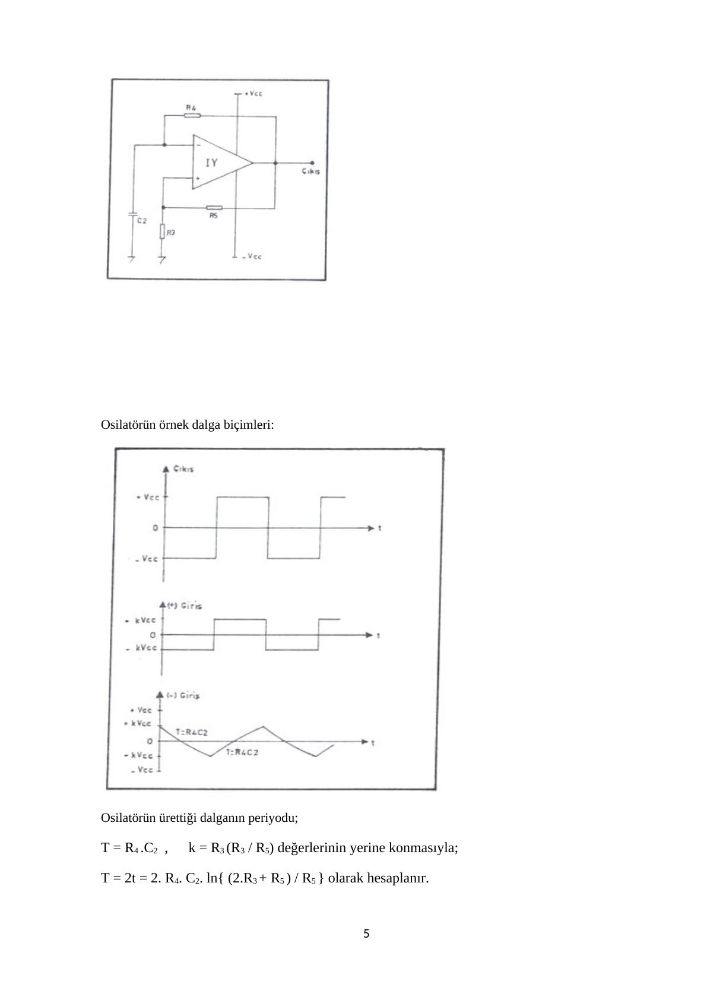
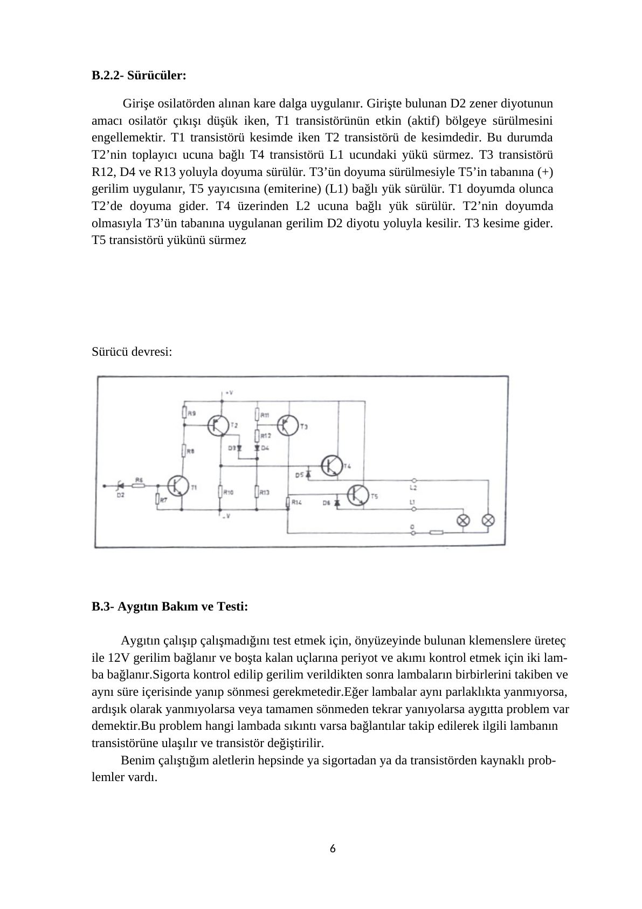
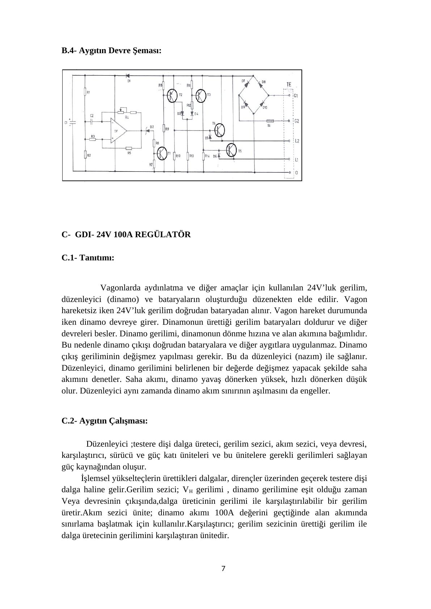
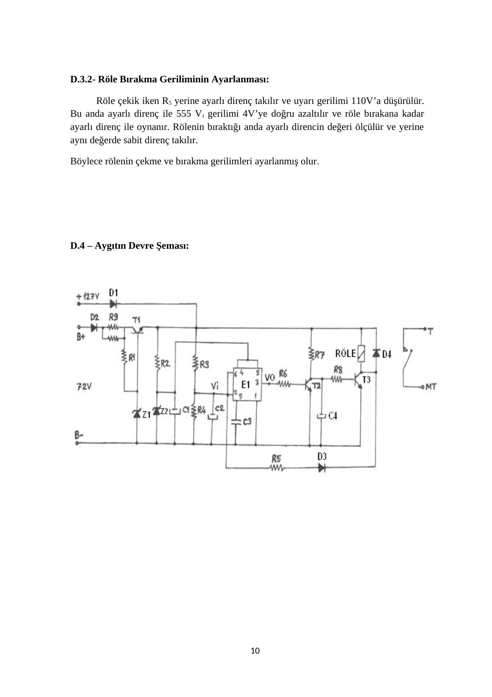
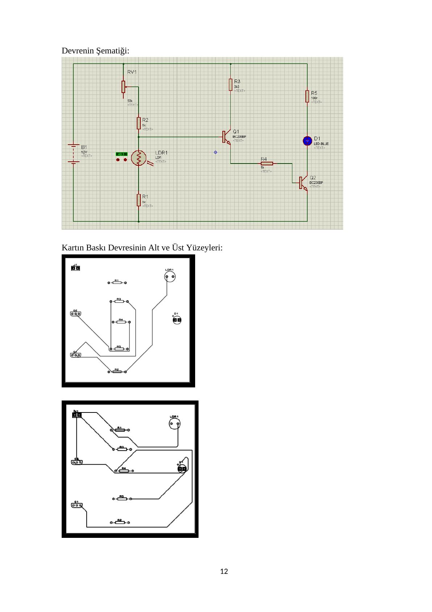

This post is the report of the internship carried out at the TCDD 2nd Regional Directorate **Electronics Maintenance and Repair Center Directorate** (Gar/Ulus, Ankara) for the **EEM300 internship course** of the Electrical and Electronics Engineering Department at Başkent University. The report was prepared by a friend (October 2013); names, student numbers, and the names of institutional officials have been removed. The report is 14 pages long; the original pages can be downloaded as a PDF at the end of the post. For the text of an older internship logbook from the same unit, see the post [TCDD EAM Stajer Staj Notları](/arsiv/staj-tcdd-eam-stajer-staj-notlari-2009/).

## Section 1: General Introduction of the Organization

**Name and address:** TCDD 2nd Regional Directorate, Electronics Maintenance and Repair Center Directorate (EBOM), Talatpaşa Boulevard, Gar/Ulus, Ankara.

**History:** EBOM was established by the authorization decision no. 23/221 of the TCDD Board of Directors dated 07.06.1973, in order to carry out research and development, repair, and manufacturing work on existing and future electrical-electronic systems within TCDD in the best and most economical way.

**Parent organization:** TCDD operates under the Ministry of Transport; EBOM carries out its work through the Research and Development Technical Directorate and the Manufacturing and Repair Technical Directorate, within the framework of regulations, statutes, and other legislation.

**Number of employees:** 18 people in total, including 4 electrical-electronics engineers, 7 technicians, 3 workers, and the director and chiefs.

**Status:** State Economic Enterprise (KİT); its capital structure is affiliated with the Undersecretariat of the Treasury.

**Areas of activity:** Research, development, maintenance, and repair. Schematics and general designs of the electronic devices and circuit boards found on trains are prepared and tested; damaged or non-working electronic devices are maintained and repaired; research is carried out to make existing devices operate more efficiently.

**Organization chart (Appendix 1):** Director, facilities chief, office chief; under them are engineers, senior technicians, technicians, and workers (the names in the chart in the report's appendix have been removed).

**Production and working method:** No manufacturing is done at EBOM. Circuit boards and schematics are designed in the unit, and their production is done by contracted firms; boards and device enclosures coming from the firms are assembled in the unit together with components such as transformers and heat sinks, and then assembly and testing are carried out. Since board production is cheaper in the private sector, boards are not produced in the unit; designs are made with the ISIS modeling program.

**Computer use:** The unit has 12 computers; research, design, records of incoming and outgoing equipment, stock control, and administrative and financial affairs are handled with these computers.

## Section 2: Work Done During the Internship

During the internship, work was done on the maintenance, repair, and testing of electronic devices used on trains, such as rectifiers, flashers, regulators, YS1, relays, and converters; in addition, the supervising engineer demonstrated the ISIS and ARES processes of the Proteus program, and a small circuit was designed.

### Week 1: 12 V 3 A Rectifier (Battery Charger)

**Introduction:** It is designed to supply TMİ and service substations. The output voltage can be adjusted between 3–20 V, and the maximum output current between 0–3.5 A.

**Operation, use, and maintenance:** The device has red, green, and orange LEDs. When 220 V mains is applied, the green LED, indicating that the device is operating, lights up; if the battery is empty, the orange LED lights up; when excessive current is drawn, the red LED lights up.

When the mains voltage is connected, it is first checked whether voltage reaches the inputs and outputs. If no voltage arrives, the cause is either a blown 5 A protective fuse or a faulty transformer in the device; the fuse is replaced first, and if the problem persists, the transformer is replaced and testing begins. For measurement, a multimeter is used, and a load is connected to the device output to observe the current limiting. With the multimeter on the DC range, the output voltage should read **13.8 V** and the short-circuit current at most **1.5 A**; if not, the output voltage is adjusted with the voltage pot on the board. The current and voltage are monitored while varying the resistance of the externally connected load; according to Ohm's law (V = I·R), the current increases as the resistance decreases. If the current exceeds 3 A, it is limited with the current pot on the board.

The Iled pot on the board is adjusted so that the red LED lights in a possible overcurrent condition; the lighting point is set as the point at which the output voltage begins to drop. In general, the overcurrent LED should light when the output voltage falls below 11 V.

If the desired values are still not obtained despite all adjustments, the problem is in the circuit board. The integrated circuit on the board may not have been adjusted: with the socket empty, pins 3 and 8 are shorted, and in this case the voltages at pins 5 and 6 should be equal (adjusted with the Valt pot). With the IC installed, the value at pin 11 should be half of the value at pin 2, with the opposite sign (adjusted with the Vüst pot). If the device still does not work after these, the board is replaced with a new one and the steps are repeated. The report's author worked most on these rectifier devices.

### Week 2: YS1 (Flasher)

**Introduction:** It is designed to be used in place of the PF 256 relay in the CTC signaling system. It operates with alternating or direct voltage. The on-off frequency is 1 ± 0.1 Hz. It has two outputs that are complementary to each other, each able to drive 3 A. The lower and upper limits of the operating voltage in AC and DC are 12 V and 28 V. It is enclosed so that it can be connected to the relay rack like other relays.

**Operation:** The flasher consists of an oscillator that generates a square wave and two drivers, one driven by the complement of the other. A diode bridge is provided so that it can be supplied with both AC and DC. In AC, the drivers are supplied with the full-wave rectified voltage, while the oscillator is supplied with the smooth DC voltage obtained by filtering this voltage. In DC, the diode bridge ensures that the voltage is delivered to the circuit with the proper polarity.

**Oscillator:** The oscillator that generates the square wave is an astable multivibrator built with an operational amplifier. The period of the generated wave is calculated, by substituting T = R4·C2 and k = R3(R3/R5), as

T = 2t = 2·R4·C2·ln((2·R3 + R5) / R5)

**Drivers:** The square wave from the oscillator is applied to the input. The zener diode D2 at the input prevents transistor T1 from being driven into the active region when the oscillator output is low. While T1 is cut off, T2 is also cut off; in this case T4, connected to the collector terminal of T2, does not drive the load at terminal L1. Transistor T3 is driven into saturation through R12, D4, and R13; with the saturation of T3, a (+) voltage is applied to the base of T5, and the load connected to the emitter of T5 (L1) is driven. When T1 saturates, T2 also goes into saturation; the load connected to terminal L2 is driven through T4. T2 being in saturation cuts off, through D2, the voltage applied to the base of T3; T3 goes into cutoff and T5 does not drive its load.

**Maintenance and testing:** 12 V is connected from a generator to the terminals on the front panel, and two lamps are attached to the unused terminals to check the period and current. After the fuse is checked and voltage is applied, the lamps should flash one after the other, each lit for the same duration. If the lamps do not light with the same brightness, do not light consecutively, or come on again without going completely out, there is a problem in the device; the connections of the relevant lamp are traced to reach its transistor, and the transistor is replaced. In all the devices the report's author worked on, the problem was caused by either the fuse or a transistor.

### Week 2: GDI 24 V 100 A Regulator

**Introduction:** The 24 V used in railcars for lighting and other purposes is obtained from a system consisting of a regulator, a dynamo (generator), and batteries. When the railcar is stationary, the 24 V is taken directly from the battery; when the railcar is moving, the dynamo comes into operation, charges the batteries, and supplies the other circuits. The dynamo voltage depends on rotation speed and field current; for this reason the dynamo output is not applied directly to the batteries, and the regulator controls the field current so as to keep the dynamo voltage constant at a certain value. The field current is high when the dynamo rotates slowly and low when it rotates fast. The regulator also prevents the dynamo current limit from being exceeded.

**Operation:** The regulator consists of a sawtooth wave generator, a voltage sensor, a current sensor, an OR circuit, a comparator, a driver, and a power stage, together with the power supply that provides the necessary voltages to them. The current sensor is used to start limiting the field current when the dynamo current exceeds 100 A; the comparator compares the voltage produced by the voltage sensor with the voltage of the wave generator. When the V_H voltage is greater than the dynamo voltage and the current driven by the dynamo is less than 100 A, the device begins its regulating function; the dynamo voltage is kept constant by sending pulsed current to the dynamo's field winding. When V_H is higher than the charging voltage, no current is sent to the field winding, and the dynamo voltage and current are held constant. These operations take place very quickly and in succession when needed.

**Maintenance and testing:** Since the voltage and current adjustments are made during manufacture, no adjustment is needed under normal conditions; only the automatic field winding fuse on the side panel must be installed (if it is blown, no current flows through the field winding and the dynamo does not produce voltage). During testing, the fuse is checked first; the dynamo voltage is set to **29.5 V**, and the lamp and battery voltage to **28 V**. While holding these voltages constant, the load is increased so that the dynamo current reaches up to **90 A**. If the current cannot reach 90 A, or if the dynamo voltage drops excessively while approaching it, there is a problem in the device; the voltages are measured by following the circuit diagram, and components such as diodes, resistors, and transistors are checked and replaced if necessary.

### Week 3: Q33 Overvoltage Protection Relay

**Introduction:** The Q33 relay is designed to prevent overvoltage in the heating block of DE09 (24000 type) locomotives equipped with electric heating. When a voltage greater than 127 V arrives at the 127 V input terminals, the T-MT terminals are short-circuited, the Q60 system is energized, and the overvoltage is prevented. When the input voltage drops below 110 V, the T-MT terminals become an open circuit and Q60 is de-energized.

**Operation:** From the 72 V battery voltage, 24 V DC is drawn to supply the relay and 12 V DC to supply the 555 IC. When the warning voltage is greater than 127 V, the 555's input voltage V_i becomes greater than 8 V and the output V_o drops to 0 V; thus T1 (MJ340) goes into cutoff, T2 (BC337) goes into saturation, the relay pulls in, short-circuits the MT-T terminals, and the Q60 system is connected to the battery and energized. When the warning voltage drops below 110 V, V_i falls below 4 V and V_o becomes 12 V; T1 goes into conduction, T2 into cutoff, the relay drops out, and Q60 is de-energized.

The relay pull-in voltage is set with resistor R4, and the drop-out voltage with resistor R5. Capacitor C4 is used to prevent the 50 kHz oscillations that occur at the 555 output when the relay drops out; its impedance is

Z = 1 / (2·π·f·C) = 1 / (2·π·50·10³·10⁻⁶) ≈ 3.20 Ω

Capacitor C2 is used so that the circuit is not affected by short-term variations in the warning voltage; the response time of the circuit is designed to be approximately 0.5 s.

**Pull-in voltage adjustment:** 72 V is connected to the B+ and B− terminals of the circuit, and the 127 V warning voltage to the + and − terminals. An adjustable resistor is installed in place of R4, the warning voltage is raised to 127 V, and the 555 input is raised toward 8 V with the adjustable resistor until the relay pulls in. The resistance value at that moment is measured, and a fixed resistor of the same value is installed in its place. R5 must not be in the circuit while this is done.

**Drop-out voltage adjustment:** With the relay pulled in, an adjustable resistor is installed in place of R5, the warning voltage is lowered to 110 V; the adjustable resistor is varied, decreasing the 555 V_i voltage toward 4 V, until the relay drops out. The resistance value at the moment of drop-out is measured, and a fixed resistor of the same value is installed in its place.

### Week 4: Railcar Flasher

**Introduction:** This is the device placed in the last railcar of a train consisting, which flashes with its red or orange LEDs when needed. Its difference from the others is that it was not designed within TCDD but purchased from the private sector; when it failed and was sent to EBOM, there was no circuit diagram or explanation to help solve the problem.

**Operation and repair:** It has 4 transistors, 1 of which is a MOSFET; it has an integrated circuit that regulates the incoming voltage so that the LEDs flash. When 12 V is applied from the power supply, the LEDs should blink simultaneously and with the same light intensity. If the LEDs do not light, the problem is sought in the transistors or diodes on the circuit board: the diodes are measured with the multimeter on the diode range, and faulty ones are replaced; then, following the input-output and the traces, the voltages at the transistor pins are measured, and if anything is abnormal, the transistor is replaced. If the pin voltages are normal, the LEDs are checked one by one (since the LEDs on the board are connected in series, the failure of one LED disables all of them). If the LEDs light but do not flash, the problem is in the integrated circuit; after verifying that voltage reaches the pins and that all transistors/diodes are good, the IC is replaced.

### Proteus Work: LED That Lights in the Dark (LDR Circuit)

The supervising engineer explained the ISIS and ARES processes in Proteus: with ISIS, the circuit schematic is drawn and simulated, and with ARES, the printed circuit board is prepared. In line with what was taught during the internship, the author was asked to design a simple circuit; an LDR circuit containing an LED that turns on by itself in the dark was designed. The circuit schematic and the bottom and top layers of the board's printed circuit are shown below.

## Section 3: Benefits Gained from the Internship

According to the report, the EEM300 internship was a first experience of the profession; the supervising engineer and technicians in the unit involved the intern in the work rather than observing from a distance. The main gains were:

- Learning to read from a device's circuit diagram which voltage or current should be seen at which point and to take measurements at those points; thus learning to trace the schematic of an electronic board.
- Diode and transistor integrity tests; seeing the sensitivity of MOSFETs to static electricity by damaging a few of them.
- Soldering/desoldering, using a soldering iron, and removing and installing boards, by replacing faulty components with one's own hands.
- Finding equivalent transistors by consulting datasheets, since identical replacements for the faulty transistors in the flasher device could not be found in stock.
- Knowledge of working safely with high voltage, through tests carried out with 220 V mains and 320 V sources.
- Working with the ISIS circuit schematic/simulation and ARES board-printing programs.
