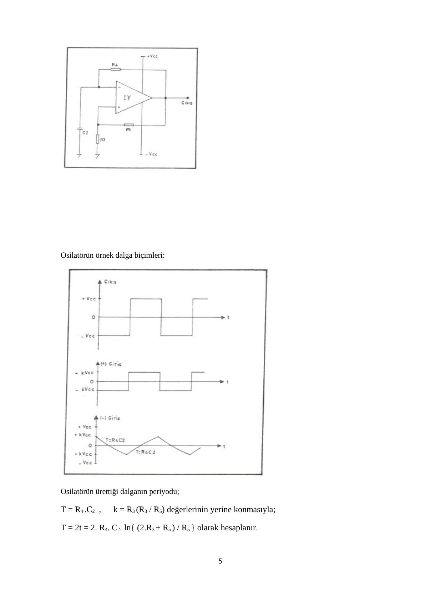
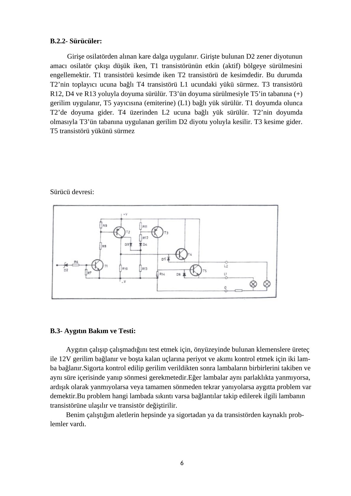
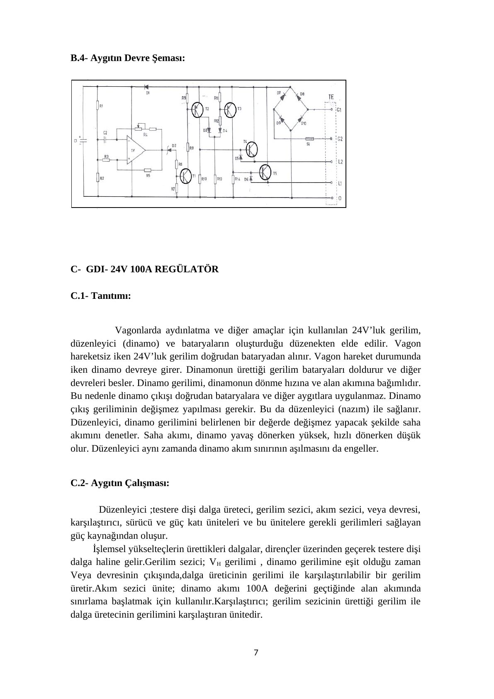
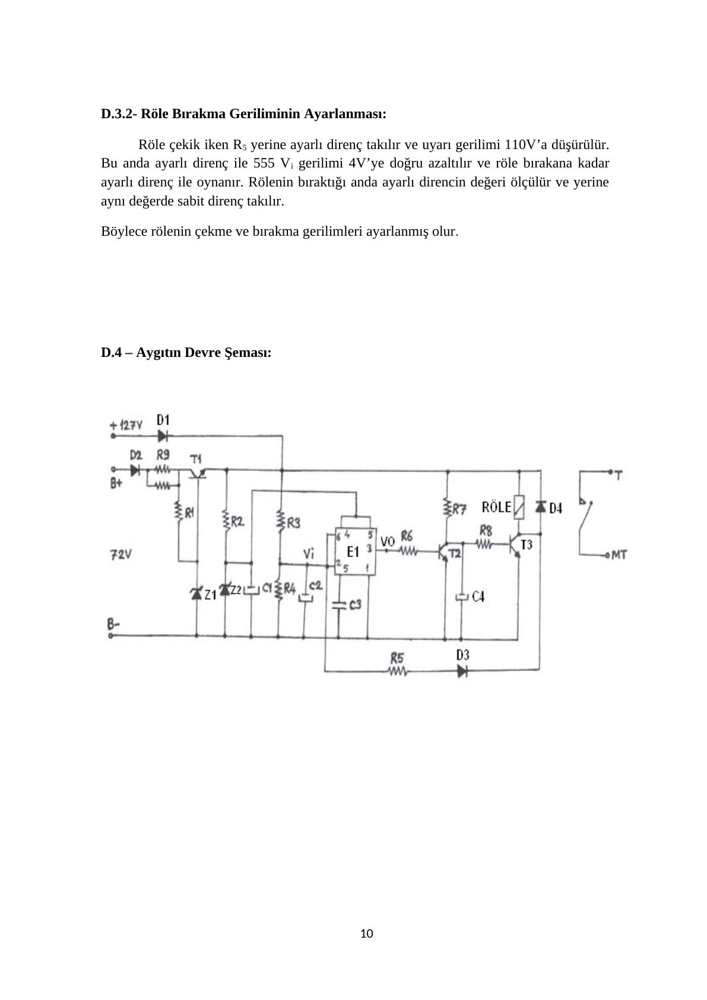
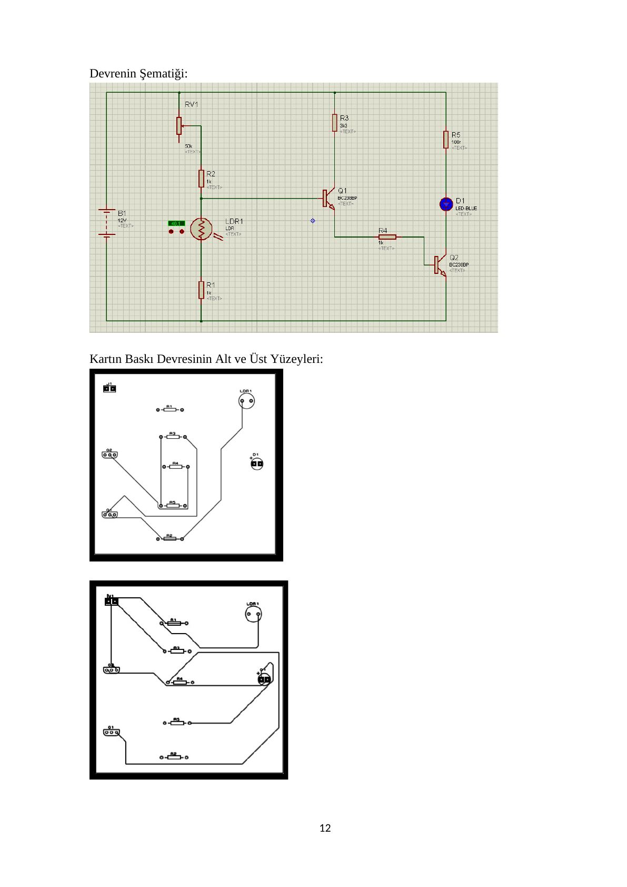

Bu yazı, Başkent Üniversitesi Elektrik-Elektronik Mühendisliği **EEM300 staj dersi** için TCDD 2. Bölge Müdürlüğü **Elektronik Bakım Onarım Merkezi Müdürlüğü**'nde (Gar/Ulus, Ankara) yapılan stajın raporudur. Raporu bir arkadaş hazırlamış (Ekim 2013); ad, numara ve kurum yetkililerinin adları çıkarıldı. Rapor 14 sayfa; orijinal sayfalar yazının sonunda PDF olarak indirilebilir. Aynı birimin eski bir staj defterinin metni için [TCDD EAM Stajer Staj Notları](/arsiv/staj-tcdd-eam-stajer-staj-notlari-2009/) yazısına bakabilirsiniz.

## Bölüm 1: Kuruluşun genel tanıtımı

**Adı ve adresi:** TCDD 2. Bölge Genel Müdürlüğü, Elektronik Bakım Onarım Merkezi Müdürlüğü (EBOM), Talatpaşa Bulvarı, Gar/Ulus, Ankara.

**Tarihçe:** EBOM; TCDD bünyesinde mevcut ve kurulacak elektrik-elektronik sistemlerde araştırma-geliştirme, onarım ve imalat çalışmalarının en iyi ve ekonomik biçimde yürütülmesi amacıyla TCDD Yönetim Kurulu'nun 07.06.1973 tarih ve 23/221 sayılı yetki kararı ile kurulmuştur.

**Üst kuruluş:** TCDD, Ulaştırma Bakanlığı çatısı altında sürer; EBOM çalışmalarını Araştırma-Geliştirme Teknik Müdürlüğü ve İmalat-Onarım Teknik Müdürlüğü aracılığıyla yönetmelik, tüzük ve diğer mevzuat çerçevesinde yürütür.

**Çalışan sayısı:** 4 elektrik-elektronik mühendisi, 7 teknisyen, 3 işçi ile müdür ve şefler dahil toplam 18 kişi.

**Statü:** Kamu İktisadi Teşebbüsü (KİT); sermaye yapısı Hazine Müsteşarlığı'na bağlıdır.

**Faaliyet alanları:** Araştırma, geliştirme, bakım ve onarım. Trenlerde bulunan elektronik aygıtların ve devre kartlarının şemaları, genel tasarımları hazırlanıp testleri yapılır; hasarlı veya çalışmayan elektronik aygıtların bakım ve onarımı yürütülür; mevcut aygıtların daha verimli çalışması için araştırma yapılır.

**Örgüt şeması (Ek-1):** Müdür, tesisler şefi, büro şefi; bunların altında mühendis, uzman teknisyenler, teknisyen ve işçi bulunur (raporun ekindeki şemadaki adlar çıkarıldı).

**Üretim ve çalışma yöntemi:** EBOM'da üretim yapılmaz. Devre kartları ve şemalar birimde tasarlanır, üretimleri anlaşmalı firmalarca yapılır; firmalardan gelen kartlar ve aygıt kasaları birimde trafo, soğutucu gibi aksamla birleştirilip montaj ve test işlemleri yapılır. Kart üretimi özel sektörde daha az maliyetle yapıldığı için birimde üretilmez; tasarımlar ISIS modelleme programıyla yapılır.

**Bilgisayar kullanımı:** Birimde 12 bilgisayar vardır; araştırma, tasarım, gelen-giden teçhizat kayıtları, stok kontrolü, idari ve mali işler bu bilgisayarlarla yürütülür.

## Bölüm 2: Staj süresince yapılan çalışmalar

Staj boyunca trenlerde kullanılan redresör, flaşör, regülatör, YS1, röle ve konvertör gibi elektronik aygıtların bakım, onarım ve testleri üzerine çalışılmış; ayrıca sorumlu mühendis Proteus programının ISIS ve ARES süreçlerini göstermiş ve küçük bir devre tasarlanmıştır.

### Hafta 1: 12 V 3 A redresör (akü şarj aygıtı)

**Tanıtım:** TMİ ve hizmet santrallerini beslemek için tasarlanmıştır. Çıkış gerilimi 3–20 V arasında, çıkış akımının en büyük değeri 0–3,5 A arasında ayarlanabilir.

**Çalışma, kullanım ve bakım:** Aygıt üzerinde kırmızı, yeşil ve turuncu ledler vardır. 220 V şebeke verildiğinde aygıtın çalıştığını gösteren yeşil led yanar; akü boşsa turuncu led yanar; aşırı akım çekildiğinde kırmızı led yanar.

Şebeke gerilimi bağlandığında önce giriş-çıkışlara gerilim gidip gitmediği kontrol edilir. Gerilim gitmiyorsa sebep 5 A'lik koruyucu sigortanın atması ya da aygıtın kendi trafosunun bozulmasıdır; önce sigorta, sorun sürerse trafo değiştirilip teste başlanır. Ölçüm için multimetre ve akım sınırlamasını görmek için bir yük aygıtın çıkışına bağlanır. Multimetre DC kademesindeyken çıkış gerilimi **13,8 V** ve kısa devre akımı en fazla **1,5 A** görülmelidir; görülmüyorsa kart üzerindeki voltaj potu ile çıkış gerilimi ayarlanır. Dışarıdan bağlanan yükün direnci değiştirilerek akım ve gerilim izlenir; Ohm kanununa (V = I·R) göre direnç küçüldükçe akım büyür. Akım 3 A'i geçerse kart üzerindeki akım potuyla sınırlama yapılır.

Kırmızı ledin olası aşırı akım durumunda yanması için kart üzerindeki Iled potu ayarlanır; yanma noktası, çıkış geriliminin düşmeye başladığı nokta olarak belirlenir. Genelde çıkış gerilimi 11 V'un altına düştüğünde aşırı akım ledi yanmalıdır.

Tüm ayarlara rağmen istenen değerler görülmüyorsa sorun devre kartındadır. Kart üzerindeki entegrenin ayarı yapılmamış olabilir: soket boştayken 3 ve 8. bacaklar kısa devre yapılır, bu durumda 5 ve 6. bacaklardaki gerilimler eşit olmalıdır (Valt potuyla ayarlanır). Entegre takılıyken 11. bacaktaki değer, 2. bacaktaki değerin ters işaretlisi ve yarısı kadar olmalıdır (Vüst potuyla ayarlanır). Bunlardan sonra da aygıt çalışmazsa kart yeni bir kartla değiştirilir ve adımlar tekrarlanır. Rapor sahibi en çok bu redresör aygıtlarında çalışmıştır.

### Hafta 2: YS1 (yanar söner)

**Tanıtım:** CTC sinyal sistemindeki PF 256 rölesi yerine kullanılmak üzere tasarlanmıştır. Alternatif veya doğru gerilimle çalışır. Yanma-sönme frekansı 1 ± 0,1 Hz'dir. Birbirine göre evrik, her biri 3 A sürebilen iki çıkışı vardır. AC ve DC'de çalışma geriliminin alt ve üst sınırları 12 V ve 28 V'tur. Röle çatısına diğer röleler gibi bağlanabilecek biçimde kutulanmıştır.

**Çalışma:** Yanarsöner, kare dalga üreten bir osilatör ve biri diğerinin evriği ile sürülen iki sürücüden oluşur. Hem AC hem DC ile beslemek için bir diyot köprüsü bulunur. AC'de sürücüler tam dalga doğrultulmuş gerilimle, osilatör ise bu gerilimin süzgeçten geçirilmesiyle elde edilen düzgün doğru gerilimle beslenir. DC'de diyot köprüsü gerilimin devreye uygun polaritede aktarılmasını sağlar.

**Osilatör:** Kare dalga üreten osilatör, işlem yükselteci ile yapılmış kararsız (astable) bir multivibratördür. Üretilen dalganın periyodu, T = R4·C2 ve k = R3(R3/R5) değerleri yerine konarak

T = 2t = 2·R4·C2·ln((2·R3 + R5) / R5)

olarak hesaplanır.

**Sürücüler:** Girişe osilatörden kare dalga uygulanır. Girişteki D2 zener diyotu, osilatör çıkışı düşükken T1 transistörünün etkin bölgeye sürülmesini engeller. T1 kesimdeyken T2 de kesimdedir; bu durumda T2'nin toplayıcı ucuna bağlı T4, L1 ucundaki yükü sürmez. T3 transistörü R12, D4 ve R13 yoluyla doyuma sürülür; T3'ün doyumu ile T5'in tabanına (+) gerilim uygulanır ve T5 yayıcısına (L1) bağlı yük sürülür. T1 doyuma girince T2 de doyuma gider; T4 üzerinden L2 ucuna bağlı yük sürülür. T2'nin doyumda olması T3'ün tabanına uygulanan gerilimi D2 yoluyla keser; T3 kesime gider ve T5 yükünü sürmez.

**Bakım ve test:** Önyüzeydeki klemenslere üreteçle 12 V bağlanır, boşta kalan uçlara periyot ve akımı kontrol etmek için iki lamba takılır. Sigorta kontrol edilip gerilim verildikten sonra lambalar birbirini takip ederek ve aynı süre boyunca yanıp sönmelidir. Lambalar aynı parlaklıkta yanmıyor, ardışık yanmıyor ya da tamamen sönmeden tekrar yanıyorsa aygıtta sorun vardır; ilgili lambanın bağlantıları izlenerek transistörüne ulaşılır ve transistör değiştirilir. Rapor sahibinin çalıştığı aygıtların hepsinde sorun sigortadan ya da transistörden kaynaklanmıştır.

### Hafta 2: GDI 24 V 100 A regülatör

**Tanıtım:** Vagonlarda aydınlatma ve diğer amaçlar için kullanılan 24 V, düzenleyici (dinamo) ve bataryalardan oluşan düzenekten elde edilir. Vagon hareketsizken 24 V doğrudan bataryadan alınır; vagon hareket halindeyken dinamo devreye girer, bataryaları doldurur ve diğer devreleri besler. Dinamo gerilimi dönme hızına ve alan akımına bağlıdır; bu yüzden dinamo çıkışı doğrudan bataryalara uygulanmaz, düzenleyici (nazım) dinamo gerilimini belirli bir değerde sabit tutacak şekilde saha akımını denetler. Saha akımı dinamo yavaş dönerken yüksek, hızlı dönerken düşük olur. Düzenleyici aynı zamanda dinamo akım sınırının aşılmasını engeller.

**Çalışma:** Düzenleyici; testere dişi dalga üreteci, gerilim sezici, akım sezici, veya devresi, karşılaştırıcı, sürücü ve güç katı ünitelerinden ve bunlara gerekli gerilimleri sağlayan güç kaynağından oluşur. Akım sezici, dinamo akımı 100 A'i geçtiğinde alan akımında sınırlama başlatmak için kullanılır; karşılaştırıcı, gerilim sezicinin ürettiği gerilimle dalga üretecinin gerilimini karşılaştırır. V_H gerilimi dinamo geriliminden fazla ve dinamonun sürdüğü akım 100 A'den az olduğunda aygıt düzenleme görevine başlar; dinamonun alan sargısına darbeli akım gönderilerek dinamo gerilimi sabit tutulur. V_H şarj geriliminden yüksek olduğunda alan sargısına akım gönderilmez ve dinamo gerilimi ile akımı sabitlenir. Bu işlemler gerektiğinde çok hızlı ve ardışık gerçekleşir.

**Bakım ve test:** Gerilim ve akım ayarları imalat sırasında yapıldığından normal koşullarda ayar gerektirmez; yalnızca yan yüzdeki otomatik alan sargısı sigortasının takılı olması gerekir (atıksa alan sargısından akım geçmez ve dinamo gerilim üretmez). Test sırasında önce sigorta kontrol edilir; dinamo gerilimi **29,5 V**, lamba ve batarya gerilimi **28 V** olarak ayarlanır. Bu gerilimler sabit tutularak yük artırılır ve dinamo akımının **90 A**'e kadar ulaşması sağlanır. Akım 90 A'e ulaşamıyorsa ya da ulaşırken dinamo gerilimi fazlaca düşüyorsa aygıtta sorun vardır; devre şeması izlenerek gerilimler ölçülür, diyot, direnç ve transistör gibi elemanlar kontrol edilip gerekirse değiştirilir.

### Hafta 3: Q33 aşırı gerilim koruma rölesi

**Tanıtım:** Q33 rölesi, DE09 (24000 tipi) elektrik ısıtma tertibatlı lokomotiflerin ısıtma bloğunda aşırı gerilimi önlemek için tasarlanmıştır. 127 V giriş uçlarına 127 V'tan büyük gerilim geldiğinde T-MT uçları arası kısa devre olur, Q60 sistemi enerjilenir ve aşırı gerilim önlenir. Giriş gerilimi 110 V'un altına düştüğünde T-MT uçları arası açık devre olur ve Q60'ın enerjisi kesilir.

**Çalışma:** 72 V akü geriliminden röleyi beslemek için 24 V, 555 entegresini beslemek için 12 V DC çekilir. Uyarı gerilimi 127 V'tan büyük olduğunda 555'in V_i giriş gerilimi 8 V'tan büyük olur ve çıkış V_o 0 V'a düşer; böylece T1 (MJ340) kesime, T2 (BC337) doyuma gider, röle çeker, MT-T uçlarını kısa devre eder ve Q60 sistemi aküye bağlanarak enerjilenir. Uyarı gerilimi 110 V'un altına düştüğünde V_i 4 V'un altına iner, V_o 12 V olur; T1 iletime, T2 kesime gider, röle bırakır ve Q60'ın enerjisi kesilir.

Röle çekme gerilimi R4 direnci, bırakma gerilimi R5 direnci ile ayarlanır. Rölenin bırakması sırasında 555 çıkışında oluşan 50 kHz'lik osilasyonları önlemek için C4 kapasitörü kullanılmıştır; empedansı

Z = 1 / (2·π·f·C) = 1 / (2·π·50·10³·10⁻⁶) ≈ 3,20 Ω

olur. Uyarı gerilimindeki kısa süreli değişmelerden devrenin etkilenmemesi için C2 kapasitörü kullanılmıştır; devrenin tepki süresi yaklaşık 0,5 s olacak biçimde tasarlanmıştır.

**Çekme gerilimi ayarı:** Devrenin B+ ve B− uçlarına 72 V, + ve − uçlarına 127 V uyarı gerilimi bağlanır. R4 yerine ayarlı bir direnç takılır, uyarı gerilimi 127 V'a çıkarılır ve ayarlı direnç ile 555 girişi 8 V'a doğru yükseltilip rölenin çekmesi sağlanır. Bu andaki direnç değeri ölçülür ve yerine aynı değerde sabit direnç takılır. Bu işlem yapılırken R5 devrede olmamalıdır.

**Bırakma gerilimi ayarı:** Röle çekikken R5 yerine ayarlı direnç takılır, uyarı gerilimi 110 V'a düşürülür; ayarlı direnç ile 555 V_i gerilimi 4 V'a doğru azaltılarak röle bırakana kadar oynanır. Bırakma anındaki direnç değeri ölçülüp yerine aynı değerde sabit direnç takılır.

### Hafta 4: Vagon flaşörü

**Tanıtım:** Tren katarının en sonundaki vagona yerleştirilen, gereken durumlarda kırmızı ya da turuncu ledleriyle flaşör yapan aygıttır. Diğerlerinden farkı, TCDD bünyesinde tasarlanmayıp özel sektörden alınmış olmasıdır; arıza yapıp EBOM'a gönderildiğinde sorunu çözmeye yardımcı olacak devre şeması ya da açıklama yoktu.

**Çalışma ve onarım:** Üzerinde 1'i MOSFET olmak üzere 4 transistör vardır; gelen gerilimi ledlerin flaşör yapması için düzenleyen bir entegresi bulunur. Güç kaynağından 12 V verildiğinde ledler aynı anda ve aynı ışık şiddetiyle yanıp sönmelidir. Ledler yanmıyorsa sorun devre kartındaki transistör ya da diyotlarda aranır: multimetre diyot kademesinde diyotlar ölçülür, arızalılar değiştirilir; sonra giriş-çıkış ve yollar izlenerek transistör bacaklarındaki gerilimler ölçülür, anormal bir durumda transistör değiştirilir. Bacak gerilimleri normalse ledler tek tek kontrol edilir (ledler kart üzerinde seri bağlı olduğundan bir ledin arızası hepsini devre dışı bırakır). Ledler yanıyor ama flaşör yapmıyorsa sorun entegrededir; bacaklara gerilim gidip gitmediği ve tüm transistör/diyotların sağlam olduğu doğrulandıktan sonra entegre değiştirilir.

### Proteus çalışması: karanlıkta yanan LED (LDR devresi)

Sorumlu mühendis Proteus'ta ISIS ve ARES süreçlerini anlattı: ISIS ile devrenin şematiği çizilip simülasyonu yapılır, ARES ile baskı devre kartı hazırlanır. Staj boyunca öğretilenler doğrultusunda basit bir devre tasarlaması istendi; karanlıkta kendiliğinden yanan LED içeren bir LDR devresi tasarlandı. Devre şematiği ve kartın baskı devresinin alt ve üst yüzeyleri aşağıda.

## Bölüm 3: Stajda sağlanan yararlar

Rapora göre EEM300 stajı mesleğe dair ilk deneyim olmuş; birimdeki sorumlu mühendis ve teknisyenler stajyeri uzaktan izlemek yerine işin içine katmıştır. Başlıca kazanımlar:

- Aygıtın devre şemasından hangi noktada hangi gerilim ya da akımın görülmesi gerektiğini okuyup o noktalarda ölçüm yapmak; böylece bir elektronik kartın şemasını izlemeyi öğrenmek.
- Diyot ve transistör sağlamlık testleri; birkaç MOSFET'i bozarak MOSFET'lerin statik elektriğe karşı hassasiyetini görmek.
- Hatalı elemanları kendi eliyle değiştirerek lehim yapma/sökme, havya kullanma, kart sökme-takma becerileri.
- Flaşör aygıtındaki arızalı transistörlerin aynısı depoda bulunamadığı için datasheet'lere bakarak eşdeğer transistör bulmak.
- 220 V şebeke ve 320 V kaynaklarla yapılan testlerde yüksek gerilimle güvenli çalışma bilgisi.
- ISIS ile devre şeması/simülasyon ve ARES ile kart baskılama programlarında çalışma.
